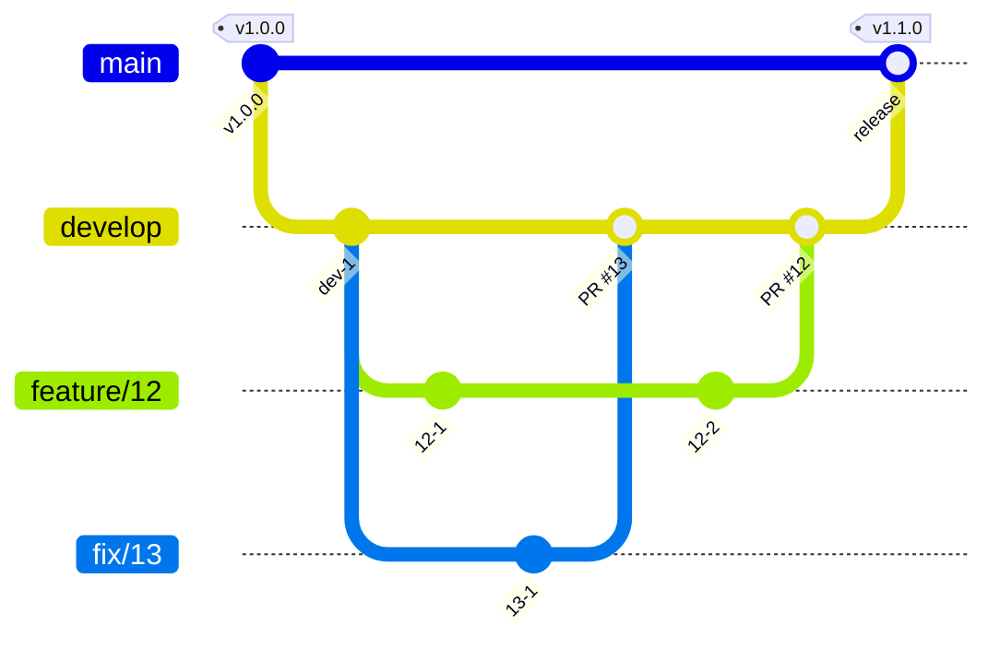

# 開発の準備

必要なものは Node.js、pnpm、mise である。Node.js と pnpm のバージョンは `package.json` の `engines` と `packageManager` に、apm のバージョンは `mise.toml` にある。

```sh
mise install
pnpm install
```

`pnpm install` は、`prepare` で lefthook の Git のフックを入れる。

スキルとフックは apm で配置し、Git で追跡しない。clone した後の最初のセッションで、セッションの開始のフックが配置する。手で配置するときは次を実行する。

```sh
apm install --frozen
```

`apm install` の後に配置先を `.gitignore` に足す post-install は、マシンごとに 1 度信頼させる。

```sh
apm lifecycle trust
```

## 文書を直すとき

文章の規則は textlint で、経緯の混入とリンクは docs のスクリプトで確かめる。指摘された語は言い換え、`--fix` は使わない。

```sh
pnpm exec textlint <直した Markdown>
node .claude/hooks/docs/hooks/check-history.mjs
node .claude/hooks/docs/hooks/check-links.mjs --exclude apps/web/src/content/
```

- textlint は、`apps/` のサイトの原稿にも掛ける。リンクのチェックは、原稿（`apps/web/src/content/`）を対象にしない。原稿はサイト内の URL でリンクするためである。
- 既存の文書には textlint の指摘が残っている。直した文書だけに掛け、CI も pull request で変えた Markdown だけを見る。

`verified_commit` の後に実装が変わった文書は、`node .claude/hooks/docs/hooks/list-drift.mjs` で一覧する。実装と読み比べてから `verified_commit` を進める。

## コミットするとき

コミットの前に、lefthook が次を確かめる。設定は `lefthook.yml` にある。

- 保護するブランチへの直接のコミットと push を止める。
- ステージした Markdown に textlint を掛ける。
- commit-msg のフックで、commitlint がメッセージの形式を確かめる。規則は `commitlint.config.mjs` にある。

- 変更の分け方とメッセージの書き方は、スキル write-commit に従う。

## ブランチとリリース

<!-- 次は既定の運用。運用が違えば本文と図を書き換える -->

ブランチは、`main`、`develop`、issue ごとの作業用のブランチにする。

- `main` はリリース済みの状態を指す。`develop` は次のリリースに向けて変更を集める。
- 作業用のブランチは `develop` から切る。名前は `feature/<issue 番号>` にし、不具合は `fix/<issue 番号>` にする。`develop` へは、pull request を通して取り込む。
- リリースは、`develop` を `main` へ pull request で取り込み、`main` のコミットにタグを付ける。バージョンはセマンティック バージョニングに従う。
- リリース後の緊急の修正は、`main` から `hotfix/<issue 番号>` を切り、`main` と `develop` の両方へ取り込む。
- 保護するブランチは `main`、`develop` である。直接はコミットせず、pull request を通して取り込む。直接コミットを許す場面があれば、この行の下に場面と理由を書く。

<!-- 次のバージョンを何から決めるか。コミットメッセージからなら release-please、変更ごとの記述からなら changesets -->



## issue と pull request

<!-- issue の種類とラベル、pull request との対応 -->

- 作業は issue から始める。pull request は 1 つの issue に対応させる。
- 題と本文の書き方は、スキル write-issue-pr に従う。
