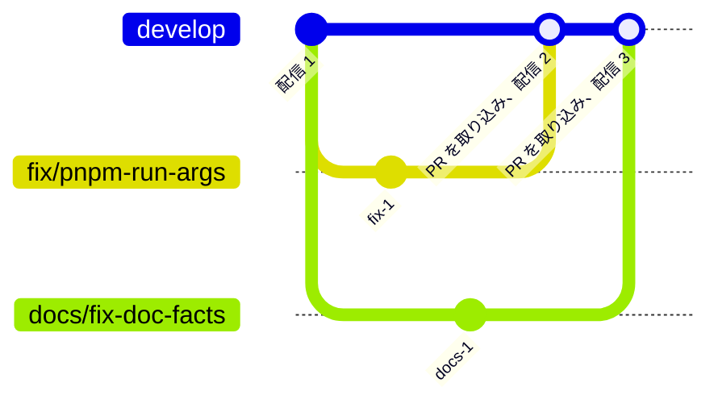

# 開発の準備

必要なツールは mise、pnpm、python3 である。
Node.js、uv、apm、similarity-ts は `mise.toml` にバージョンが書いてあり、`mise install` が入れる。
pnpm のバージョンは `package.json` の `packageManager` にある。
python3 は、lefthook の `protected-branch` のフックが使う。

```sh
mise install
pnpm install
```

`pnpm install` は、`prepare` で lefthook の Git のフックを入れる。

スキルとフックは apm で配置し、Git で追跡しない。clone した後の最初のセッションで、セッションの開始のフックが配置する。手で配置するときは次を実行する。

```sh
apm install --frozen
```

`apm install` の後に配置先を `.gitignore` に足す post-install は、マシンごとに 1 度信頼させる。

```sh
apm lifecycle trust
```

## 文書を直すとき

文章の規則は textlint で、経緯の混入とリンクは docs のスクリプトで確かめる。指摘された語は言い換え、`--fix` は使わない。

```sh
pnpm exec textlint <直した Markdown>
node .claude/hooks/docs/hooks/check-history.mjs
git ls-files -z -- '*.md' ':!:apps/web/src/content/' | xargs -0 node .claude/hooks/docs/hooks/check-links.mjs
```

- textlint は、`apps/` のサイトの原稿にも掛ける。リンクのチェックは、原稿（`apps/web/src/content/`）を対象にしない。原稿はサイト内の URL でリンクするためである。
- 既存の文書には textlint の指摘が残っている。直した文書だけに掛け、CI も pull request で変えた Markdown だけを見る。

`verified_commit` の後に実装が変わった文書は、`node .claude/hooks/docs/hooks/list-drift.mjs` で一覧する。実装と読み比べてから `verified_commit` を進める。

## コミットするとき

コミットと push の前に、lefthook が次を実行する。設定は `lefthook.yml` にある。

- 保護するブランチへの直接のコミットと push を止める。
- ステージしたファイルに Oxfmt を掛け、整形した結果をステージし直す。
  - Oxfmt の設定は `.oxfmtrc.jsonc` にある。
- ステージした Markdown に textlint を掛ける。
- commit-msg のフックで、`ticket-number` が issue 番号をメッセージに足す。
  - ブランチの名前が `feature/<issue 番号>` で、1 行目に `#<issue 番号>` がないときに、1 行目の末尾へ足す。
- commit-msg のフックで、commitlint がメッセージの形式を確かめる。規則は `commitlint.config.mjs` にある。

- 変更の分け方とメッセージの書き方は、スキル write-commit に従う。

## ブランチとリリース

ブランチは、`develop` と作業用のブランチにする。

- `develop` は GitHub の既定のブランチで、本番に配信している状態を指す。
- 作業用のブランチは `develop` から切る。名前は `<種別>/<内容>` にする。
  - 例: `fix/pnpm-run-args`、`docs/fix-doc-facts`、`chore/add-agent-playbooks`
- `develop` へは pull request を通して取り込み、直接はコミットしない。
  - lefthook のフックが、`develop` への直接のコミットと push を止める。
- `develop` に取り込むと、check workflow が `develop` で通った後に、deploy workflow が本番へ配信する。
- バージョンとタグは付けない。

作業用のブランチを `develop` に取り込むたびに、本番へ配信する。



## issue と pull request

<!-- issue の種類とラベル、pull request との対応 -->

- 作業は issue から始める。pull request は 1 つの issue に対応させる。
- 題と本文の書き方は、スキル write-issue-pr に従う。
