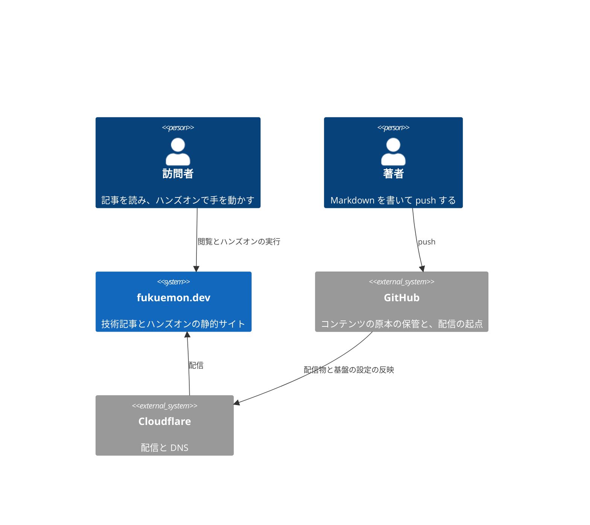

# fukuemon.dev PRD

## Overview / Problem Statement

fukuemon.dev は、技術記事とハンズオンの 2 種類だけを公開する個人サイトである。  
ハンズオンは CLaaT 形式の Codelab を指す。手順に区切られ、進捗が残り、ブラウザの中で実際にコードが動く。

中核の価値は、種別の多さにはない。  
読んで分かった気になる段階と、動かして分かる段階のあいだを、同じサイトの中で埋めることにある。  
記事とハンズオンは相互に参照し合い、読者は片方から他方へ移れる。

いま作る理由は 2 つある。  
ハンズオンをこれから作るので、置き場の設計を先に決める必要がある。  
コンテンツが増えてから相互参照の仕組みを足すと、既存の全件に metadata を付ける必要があり、着手の手間が増え続ける。

## Background

### 読むことと手を動かすことが、同じ主題の上でつながっていない

技術記事を読んで理解した気になっても、手を動かすところまではつながらない。  
逆に、手を動かす教材は環境構築で止まる。

| 段階                 | 現状                                     | 問題                                             |
| -------------------- | ---------------------------------------- | ------------------------------------------------ |
| 読んで理解する       | 外部のブログサービスなどに技術記事がある | 読み終えた後に試す先がない                       |
| 手を動かして確かめる | まだ作っていない                         | 作る置き場がない                                 |
| その両方を行き来する | 存在しない                               | 記事と教材が別々の場所にあり、相互に参照できない |

分散していること自体は問題ではない。  
同じ主題について「説明を読む」と「自分で壊してみる」が地続きになっていないことが問題である。

## Goals

対象の利用者は次の 2 者。

- 訪問者: 技術者。ある主題を読んで理解し、そのまま手を動かして確かめたい。
- 著者: 運営者 1 名。Markdown を 1 枚足すだけで公開でき、体裁と索引の更新に手を取られたくない。

訪問者は、記事から関連するハンズオンへ移り、実行環境を入れずにブラウザの中でコードを動かせる。  
著者は、Markdown を 1 枚書くだけで、一覧と相互参照に新しいコンテンツを載せられる。

読者アカウントを持つ学習者は、利用者に含めない。  
ADR-0008: [読者の identity を前提とする機能を作らない](adr/0008-no-reader-identity.md)

## Lower-Priority Goals

次の機能は、それぞれの条件が実在したときに作る。  
時期では判断しない。  
ここに挙げていない機能は作らない。  
読者の identity を前提とする機能と、Non-Goals に挙げた種別の追加は、ここにも載せない。

- 分類での絞り込み: 分類での絞り込みが要ると判断したとき、または分類が 12 を超えたとき。
- 一覧をまたいで探す手段: コンテンツが増えて、一覧から辿れなくなったとき。
- SQL 以外の言語と、Postgres 以外のデータベースを本文の中で動かすこと: そのような記事かハンズオンが実在したとき。
- プロジェクト一式、シェル、プレビューをブラウザの中で動かすハンズオン: そのようなハンズオンが実在したとき。
- コメント: コメントが欲しくなったとき。
- 問い合わせのフォーム: 送信を受ける口が要るとき。
- サイトを公開するときに用意しておけない検索: そのような検索が要ると分かったとき。
- 見せるためのコンポーネントの一覧: 作りたくなったとき。

条件が成り立ったときに作る形は [Design Doc](design/DesignDoc.md#条件つきで足す機能の形) にある。

既存の記事の一括登録は、基盤ができた後に回す。  
棚卸しは着手を止めるだけで、基盤の設計を 1 つも決めない。  
分類の粒度は、既存の棚卸しより、実際に書いた数件のコンテンツから決めたほうが正確になる。  
棚卸しで分かるのは過去の分類であり、これから書くものの分類ではない。

## Non-Goals

次のものは作らない。

- 登壇資料（Slides）と登壇実績（Talks）の管理
  - 種別を 2 つに絞る。外部でホストする資料は、表紙からリンクするにとどめる。
- 制作物（Projects）の一覧
  - 種別を 2 つに絞る。ポートフォリオを目的としない。
- Topic ごとの交差のページ
  - 種別が 2 つでは交差が成り立たない。相互参照で足りる。
- Coverage View（分類と種別の網羅のマトリクス）
  - 実質的に分類の索引で、分類の索引のページを作らない方針と衝突する。一覧の表が分類の列を持つので、情報も重なる。
- 分類ごとの索引のページ
  - 分類は組み合わせで数が爆発する。分類での絞り込みは一覧のページの中で行い、絞り込んだ状態は URL で共有できる。
- 読者アカウントと認証
  - 個人サイトが読者の identity を得る動機がない。
  - ADR-0008: [読者の identity を前提とする機能を作らない](adr/0008-no-reader-identity.md)
- Bookmark
  - ブラウザのブックマークと重なり、しかも劣る。
- Highlight と Annotation
  - identity とテキストのアンカーが要る。実装が重いわりに、使う人がいない。
- 多言語への対応
  - 日本語だけにする。
- 直接的な和風のモチーフ（桜、鳥居、筆文字、和柄、庭園の写真）
  - 版画的な自然の図版と縦組みで表す。モチーフをそのまま持ち込まない。
  - 見た目の設計は [Design System の Design Doc](packages/design-system/DesignDoc.md) にある。

## User Stories

### 訪問者が、記事を読み終えた後に試す先がない

外部のブログサービスの記事は、読み終えた後に試す先を持たない。  
How Might We: 記事を読み終えた訪問者が、同じ主題のハンズオンへそのまま移れるようにするには。

### 訪問者が、手を動かす前に環境構築で止まる

手を動かす教材は、環境構築が重い主題ほど訪問者に届かない。  
How Might We: 訪問者が実行環境を入れずに、ページの中でコードを動かして確かめられるようにするには。

### 訪問者が、ハンズオンを途中でやめて、後で続きから再開したい

How Might We: 読者アカウントを持たずに、同じ端末で再訪した訪問者が、続きの手順から再開できるようにするには。

### 著者が、コンテンツを 1 本足すたびに索引と体裁を直している

How Might We: 著者が Markdown を 1 枚書くだけで、一覧と相互参照に新しいコンテンツが載るようにするには。

## Proposed Solution / Feature Description

### Landscape

訪問者はサイトを閲覧してハンズオンを実行し、著者は GitHub に Markdown を push する。  
GitHub が配信物を Cloudflare へ反映し、Cloudflare がサイトを配信する。

ハンズオンの実行環境は、訪問者のブラウザの中で完結する。  
実行のための外部のシステムを持たない。

### 表紙と一覧

サイトは about、blog、playground の 3 つのセクションに分ける。  
ADR-0009: [サイトのセクションと playground](adr/0009-site-sections-and-playground-collection.md)

- 表紙: about を兼ねる。最近の更新、各セクションへのリンク、登壇と寄稿を載せる。
- 一覧: すべてのコンテンツの一覧、記事だけの一覧、ハンズオンだけの一覧の 3 つ。種別で絞り込む。
- 記事とハンズオンの本体
- playground: 手順に縛られずに実行環境を触れる場所。一覧と、1 つずつの playground を持つ。
- RSS

表紙と一覧を分ける。  
表紙は伝える場所で、一覧は探す場所であり、求められるものが違う。

about に独立したページを与えない。  
分量が増えないものに 1 ページを割かない。  
伝える場所に置くものが 2 つあると、どちらの印象も薄くなるので、表紙を about が兼ねる。

一覧のタブと本文の検索は、一覧の 3 ページにだけ出す。  
検索を全ページの上端に置かない。探す気がある人は一覧まで来る。

一覧は JavaScript を無効にしても使える。

### 記事とハンズオンの相互参照

著者は、記事かハンズオンの片方にだけ関連を書く。  
サイトは、関連を両方のページに表示する。  
関連は著者が明示した筋で、分類が同じであることからは作らない。

### ハンズオン

- ハンズオンは手順に区切り、1 画面に 1 手順を出す。
- 手順の中のコードを、ページの上で実行できる。実行環境のインストールを求めない。
- ブラウザで再現できない主題（ポートを開く、プロセスを分ける、ホストのリソースを測る）は、読者の端末で動かす手順を出す。
- 進捗は読者のブラウザに残し、同じ端末で再訪したときに戻す。別の端末では最初からになる。

### コンテンツの追加

著者は Markdown を 1 枚書いてコンテンツを足す。  
索引のページを手で直さない。

### Milestones

#### 最初のリリース

提供する機能は次のとおり。

- コンテンツ: about、記事、ハンズオン
- 種別で絞り込む一覧、記事とハンズオンの相互参照、ハンズオンの手順の分割と進捗の保存、本文の中でのコードの実行

確かめる問いは、記事とハンズオンをつなぐ仕組みが実際のコンテンツで動くかである。  
Success Metrics のすべての条件を、測れる形で満たしたら完了とする。

既存の記事を登録する代わりに、seed のコンテンツを新しく書き、仕組みが動くことを示す。

- 記事を 2 本書く。本文の描画を確かめ、一覧に 2 件以上が並ぶ状態を作る。
- ハンズオンを 1 本書く。手順の導出、進捗の保存、コードの実行を確かめる。
- 記事とハンズオンのあいだに、関連を 1 本以上書く。片方向の記述で双方向に出る関連を、測れる状態にする。

seed は捨てないコンテンツにする。  
ダミーの文章ではなく、実際に公開する内容を書く。  
ダミーでは、日本語の分量と技術用語の現れ方が本物と違い、Design System を確かめられない。後で消す作業も生じる。

### Success Metrics

- 記事とハンズオンを、種別で絞り込んだ一覧から辿れる。
  - すべて、記事だけ、ハンズオンだけの 3 つの一覧が、それぞれ別の URL で開け、該当する種別だけを並べる。JavaScript を無効にしても機能する。
  - 一覧の URL は [Design Doc の URL の構成](design/DesignDoc.md#url-の構成) にある。
- コンテンツの間の関連が、片方向の記述だけで双方向に表示される。
  - 著者が記事の側にだけハンズオンとの関連を書くと、ハンズオンのページにもその記事が表示される。
  - 逆向きの関連を導く処理を確かめるテストは [context/testing.md](context/testing.md#test-types-and-guarantees) にある。
- コンテンツの追加が、Markdown のファイルを 1 枚作るだけで完結する。
  - 新しく足すときに変える必要があるファイルが、その Markdown だけである。索引のページを手で更新しない。
- ハンズオンがブラウザだけで完結する。
  - 手順の中のコードをページの上で実行でき、実行環境のインストールを求めない。進捗が再訪したときに戻る。
- 初回の表示が実用の速さに収まる。
  - Lighthouse の Performance が 90 以上で、LCP が 2.5 秒以内（Moto G Power、Slow 4G 相当）。
- 公開に関わる Cloudflare の設定が、Dashboard の上の属人的な設定として残らない。
  - ドメイン、DNS、サイトの配信先の設定が、リポジトリに書いた定義と一致し、Dashboard で手で変えた設定が残っていない。
  - 確かめた結果は [基盤の Design Doc の Verification](infra/DesignDoc.md#verification) にある。

## Open Questions / Risks

### Open Questions

判断するのは、どれも運営者である。

- 分類の粒度と最初の分類の組。暫定で始め、コンテンツが 10 件を超えた時点で見直す。分類は `contentId` と違って関係の主キーではないので、改名できる。
- ハンズオンの `repository` を、本文に出すか、詳細の末尾にとどめるか。実装に着手する前に決める。
- WebContainers の商用ライセンスの条件に、このサイトが当たるか。当たるなら Sandpack を採る。`sandbox` を検討するときに確かめる。
- Sandpack の Node のランタイムが cross-origin isolation を求めるか。バンドラだけなら求めない。`sandbox` を検討するときに確かめる。
- 言語の記事で、SQL のほかに Python、TypeScript、Go のコードを本文の中で動かすか。Go はブラウザの中で動かせるかを確かめていない。言語の記事を書くときに決める。

### Risks

未定。
