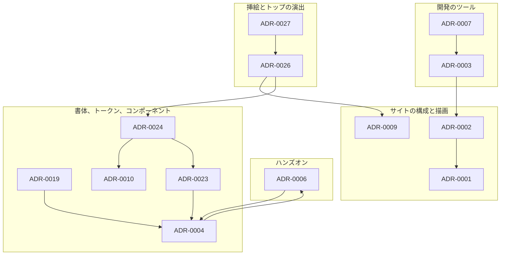

# ADR の索引

今有効な ADR を、話題ごとに並べる。

## サイトの構成と描画

| ADR                                                         | 題                                                                                            |
| ----------------------------------------------------------- | --------------------------------------------------------------------------------------------- |
| [ADR-0001](0001-starlight-as-docs-renderer.md)              | Starlight を採らず、Astro 単体 + Expressive Code + Pagefind で組む                            |
| [ADR-0002](0002-content-model-independence.md)              | 関係を `contentId` の辺として持ち、Content Model を Astro 非依存に保つ                        |
| [ADR-0008](0008-no-reader-identity.md)                      | 読者の identity を前提とする機能を作らず、バックエンドを持たない                              |
| [ADR-0009](0009-site-sections-and-playground-collection.md) | サイトを about / blog / playground の 3 つのセクションに分け、playground を collection にする |
| [ADR-0012](0012-search-dialog-on-listing.md)                | 本文の検索を、一覧の 3 ページに dialog として置く                                             |
| [ADR-0016](0016-render-mermaid-with-pele.md)                | mermaid の図を、ビルドでも島でも Pele で SVG にする                                           |
| [ADR-0018](0018-playground-groups-by-directory.md)          | playground を `playgrounds/` の直下のディレクトリで分類し、URL をファイルのパスにする         |

## ハンズオン

| ADR                                            | 題                                                                                            |
| ---------------------------------------------- | --------------------------------------------------------------------------------------------- |
| [ADR-0006](0006-interactive-content-levels.md) | 手を動かす場所を 4 つに分け、cross-origin isolation を `/playground/*` に限定する             |
| [ADR-0013](0013-pglite-for-planner-output.md)  | DB を使うハンズオンは、Postgres のプランナの出力を見せるために PGlite をデフォルトにする      |
| [ADR-0014](0014-lab-page-islands.md)           | ハンズオンのページは、手順の切り替えを React の外に置き、island どうしを CustomEvent でつなぐ |
| [ADR-0015](0015-lab-steps-in-rehype.md)        | ハンズオンの手順の画面へのまとめを、remark ではなく rehype のプラグインに置く                 |

## 開発のツール

| ADR                                             | 題                                                                                           |
| ----------------------------------------------- | -------------------------------------------------------------------------------------------- |
| [ADR-0003](0003-monorepo-and-vite-plus.md)      | pnpm workspace の monorepo とし、Vite+ を `vp run` / `vp env` / 同梱ツールに限定して採用する |
| [ADR-0007](0007-quality-gates.md)               | 品質チェックに react-doctor / knip / similarity-ts を採り、mise / Bun / Biome を採らない     |
| [ADR-0011](0011-pin-tool-versions-with-mise.md) | ツールのバージョンを mise で固定する                                                         |
| [ADR-0017](0017-vp-run-cache-for-web-build.md)  | Vite+ は `apps/web` の build を `vp run` でキャッシュすることだけに使う                      |

## 配信の基盤

| ADR                                                     | 題                                                                                         |
| ------------------------------------------------------- | ------------------------------------------------------------------------------------------ |
| [ADR-0005](0005-workers-terraform-wrangler-boundary.md) | Cloudflare Workers Static Assets を採用し、基盤を Terraform、deploy を Wrangler が管理する |

## 書体、トークン、コンポーネント

| ADR                                           | 題                                                                                                                                                                   |
| --------------------------------------------- | -------------------------------------------------------------------------------------------------------------------------------------------------------------------- |
| [ADR-0004](0004-typography-static-weights.md) | 和文に静的 2 ウェイトの Zen Old Mincho を採り、可変フォントを使わず self-host する                                                                                   |
| [ADR-0019](0019-latin-font-stix-two-text.md)  | 欧文の書体に、x-height と線の太さが和文に近い STIX Two Text を使う                                                                                                   |
| [ADR-0023](0023-keep-art-and-key-color.md)    | 個性として和の感じを残し、見出しを明朝にし、主の色を緑にする                                                                                                         |
| [ADR-0010](0010-tailwind-as-styling-base.md)  | Tailwind CSS v4 を CSS スタイリングの基盤にし、コンポーネントの CSS を utility へ移す                                                                                |
| [ADR-0024](0024-tokens-of-fukuemon-dev.md)    | トークンを、fukuemon.dev の値のプリミティブトークン、セマンティックトークン、テーマ変数の 3 つの層にし、生成りの地と旧サイトの差し色で、角丸と影を使わない版面にする |
| [ADR-0021](0021-ui-components-and-catalog.md) | packages/ui に Base と Case の React のコンポーネントを置き、packages/ui の Storybook をカタログにする                                                               |
| [ADR-0022](0022-code-colors-from-tokens.md)   | コードの色を、セマンティックトークンから生成したテーマで、コードブロック、エディタ、端末に配る                                                                       |

ADR-0020（[トークンを、DADS の値をコピーしたプリミティブトークン、セマンティックトークン、テーマ変数の 3 つの層にし、ライトとダークをセマンティックトークンで切り替える](0020-design-tokens-from-dads.md)）は、ADR-0024 に置換した。

## 挿絵とトップの演出

| ADR                                             | 題                                                                           |
| ----------------------------------------------- | ---------------------------------------------------------------------------- |
| [ADR-0026](0026-sumi-gate-and-garden-on-top.md) | トップの最初の訪問で水墨の門を描き、門をくぐった立体の庭にプロフィールを置く |
| [ADR-0027](0027-garden-by-season-and-time.md)   | トップの庭の絵を、訪問者の端末の日付と時刻で、季節と時間帯ごとに変える       |

ADR-0025（[挿絵を、トークンの色で描く版画風の図柄に作り替える](0025-woodblock-art.md)）は、ADR-0026 に置換した。

## 提案の ADR

承認の前の ADR を並べる。  
承認したら、上の話題の表へ移し、置換する ADR の Status と、下の依存の図を直す。

| ADR                                              | 題                                                                                  | 承認したら置換する ADR                                                                                            |
| ------------------------------------------------ | ----------------------------------------------------------------------------------- | ----------------------------------------------------------------------------------------------------------------- |
| [ADR-0029](0029-repository-layout-like-buddy.md) | リポジトリの構成を buddy に合わせ、文書を `docs/` に、E2E を `packages/e2e` に置く  | ADR-0001 の Decision 4、ADR-0003 の Decision 1 の構成の一覧                                                       |
| [ADR-0030](0030-articles-format-and-series.md)   | 種別を記事の 1 つにし、構成を記事の形式で、シリーズをディレクトリで表す             | ADR-0001 の Decision 3、ADR-0006 の Decision 2 のほか、ADR-0009、ADR-0012、ADR-0013、ADR-0014、ADR-0015、ADR-0018 |
| [ADR-0031](0031-subdomains-and-workers.md)       | サブドメインに分ける規則を決め、1 つのアプリを 1 つの Worker とホスト名に割り当てる | ADR-0006 の Decision 2                                                                                            |
| [ADR-0032](0032-docs-site-behind-access.md)      | ドキュメントサイトを Zensical でビルドし、Cloudflare Access を Terraform で設定する | 無い                                                                                                              |

## ADR の間の依存

矢印は、ADR から、その ADR の Context が前提にした ADR へ向く。

依存の無い ADR（ADR-0005、ADR-0008、ADR-0011〜0018、ADR-0021、ADR-0022）は、図に描かない。

## 番号の対応

コミット、issue、pull request に書いた番号から、今その判断を持つ ADR を探すための表。

| 旧番号   | 判断                                               | 今の ADR                           |
| -------- | -------------------------------------------------- | ---------------------------------- |
| ADR-0023 | 挿絵を、トークンの色で描く版画風の図柄に作り替える | ADR-0026（分けた ADR-0025 を置換） |
