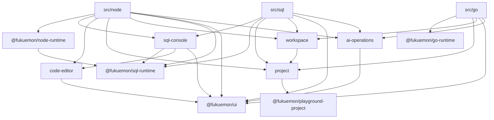
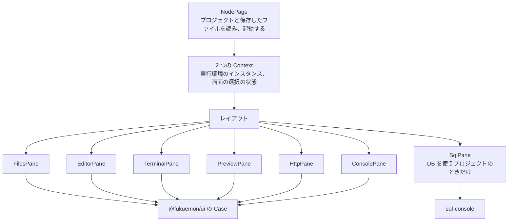
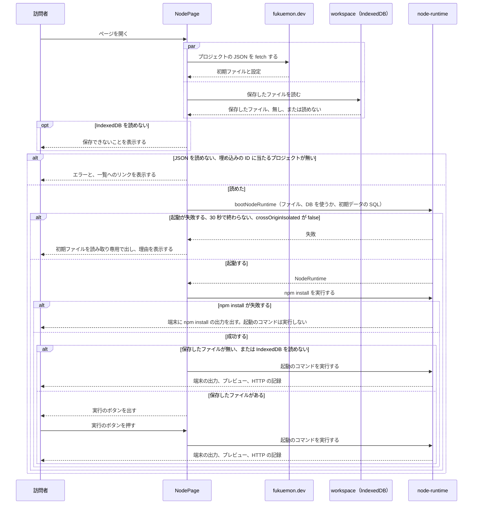

# プレイグラウンド

## Overview

プレイグラウンドは、訪問者がブラウザの中でコードと SQL を動かすツールを、`play.fukuemon.dev` で提供するアプリである。  
ツールは、Node の実行環境、SQL だけを動かすツール、Go を動かすツールの 3 つである。  
記事は、ツールのページを iframe で埋め込む。訪問者は、同じページをトップレベルでも開ける。

全体の構成とホスト名は [fukuemon.dev Design Doc](../../docs/design/DesignDoc.md) にある。  
実行の方式は、次の ADR が決めている。

- ADR-0033: [Node と npm の実行に WebContainers を採り、実行環境と画面の間をインターフェースで分ける](../../docs/adr/0033-webcontainers-for-node.md)
- ADR-0037: [Go のコードを、Yaegi のインタプリタの WASM で動かす](../../docs/adr/0037-go-with-yaegi.md)
- ADR-0053: [DB の記事は PGlite を使い、Node のコードからは Unix ドメインソケットで `pg` から接続し、SQL は DB のプロセスの標準入出力で送る](../../docs/adr/0053-pglite-database-in-playground.md)

## Scope

持つものは次のとおり。

- アプリの構成、パス、ディレクトリと import の向き
- Node の実行環境と画面の間のインターフェースの型と、画面が記録を読む形
- ツールのページの React のツリーと、状態の置き場
- プロジェクトの JSON の形、訪問者のファイルの保存の形
- 起動から実行までの流れ、動かせないブラウザでの表示
- SQL を送る形式と、結果の表示

持たないものは次のとおり。

- AI のエージェントからの操作の登録。登録する位置（トップレベルで開いたページ）だけを書く。操作の名前、許可のスイッチ、確認、記録は、[AI からの操作の Design Doc](../../docs/design/features/ai-operations/DesignDoc.md) が持つ。
  - ADR-0044: [AI のエージェントからの操作は、WebMCP の API で登録し、MCP-B の polyfill と relay でも呼べるようにする](../../docs/adr/0044-ai-operations-with-webmcp.md)
- コンソールの式を評価する入力欄。
- キャンバスとスライドのエディタの中の構成。ディレクトリを並べる位置だけを書く。
- 記事の本文で、埋め込みを置く書き方。記事の形式の設計が持つ。
- 画面のコンポーネントの見た目。[packages/ui/DESIGN.md](../../packages/ui/DESIGN.md) が持つ。

## Design

### アプリとパス

`apps/playground` は、Vite の React のアプリである。  
ツールごとに、HTML のエントリーポイントを持ち、1 つのツールのページが、1 つの React のツリーになる。  
ADR-0046: [プレイグラウンドを Vite の React のアプリにし、ツールごとに HTML のエントリーポイントとパスを分ける](../../docs/adr/0046-playground-as-vite-react-app.md)

| パス     | ツール                 | cross-origin isolation のヘッダ |
| -------- | ---------------------- | ------------------------------- |
| `/node/` | Node の実行環境        | 返す                            |
| `/sql/`  | SQL だけを動かすツール | 返さない                        |
| `/go/`   | Go を動かすツール      | 返さない                        |

- `/` は、`https://fukuemon.dev/playground` へリダイレクトする。
- 開くプロジェクトは、クエリの `project` で指定する（`/node/?project=<埋め込みの ID>`）。`project` が無いときは、デフォルトのプロジェクトを開く。
- 記事の iframe と、トップレベルで開くページは、同じ URL を使う。ページは、`window.self !== window.top` で埋め込みかどうかを判定し、埋め込みのときは、ページのヘッダを出さず、AI のエージェントからの操作を登録しない。
- ペインの並べ方は、ページの幅で決める。

ビルドは、`vp build` で行う。  
React Compiler を、`apps/playground` のビルドにだけ入れる。`apps/playground` のコードに、`memo`、`useMemo`、`useCallback` を書かない。書くのは、計測して遅いと分かったときだけにする。  
ADR-0047: [React Compiler を、`apps/playground` にだけ入れる](../../docs/adr/0047-react-compiler-in-playground.md)

### ディレクトリ

`apps/playground/src/` は、関心ごとのディレクトリで分ける。実装の種類のディレクトリ（`components/`、`hooks/`、`utils/`）を作らない。  
ADR-0048: [Node の実行環境のモジュールを package にし、記録を store で、ファイルの書き込みとプロセスの起動を関数で公開する](../../docs/adr/0048-node-runtime-interface-and-stores.md)

```text
apps/playground/
  node/index.html         Node の実行環境のエントリーポイント
  sql/index.html          SQL だけを動かすツールのエントリーポイント
  go/index.html           Go を動かすツールのエントリーポイント
  src/
    node/                 Node の実行環境のページ。レイアウト、ペインのコンポーネント、Context、選択の状態、起動と保存を進める React の外のモジュール
    sql/                  SQL だけを動かすツールのページ。入力欄の SQL、実行中かどうか、読み込みと実行の関数を持つ React の外のモジュール
    go/                   Go を動かすツールのページ
    sql-console/          SQL の入力欄、結果の表、実行計画の木
    code-editor/          ツールのエディタに共通の、CodeMirror 6 の拡張の組み立てと、EditorFrame にエディタのエンジンを渡すコンポーネント
    project/              埋め込みの ID、プロジェクトの JSON の読み込み、デフォルトのプロジェクト
    workspace/            訪問者のファイルの保存
    ai-operations/        AI のエージェントからの操作の許可のスイッチ、登録、確認、記録

packages/
  sql-runtime/src/        SqlDatabase の型、結果とエラーの形、PGlite で SQL を実行して結果の形にする関数、PGlite を Web Worker で動かす実装
  node-runtime/src/       NodeRuntime の型、bootNodeRuntime、store、記録の行を抜き出す処理、標準入出力で SqlDatabase を実装する処理
    webcontainer/         @webcontainer/api を import する実装。WebContainers に依る処理
    guest/                実行環境の中の Node が動かすファイル（preload、DB のプロセスのスクリプト、DB のプロセスの依存を書く package.json）
  go-runtime/src/         GoRunner の型、Yaegi の読み込みと実行
```

- キャンバスとスライドのエディタは、追加するときに、`apps/playground/src/` の同じ階層に並べる。
  - キャンバスのディレクトリ（`drawio/`、`excalidraw/`、`documents/`、`figures/`）の間と、`@fukuemon/figures` への import の向きは、[キャンバスの Design Doc](../../docs/design/features/canvas/DesignDoc.md#ディレクトリ) にある。Oxlint は、`drawio/` と `excalidraw/` も、ツールのページの間の import を止める対象にする。
  - スライドのエディタのディレクトリ（`slides/`）と、`@fukuemon/slides` への import の向きは、[スライドの Design Doc](../../docs/design/features/slides/DesignDoc.md#ディレクトリと依存) にある。Oxlint は、`slides/` も、ツールのページの間の import を止める対象にする。
- `code-editor/` は、Node の実行環境のページ（`src/node/`）と、スライドのエディタのページ（`src/slides/`）が共有する。`code-editor/` は、ツールのページのディレクトリと、`documents/` を import しない。
- 実行環境の処理は、実行環境ごとの 3 つの package に置く。package は、型、store、関数だけを持つ。React のコンポーネントと、store を React で読む処理は、`apps/playground` に置く。
  - `@fukuemon/sql-runtime`（`packages/sql-runtime`）: PGlite で SQL を実行する処理。
  - `@fukuemon/node-runtime`（`packages/node-runtime`）: Node の実行環境の処理。`@fukuemon/sql-runtime` に依存する。
  - `@fukuemon/go-runtime`（`packages/go-runtime`）: Go のコードを実行する処理。
  - 3 つの package は、`@fukuemon/ui`、`@fukuemon/playground-project`、React に依存しない。`@fukuemon/sql-runtime` と `@fukuemon/go-runtime` は、workspace のどの package にも依存しない。
  - package は、ほかの package と同じく、`exports` でソースのファイルを指す。ビルドは、`apps/playground` の Vite が行う。
- この文書では、`node-runtime/` は `packages/node-runtime/src/` を、`webcontainer/` と `guest/` はその下のディレクトリを指す。
- `@fukuemon/sql-runtime` は、エントリーポイントを 2 つに分ける。
  - 型と、PGlite で SQL を実行して結果の形にする関数。このエントリーポイントは、PGlite から型だけを import する。関数はブラウザと Node の両方で動くので、このエントリーポイントは DOM と Worker の API を使わない。`Store` の型も、このエントリーポイントに置く。
  - PGlite を Web Worker で動かす、`SqlDatabase` の実装。SQL だけを動かすツールが使う。
- プロジェクトの JSON と、`playground.json` の型と schema は、`packages/playground-project`（`@fukuemon/playground-project`）に置く。`apps/web` のビルドと、`project/` が使う。
- `guest/` のファイルは、ブラウザではなく、実行環境の中の Node で動く。`webcontainer/` が、ファイルの中身を文字列として読み込み、実行環境に書く。tsconfig と lint の対象を、ブラウザのコードと分ける。
- `guest/` の `package.json` は、DB のプロセスの依存（PGlite、`pglite-socket`）のバージョンを、範囲ではなく 1 つの値で書く。PGlite のバージョンは、`@fukuemon/sql-runtime` の依存と同じにする。`@fukuemon/node-runtime` のテストで、2 つの `package.json` の PGlite のバージョンを比べ、同じことを確認する。
- `node-runtime/` の中の import の向きは、次のとおり。
  - `node-runtime/` の直下は、`webcontainer/` の `RuntimeBackend` の実装を、`bootNodeRuntime` の 1 か所だけで import する。
  - `webcontainer/` が `node-runtime/` の直下から import するのは、型だけである。
  - `guest/` は、`node-runtime/` の直下と `webcontainer/` を import しない。

次の図は、`apps/playground/src/` のディレクトリと package の、互いの間で許す import の向きを示す。矢印の無い組は、import しない。



- `src/node/`、`sql-console/`、`node-runtime/` が `@fukuemon/sql-runtime` から import するのは、型だけである。`workspace/` が `project/` から import するのも、型だけである。
  - `guest/` の DB のプロセスのスクリプトだけは、`@fukuemon/sql-runtime` の、PGlite で SQL を実行して結果の形にする関数を import する。`guest/` は、PGlite を Web Worker で動かす `SqlDatabase` の実装のエントリーポイントを import しない。
- `node-runtime/` は、`project/` を import しない。`BootOptions` は、プロジェクトの型を使わない。
- `workspace/` と `node-runtime/` は、互いを import しない。2 つをつなぐ処理は、`src/node/` が持つ。
- `sql-console/` は、`workspace/` を import しない。入力欄の値と、値の変更は、props で受ける。値を持ち、保存するのは、`src/node/` と `src/sql/` である。
- `@webcontainer/api` に依存するのは、`@fukuemon/node-runtime` だけである。`apps/playground` の `package.json` には、`@webcontainer/api` を依存として書かない。
- Oxlint の `no-restricted-imports` が止める import は、次の 3 つ。
  - `packages/node-runtime/src/webcontainer/` のほかからの、`@webcontainer/api` の import
  - `apps/playground/src/` の `node/`、`sql/`、`go/`、`drawio/`、`excalidraw/`、`slides/` の間の import
  - `apps/playground/src/ai-operations/` からの、ツールのディレクトリの import

### NodeRuntime

Node の実行環境と画面の間は、`NodeRuntime` で分ける。store と関数が渡すデータは、シリアライズできる素の値だけにする。型に、`@webcontainer/api` の型を含めない。

```ts
type Store<T> = {
  subscribe: (onChange: () => void) => () => void;
  getSnapshot: () => T;
};

type BootOptions = {
  files: Readonly<Record<string, string>>;
  database: boolean;
  initialSql?: string;
};

declare function bootNodeRuntime(options: BootOptions): Promise<NodeRuntime>;

type NodeRuntime = {
  files: {
    tree: Store<readonly FileEntry[]>;
    changes: { subscribe: (onChange: (paths: readonly string[]) => void) => () => void };
    readAll: (options: ReadAllOptions) => Promise<readonly FileSnapshot[]>;
    read: (path: string) => Promise<string>;
    write: (path: string, contents: string) => Promise<void>;
    createDirectory: (path: string) => Promise<void>;
    rename: (from: string, to: string) => Promise<void>;
    remove: (path: string) => Promise<void>;
  };
  processes: {
    list: Store<readonly ProcessInfo[]>;
    get: (id: string) => ProcessHandle | undefined;
    start: (
      command: string,
      args: readonly string[],
      options?: { name?: string; terminal?: TerminalSize },
    ) => Promise<ProcessHandle>;
    startShell: (options?: { name?: string; terminal?: TerminalSize }) => Promise<ProcessHandle>;
  };
  ports: Store<readonly OpenPort[]>;
  httpExchanges: Store<readonly HttpRecord[]>;
  consoleEntries: Store<readonly ConsoleRecord[]>;
  database?: SqlDatabase;
  dispose: () => Promise<void>;
};

type ReadAllOptions = { exclude: readonly string[]; maxBytes: number };

type FileSnapshot = { path: string; size: number; text: string | null };

type ProcessHandle = {
  id: string;
  output: OutputLog;
  write: (data: string) => void;
  resize: (size: TerminalSize) => void;
  kill: () => void;
  exit: Promise<number>;
};

type OutputLog = {
  read: () => string;
  subscribe: (onChunk: (chunk: string) => void) => () => void;
};
```

名前は、実装のときに変えてよい。

- 起動は、`bootNodeRuntime` が返す Promise で待つ。起動の失敗は、Promise の失敗で受け取る。失敗は、理由（`crossOriginIsolated` が `false`、30 秒で終わらない、そのほか）を持つ。
- 30 秒の判定と、作りかけのインスタンスの破棄は、`bootNodeRuntime` の中で行う。
- `node-runtime/` が公開する起動の関数は、`bootNodeRuntime` だけである。Promise を埋め込みの ID ごとに持つ処理は、`src/node/` に置く。
- `webcontainer/` の `spawn` が、接続先の環境変数と `NODE_OPTIONS` を組み立てて、プロセスに渡す。画面は、環境変数を渡さない。渡す値は、[実行環境が追加するファイルとプロセス](#実行環境が追加するファイルとプロセス) にある。
- 実行環境が自分で起動するプロセス（DB のプロセス、DB の依存の `npm install`）は、`processes.list` に入れない。
- 端末のシェルは、`processes.startShell` で起動する。起動するシェルのプログラムは、`webcontainer/` が決める。画面は、シェルのプログラムの名前を持たない。
- `start` を呼ばないコンポーネントは、`processes.get` で、プロセスの出力を読む。
- `files.changes` は、ファイルの中身が変わったことの通知である。保存と、エディタで開いているファイルの更新に使う。
- `files.readAll` は、作業ディレクトリのファイルを、パス、サイズ、テキストの中身で返す。`exclude` に当たるパスは読まない。`maxBytes` を超えるファイルと、テキストとして読めないファイルは、`text` が `null` になる。`exclude` に当たるかの判定、`maxBytes` を超えるかの判定、テキストかどうかの判定は、`node-runtime/` の直下が持つ。
- `FileEntry` は、パスを持つ。画面は、パスを、`FileTree` の項目の `id` に使う。
- `OpenPort` は、ポート、URL、プレビューの iframe に付ける属性（`sandbox`、`allow`）を持つ。属性の値は、`webcontainer/` が決める。
- プレビューに入れるスクリプトから `postMessage` で送られるコンソールの記録を受けて、`consoleEntries` に入れる処理は、`node-runtime/` が持つ。スクリプトの中身と、メッセージの形は、`node-runtime/` の直下が持つ。`node-runtime/` の直下は、スクリプトの中身を、`BackendBootOptions` の `previewScript` で `webcontainer/` に渡す。メッセージの origin の確認は、`webcontainer/` が行う。
- `database` は、DB を使うプロジェクトのときだけある。DB のプロセスの状態は、`database` の `status` で公開し、`NodeRuntime` には持たせない。
- 実行環境を起動し直すときは、`src/node/` のモジュールが、古いインスタンスの `files.readAll` の結果を受け取ってから、`dispose` を呼ぶ。その結果を `BootOptions` の `files` に渡して、`bootNodeRuntime` で新しいインスタンスを作る。
  - `files.readAll` には、保存のときと同じ `exclude` と `maxBytes` を渡す。`text` が `null` のファイルは、新しいインスタンスに渡さない。
  - `src/node/` のモジュールは、起動し直すときの `files.readAll` に、時間の上限を付ける。失敗したときと、上限までに終わらないときは、保存のために最後に読んだ `files.readAll` の結果で起動する。その結果も無いときは、初期ファイルで起動する。上限の値は、実装のタスクで測って決める。
  - ページを開いたときに IndexedDB から読んだファイルは使わない。作業ディレクトリのファイルで起動するので、IndexedDB を読めないときも、訪問者が変えたファイルが残る。

SQL だけを動かすツールと、Go を動かすツールは、`NodeRuntime` を実装しない。それぞれ、`SqlDatabase`（`@fukuemon/sql-runtime`）と `GoRunner`（`@fukuemon/go-runtime`）を持つ。

### `webcontainer/` が実装する型

`node-runtime/` の直下と、`webcontainer/` の間は、次の型で分ける。  
直下のコードは、この型だけを使い、WebContainers に依る処理を持たない。

```ts
type RuntimeBackend = {
  isSupported: () => boolean;
  boot: (options: BackendBootOptions) => Promise<BackendInstance>;
};

type BackendBootOptions = {
  files: Readonly<Record<string, string>>;
  database: boolean;
  previewScript: string;
};

type BackendInstance = {
  files: BackendFiles;
  spawn: (
    command: string,
    args: readonly string[],
    options?: { terminal?: TerminalSize; internal?: boolean; cwd?: string },
  ) => Promise<BackendProcess>;
  spawnShell: (options?: { terminal?: TerminalSize }) => Promise<BackendProcess>;
  ports: { subscribe: (onChange: (ports: readonly OpenPort[]) => void) => () => void };
  previewMessages: { subscribe: (onMessage: (message: unknown) => void) => () => void };
  guestDirectory: string;
  teardown: () => Promise<void>;
};

type BackendProcess = {
  output: { subscribe: (onChunk: (chunk: string) => void) => () => void };
  write: (data: string) => void;
  resize: (size: TerminalSize) => void;
  kill: () => void;
  exit: Promise<number>;
};
```

名前は、実装のときに変えてよい。

- `BackendFiles` は、ファイルかディレクトリかを持つ一覧、バイト列での読み込み、書き込み、ディレクトリの作成、名前の変更、削除、変更の通知を持つ。store は持たない。`files.tree` の store と `files.readAll` は、`node-runtime/` の直下が、この操作から組み立てる。
- `webcontainer/` が持つ処理は、次のとおり。
  - `isSupported`: `crossOriginIsolated` の判定。
  - `boot`: WebContainers の起動、初期ファイルの書き込み、`guest/` のファイルを実行環境のディレクトリに置く処理、プレビューに入れるスクリプトの登録。
  - `spawn`: `NODE_OPTIONS` と環境変数の組み立て。`internal` が `true` のプロセスには、preload を追加しない。`node-runtime/` の直下は、DB の依存の `npm install` を `guestDirectory` で実行するときに、`cwd` を渡す。
  - `spawnShell`: 起動するシェルのプログラムの決定と、シェルの起動。環境変数は、`spawn` が、`internal` を指定しないプロセスに渡すのと同じ値を渡す。
  - `ports`: 待ち受けたポートの通知、`OpenPort` の `sandbox` と `allow` の値、ポートの URL を書くファイルの更新。
  - `previewMessages`: プレビューからの `postMessage` の受信と、origin の確認。
- `node-runtime/` の直下が持つ処理は、store、記録の行を抜き出す処理、30 秒の判定、DB のプロセスの起動と、標準入出力での `SqlDatabase` の実装である。
- `guest/` のファイルと、標準入出力での `SqlDatabase` の実装は、実行環境が Node のプロセスを動かすことを前提にしている。Node のプロセスを持たない実行環境に差し替えるときは、`webcontainer/` に加えて、この 2 つも直す。

### 記録を読む形

- 記録（ファイルのツリー、プロセスの一覧、ポート、HTTP の記録、コンソールの記録）は、種類ごとの store で公開する。画面は、`useSyncExternalStore` で読む。Effect の中で `setState` を呼んで、記録を写さない。
- `getSnapshot` は、記録が変わっていない間、同じ参照を返す。
- プロセスの出力は、`OutputLog` で公開する。端末のペインは、Effect の中で、`read` の結果を端末のエンジンに書いてから、`subscribe` で追加の出力を書く。
- preload は、記録の行の行頭に、固定のプレフィックスを付ける。`node-runtime/` の直下（`webcontainer/` の外）の処理が、`BackendProcess` の `output` から受けたそのままの出力から、プレフィックスの付いた行を抜き出して、store に入れる。`OutputLog` には、抜き出した後の出力を渡す。
- コンソールの記録の、出力したプロセスの名前は、行を抜き出す処理が付ける。名前は、行を出力したプロセスの、`start` の `name` である。シェルで起動したプロセスの行には、シェルの名前が付く。
- プレフィックスは、HTTP の記録が `@@fd:http `、コンソールの記録が `@@fd:console `、DB のプロセスの応答が `@@fd:sql ` である。見分ける処理は、`node-runtime/` の直下に 1 つ置く。
  - ADR-0054: [HTTP の流れとコンソールを preload とプレビューのスクリプトで記録し、記録の行は端末に出さない](../../docs/adr/0054-record-http-and-console-with-prefixed-lines.md)
- store は、記録の件数に上限を置き、超えた古い記録を消す。上限は、プロセスの出力が 1 つのプロセスにつき 1 MB、コンソールの記録が 1000 件、HTTP の記録が 500 件である。値は、実装のタスクで測って変えてよい。

### React のツリーと状態

次の図は、Node の実行環境のページのツリーを示す。



- Context は 2 つで、`src/node/` に定義する。
  - 実行環境のインスタンスを渡す Context。値が変わるのは、実行環境を起動し直すときだけである。
  - 画面の選択の状態を渡す Context。選んだファイル、開いているタブ、選んだ HTTP のやり取り、下のペインのタブを持つ。状態は、`NodePage` が `useReducer` で持つ。
- Context は、`<Context>` を provider として書き、`use(Context)` で読む。
- ツリーをまたぐ通知（`CustomEvent`）と、状態管理のライブラリは使わない。
- ペインのコンポーネント（`FilesPane` など）が、実行環境を読み、`@fukuemon/ui` の Case に、素の値の props を渡す。Case と、`sql-console/` のコンポーネントは、`NodeRuntime` の型を import しない。
  - `HttpPane` は、`httpExchanges` の送信元と送信先と、`ports` から、`HttpExchangeList` の `actors` を組み立てる。`processes.list` は使わない。シェルで起動したサーバーは、`processes.list` に入らないためである。
  - `PreviewPane` は、`ports` の URL と属性から、iframe を作る。
  - `sql-console/` のコンポーネントは、`SqlDatabase` の `status`、SQL を実行する関数、実行中かどうかの値、入力欄の値、入力欄のファイルの名前、DB が止まったときの復帰の案内を、props で受ける。`status` は、`useSyncExternalStore` で読む。実行の結果は、このコンポーネントが持ち、表に出す。
  - 復帰の動きは `SqlDatabase` の実装ごとに違うので、復帰の案内の文は呼ぶ側が渡す。
  - `SqlPane` は、`NodeRuntime` の `database` の `status` と `run`、`useTransition` から得た実行中かどうかの値、入力欄の値を、`sql-console/` のコンポーネントに渡す。
  - SQL だけを動かすツールは、`src/sql/` の React の外のモジュールが持つ、SQL を実行する関数と、実行中かどうかの値を渡す。画面の実行のボタンと、AI からの操作の `sql_run_query` は、同じ関数を呼ぶ。
  - SQL だけを動かすツールは、`sql-console/` のコンポーネントの省略できる props で、もう 1 つの値を渡す。AI からの操作が、時間の上限で DB を初期の状態に戻したかどうかを表す値である。値は、`src/sql/` のモジュールが持つ。`sql-console/` のコンポーネントは、値が戻したことを示すときに、DB を初期の状態に戻したことを出す。`SqlPane` は、渡さない。
  - 「実行環境を起動し直す」の関数は、起動の Promise を持つ `src/node/` のモジュールが公開する。`SqlPane` は、この関数を、`sql-console/` のコンポーネントの、省略できる props で渡す。SQL だけを動かすツールは、渡さない。
- `Suspense` の境界は、ペインごとに置く。fallback は、同じ Case に、`state` の `loading` を渡したものにする。
- `use` に渡す Promise は、React の外のモジュールが、埋め込みの ID ごとに 1 つ作って持つ。プロジェクトの JSON の Promise は `project/` が、保存したファイルの Promise は `workspace/` が、起動の Promise は `src/node/` が持つ。実行環境を起動し直すときは、`src/node/` が、起動の Promise を新しいものに替える。
- タブで切り替えるペイン（端末、コンソール、HTTP の一覧、プレビュー）は、`Activity` で包む。隠している間の記録は、store が持つ。
- Node の実行環境では、実行のボタンの、実行中かどうかの値を、`useTransition` で持つ。
- SQL だけを動かすツールと、Go を動かすツールでは、`src/sql/` と `src/go/` の React の外のモジュールが、実行中かどうかの値を持つ。コンポーネントは、この値を `useSyncExternalStore` で読む。AI からの操作で実行している間も、ボタンを実行中の表示にするためである。モジュールは、PGlite と Yaegi を読み込んでいる間も、値を実行中にする。
- SQL だけを動かすツールの PGlite と、Go を動かすツールの Yaegi は、訪問者が実行のボタンを押したときと、AI からの操作の `sql_run_query`、`go_run`、`go_test` が呼ばれたときに読み込む。ページを開いたときには、読み込まない。
  - ADR-0063: [AI のエージェントからの操作を、SQL だけを動かすツールと Go を動かすツールにも公開し、PGlite と Yaegi を操作が呼ばれたときにも読み込む](../../docs/adr/0063-ai-operations-for-sql-and-go.md)

SQL だけを動かすツールのページは、次のとおり組む。

- `src/sql/` の React の外のモジュールが、埋め込みの ID ごとに 1 つ、次のものを持つ。
  - 入力欄の今の SQL の store と、値を変える関数。初期値は、プロジェクトの `files` の、`open` のファイルの中身である。
  - 実行中かどうかの store。
  - `SqlDatabase` を Web Worker で動かす実装（`@fukuemon/sql-runtime`）と、PGlite の読み込みを始める関数。
  - 実行する関数。実行中かどうかの値を変え、`SqlDatabase` の `run` を呼び、`SqlResponse` を返す。実行中に呼んだときは、実行せずに `error` を持つ値を返す。
- 同じモジュールが、ページの URL のクエリからプロジェクトを読み、埋め込みの ID の SqlSession を返す関数を持つ。ページは、この関数の Promise を `use` で読む。
- ページは、このモジュールの値を `useSyncExternalStore` で読み、`sql-console/` のコンポーネントに渡す。
- 入力欄のエディタは、CodeMirror 6 にする。Ctrl か ⌘ と Enter で実行する。
- CodeMirror 6 の拡張の組み立ては、`src/code-editor/` の 1 か所に置く。Node の実行環境と Go を動かすツールのエディタも、同じ組み立てを使い、言語の拡張だけを足す。
  - 行番号、今いる行の帯、字下げの補助線、対応する括弧の強調を出す。折りたたみの印は出さない。Tab のキーは字下げに使わない。
  - 色は、`packages/ui` のテーマ変数を読む。字句の色は `--color-code-*`、今いる行の帯は `--color-surface`、字下げの補助線は `--color-border`、対応する括弧の枠は `--color-border-field` である。
- 実行のボタンを押してから結果が出るまで、待っている段階を `Loading` で出す。段階は、PGlite の読み込み、初期データの SQL の実行、SQL の実行の 3 つである。
- 埋め込みのときは、ページの題を出さない。

Node の実行環境のページは、次のとおり組む。

- ペインは、左にファイルのツリー、中央にエディタ、右にプレビュー、下に端末を置く。ペインの間は `SplitPane` で分け、訪問者が幅と高さを変えられる。
- `NodePage` は、プロジェクトの Promise を `use` で読んでから、ペインを並べる。起動の Promise は、`RuntimeContext` で渡し、ペインが `use` で読む。起動を待つ間は、ペインごとの `Suspense` が、同じ Case の読み込み中を出す。
- `src/node/` の React の外のモジュールが、プロジェクトごとに 1 つ、起動の Promise を持つ。起動した後に、シェル、`npm install`、起動のコマンドの順にプロセスを起動する。Promise は、プロセスの起動を待たずに解決する。
- ファイルのツリーは、`node_modules` の下を、パッケージのディレクトリ（`node_modules/<名前>` と `node_modules/@scope/<名前>`）までにし、その中身を出さない。中身まで出すと、項目が数千になるためである。この規則は、`node-runtime/` の直下が、ツリーの store を組むときに持つ。
- ファイルとディレクトリを消す前に、`ConfirmDialog` で確認する。
- エディタは、開いたファイルをタブで並べる。入力のたびに、実行環境のファイルに書き込む。コマンドがファイルを書き換えたときは、`files.changes` の通知を受けて、エディタの中身を置き換える。自分が書き込んでいる間の通知では、置き換えない。
- エディタの言語は、拡張子で決める。`.js`、`.mjs`、`.cjs`、`.jsx`、`.ts`、`.mts`、`.cts`、`.tsx` は JavaScript と TypeScript、`.json` は JSON にする。ほかの拡張子には、色を付けない。
- 端末のエンジンは、xterm.js（`@xterm/xterm` と `@xterm/addon-fit`）にする。色は、`packages/ui` の `toVsCodeTheme` の値を写して渡す。xterm.js は CSS の変数を読まないためである。ライトとダークは、OS の設定で決める。
- 端末は、`processes.list` のプロセスをタブで並べる。終了したプロセスは、タブの文に終了コードを添える。端末の題の右の「新しい端末」のボタンで、シェルを足す。2 つ目からのシェルの名前には、番号を付ける。
- プレビューは、待ち受けたポートをタブで並べる。選んでいないポートの iframe も `Activity` で隠して残し、タブを切り替えても、ページの状態を消さない。再読み込みのボタンは、選んだポートの iframe を作り直す。
- 実行環境を起動できなかったときは、ファイルのツリーとエディタに初期ファイルを読み取り専用で出す。端末とプレビューのペインには、理由と、対応するブラウザ（デスクトップの Chrome か Edge の最新版）を出す。
- `project` を付けずに開いたときのプロジェクトは、`package.json` と、3000 番で待ち受ける `index.js` の 2 つのファイルを持つ。起動のコマンドは、`node index.js` の 1 つである。

### プロジェクト

1 つの埋め込みが持つ、初期ファイルの一式と設定を、プロジェクトと呼ぶ。  
ADR-0049: [記事の埋め込みの初期ファイルと設定を、`apps/web` のビルドが JSON にし、ツールのページが埋め込みの ID で読む](../../docs/adr/0049-playground-projects-from-articles.md)

- 埋め込みの ID は、記事の `contentId` と、記事の中の埋め込みの名前の組である（`<contentId>/<埋め込みの名前>`）。
- 運営者は、プロジェクトを、記事のディレクトリの下に置く（`apps/web/src/content/articles/<記事>/playground/<埋め込みの名前>/`）。設定は、同じディレクトリの `playground.json` に書く。
- `apps/web` のビルドが、プロジェクトごとに、1 つの JSON を、`https://fukuemon.dev/playground-projects/<埋め込みの ID>.json` に出力する。`fukuemon.dev` は、`/playground-projects/*` に、`play.fukuemon.dev` を許す `Access-Control-Allow-Origin` を返す。
- ツールのページは、埋め込みの ID から JSON の URL を組み立てて、`fetch` する。
  - `fukuemon.dev` の origin は、`apps/playground` のビルドのときの環境変数で渡す。`project/` と、キャンバスの `figures/` が、同じ環境変数を読む。
- JSON を読めないときと、埋め込みの ID に当たるプロジェクトが無いときは、ツールのページに、エラーと、`https://fukuemon.dev/playground` へのリンクを出す。デフォルトのプロジェクトは開かない。
- デフォルトのプロジェクトは、`apps/playground` が、ツールごとに 1 つ持つ。置き場は、`project/` である。
- JSON と `playground.json` の型と schema は、`@fukuemon/playground-project` が持つ。`apps/web` のビルドは、この schema で `playground.json` を検証する。`project/` は、読んだ JSON を、同じ schema で検証する。schema に合わないときは、JSON を読めないときと同じ表示にする。
- 埋め込みの ID が `<英小文字、数字、ハイフン>/<英小文字、数字、ハイフン>` の形でないときと、JSON の `tool` が開いたページのツールと違うときも、JSON を読めないときと同じ表示にする。形でない ID では、JSON を取得せず、エラーの文に ID を出さない。URL を作った人の任意の文を、ページに出さないためである。

JSON は、次の値を持つ。

| キー         | 中身                                                | 使うツール    |
| ------------ | --------------------------------------------------- | ------------- |
| `tool`       | ツールの種類。`node`、`sql`、`go` のどれか          | 全て          |
| `version`    | 初期ファイルの中身から求めたハッシュ                | 全て          |
| `files`      | ファイルのパスと中身                                | 全て          |
| `open`       | 最初に開くファイルのパス                            | 全て          |
| `start`      | 起動のコマンドの一覧                                | `node`        |
| `database`   | `true` のときに、実行環境が DB のプロセスを起動する | `node`        |
| `initialSql` | 初期データの SQL                                    | `node`、`sql` |

- `start` は、`{ command, args, name }` の配列である。`src/node/` が、1 つの要素を、1 回の `processes.start(command, args, { name })` に渡す。コマンドの文字列を、引数に分ける処理は持たない。

### 保存

訪問者のファイルは、`play.fukuemon.dev` の IndexedDB に保存する。  
ADR-0050: [訪問者のファイルを、埋め込みの ID ごとに、IndexedDB に保存する](../../docs/adr/0050-save-visitor-files-in-indexeddb.md)

- キーは、ツールの名前と、埋め込みの ID の組である。デフォルトのプロジェクトは、固定のキーを使う。
- SQL だけを動かすツールは、入力欄の SQL を保存する。Go を動かすツールは、ファイルを保存する。

Node の実行環境は、次のとおり保存する。

- レコードは、ファイルのパスと中身の一覧、保存した時刻、初期ファイルのバージョンを持つ。DB を使うプロジェクトでは、SQL のペインの入力欄の SQL も持つ。
- `src/node/` が、`files.changes` の通知を受けて、`files.readAll` の結果を `workspace/` に渡す。
- `src/node/` は、`files.readAll` の結果と、SQL のペインの入力欄の SQL を合わせて、1 つのレコードとして `workspace/` に渡す。`workspace/` は、保存してあるレコードを、受け取ったレコードで丸ごと置き換える。
- ADR-0050 の承認の条件の確認で、`files.changes` が、コマンドの作ったファイルを通知しないと分かったときは、`src/node/` が、5 秒ごとに `files.readAll` を呼び、前回と中身が違うときに保存する。5 秒は、測っていない値で、実装のタスクで測って変えてよい。
- 保存しないファイルの規則は、`src/node/` の 1 か所に置き、`files.readAll` の引数で渡す。`exclude` に `node_modules` を、`maxBytes` に 1 MB を渡す。
- 1 つのファイルが 1 MB を超えるものと、テキストとして読めないもの（`text` が `null` のもの）は、保存しない。
- 保存したバージョンと、プロジェクトの JSON のバージョンが違うときは、保存したファイルを開き、「初期の状態に戻す」の操作を出す。
- `workspace/` は、読み込みの結果を、保存したファイルが無い、保存したファイルがある、IndexedDB を読めない、の 3 つの種類で返す。IndexedDB を読めないときは、`src/node/` のモジュールが、保存したファイルが無いときと同じに扱って、初期ファイルで起動する。`NodePage` は、保存できないことを画面に出す。
- `workspace/` は、IndexedDB を読めなかったことを、ページを開いている間だけ持ち、その間は IndexedDB に書き込まない。SQL だけを動かすツールと、Go を動かすツールでも、`workspace/` は同じように書き込まない。
- 実行環境が追加するファイルは、作業ディレクトリの外にあるので、保存の対象に入らない。
  - ADR-0052: [実行環境が追加するファイルを、訪問者の作業ディレクトリの外に置き、preload を `NODE_OPTIONS` で渡す](../../docs/adr/0052-runtime-files-outside-workdir.md)

### 起動から実行まで

次の図は、Node の実行環境のページを開いてから、サーバーが動くまでの流れを示す。  
ADR-0051: [Node の実行環境は、ページを開いたときに起動し、シェルを制限なしで使わせ、訪問者が変えたコードは操作の後に動かす](../../docs/adr/0051-node-runtime-boot-and-commands.md)



- 図の `NodePage` の手順のうち、`bootNodeRuntime` の呼び出し、`npm install`、起動のコマンドの実行は、起動の Promise を持つ `src/node/` のモジュールが進める。React のコンポーネントは、Effect の中でプロセスを起動しない。
- `bootNodeRuntime` は、DB を使うプロジェクトのときに、DB のプロセスの依存を入れ、DB のプロセスを起動し、初期データの SQL を実行してから、Promise を解決する。30 秒は、`bootNodeRuntime` を呼んでから、Promise が解決するまでの時間で判定する。
- 30 秒で終わらないときは、`bootNodeRuntime` が、作りかけのインスタンスを破棄してから、Promise を失敗させる。
- 起動が失敗したときは、端末とプレビューのペインに、動かせない理由と、対応するブラウザを出す。
- `npm install` が 0 でない終了コードで終了したときは、起動のコマンドを実行しない。端末に、`npm install` の出力が残る。
- 起動のコマンドが複数あるときは、`start` の順に起動する。前のコマンドの終了を待たない。
- 保存したバージョンと、プロジェクトの JSON のバージョンが違うときも、保存したファイルで起動し、保存したファイルがあるときと同じに扱う。
- プレビューの iframe が 30 秒で読み込まれないときは、`PreviewPane` が、プレビューのペインにだけ、動かせない理由を出す。
- 訪問者は、端末で、WebContainers のシェルを制限なしで使う。
- 「実行環境を起動し直す」の操作は、いつでも使える。起動し直した後は、保存したファイルがあるときと同じに扱う。`npm install` だけを自動で実行し、起動のコマンドは、訪問者が実行のボタンを押してから実行する。
- DB のプロセスが終了したとき以外で、起動の後に実行環境が動かなくなったときは、訪問者が、「実行環境を起動し直す」の操作で起動し直す。画面は、実行環境の全体の状態を表示しない。

### 実行環境が追加するファイルとプロセス

- 実行環境は、preload、DB のプロセスのスクリプトと依存、待ち受けたポートの URL を書くファイルを、`/tmp` の下の、実行環境のディレクトリに置く。
- ファイルを置く処理と、環境変数の組み立ては、`webcontainer/` が持つ。
- `webcontainer/` は、`start` で起動するプロセスと、シェルの環境変数に、次の値を渡す。実行環境が自分で起動するプロセス（`internal` が `true`）には、preload を追加しない。
  - `NODE_OPTIONS`: preload ごとの `--require <絶対パス>`。HTTP の流れとコンソールを記録する preload は、どのプロジェクトでも追加する。Unix ドメインソケットに接続している間はプロセスを終了させない preload は、DB を使うプロジェクトのときだけ追加する。
  - `PLAYGROUND_PORTS_FILE`: 待ち受けたポートの URL を書くファイルのパス。
  - DB を使うプロジェクトのときは、`PGHOST`、`PGUSER`、`PGDATABASE`、`DATABASE_URL`。
- 待ち受けたポートの URL を書くファイルは、`/tmp/fukuemon-playground/ports.json` である。中身は、ポートの番号をキー、URL を値にした 1 行の JSON（`{"3000":"https://..."}`）で、ポートが開くか閉じるたびに書き直す。ポートが 1 つも無いときは `{}` である。
  - `webcontainer/` は、このファイルを、実行環境の中の Node で書く。書く中身を環境変数で渡すので、中身を 1 行にする。WebContainers は、改行を含む環境変数の値を、最初の行で切る。
- `public/_headers` は、Cloudflare でだけ働く。`apps/playground` の `vite.config` は、`vp dev` と `vp preview` でも、`/node/` に同じ isolation のヘッダを返す。

### SQL

SQL の画面（`sql-console/`）は、SQL を実行する関数を props で受ける。  
この関数に SQL を渡し、結果を表示する。  
SQL を実行する関数は、`SqlDatabase` の `run` を呼ぶ。  
`SqlDatabase` の実装は 2 つである。

- SQL だけを動かすツール: Web Worker で動かす PGlite（`@fukuemon/sql-runtime`）。ツールのページのメインスレッドでは、SQL を実行しない。
- DB を使うプロジェクトの Node の実行環境: DB のプロセスの標準入出力（`node-runtime/`）。

```ts
type SqlDatabase = {
  status: Store<DatabaseStatus>;
  run: (sql: string) => Promise<SqlResponse>;
};

type DatabaseStatus = { kind: "ready" } | { kind: "stopped"; reason: string };

type SqlResponse =
  | { results: readonly SqlResult[]; ms: number }
  | { error: { message: string; code?: string; position?: number }; ms: number };

type SqlResult = {
  fields: readonly string[];
  rows: readonly (readonly unknown[])[];
  affectedRows: number;
  totalRows: number;
  truncated: boolean;
};
```

- 複数の文を 1 回で渡したときは、`results` に、文ごとの結果が入る。SQL の画面は、最後の文の結果を表示する。
- 1 つの文が失敗したときは、全部を取り消す。SQL の画面は、エラーと、全部を取り消したことを表示する。
  - SQL の画面が、全部を取り消したことを表示するのは、`error` が `code`（SQLSTATE）を持つときだけである。`code` を持たない `error`（PGlite の読み込みの失敗、Web Worker の異常終了）では、取り消した文は無いので、メッセージだけを出す。
- 1 つの結果が 100,000 行を超えるときは、`rows` に先頭の 100,000 行を入れ、`totalRows` に全体の行の数を、`truncated` に `true` を入れる。SQL の画面は、切ったことと、全体の行の数を表示する。
- SQL の画面は、結果をページ送りで表示する。1 ページの行の数は、訪問者が 10、50、100、500 から選ぶ。デフォルトは 100 である。
- 結果の列が `QUERY PLAN` の 1 つだけのときは、実行計画として表示する。1 行で JSON の値のときは、`FORMAT JSON` の出力として、ノードの木（`TreeView`）と、`Planning Time` と `Execution Time` を出す。それ以外は、行をつないだテキストで出す。
  - SQL の画面は、訪問者が書いた文を書き換えて実行し直さない。`EXPLAIN ANALYZE` は文を実際に実行するので、書き換えて 2 回実行すると、`INSERT` のような文も 2 回実行されるためである。
  - 実行計画の木は、`sql-console/` に置く。使うのが `sql-console/` だけのためである。
- 結果のセルは、`NULL` を `NULL` と出し、空の文字列と見分けられるようにする。日時は ISO 8601、`bytea` は `\x` で始まる 16 進数、JSON とそのほかのオブジェクトは JSON の文字列で出す。
- SQL だけを動かすツールの DB の中身は、保存しない。ページを開き直すと、初期データの SQL を実行した状態に戻る。
- `run` は、SQL の失敗でも、DB が止まっているときでも、Promise を失敗させず、`error` を持つ値を返す。
- SQL の実行、100,000 行で切る処理、`SqlResponse` を組み立てる処理は、`@fukuemon/sql-runtime` の 1 つの関数が持つ。関数は、PGlite のインスタンスと SQL を受け取る。2 つの実装は、同じ関数を呼ぶ。
  - `guest/` の DB のプロセスのスクリプトは、この関数を import し、ビルドで 1 つのファイルに束ねる。PGlite と `pglite-socket` は束ねず、実行環境の中で `npm install` する。
  - 束ねる処理は、`@fukuemon/node-runtime` が export する Vite の plugin が持つ。`apps/playground` の `vite.config` は、plugin を登録するだけである。束ねた結果は、コミットしない。
  - plugin は、ブラウザのコードと別のエントリーポイントから export する。`webcontainer/` は、plugin が束ねた結果を、文字列として import する。
  - `@fukuemon/node-runtime` は、npm に公開しない。plugin を使うのは、このリポジトリの中だけである。
  - 束ねられないときは、関数を `guest/` にコピーし、同じテストの入力で、2 つの実装をテストする。束ねられるかは、実装のタスクで確認する。

DB のプロセスの標準入出力では、次の形式で送る。

- リクエスト: 1 行の JSON（`{"id": "<連番>", "sql": "<SQL>"}`）。
- レスポンス: 行頭にプレフィックスを付けた、1 行の JSON。`id` と、`SqlResponse` の値を持つ。
- `node-runtime/` は、`id` でリクエストとレスポンスを対応づける。プレフィックスの無い行（DB のプロセスのログと、入力のエコー）は捨てる。
- DB のプロセスが終了したときは、`node-runtime/` が、`database` の `status` を `stopped` にし、待っているリクエストに、`error` を持つ値を返す。その後の `run` も、同じ値を返す。
- `status` が `stopped` のときは、SQL のペインにだけ、DB が止まったことをエラーとして出す。エラーの隣に、「実行環境を起動し直す」の操作を出す。端末と、Node のコードのプロセスは、動かし続ける。
- SQL だけを動かすツールでは、Web Worker が異常終了したときに、`@fukuemon/sql-runtime` が、`status` を `stopped` にし、待っているリクエストに、`error` を持つ値を返す。SQL の画面は、エラーを出す。次に `run` を呼んだときに、Web Worker を作り直し、`status` を `ready` に戻す。DB の中身は、初期の状態に戻る。
- Web Worker で動かす実装は、`SqlDatabase` に加えて、読み込みの段階の store（`idle`、`loading`、`seeding`、`ready`、`failed`）と、読み込みを始める関数を持つ。Web Worker は、最初に読み込みを始める関数か `run` を呼んだときに作る。
- PGlite を読み込めないときと、初期データの SQL が失敗したときは、`run` が `error` を持つ値を返し、Web Worker を捨てる。次の `run` で、Web Worker を作り直す。Web Worker を作れないときも、同じに扱う。初期データの SQL が失敗したときのメッセージは、`初期データの SQL が失敗しました: ` で始める。
- Web Worker を捨てる処理は、`@fukuemon/sql-runtime` の中の 1 つの関数に置く。実行を止める手段を公開するときは、この関数を使う。

## Interface

### 置くファイル

- `apps/playground/`: アプリのコード。Worker の設定と、レスポンスヘッダ（`/node/*` の cross-origin isolation のヘッダ、`/` のリダイレクト）を持つ。
- `apps/web/src/content/articles/<記事>/playground/<埋め込みの名前>/`: 運営者が書くプロジェクト。`playground.json` と、初期ファイルを置く。
- `packages/playground-project/`: プロジェクトの JSON と、`playground.json` の型と schema。
- `packages/sql-runtime/`、`packages/node-runtime/`、`packages/go-runtime/`: 実行環境ごとの処理。

### 読む値

- URL のクエリの `project`: 埋め込みの ID。
- IndexedDB: 訪問者のファイルと、SQL の入力欄の値。キーは、ツールの名前と、埋め込みの ID の組。

### 動くチェック

- Oxlint の `no-restricted-imports`: 次の 3 つの import を止める。
  - `packages/node-runtime/src/webcontainer/` のほかからの、`@webcontainer/api` の import
  - `apps/playground/src/` の `node/`、`sql/`、`go/`、`drawio/`、`excalidraw/`、`slides/` の間の import
  - `apps/playground/src/ai-operations/` からの、ツールのディレクトリの import
- package の依存の宣言と knip: 次の 3 つを確認する。
  - `apps/playground` が、`@webcontainer/api` を import しないこと
  - 実行環境の 3 つの package が、React、`@fukuemon/ui`、`@fukuemon/playground-project` に依存しないこと
  - `@fukuemon/node-runtime` が、workspace の package では、`@fukuemon/sql-runtime` だけに依存すること
- `apps/web` のビルド: `@fukuemon/playground-project` の schema で `playground.json` を検証する。`tool` が `node` のプロジェクトを埋め込む記事の URL を、`_headers` に書く。
