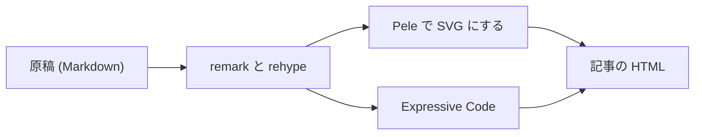

このシリーズは、このサイトの記事で出会う要素を、実物を見せながら説明する。
この記事では、どの記事にも出てくる、本文、表、コードブロック、図を取り上げる。
各節の終わりに、記事を書く人向けの置き方を短く添える。

## 本文

本文は、段落、箇条書き、引用で組む。
段落は、1 文を 1 行に書く。
和文の間の改行は、ページには出ない。
約物で終わらない行の、和文と
English の間の改行は、空白として残る。

- 箇条書きの 1 つ目
- 箇条書きの 2 つ目
  - 入れ子の項目

1. 番号付きの 1 つ目
2. 番号付きの 2 つ目

> 引用の段落である。

文中の `inline code` は、等幅の字で出る。
記事の中のリンクは、シリーズに入れない記事の例として [シリーズに入れない記事](/articles/standalone-article) へ張る。
外部のリンクは [Pele](https://pele.run/) のように置く。

## 表

表は、本文の幅に収まるときは、そのまま出る。

| 項目 | 値                 |
| ---- | ------------------ |
| 形式 | `page`             |
| 図   | ビルドのときに SVG |

列が多く、本文の幅に収まらない表は、枠の中で横に送る。
あふれているときだけ、枠の右端が薄くなる。

| 列 1           | 列 2           | 列 3           | 列 4           | 列 5           | 列 6           |
| -------------- | -------------- | -------------- | -------------- | -------------- | -------------- |
| 横に送る表の値 | 横に送る表の値 | 横に送る表の値 | 横に送る表の値 | 横に送る表の値 | 横に送る表の値 |

## コードブロック

コードブロックは、言語ごとに色が付く。
ファイル名を持つコードブロックは、上に名前の帯が付く。

```ts title="article-pages.ts"
export function articleHref(id: string): string {
  // シリーズの記事は id の先頭がディレクトリ名になる
  return `/articles/${id}`;
}
```

端末のコマンドも、同じ形で出る。

```sh
pnpm --filter @fukuemon/web build
```

ファイル名のないコードブロックは、帯を持たない。

```ts
export function untitledArticleHref(id: string, base: string): string {
  return base + id;
}
```

横に長い行は、折り返さず、コードブロックの中で横に送る。

```sh title="long-line.sh"
pnpm --filter @fukuemon/web exec astro build --site https://fukuemon.dev --outDir ./dist-check --root ./apps/web --verbose --devOutput
```

どのコードブロックにも、コピーのボタンが出る。
押すと、コードがクリップボードに入り、吹き出しが出る。

### 見出しの直後のコードブロック

見出しの直後にコードブロックが続くときも、同じ形で出る。

```ts
export function headingFollowedHref(id: string, base: string): string {
  return base + id;
}
```

## 図

図は、ページを開いたときに、すでに SVG として組まれている。
読む人のブラウザが、図のために別のライブラリを読み込むことはない。
次の図は、原稿が記事のページになるまでを示す。



## 書く人向けの置き方

- 段落は、1 文を 1 行に書く。
- コードは、言語の名前を付けたコードフェンスで書く。ファイル名を出すときは、フェンスに `title="<ファイルの名前>"` を書く。
- 図は、`mermaid` のコードフェンスで書き、色を指定しない。暗い地でも読めるようにするためである。
