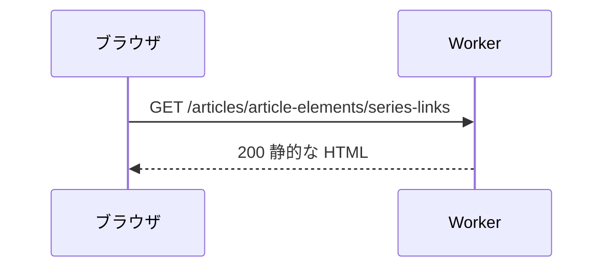

この記事は、シリーズ「このサイトの記事で使われる構成要素」の 2 本目である。
ページの下を見ると、シリーズの名前、シリーズの中の位置、前の記事と次の記事へのリンクが出ている。

## シリーズの記事で出るもの

- シリーズの名前: 何のシリーズかを示す。
- シリーズの中の位置: 「全体の何本目か」を示す。
- 前の記事と次の記事へのリンク: シリーズの先頭の記事には前が、最後の記事には次が出ない。

下書きや終了した記事は数えないので、読める記事だけで位置と前後が決まる。

## シリーズのページ

シリーズのページは、シリーズの名前、説明、記事の一覧を出す。
記事は、書いた順や公開の日付の順ではなく、シリーズの中の読む順で並ぶ。
読む順の決め方は、次の記事で説明する。

## ページが組まれるまで

ブラウザが記事を開くとき、Worker は、ビルドのときに書き出した静的な HTML を返す。
シリーズの位置と前後のリンクも、ビルドのときに HTML に入っている。

## 書く人向けの置き方

- シリーズに入れる記事は、`articles/<series>/` に置き、frontmatter に `order` を書く。
- 新しいシリーズを作るときだけ、`articles/<series>/index.md` に `title` と `description` を書く。
