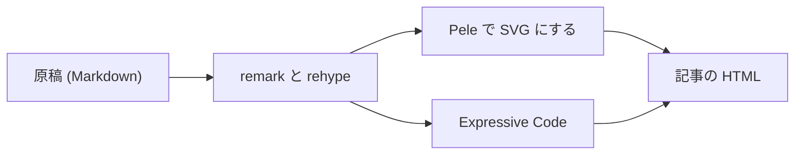

この記事は、記事のページの描画を確認するための検証用の原稿である。
本番の切り替えの前に消す。

## 本文

段落は、1 文を 1 行に書く。
和文の間の改行は、ビルドのときに消える。
約物で終わらない行の、和文と
English の間の改行は、空白として残る。

- 箇条書きの 1 つ目
- 箇条書きの 2 つ目
  - 入れ子の項目

1. 番号付きの 1 つ目
2. 番号付きの 2 つ目

> 引用の段落である。

文中の `inline code` と、[シリーズに入れない記事へのリンク](/articles/page-check-standalone) を置く。
外部のリンクは [Pele](https://pele.run/) のように置く。

| 項目 | 値                 |
| ---- | ------------------ |
| 形式 | `page`             |
| 図   | ビルドのときに SVG |

列の多い表は、本文の幅に収まらないときに横に送る。

| 列 1           | 列 2           | 列 3           | 列 4           | 列 5           | 列 6           |
| -------------- | -------------- | -------------- | -------------- | -------------- | -------------- |
| 横に送る表の値 | 横に送る表の値 | 横に送る表の値 | 横に送る表の値 | 横に送る表の値 | 横に送る表の値 |

## コードブロック

```ts title="article-pages.ts"
export function articleHref(id: string): string {
  // シリーズの記事は id の先頭がディレクトリ名になる
  return `/articles/${id}`;
}
```

```sh
pnpm --filter @fukuemon/web build
```

横に長い行は、コードブロックの中で横に送る。

```sh title="long-line.sh"
pnpm --filter @fukuemon/web exec astro build --site https://fukuemon.dev --outDir ./dist-check --root ./apps/web --verbose --devOutput
```

## 図

次の図は、原稿が記事のページになるまでを示す。


