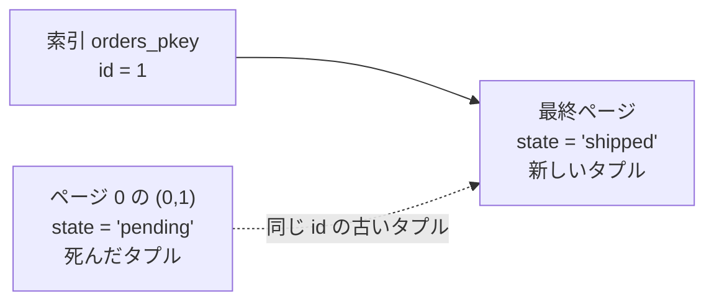
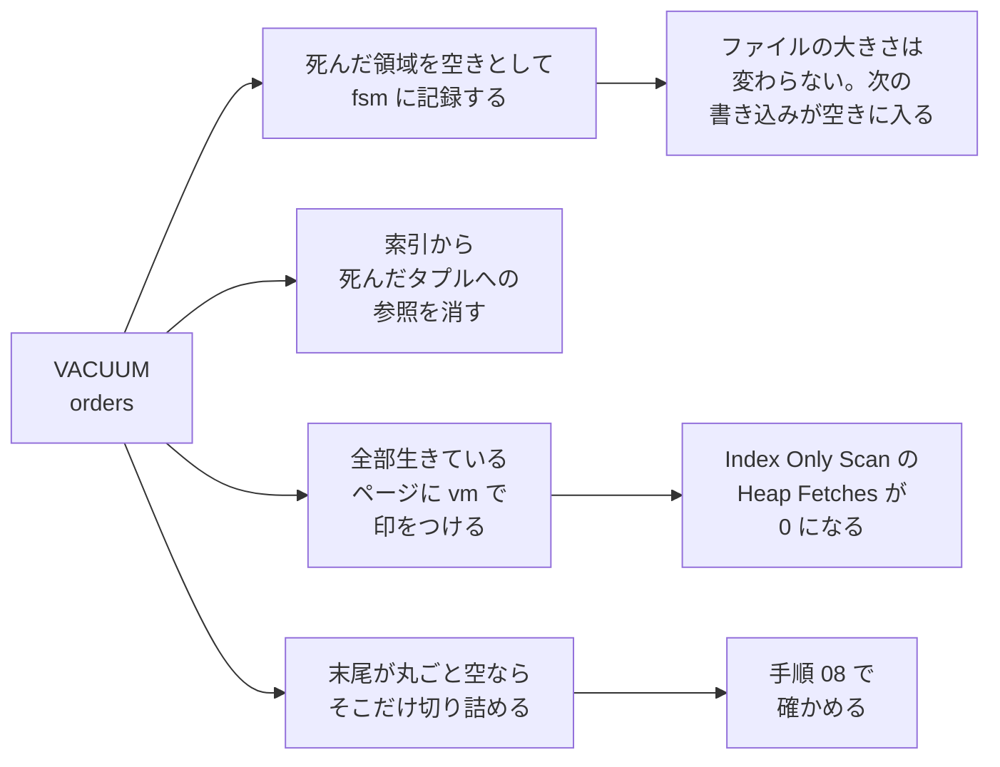

ブラウザの中で動く Postgres を使います。`pg_relation_size` は実際のファイルの大きさを返し、SQL は書き換えて再実行できます。

すべての手順で同じインスタンスを使います。

使うのは `orders` テーブル 1 つです。

| 列      | 型          | 中身                           |
| ------- | ----------- | ------------------------------ |
| `id`    | `bigserial` | 主キー                         |
| `state` | `text`      | `paid` と `pending` が半分ずつ |
| `note`  | `text`      | 120 バイトの詰め物             |

全 20,000 行、`analyze` 済みです。`note` は、1 行を大きくしてページ数を増やすために入れています。行が小さいと表より索引のほうが大きくなり、追いかけたいヒープの増減が読めません。

**`VACUUM` は 1 つのフェンスに 1 文だけ書きます。** 複数の文は暗黙のトランザクションに包まれ、トランザクションの中では `VACUUM` を実行できないためです。`ANALYZE` や `SET` にこの制限はありません。

## いまの大きさを 3 つの数で測る

Duration: 04:00

Postgres は表を 8 kB のページの列として持ちます。
行はページの中に詰められ、ページが埋まると新しいページが末尾に足されます。

表の大きさは、このページの枚数で決まります。
索引は別のファイルなので、別に数えます。

```sql run
select current_setting('block_size') as block_size,
       pg_size_pretty(pg_relation_size('orders')) as heap,
       pg_relation_size('orders') / 8192 as heap_pages,
       pg_size_pretty(pg_indexes_size('orders')) as index,
       count(*) as live_rows,
       round(count(*)::numeric / (pg_relation_size('orders') / 8192), 1) as rows_per_page
from orders;
```

`heap_pages` と `rows_per_page` を覚えておいてください。以降の手順では、この 2 つと比べます。

1 つのテーブルは、複数のファイルでできています。
行が入る `main` のほかに、空き容量を記録する `fsm` と、掃除済みのページに印をつける `vm` があります。これらをフォークと呼びます。

```sql run
select pg_relation_size('orders', 'main') / 8192 as main_pages,
       pg_relation_size('orders', 'fsm') as fsm_bytes,
       pg_relation_size('orders', 'vm')  as vm_bytes;
```

`vm_bytes` が 0 です。可視性マップはまだありません。作るのは `VACUUM` です。手順 06 でここへ戻ります。

`'main'` を `'fsm'` や `'vm'` に入れ替えて、どのフォークが何バイトあるか確かめてください。

## UPDATE は行を書き換えない

Duration: 05:00

Postgres の `UPDATE` は、その行があった場所を上書きしません。
更新後の行を新しいタプルとして別の場所に書き、古いタプルに「ここで無効になった」という印をつけるだけです。追記型更新と呼びます。

行がどのページの何番目にあるかは、`ctid` という隠し列で読めます。`(ページ番号, ページ内の位置)` の形です。

まず更新前の位置を控えます。

```sql run
select ctid, id, state from orders where id = 1;
```

ページ 0 の 1 番目で、表の先頭です。この行を 1 つ更新します。

```sql run
update orders set state = 'shipped' where id = 1 and state <> 'shipped';

select ctid, id, state, pg_relation_size('orders') / 8192 as heap_pages
from orders where id = 1;
```

行の位置が、先頭のページから最終ページへ移りました。
1 行を書き換えたつもりでも、実際には最終ページに 1 行書き足しています。
ページ 0 の元の位置には、どのトランザクションからも見えない古いタプルが残っています。

`heap_pages` は変わりません。最終ページに空きがあったので、新しいページは要りませんでした。



`and state <> 'shipped'` は、何度押しても同じ状態になるようにするためのものです。
外して 2 回押すと、押すたびに `ctid` が動きます。確かめたら戻してください。

## 1 行も増えないのにファイルが 1.5 倍になる

Duration: 05:00

削除は一度もしません。`pending` の 1 万行を `paid` に変えるだけです。
行数は前後で 20,000 のまま変わりません。

それでもファイルは大きくなります。手順 02 で見たことが 1 万回起きるためです。

```sql run
update orders set state = 'paid' where state = 'pending';

select pg_stat_force_next_flush();

select pg_size_pretty(pg_relation_size('orders')) as heap,
       pg_relation_size('orders') / 8192 as heap_pages,
       pg_size_pretty(pg_indexes_size('orders')) as index,
       count(*) as live_rows
from orders;
```

`live_rows` は 20,000 のままで、ヒープは 1.5 倍近くになりました。

索引はさらに大きく増え、ほぼ倍になっています。
新しいタプルには、新しい索引エントリが要るためです。実務で索引のほうが先に大きくなるのは、このためです。

途中の `pg_stat_force_next_flush()` は、この更新の統計をすぐ書き出させるためのものです。次の手順で読みます。

**`where state = 'pending'` を `'paid'` に変えないでください。** 押すたびにファイルが大きくなり続けます。

## 死んだタプルを数える

Duration: 06:00

増えたページの中身を、統計に出ている死んだタプルの数、生きている行の位置、読み取りの動きの 3 つから調べます。

死んだタプルは、まだファイルの中にあるのに、どのトランザクションからも見えなくなったタプルです。

```sql run
select n_live_tup, n_dead_tup,
       round(100.0 * n_dead_tup / (n_live_tup + n_dead_tup), 1) as dead_pct
from pg_stat_user_tables where relname = 'orders';
```

死んだタプルが、表の 3 分の 1 を占めています。
9,999 と 10,000 のどちらになるかは実行のたびに変わります。読み取りのついでに 1 つ掃除されることがあるためです。

この数はフェンスをまたいでしか読めません。統計はいったん溜まり、書き出されるまで 0 のままです。手順 03 のフェンスに `pg_stat_force_next_flush()` を置いたのはこのためです。

次に、生きている行の位置を見ます。

```sql run
select case when (ctid::text::point)[0]::int < 417 then '0-416 : 最初からあったページ'
            else '417-   : 更新で足されたページ' end as region,
       count(*) as live_rows
from orders group by 1 order by 1;
```

`ctid` は専用の型なので、`::text::point` と二段でキャストしてから `[0]` でページ番号を取り出します。

最初からあったページでは、半分が生きた行で、残り半分が死んだタプルです。


最後に、索引を使った読み取りが、死んだタプルのためにヒープを読みに行く様子を見ます。

```sql run
set enable_seqscan = off;

explain (analyze, buffers)
select count(*) from orders where id between 1 and 20000;

reset enable_seqscan;
```

名前は `Index Only Scan` ですが、`Heap Fetches` が行数を超えています。
`Heap Fetches` は、索引だけでは「その行が今も生きているか」を判定できず、ヒープを読みに行った回数です。死んだタプルを指す索引エントリの分も、ヒープを読んでいます。

`Buffers` は、表の全ページ数より 1 桁以上多くなります。同じページを何十回も読み直しています。

もう一度押すと、`Heap Fetches` が減ります。読み取りがページを掃除していくためです。値そのものより、桁を見てください。

`417` を `310` や `500` に変えて、境目をずらしたときの内訳を見てください。

## VACUUM を走らせる

Duration: 04:00

`VACUUM` は死んだタプルを回収します。
回収は、ファイルを縮めることではなく、そのページの中で「ここは空きだ」と記録し直すことです。
何が起きて何が起きないかを、数字で確かめます。

```sql run
vacuum orders;
```

このフェンスは列を返さないので、画面には行数だけが出ます。大きさは次のフェンスで測ります。

```sql run
select pg_size_pretty(pg_relation_size('orders')) as heap,
       pg_relation_size('orders') / 8192 as heap_pages,
       pg_size_pretty(pg_indexes_size('orders')) as index,
       count(*) as live_rows
from orders;
```

手順 03 の出力から、1 バイトも変わっていません。

```sql run
select n_live_tup, n_dead_tup, vacuum_count
from pg_stat_user_tables where relname = 'orders';
```

死んだタプルは 0 になりましたが、ファイルの大きさは変わりません。空いた領域は、ファイルの中に残っています。

`vacuum orders;` の後ろに `select 1;` を足して実行してください。
1 つのフェンスに 2 つの文を書いたときのエラーを、ここで一度見ておいてください。

## VACUUM が置いていったもの

Duration: 05:00

`VACUUM` は領域を回収するほかに、「このページは全部生きている」という印を可視性マップに書き、索引から死んだタプルへの参照を消します。

手順 01 で 0 だったフォークを見直します。

```sql run
select pg_relation_size('orders', 'main') / 8192 as main_pages,
       pg_relation_size('orders', 'fsm') as fsm_bytes,
       pg_relation_size('orders', 'vm')  as vm_bytes;
```

`vm_bytes` が 0 から 8192 になりました。可視性マップがここで作られました。

同じ問い合わせを、今度は `set` なしで実行します。

```sql run
explain (analyze, buffers)
select count(*) from orders where id between 1 and 20000;
```

`set enable_seqscan = off;` を書いていないのに、`Index Only Scan` が選ばれています。
手順 04 で `set enable_seqscan = off;` を書いたのは、`VACUUM` の前はこの問い合わせに Seq Scan が選ばれるためです。可視性マップができたことで、索引だけで読む走査のコストが下がりました。

`Heap Fetches` は 0 で、ヒープを 1 ページも読んでいません。
`Buffers` も、手順 04 より 2 桁少なくなります。

`VACUUM` は、領域を回収するだけでなく、読み取りも速くします。
「ディスクが余っているから `VACUUM` は要らない」と判断すると、この読み取りの差を失います。



## 空きが再利用されるのを確かめる

Duration: 04:00

`VACUUM` が作った空き領域は、次の書き込みが使います。どこに空き領域があるかは、`fsm` フォークが記録しています。

もう 1 万行を更新します。手順 03 とほぼ同じ量です。
手順 03 では、200 ページ以上増えました。

```sql run
update orders set state = 'closed' where state = 'paid' and id <= 10000;

select pg_size_pretty(pg_relation_size('orders')) as heap,
       pg_relation_size('orders') / 8192 as heap_pages,
       count(*) filter (where state = 'closed') as closed_rows,
       count(*) as live_rows
from orders;
```

1 万行を更新しても、ページは 1 枚も増えていません。
`VACUUM` が記録した空き領域に、新しいタプルが入りました。

肥大化は、ファイルが大きくなったまま戻らないことではなく、空き領域が作られる速さより、使われる速さが上回り続ける状態です。

`id <= 10000` を `id <= 20000` に変えて押してください。空き領域が足りなくなり、ページが増えます。確かめたら手順 05 の `vacuum orders;` を押して戻してください。

## 縮む DELETE と縮まない DELETE

Duration: 06:00

手順 05 では、`VACUUM` がファイルを縮めないことを見ました。
ただし、末尾のページが丸ごと空になっていれば、`VACUUM` はそこを切り詰めます。
切り詰められないのは、空きがファイルの途中に散らばっているときです。

同じ 2 万行の表を 2 つ作り、同じ 1 万行を、片方は後ろ半分から、片方は 1 行おきに消して比べます。

```sql run
drop table if exists tail_demo;
drop table if exists gap_demo;

create table tail_demo (id bigint primary key, note text not null);
create table gap_demo  (id bigint primary key, note text not null);

insert into tail_demo select g, repeat('x', 120) from generate_series(1, 20000) g;
insert into gap_demo  select g, repeat('x', 120) from generate_series(1, 20000) g;

delete from tail_demo where id > 10000;
delete from gap_demo  where id % 2 = 1;

select pg_relation_size('tail_demo') / 8192 as tail_pages,
       pg_relation_size('gap_demo')  / 8192 as gap_pages,
       (select count(*) from tail_demo) as tail_rows,
       (select count(*) from gap_demo)  as gap_rows;
```

ここまでは同じです。行数もページ数も揃っています。
違うのは、死んだタプルがどこにあるかだけです。

```sql run
vacuum tail_demo;
```

```sql run
vacuum gap_demo;
```

```sql run
select pg_relation_size('tail_demo') / 8192 as tail_pages,
       pg_relation_size('gap_demo')  / 8192 as gap_pages;
```

後ろからまとめて消したほうは、ページ数が半分になりました。
1 行おきに消したほうは、1 ページも減っていません。

`VACUUM` がファイルを切り詰められるのは、**末尾から連続して空になっている部分だけ**です。
途中に 1 行でも生きた行があれば、そこから先は動かせません。行の物理的な位置は `ctid` として索引に記録されているので、勝手に前へ詰められないためです。


「`VACUUM` は OS に領域を返さない」という言い方は、正確には「返せるのは末尾だけ」です。
古いパーティションを丸ごと削除する運用が役に立つのは、このためです。

`delete from gap_demo where id % 2 = 1;` に `and id < 19000` を足して、末尾 1,000 行だけを残してみてください。切り詰めがどこで止まるかが分かります。

## VACUUM FULL で本当に縮める

Duration: 04:00

ファイルを縮めるには、`VACUUM FULL` を使います。
`VACUUM FULL` は、同じファイルを掃除するのではなく、生きている行だけを新しいファイルへ書き直します。

そのぶん、表全体を排他ロックし、書き直す間は元のファイルと新しいファイルの 2 つぶんの容量が要ります。
稼働中のデータベースで気軽に実行するものではありません。

```sql run
vacuum full orders;
```

```sql run
select pg_size_pretty(pg_relation_size('orders')) as heap,
       pg_relation_size('orders') / 8192 as heap_pages,
       pg_size_pretty(pg_indexes_size('orders')) as index,
       count(*) as live_rows
from orders;
```

ヒープが縮み、索引も元の大きさへ戻りました。
索引が縮んだのは、ここが初めてです。`VACUUM FULL` は索引も作り直すためです。

ページ数は、手順 01 より少なくなっています。
最初のテーブルは `INSERT` の途中でページに端数の空きを残していました。`VACUUM FULL` はそれも詰め直します。

手順 06 の `EXPLAIN` へ戻って押してください。`Heap Fetches` がどうなるか予想してから確かめると、`VACUUM FULL` が可視性マップに何をしたかが分かります。

## 肥大化を起こさない更新にする

Duration: 06:00

ここまでは、起きた肥大化を掃除する方法でした。ここからは、肥大化を起こさない方法を 1 つ試します。

新しいタプルが同じページに収まり、かつ索引の付いた列を変えていないとき、Postgres は索引を変えずに、ページの中でタプルをつなぎます。これを HOT 更新と呼びます。

`fillfactor` は、ページをどこまで埋めるかの設定です。
下げると最初から大きくなる代わりに、更新のための余白が各ページに残ります。

```sql run
drop table if exists ff100;
drop table if exists ff70;

create table ff100 (id bigint primary key, state text not null, note text not null);
create table ff70  (id bigint primary key, state text not null, note text not null)
  with (fillfactor = 70);

insert into ff100 select g, 'v0', repeat('x', 120) from generate_series(1, 20000) g;
insert into ff70  select g, 'v0', repeat('x', 120) from generate_series(1, 20000) g;

select pg_relation_size('ff100') / 8192 as ff100_pages,
       pg_relation_size('ff70')  / 8192 as ff70_pages;
```

`fillfactor = 70` の `ff70` は、最初から 4 割ほど大きくなります。

ここから、全体の 10% にあたる 2,000 行を 2 回更新します。

```sql run
update ff100 set state = 'v1' where id % 10 = 0 and state = 'v0';
update ff70  set state = 'v1' where id % 10 = 0 and state = 'v0';

select pg_relation_size('ff100') / 8192 as ff100_pages,
       pg_relation_size('ff70')  / 8192 as ff70_pages;
```

```sql run
update ff100 set state = 'v2' where id % 10 = 0 and state = 'v1';
update ff70  set state = 'v2' where id % 10 = 0 and state = 'v1';

select pg_stat_force_next_flush();

select pg_relation_size('ff100') / 8192 as ff100_pages,
       pg_relation_size('ff70')  / 8192 as ff70_pages;
```

`fillfactor` を指定していない `ff100` は、更新のたびにページが増えています。`ff70` は 1 枚も増えていません。

```sql run
select relname, n_tup_upd, n_tup_hot_upd
from pg_stat_user_tables where relname in ('ff100', 'ff70') order by relname;
```

`n_tup_hot_upd` を見てください。
同じ回数の更新が、片方では全部ページの中で済み、片方ではほぼ全部が新しいページを使いました。

`n_tup_hot_upd / n_tup_upd` は、更新の多い表を調べるときに最初に見る比です。

ただし、`fillfactor` を下げれば必ず防げるわけではありません。
**全行を一度に更新すると、`fillfactor = 70` でもファイルは大きくなります。** 1 ページの余白は十数行ぶんしかないので、全部を同時に更新すれば余白に収まりません。`fillfactor` が役に立つのは、一部の行が繰り返し更新される場合です。

`id % 10 = 0` を `id % 2 = 0` に変えて、`ff70` も大きくなり始める点を探してください。

## まとめ

Duration: 03:00

肥大化を起こすのは、削除ではなく更新です。
掃除の方法は 3 つあり、それぞれコストが違います。

| 見る場所                                        | 考えられる原因                       | 対処                                         |
| ----------------------------------------------- | ------------------------------------ | -------------------------------------------- |
| `n_dead_tup` の割合                             | 掃除が追いついていない               | `VACUUM`。追いつかないなら autovacuum を調整 |
| `n_tup_hot_upd / n_tup_upd` が低い              | 更新のたびに新しいページを使っている | `fillfactor` を下げる。索引を見直す          |
| `Index Only Scan` の `Heap Fetches` が 0 でない | 可視性マップの印が消えている         | `VACUUM`                                     |
| 行が減ったのにファイルが縮まない                | 空きがファイルの途中に散っている     | `VACUUM FULL` (排他ロックと 2 倍の容量)      |
| 古いデータをまとめて消す運用                    | ファイルの途中に空き領域を作っている | 末尾から消す。パーティションごと削除する     |

この演習環境では再現できないことが 1 つあります。
**開いたままのトランザクションは、`VACUUM` の回収を止めます。** そのトランザクションがまだそのタプルを見ているかもしれないので、消せないためです。

実務で「`VACUUM` を実行しているのに `n_dead_tup` が減らない」ときは、まず `pg_stat_activity` で長く開いたままのトランザクションを探してください。
この演習環境は接続が 1 本しかないため、その状態を作れません。
