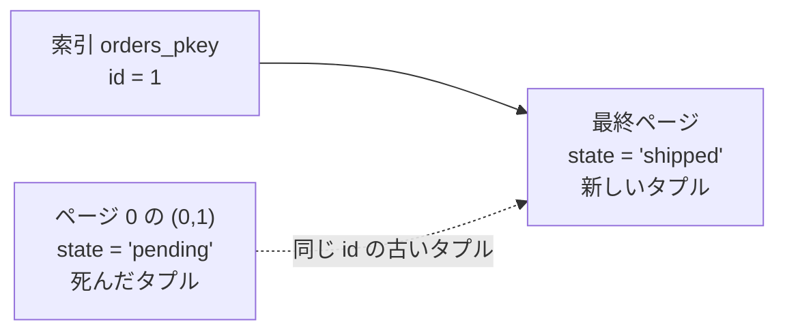
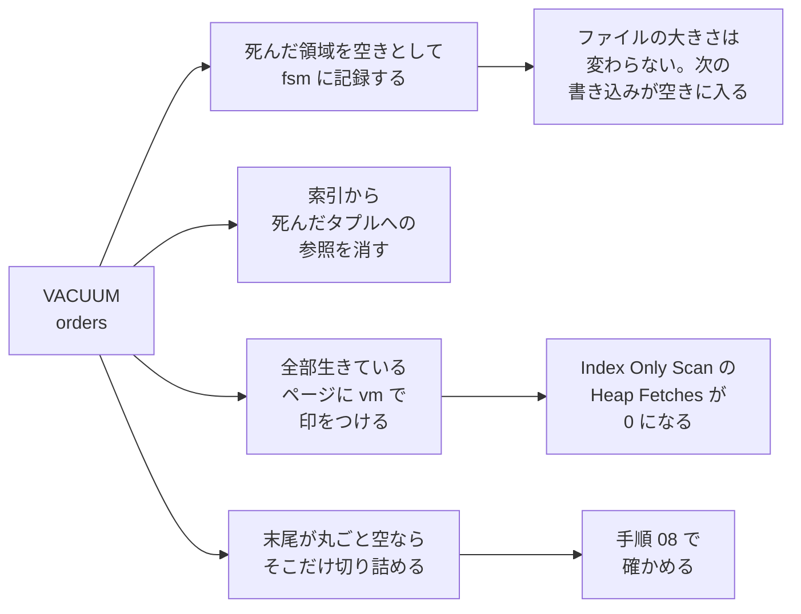

ブラウザの中で動く Postgres を使う。
`pg_relation_size` は、テーブルのファイルの実際のバイト数を返す。
SQL は書き換えて再実行できる。

すべての手順で同じインスタンスを使う。
ある手順で更新した行や作ったテーブルは、後の手順にも残る。

使うのは `orders` テーブル 1 つである。

| 列      | 型          | 中身                           |
| ------- | ----------- | ------------------------------ |
| `id`    | `bigserial` | 主キー                         |
| `state` | `text`      | `paid` と `pending` が半分ずつ |
| `note`  | `text`      | 120 バイトの詰め物             |

全 20,000 行で、`analyze` 済みである。
`note` は、1 行のバイト数を増やし、ヒープのページ数を増やすために入れている。
行が小さいとヒープより索引のほうが大きくなり、手順で追うヒープのページ数の増減が、索引の増減に比べて小さくなる。

**`VACUUM` は 1 つのフェンスに 1 文だけ書く。**
1 つのフェンスに書いた複数の文は暗黙のトランザクションに包まれ、`VACUUM` はトランザクションの中では実行できないためである。
`ANALYZE` や `SET` にこの制限はない。

## いまの大きさを 3 つの数で測る

Duration: 04:00

Postgres は、表を 8 kB のページを並べたファイルとして持つ。
行はページの中に詰められ、ページが埋まると新しいページがファイルの末尾に足される。

表のファイルのバイト数は、ページの枚数 × 8 kB である。
索引は表とは別のファイルなので、別に数える。

```sql run
select current_setting('block_size') as block_size,
       pg_size_pretty(pg_relation_size('orders')) as heap,
       pg_relation_size('orders') / 8192 as heap_pages,
       pg_size_pretty(pg_indexes_size('orders')) as index,
       count(*) as live_rows,
       round(count(*)::numeric / (pg_relation_size('orders') / 8192), 1) as rows_per_page
from orders;
```

`heap_pages` と `rows_per_page` の値を控えておく。
以降の手順では、この 2 つの値と比べる。

1 つのテーブルは、複数のファイルでできている。
行が入る `main` のほかに、ページごとの空き容量を記録する `fsm` と、すべてのタプルがどのトランザクションからも見えるページに印をつける `vm` がある。
`main`、`fsm`、`vm` のそれぞれのファイルをフォークと呼ぶ。

```sql run
select pg_relation_size('orders', 'main') / 8192 as main_pages,
       pg_relation_size('orders', 'fsm') as fsm_bytes,
       pg_relation_size('orders', 'vm')  as vm_bytes;
```

`vm_bytes` が 0 である。
可視性マップのファイルはまだ無い。
可視性マップを作るのは `VACUUM` である。
手順 06 で、このフェンスをもう一度実行する。

`'main'` を `'fsm'` や `'vm'` に入れ替えて実行し、各フォークのバイト数を確かめる。

## UPDATE は行を書き換えない

Duration: 05:00

Postgres の `UPDATE` は、その行があった場所を上書きしない。
更新後の行を新しいタプルとして別の場所に書き、古いタプルには、そのタプルを無効にしたトランザクションの ID を書くだけである。
この更新の方式を追記型更新と呼ぶ。

行がどのページの何番目にあるかは、`ctid` というシステム列で読める。
`ctid` の値は `(ページ番号, ページ内の位置)` の形である。

まず、更新前の `ctid` を控える。

```sql run
select ctid, id, state from orders where id = 1;
```

`ctid` は `(0,1)` で、ページ 0 の 1 番目、つまり表の先頭である。
この行を 1 行だけ更新する。

```sql run
update orders set state = 'shipped' where id = 1 and state <> 'shipped';

select ctid, id, state, pg_relation_size('orders') / 8192 as heap_pages
from orders where id = 1;
```

`ctid` のページ番号が、0 から最終ページの番号に変わった。
`UPDATE` は 1 行を書き換えたのではなく、最終ページに 1 行を書き足している。
ページ 0 の `(0,1)` には、どのトランザクションからも見えない古いタプルが残っている。

`heap_pages` の値は変わらない。
最終ページに空きがあったので、新しいページを足さずに済んだ。



`and state <> 'shipped'` は、何度押しても同じ状態になるようにするためのものである。
`and state <> 'shipped'` を外して 2 回押すと、押すたびに `ctid` の値が変わる。
確かめたら、`and state <> 'shipped'` を元に戻す。

## 1 行も増えないのにファイルが 1.5 倍になる

Duration: 05:00

この手順では、行を一度も削除しない。
`state` が `pending` の 1 万行を `paid` に変えるだけである。
行数は、更新の前も後も 20,000 である。

それでもファイルのページ数は増える。
手順 02 で見た、最終ページへの新しいタプルの書き足しが 1 万回起きるためである。

```sql run
update orders set state = 'paid' where state = 'pending';

select pg_stat_force_next_flush();

select pg_size_pretty(pg_relation_size('orders')) as heap,
       pg_relation_size('orders') / 8192 as heap_pages,
       pg_size_pretty(pg_indexes_size('orders')) as index,
       count(*) as live_rows
from orders;
```

`live_rows` は 20,000 のままで、`heap` は手順 01 の 1.5 倍近くになった。

`index` はヒープより大きな割合で増え、手順 01 のほぼ 2 倍になっている。
新しいタプルには、それを指す新しい索引エントリが要るためである。
更新の多い表で、ヒープより先に索引のバイト数が増えるのは、このためである。

途中の `pg_stat_force_next_flush()` は、この更新の件数を統計にすぐ書き出させるためのものである。
書き出した統計は、次の手順で読む。

**`where state = 'pending'` を `'paid'` に変えない。**
`'paid'` に変えると、押すたびに `state` が `paid` の行がすべて更新され、ファイルのページ数が増え続ける。

## 死んだタプルを数える

Duration: 06:00

増えたページの中身を、統計に出ている死んだタプルの数、生きている行の `ctid`、索引を使った読み取りの `Heap Fetches` の 3 つから調べる。

死んだタプルは、まだファイルの中にあるのに、どのトランザクションからも見えなくなったタプルである。

```sql run
select n_live_tup, n_dead_tup,
       round(100.0 * n_dead_tup / (n_live_tup + n_dead_tup), 1) as dead_pct
from pg_stat_user_tables where relname = 'orders';
```

`dead_pct` は 33 前後で、死んだタプルが表のタプルの 3 分の 1 を占めている。
`n_dead_tup` が 9,999 と 10,000 のどちらになるかは、実行のたびに変わる。
`SELECT` がページを読むときに、そのページの死んだタプルを 1 つ片付けることがあるためである。

`n_dead_tup` は、更新したフェンスとは別のフェンスでしか読めない。
更新の件数はいったんセッションの中に溜まり、統計に書き出されるまで `pg_stat_user_tables` の値は 0 のままである。
手順 03 のフェンスに `pg_stat_force_next_flush()` を置いたのはこのためである。

次に、生きている行の `ctid` のページ番号を見る。

```sql run
select case when (ctid::text::point)[0]::int < 417 then '0-416 : 最初からあったページ'
            else '417-   : 更新で足されたページ' end as region,
       count(*) as live_rows
from orders group by 1 order by 1;
```

`ctid` は `tid` 型なので、`::text::point` と二段でキャストしてから `[0]` でページ番号を取り出す。

最初からあったページ 0〜416 では、タプルの半分が生きた行で、残り半分が死んだタプルである。


最後に、索引を使った読み取りが、死んだタプルを指す索引エントリのためにヒープを読む回数を見る。

```sql run
set enable_seqscan = off;

explain (analyze, buffers)
select count(*) from orders where id between 1 and 20000;

reset enable_seqscan;
```

ノードの名前は `Index Only Scan` だが、`Heap Fetches` の値が行数 20,000 を超えている。
`Heap Fetches` は、索引だけでは「その行が今も生きているか」を判定できず、ヒープを読んだ回数である。
死んだタプルを指す索引エントリの分も、ヒープを読んでいる。

`Buffers` の値は、表の全ページ数より 1 桁以上大きい。
同じページを何十回も読み直している。

もう一度押すと、`Heap Fetches` の値が減る。
1 回目の読み取りが、読んだページの死んだタプルを片付けたためである。
`Heap Fetches` の値は実行のたびに変わるので、行数 20,000 と比べた桁を見る。

`417` を `310` や `500` に変えて、ページ番号の境目をずらしたときの `live_rows` の内訳を見る。

## VACUUM を実行する

Duration: 04:00

`VACUUM` は死んだタプルを回収する。
回収は、ファイルを縮めることではなく、死んだタプルがあった領域を、そのページの空き領域として記録し直すことである。
`VACUUM` で変わる値と変わらない値を、`heap_pages` と `n_dead_tup` で確かめる。

```sql run
vacuum orders;
```

`vacuum orders;` は列を返さないので、画面には行数だけが出る。
ファイルのバイト数は次のフェンスで測る。

```sql run
select pg_size_pretty(pg_relation_size('orders')) as heap,
       pg_relation_size('orders') / 8192 as heap_pages,
       pg_size_pretty(pg_indexes_size('orders')) as index,
       count(*) as live_rows
from orders;
```

`heap` も `heap_pages` も `index` も、手順 03 の出力から 1 バイトも変わっていない。

```sql run
select n_live_tup, n_dead_tup, vacuum_count
from pg_stat_user_tables where relname = 'orders';
```

`n_dead_tup` は 0 になったが、ファイルのバイト数は変わらない。
死んだタプルがあった領域は、空き領域としてファイルの中に残っている。

`vacuum orders;` の後ろに `select 1;` を足して実行する。
1 つのフェンスに 2 つの文を書いたときに出るエラーを、ここで一度確かめる。

## VACUUM が置いていったもの

Duration: 05:00

`VACUUM` は領域を回収するほかに、「このページのタプルは全部生きている」という印を可視性マップに書き、索引から死んだタプルへの参照を消す。

手順 01 で `vm_bytes` が 0 だったフォークのバイト数を測り直す。

```sql run
select pg_relation_size('orders', 'main') / 8192 as main_pages,
       pg_relation_size('orders', 'fsm') as fsm_bytes,
       pg_relation_size('orders', 'vm')  as vm_bytes;
```

`vm_bytes` が 0 から 8192 になった。
可視性マップのファイルが、手順 05 の `VACUUM` で作られた。

手順 04 と同じ問い合わせを、今度は `set enable_seqscan = off;` なしで実行する。

```sql run
explain (analyze, buffers)
select count(*) from orders where id between 1 and 20000;
```

`set enable_seqscan = off;` を書いていないのに、`Index Only Scan` が選ばれている。
手順 04 で `set enable_seqscan = off;` を書いたのは、`VACUUM` の前はこの問い合わせに Seq Scan が選ばれるためである。
可視性マップができたので、プランナが見積もる `Index Only Scan` のコストが下がった。

`Heap Fetches` は 0 で、ヒープを 1 ページも読んでいない。
`Buffers` の値も、手順 04 より 2 桁小さい。

`VACUUM` は、領域を回収するだけでなく、`Index Only Scan` が読むページ数も減らす。
「ディスクが余っているから `VACUUM` は要らない」と判断すると、この 2 桁の `Buffers` の差を失う。



## 空きが再利用されるのを確かめる

Duration: 04:00

`VACUUM` が作った空き領域は、次の `INSERT` や `UPDATE` が新しいタプルを書くときに使う。
どのページに何バイトの空き領域があるかは、`fsm` フォークが記録している。

もう 1 万行を更新する。
手順 03 とほぼ同じ行数である。
手順 03 では、`heap_pages` が 200 ページ以上増えた。

```sql run
update orders set state = 'closed' where state = 'paid' and id <= 10000;

select pg_size_pretty(pg_relation_size('orders')) as heap,
       pg_relation_size('orders') / 8192 as heap_pages,
       count(*) filter (where state = 'closed') as closed_rows,
       count(*) as live_rows
from orders;
```

1 万行を更新しても、`heap_pages` は 1 ページも増えていない。
`VACUUM` が記録した空き領域に、新しいタプルが入った。

肥大化は、ファイルのバイト数が増えたまま戻らないことではない。
更新が新しいタプルに使う領域が、`VACUUM` が回収する領域を上回り続け、ページ数が増え続ける状態である。

`id <= 10000` を `id <= 20000` に変えて押す。
更新する行数が空き領域に入る行数を超え、`heap_pages` が増える。
確かめたら、手順 05 の `vacuum orders;` を押して、死んだタプルを回収する。

## 縮む DELETE と縮まない DELETE

Duration: 06:00

手順 05 では、`VACUUM` がファイルのバイト数を減らさないことを見た。
ただし、ファイルの末尾のページが丸ごと空になっていれば、`VACUUM` はその空のページを切り詰める。
切り詰められないのは、空き領域がファイルの途中のページに散らばっているときである。

同じ 2 万行の表を 2 つ作り、どちらからも 1 万行を消す。
`tail_demo` は後ろ半分の `id` を、`gap_demo` は奇数の `id` を消して比べる。

```sql run
drop table if exists tail_demo;
drop table if exists gap_demo;

create table tail_demo (id bigint primary key, note text not null);
create table gap_demo  (id bigint primary key, note text not null);

insert into tail_demo select g, repeat('x', 120) from generate_series(1, 20000) g;
insert into gap_demo  select g, repeat('x', 120) from generate_series(1, 20000) g;

delete from tail_demo where id > 10000;
delete from gap_demo  where id % 2 = 1;

select pg_relation_size('tail_demo') / 8192 as tail_pages,
       pg_relation_size('gap_demo')  / 8192 as gap_pages,
       (select count(*) from tail_demo) as tail_rows,
       (select count(*) from gap_demo)  as gap_rows;
```

ここまでは、2 つの表で `tail_rows` と `gap_rows`、`tail_pages` と `gap_pages` がそれぞれ同じ値である。
違うのは、死んだタプルがファイルのどのページにあるかだけである。

```sql run
vacuum tail_demo;
```

```sql run
vacuum gap_demo;
```

```sql run
select pg_relation_size('tail_demo') / 8192 as tail_pages,
       pg_relation_size('gap_demo')  / 8192 as gap_pages;
```

後ろ半分を消した `tail_pages` は、半分になった。
1 行おきに消した `gap_pages` は、1 ページも減っていない。

`VACUUM` がファイルを切り詰められるのは、**末尾から連続して空になっているページだけ**である。
`VACUUM` は、生きた行が 1 行でも残っている最後のページより後ろだけを切り詰める。
行の物理的な位置は `ctid` として索引に記録されているので、`VACUUM` は生きた行をファイルの前のページへ移さない。


「`VACUUM` は OS に領域を返さない」という言い方は、正確には「`VACUUM` が OS に返せるのは、ファイルの末尾の空のページだけ」である。
古いデータをパーティションごと削除すると、そのパーティションのファイルが消えるので、`VACUUM` を待たずに領域が OS に戻る。

`delete from gap_demo where id % 2 = 1;` に `and id < 19000` を足して、末尾の 1,000 行を消さずに残す。
`VACUUM` の後の `gap_pages` の値から、切り詰めが止まるページが分かる。

## VACUUM FULL で本当に縮める

Duration: 04:00

ファイルのバイト数を減らすには、`VACUUM FULL` を使う。
`VACUUM FULL` は、元のファイルの中で空き領域を記録し直すのではなく、生きている行だけを新しいファイルへ書き直す。

そのため、`VACUUM FULL` は表全体を排他ロックし、書き直す間は元のファイルと新しいファイルの 2 つ分の容量が要る。
排他ロックの間は、その表への読み取りも書き込みも待たされるので、稼働中のデータベースでは実行する時間帯を選ぶ。

```sql run
vacuum full orders;
```

```sql run
select pg_size_pretty(pg_relation_size('orders')) as heap,
       pg_relation_size('orders') / 8192 as heap_pages,
       pg_size_pretty(pg_indexes_size('orders')) as index,
       count(*) as live_rows
from orders;
```

`heap` が減り、`index` も手順 01 の値へ戻った。
`index` が減ったのは、この手順が初めてである。
`VACUUM FULL` は索引も作り直すためである。

`heap_pages` は、手順 01 の値より小さい。
最初のテーブルは、`INSERT` の途中でページに行 1 行に満たない空き領域を残していた。
`VACUUM FULL` は、その空き領域も詰め直す。

手順 06 の `EXPLAIN` のフェンスへ戻って押す。
`Heap Fetches` の値を予想してから確かめると、`VACUUM FULL` が可視性マップに何をしたかが分かる。

## 肥大化を起こさない更新にする

Duration: 06:00

ここまでは、増えたページを `VACUUM` と `VACUUM FULL` で回収する方法だった。
ここからは、更新でページが増えないようにする方法を 1 つ試す。

新しいタプルが古いタプルと同じページに収まり、かつ索引の付いた列を変えていないとき、Postgres は索引エントリを足さずに、ページの中で古いタプルから新しいタプルへつなぐ。
この更新を HOT 更新と呼ぶ。

`fillfactor` は、`INSERT` がページを何 % まで埋めるかの設定である。
下げると挿入した時点のページ数が増える代わりに、更新のための余白が各ページに残る。

```sql run
drop table if exists ff100;
drop table if exists ff70;

create table ff100 (id bigint primary key, state text not null, note text not null);
create table ff70  (id bigint primary key, state text not null, note text not null)
  with (fillfactor = 70);

insert into ff100 select g, 'v0', repeat('x', 120) from generate_series(1, 20000) g;
insert into ff70  select g, 'v0', repeat('x', 120) from generate_series(1, 20000) g;

select pg_relation_size('ff100') / 8192 as ff100_pages,
       pg_relation_size('ff70')  / 8192 as ff70_pages;
```

`fillfactor = 70` の `ff70` は、挿入した時点で `ff70_pages` が `ff100_pages` の 4 割ほど多い。

ここから、全体の 10% にあたる 2,000 行を 2 回更新する。

```sql run
update ff100 set state = 'v1' where id % 10 = 0 and state = 'v0';
update ff70  set state = 'v1' where id % 10 = 0 and state = 'v0';

select pg_relation_size('ff100') / 8192 as ff100_pages,
       pg_relation_size('ff70')  / 8192 as ff70_pages;
```

```sql run
update ff100 set state = 'v2' where id % 10 = 0 and state = 'v1';
update ff70  set state = 'v2' where id % 10 = 0 and state = 'v1';

select pg_stat_force_next_flush();

select pg_relation_size('ff100') / 8192 as ff100_pages,
       pg_relation_size('ff70')  / 8192 as ff70_pages;
```

`fillfactor` を指定していない `ff100` は、更新のたびに `ff100_pages` が増えている。
`ff70_pages` は 1 ページも増えていない。

```sql run
select relname, n_tup_upd, n_tup_hot_upd
from pg_stat_user_tables where relname in ('ff100', 'ff70') order by relname;
```

`n_tup_upd` と `n_tup_hot_upd` の値を比べる。
`n_tup_upd` は 2 つの表で同じ 4,000 である。
`ff70` では `n_tup_hot_upd` が `n_tup_upd` と同じで、全部の更新がページの中で済んだ。
`ff100` では、ほぼ全部の更新が HOT 更新にならず、新しいページを使った。

`n_tup_hot_upd / n_tup_upd` は、更新の多い表を調べるときに最初に見る比である。
1 に近いほど、更新が索引エントリを足さずに同じページの中で済んでいる。

ただし、`fillfactor` を下げても、ページ数の増加を必ず防げるわけではない。
**全行を一度に更新すると、`fillfactor = 70` でもファイルのページ数は増える。**
1 ページの余白は十数行分しかないので、ページ内の全行を同時に更新すると、新しいタプルが余白に収まらない。
`fillfactor` を下げてページ数の増加を防げるのは、一部の行が繰り返し更新される場合である。

`id % 10 = 0` を `id % 2 = 0` などに変えて、`ff70_pages` も増え始める割合を探す。

## まとめ

Duration: 03:00

肥大化を起こすのは、削除ではなく更新である。
対処は `VACUUM`、`VACUUM FULL`、`fillfactor` の 3 つで、それぞれ引き換えにするものが違う。
`VACUUM` はファイルのバイト数を減らさない。
`VACUUM FULL` は表を排他ロックし、書き直す間は 2 倍の容量を使う。
`fillfactor` を下げると、挿入した時点のページ数が増える。

| 見る場所                                        | 考えられる原因                       | 対処                                                   |
| ----------------------------------------------- | ------------------------------------ | ------------------------------------------------------ |
| `n_dead_tup` の割合                             | 回収より速く死んだタプルが増えている | `VACUUM`。足りなければ autovacuum の起動の閾値を下げる |
| `n_tup_hot_upd / n_tup_upd` が低い              | 更新のたびに新しいページを使っている | `fillfactor` を下げる。索引を見直す                    |
| `Index Only Scan` の `Heap Fetches` が 0 でない | 可視性マップの印が消えている         | `VACUUM`                                               |
| 行が減ったのにファイルが縮まない                | 空きがファイルの途中に散っている     | `VACUUM FULL` (排他ロックと 2 倍の容量)                |
| 古いデータをまとめて消す運用                    | ファイルの途中に空き領域を作っている | 末尾から消す。パーティションごと削除する               |

この演習環境では再現できないことが 1 つある。
**開いたままのトランザクションは、`VACUUM` の回収を止める。**
そのトランザクションから死んだタプルがまだ見える可能性があるので、`VACUUM` はそのタプルを消せないためである。

実務で「`VACUUM` を実行しているのに `n_dead_tup` が減らない」ときは、まず `pg_stat_activity` で `xact_start` が古いトランザクションを探す。
この演習環境は接続が 1 本しかないため、別の接続でトランザクションを開いたままにする状態を作れない。
