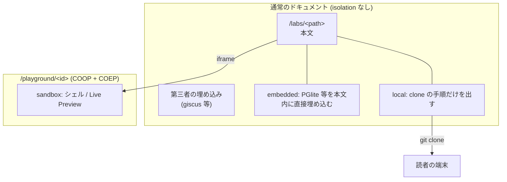

# ハンズオンと Interactive

## Overview

この機能は、ハンズオンの手順を 1 画面ずつ出し、本文の中でコードを動かし、進捗を残す。  
手を動かす場所を分け、一部の場所が求める制約がほかの場所を巻き込まないようにする。  
[PRD の Success Metrics](../../../../../PRD.md#success-metrics) のうち、ハンズオンがブラウザだけで完結することを支える。  
全体の構成は [Design Doc](../../../../../design/DesignDoc.md#components) にある。  
ADR-0006: [手を動かす場所の 4 分類](../../../../../adr/0006-interactive-content-levels.md)

## Scope

持つものは次のとおり。

- ハンズオンの形式
- 手順の導出と描画
- 手を動かす場所の 4 分類と、`interactive` の型
- cross-origin isolation の URL ごとの分離
- 進捗の保存

持たないものは次のとおり。

- claat。Codelab の形式は描画のレイヤとして自前で実装する。
  - ADR-0006: [手を動かす場所の 4 分類](../../../../../adr/0006-interactive-content-levels.md)
- 読者アカウントを前提とする進捗の管理
  - ADR-0008: [読者の identity を前提とする機能を作らない](../../../../../adr/0008-no-reader-identity.md)
- `sandbox` の実装。条件が成り立つまで作らない。

## Design

### ハンズオンの形式

種別は 1 つにする。  
読みながら手を動かす記事と、手順を踏む教材を分けない。

| 要素   | 扱い                                                                |
| ------ | ------------------------------------------------------------------- |
| 形     | 1 画面に 1 手順。全手順を 1 つの文書に入れ、CSS で 1 枚だけ出す     |
| 進捗   | 持つ。`localStorage` に手順の単位で残す                             |
| 実行   | 本文の中でコードが動く。主題が許さなければ、読者の端末で動かす      |
| layout | `LabLayout`。`SiteLayout` にサイドバーと、1 画面 1 手順の領域を足す |

分けない理由は 2 つある。  
種別を増やすと、著者は書く前に「これはどちらか」を判断させられる。  
読者から見ても違いがない。どちらも「読んで、手を動かして、進む」ページである。

記事と `related` でつなげば、読み物として書いたものから、手を動かすページへ移れる。  
種別ではなく、関係で表す。

### Codelab の形式の実体

| 要素                                   | 実装                                                               |
| -------------------------------------- | ------------------------------------------------------------------ |
| 手順の分割                             | 本文の `h2` を手順の境界とし、ビルドのときに見出しをたどって導く   |
| 手順ごとの所要時間                     | 見出しの直後の `Duration: MM:SS` の行。`remark-lab` が本文から除く |
| 手順の一覧、進捗バー、現在地のマーカー | ハンズオンの layout。手順は 1 ページに通しで並べる                 |
| 完了の状態の保存                       | `localStorage`                                                     |
| 前後の移動                             | 本文の下の前後のボタン。端では `aria-disabled`                     |
| いま DB に何が入っているか             | サイドバーの一覧。行を押すと `<dialog>` に先頭の 20 行を出す       |
| テーブルどうしの関係                   | サイドバーの「テーブル構成」。`<dialog>` に ER 図を出す            |

手順の数を frontmatter に持たない。  
本文と手順の数がずれる余地をなくすためである。  
Content Model の側の扱いは [Content Model の Design Doc](../../../../../packages/content-model/DesignDoc.md#種別ごとの拡張) にある。

手順を数える場所は 1 つにする。

- `remark-lab` が mdast の `h2` を数え、`remarkPluginFrontmatter.labSteps` で layout へ渡す。
- `rehype-lab-steps` は、同じ `h2` を 1 画面にまとめるだけで、数え直さない。
- ページの側でも本文をたどり直さない。
- 生の Markdown を正規表現で数えると、setext の見出しやフェンスの中の `##` で、AST の側とずれる。

1 つの手順を 1 画面に出す。  
左のサイドバーで切り替え、下の前後のボタンで進む。  
Google Codelabs（`claat`）と同じ形である。

手順を別の URL のページに分けない。  
全手順を 1 つの文書に入れ、CSS で 1 枚だけ出す。  
ページを移ると実行環境が落ちるので、手順ごとに DB を作り直すことになる。  
同じ文書なら PGlite のインスタンスが残り、前の手順で作ったテーブルがそのまま残る。

URL は `#step-<N>` で表す。  
`#step--1` が「はじめに」である。  
`pushState` で積むので、ブラウザの戻ると進むが手順の行き来になる。

手順の出し入れに React を使わない。  
属性の付け替えだけで足りる。  
island にすると、実行環境を持たない `local` のハンズオンにも React を配ることになる。  
`local` のページが配るのは、切り替えの 1.5 KiB（gzip、計測した値）だけである。

### 手を動かす場所の 4 分類

分ける軸は、読者がどこで実行するかである。  
frontmatter の `interactive.level` が 1 対 1 で対応する。

| `level`      | 実行するもの                            | cross-origin isolation         | 置き場                                |
| ------------ | --------------------------------------- | ------------------------------ | ------------------------------------- |
| （項目なし） | 実行しない。コードは表示だけ            | 要らない                       | 本文                                  |
| `embedded`   | 単一のランタイムを WASM で埋め込む      | 要らない                       | 本文と同じドキュメント                |
| `sandbox`    | プロジェクト一式とシェルと Live Preview | 要る                           | `/playground/<id>` の別のドキュメント |
| `local`      | ポートやプロセスを使う一式              | 要らない（こちらで実行しない） | 読者の端末                            |

上下の関係を持たせない。  
`embedded` は `sandbox` の準備の段階ではなく、それ自体で完結する。  
`local` は下位の妥協ではなく、ブラウザで再現できない主題の唯一の選択肢である。  
ポートを開く、プロセスを分ける、ホストのリソースを測るといった主題を WASM で真似ると、確かめている対象そのものが失われる。

ページに置くものは、`level` ごとに変わる。

| `level`    | 本文に出るもの     | サイドバー           | 配る JavaScript（gzip、計測した値） |
| ---------- | ------------------ | -------------------- | ----------------------------------- |
| `embedded` | 実行パネル         | 手順といまのテーブル | 61.6 KiB（React と実行環境）        |
| `sandbox`  | iframe             | 手順                 | 未実装                              |
| `local`    | clone と起動の手順 | 手順                 | 1.5 KiB（切り替えだけ）             |

`embedded` の 61.6 KiB に WASM は含まない。  
WASM は、実行のボタンを押すまで取得しない。

完了のマーカーが付くのは、実行が成功した手順と、この読み込みのあいだに通り過ぎた手順だけである。  
`localStorage` を書き換えるだけで完了を偽れないよう、現在地からは推し量らない。  
`local` のハンズオンでは実行が起きないので、印は通り過ぎた分だけになる。

### cross-origin isolation の制約

`sandbox` の候補は `SharedArrayBuffer` を求め、`COOP: same-origin` と `COEP: require-corp` が要る。  
`COEP: require-corp` の下では、CORP を返さないクロスオリジンのリソースがブロックされることを、計測して確かめた。

| リソース                        | `cross-origin-resource-policy` | COEP の下      |
| ------------------------------- | ------------------------------ | -------------- |
| `fonts.gstatic.com`             | `cross-origin`                 | 読める         |
| CORP を返さない第三者の埋め込み | なし                           | ブロックされる |

ブロックの対象は、埋め込みの `iframe`、外部の画像、埋め込みの動画、外部にホストしたスクリプトに及ぶ。

isolation は、後から取り消せない方向の制約である。  
サイト全体へ掛けると、第三者のリソースを使いたくなるたびに、そのリソースが CORP を返すかどうかで実現できるかが決まってしまう。  
条件つきで足す機能のうち、giscus が最初に当たる。

### URL ごとの分離

次の図は、isolation を掛けない通常のドキュメントと、`/playground/<id>` の分離を示す。



- `embedded` は、本文と同じドキュメントに置く。MDX の中にコンポーネントとして置ける。
- `sandbox` は、`/playground/<id>` の別のドキュメントに置き、本文からは `iframe` で埋め込む。
- `local` は実行環境を持たない。リポジトリの URL と前提の条件だけを持ち、コマンドを出す。
- isolation は、`apps/web/public/_headers` で `/playground/*` にだけ掛ける。
  - isolation を求めるランタイムが実在するまで、`/playground/*` のヘッダは書かない。PGlite は素の Worker で動き、`SharedArrayBuffer` を求めないためである。
  - 掛けるときに `/playground/*` へ書くヘッダは次のとおり。

    ```text
    /playground/*
      Cross-Origin-Opener-Policy: same-origin
      Cross-Origin-Embedder-Policy: require-corp
    ```

  - ヘッダの方針は [context/operations.md](../../../../../context/operations.md#レスポンスヘッダ) にある。

この分離で、本文の描画と、playground を持つかどうかが、独立した判断になる。  
`embedded` の埋め込みも、`sandbox` の iframe も、本文のレイアウトを変えずに実現できる。

### DB を使うハンズオンの実行環境

DB を使うハンズオンは、PGlite を既定にする。  
ランタイムの候補と、cross-origin isolation の要否は [ADR-0006](../../../../../adr/0006-interactive-content-levels.md) にある。

配信量では SQLite が勝る。  
gzip で 0.53 MiB と 5.28 MiB の差があり、Slow 4G の待ちが 29 秒から 3 秒台になる。  
それでも PGlite を採るのは、主題が Postgres のプランナの出力そのものだからである。  
SQLite の `EXPLAIN QUERY PLAN` は、cost の見積もりも `Buffers:` も `Planning Time` も返さず、想定するコンテンツの 7 手順のうち 4 手順が成り立たない。

主題が Postgres に固有でなくなったら、この判断は覆る。  
汎用の SQL の入門なら SQLite を採る。

PGlite は、Linux の VM を使わず、Postgres の単一ユーザーモードを WASM にしたものである。  
単一スレッドで単一接続なので、`SharedArrayBuffer` を使わない。  
想定するコンテンツ「RDBMS のクエリ実行を理解する」は `embedded` に収まり、ヘッダの変更も要らない。

`@sqlite.org/sqlite-wasm` の `"opfs"` VFS は `SharedArrayBuffer` と `Atomics` を求めるので、COOP と COEP が要る。  
`opfs-sahpool` とメモリの VFS は要らない。

### 実行環境の性質

- 実行環境は、実行のボタンを押すまで取得しない。ページを開いただけでは配らない。
- 押すと 4 ファイル、gzip で 5.28 MiB、brotli で 4.45 MiB を取得する（計測した値）。
- 1 ページで 1 つのインスタンスを共有する。2 回目以降の実行は 1 秒未満で返る。
- 保存先はメモリである。再読み込みすると、初期の状態に戻る。
- 初回の起動は、Fast 4G で 20〜25 秒かかる。Slow 4G では 60 秒の上限に当たって失敗しうる（計測では 73 秒）。再試行すれば、キャッシュから 10 秒台で立ち上がる。
- 結果は先頭の 200 行だけを出す。全部を描くと、ページが動かなくなる。
- 複数の文を書いたときは、列を返した最後の文の結果を表に出す。前置きの `insert` や `analyze` ではなく、確かめたい文の結果が出る。
- 実行中は「中断」を出す。Worker を終了させて止めるので、重いクエリでも画面は固まらない。
- 「初めから」を押すと、`setup` を流し直す。

### `interactive` の型

`handsOn` の拡張として持つ。  
記事が持つことはないので、`portalBase` には入れない。

```ts
const interactive = z.discriminatedUnion("level", [
  z.object({
    level: z.literal("embedded"),
    runtime: z.enum(["pglite"]),
  }),
  z.object({
    level: z.literal("local"),
    repository: z.string().url(),
    via: z.enum(["devcontainer", "docker-compose", "manual"]),
    requires: z
      .array(z.object({ name: z.string(), check: z.string().optional() }))
      .default([]),
  }),
]);
```

判別できる union にするので、`level` を足すときに既存のコンテンツへ影響が出ない。  
`level` ごとに要る項目が違うので、`repository` を持たない `embedded` に `repository` を書くと、ビルドが失敗する。

実装済みの値だけを並べる。  
`runtime` に `sqlite` を先回りして受け付けると、ビルドを通ったコンテンツが、読者が押したときに初めて失敗する。  
`sandbox` の枝も、実装するときに足す。

初期化のスクリプト（`setup`）は、`interactive` の外の `handsOn` の直下に持つ。  
`level` を変えても書き直さずに済むためである。

### local の「手元で用意する」

`local` のハンズオンでは、本文の前に「手元で用意する」の節が自動で入る。  
`requires` の各行、`git clone`、`via` に応じた起動のコマンドが、コピーのボタン付きで並ぶ。

| `via`            | 出るもの                               |
| ---------------- | -------------------------------------- |
| `devcontainer`   | `code .` と Reopen in Container の案内 |
| `docker-compose` | `docker compose up -d`                 |
| `manual`         | README を読む案内                      |

### サイドバー

サイドバーの中身と幅は [Design System の Design Doc](../../../../../packages/design-system/DesignDoc.md#ページごとの骨格) にある。

ハンズオンのサイドバーに、ほかのハンズオンへの導線は置かない。  
読者が手順を追っているあいだ、別の記事の題は判断の材料にならない。  
一覧へは、本文の上部のパンくずから戻る。

playground の「試す」は、サイドバーに置く。  
本文の側に置くと、結果の表と例が縦に並び、どちらも幅を使えない。

サイドバーの開閉の状態は `localStorage` に置く。  
この端末の都合であり、読者の identity を作らない。  
ADR-0008: [読者の identity を前提とする機能を作らない](../../../../../adr/0008-no-reader-identity.md)

「いまのテーブル」は、自分からは起動しない。  
実行パネルが 1 度でも実行された後に、そのインスタンスへ問い合わせる。  
ページを開いただけで 5 MiB を取得しないためである。

中身はサイドバーではなく `<dialog>` に出す。  
306px の列に列を並べると、日時が途中で切れ、値を読むという目的を果たせない。  
`<dialog>` は top layer に出るので、サイドバーの `overflow` に切られない。

窓は 2 種類ある。

- テーブルの窓: 列の定義と、先頭の 20 行
- テーブル構成: ER 図。テーブルの箱と外部キーの向き

開いたままの窓は、実行のたびに中身を取得し直す。  
取得し直すときは、カタログへ問い合わせ直す。  
サイドバーの一覧（state）から組むと、実行の直後に古い姿のまま描いてしまう。

### 進捗の保存

進捗は `localStorage` に限る。  
ADR-0008: [読者の identity を前提とする機能を作らない](../../../../../adr/0008-no-reader-identity.md)

```text
key:   lab:<contentId>
value: { completedSteps: number[], lastStep: number }
```

キーを `contentId` と手順の index にする。  
URL のパスはファイルの改名で変わるので、改名で進捗が消えないようにする。

`localStorage` は端末をまたげない。  
ハンズオンは 1 台で通すのが普通なので、許す。

進捗が残ることを、画面の上で明示する。  
示さないと、読者は何がどこに保存されたかを知らずに閉じることになる。

### コンポーネントの構成

次の図は、本文の Markdown が手順の画面になり、実行パネルとサイドバーが実行環境につながるまでの L3 を示す。

````mermaid
flowchart TD
    md["labs/*.md(x) (h2 = 手順)"] --> loader["Content Layer loader"]
    loader --> remark["remark-lab<br/>h2 を数え、```lang run を JSX へ"]
    remark -->|"remarkPluginFrontmatter.labSteps"| layout["LabLayout.astro"]
    remark --> rehype["rehype-lab-steps<br/>同じ h2 で section へまとめる"]
    rehype --> layout
    layout --> list["StepList.astro<br/>手順一覧 (静的)"]
    layout --> ctl["controller.ts<br/>画面の切り替え / 開閉 / 前後"]
    ctl --> ls["localStorage<br/>lab:&lt;contentId&gt;"]
    layout --> body["手順の画面 (1 枚だけ表示)"]
    body -.->|"embedded"| runner["SqlRunner.tsx"]
    pg["Playground.tsx"] --> hook
    runner --> hook["useRunner.ts<br/>実行の状態機械"]
    hook --> rt["runtime.ts<br/>Session / WORKERS / serialize"]
    rt --> w["pglite.worker.ts"]
    hook -.->|"lab:ran"| bus["bus.ts<br/>島をまたぐ通知"]
    runner -.->|"lab:progress"| ctl
    preset["Presets.tsx"] -.->|"lab:preset"| bus
    bus -.-> pg
    bus -.-> peek["DbPeek.tsx"]
    peek --> cat["catalog.ts<br/>カタログの問い合わせ"]
    cat --> rt
    peek --> er["ErDiagram.tsx"]
    body -.->|"sandbox"| frame["iframe → /playground/&lt;id&gt;"]
    layout -.->|"local"| setup["LocalSetup.astro<br/>clone / 前提条件 / 起動"]
````

React の island になるのは、実行パネル、「いまのテーブル」、「試す」だけである。  
手順の一覧、画面の切り替え、サイドバーの開閉は、`controller.ts` が属性の付け替えで行う。  
ハンズオンと playground のほかのページには載らない。

`rehype-lab-steps` を remark ではなく rehype に置く。  
remark で包むと、`.mdx` は JSX、`.md` は生の HTML と、2 通りの書き分けが要る。  
hast まで来れば拡張子の違いが消え、1 通りで済む。

#### island をまたぐ通知

実行パネルとサイドバーは別の React root なので、props でも context でもつながらない。  
両者が共通に触れられるのは `window` だけなので、`window` に CustomEvent を発火する。

| 事象           | 送り手                                                          | 受け手          | 用途                         |
| -------------- | --------------------------------------------------------------- | --------------- | ---------------------------- |
| `lab:ran`      | `useRunner`                                                     | `DbPeek`        | DB を取得し直す              |
| `lab:preset`   | `Presets`                                                       | `Playground`    | 入力欄へ SQL を入れる        |
| `lab:progress` | `progress.ts` の `saveProgress`（実行パネルと `controller.ts`） | `controller.ts` | 完了の印と進捗バーを描き直す |

React の側の購読は `bus.ts` を通す。  
`lab:progress` は、React を使わない `controller.ts` も受けるので、`progress.ts` が定義する。  
`addEventListener` をコンポーネントに置くと、事象の名前と `contentId` を確かめる処理が、使う側の数だけ重なる。

状態管理のライブラリを入れない。  
購読は `useSyncExternalStore` を経由しても本数が減らず、流しているのは値ではなく合図である。

### 実行パネルは記事にも置ける

`remark-lab` は拡張子だけを見る。  
`.mdx` で書いた記事にも、`run` を付けたフェンスを置ける。

言語の記事はこの形を採る。  
[codapi](https://codapi.org/try/postgres/) と同じ「読む、実行する、書き換える」を、記事の中で成り立たせる。

| 言語     | 実行環境                    | 状態                     |
| -------- | --------------------------- | ------------------------ |
| SQL      | PGlite                      | 済                       |
| Python   | Pyodide                     | 未。WASM で完結する      |
| TS と JS | Worker で直接               | 未。WASM も要らない      |
| Go       | TinyGo か Go の wasm target | 未。実行できるかは未確認 |

### 実行環境を足す

`embedded` に engine を足すときは、次の順に進める。

1. `runtime/pglite.worker.ts` と同じ `boot` と `exec` を持つ Worker を書き、`runtime/runtime.ts` の `WORKERS` に 1 行足す。
   - Vite は `new URL(..., import.meta.url)` を静的に解決するので、パスを変数にできない。表に literal で並べる。
2. 結果が表の形なら、ここで終わる。`interactive.runtime` に値を書けば、`SqlRunner` がそのまま動く。
3. 結果が表の形でなければ、`panel/SqlRunner.tsx` と同じ props を取るコンポーネントを書く。実行の状態機械は `useRunner` を再利用する。
4. `runners.ts` の `RUNNERS` に 1 行足す。フェンスの言語が、表を引くキーになる。

```ts
// apps/web/src/features/lab/runners.ts
export const RUNNERS: Record<string, Runner> = {
  sql: {
    name: "SqlRunner",
    path: "~/features/lab/panel/SqlRunner",
    engine: "Postgres",
    kind: "pglite",
  },
};
```

どちらの場合も、コンテンツの側の書き方は変わらない。  
著者は、frontmatter の `runtime` か、フェンスの言語を変えるだけである。

`sandbox` を足すときは、まず schema に `sandbox` の枝を戻し、`/playground/<id>` のページで iframe を出す。  
`SqlRunner` の系統は触らない。  
結果の形（端末の出力、プレビューの URL）が違うので、表を出すコンポーネントを再利用しない。

### 処理の流れ

#### 読者がハンズオンでクエリを実行する（`embedded`）

1. `/labs/rdbms-query-execution` を開く。「はじめに」の画面が出る。
2. サイドバーの手順を押すか、下の「次へ」で進む。
3. その手順の埋め込みのエディタに、SQL が用意されている。
4. 実行すると、ページの中の PGlite が、本物の Postgres として `EXPLAIN ANALYZE` を返す。
5. サイドバーの「いまのテーブル」が更新される。行を押すと、中身が `<dialog>` に出る。
6. 「テーブル構成」を押すと ER 図が出る。開いたまま実行すると、図も追従する。
7. 読者は SQL を書き換えて、もう一度実行できる。

環境構築が要らず、ヘッダの制約も受けない。  
手順を移っても同じ文書のままなので、インスタンスは落ちない。

#### 読者が手元に環境を作る（`local`）

1. `local` のハンズオンの `/labs/<path>` を開く。
2. 本文の前に「手元で用意する」が出る。前提の条件、`git clone`、起動のコマンドが、コピーのボタン付きで並ぶ。
3. 読者は、自分の端末で Dev Container を開き、本文の手順を追う。
4. サイドバーは手順の一覧だけを出す。完了の印は、この読み込みのあいだに通り過ぎた手順にだけ付く。

ページが配る JavaScript は、手順の切り替えだけである。  
React と実行環境は配らない。

#### 読者がハンズオンを中断して再開する

1. `/labs/<path>` の手順 4 まで進む。
2. 離れる。
3. 同じ端末で再訪すると、手順 4 の画面から再開できる。
4. DB は初期の状態に戻っている。保存先がメモリのためである。次の実行で、完了した手順の SQL を順に流し直してから実行する。
5. 別の端末では、最初からになる。これを許す。

流し直す SQL は、ビルドのときに HTML に書き出す。

- `remark-lab` が、手順ごとの `run` を付けたフェンスの SQL と `setup` を集め、`remarkPluginFrontmatter.labBoot` で layout へ渡す。
- `LabLayout` が、`bootSpec.ts` の `encodeBootSpec()` で JSON にし、`<script type="application/json">` として文書に 1 つだけ置く。
  - 実行パネルの props に入れると、パネルの数だけ同じ SQL が HTML に入る。
- 実行パネルは、`readBootSpec()` でその JSON を読み、`localStorage` で完了になっている手順の SQL だけを、手順の順に選ぶ。
- Worker は、`setup` を流した後に選んだ SQL を流し、流し直しに失敗した SQL の番号を返す。
  - 失敗があると、実行パネルは「初めから」で作り直せることを示す。
  - 「初めから」を押した直後の起動では、流し直さない。

## Interface

### 置くファイル

- `apps/web/src/lib/remark-lab.ts`: 手順を数え、`run` を付けたフェンスを実行パネルへ変える
- `apps/web/src/lib/rehype-lab-steps.ts`: 同じ `h2` で手順の画面にまとめる
- `apps/web/src/features/lab/runners.ts`: フェンスの言語から実行パネルを引く表
- `apps/web/src/features/lab/runtime/`: 実行環境の Worker と、実行の状態機械
- `apps/web/src/features/lab/panel/`: 実行パネルと playground
- `apps/web/src/features/lab/catalog/`: 「いまのテーブル」とテーブル構成
- `apps/web/src/features/lab/steps/`: 手順の一覧、画面の切り替え、進捗、再訪したときに流し直す SQL（`bootSpec.ts`）
- `apps/web/src/layouts/LabLayout.astro`: ハンズオンの layout。サイドバー、前後のボタン、流し直す SQL の JSON を置く
- `apps/web/src/features/lab/local/`: `local` の「手元で用意する」
- `apps/web/src/features/lab/bus.ts`: island をまたぐ通知
- `apps/web/public/_headers`: レスポンスヘッダ

ハンズオンの frontmatter のキー（`interactive.level`、`interactive.runtime`、`setup`）の条件は [context/domain/hands-on.md](../../../../../context/domain/hands-on.md) にある。  
本文の書き方は [context/conventions.md](../../../../../context/conventions.md#記事とハンズオンの本文) にある。

### チェック

テストの共通の規約は [context/testing.md](../../../../../context/testing.md) にある。

- 手順の導出（`remark-lab`）と、画面へのまとめ（`rehype-lab-steps`）にテストを置く。
  - どちらも誤っても画面は出るので、目視では見つからない。
  - `Duration:` の有無、`h2` が 0 個、フェンスの中の `##`、`.md` に `run` を書いた場合を踏む。
- 進捗（`progress.ts`）は、`localStorage` を差し替えて、読めない、書けない、JSON が崩れている、の 3 つの場合を踏む。
- `localStorage` へのアクセスは try/catch で囲む。
  - プライベートウィンドウや設定でブロックされる環境では、例外を投げる。
  - 進捗が読めなくても、ページが動き続けることを確かめる。
- `_headers` を変えるときは、`/playground/*` の外へ isolation が漏れていないことを確かめる。
  - 誤って全体へ広げると、第三者の埋め込みが一律に動かなくなる。
