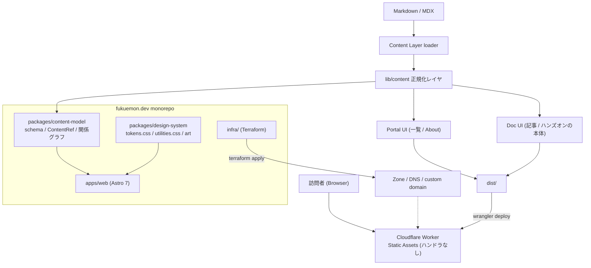
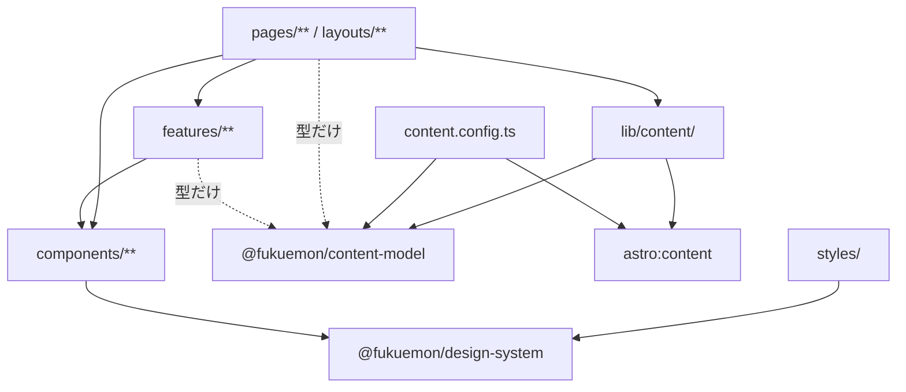

# fukuemon.dev Design Doc

## Overview

fukuemon.dev は、技術記事とハンズオンの 2 種類だけを公開する個人サイトである。  
訪問者は記事を読み、ハンズオンでコードを動かす。著者（運営者 1 名）は Markdown を書いて push する。  
誰のどの課題を解くかは [PRD](../PRD.md) にある。

実装は pnpm workspace の monorepo にし、Astro のアプリ 1 つと、Content Model と Design System の共有の package で組む。  
ADR-0003: [monorepo と Vite+ の採否](../adr/0003-monorepo-and-vite-plus.md)

記事とハンズオンの描画も、自前の Astro のページとして持つ。  
ADR-0001: [Starlight の採否](../adr/0001-starlight-as-docs-renderer.md)

配信は Cloudflare Workers Static Assets で行い、基盤のリソースを Terraform が、deploy を Wrangler が管理する。  
ADR-0005: [Workers と Terraform と Wrangler の分担](../adr/0005-workers-terraform-wrangler-boundary.md)

## Goals and Non-Goals

### Goals

- すべてをビルドのときに解決し、実行時のサーバーの処理を持たない。
- コンテンツの識別子と関係を、URL、描画のレイヤ、データソースから独立させる。
- 手を動かす場所が求める制約（cross-origin isolation）を、その場所に閉じる。
- 公開に関わる Cloudflare の設定を、コードで管理する。

### Non-Goals

- サーバー側の永続的な状態。読者の identity を前提にする機能を作らないので、求める機能がない。
- サイト全体の SPA 化。React は Astro の island として局所に使うだけにする。
- 汎用の UI コンポーネントのライブラリを自作すること。共通化は Design Tokens と版面のユーティリティまでにする。
- 設計不変量のほかに、将来のために先に作っておくもの。

## Assumptions and Constraints

### 動かせない条件

- 運営者は 1 名である。レビューによる職務の分離が成り立たないので、規約は自動でチェックできる形にする。
- サーバー側の永続的な状態を持たない。動的な機能は、静的な生成で表せる範囲に限る。
- 日本語の技術文書を主とし、本文には Latin の技術用語が頻繁に現れる。

### Astro の制約

Astro 7 を採る。  
ツールのバージョンの所在は [context/tech-stack.md](../context/tech-stack.md#toolchain) にある。

`id` は Astro がファイルのパスから導いて占有するので、安定した識別子は `contentId` という別の名前で持つ。  
ADR-0002: [Content Model の Astro からの独立](../adr/0002-content-model-independence.md)  
設計は [Content Model の Design Doc](../packages/content-model/DesignDoc.md#安定識別子) にある。

### 確かめた前提

- `pagefind` が自前のページを索引に入れる。`data-pagefind-body` は本文の要素にだけ付ける。
- config の rehype plugin は、Expressive Code より先に動く。素の `<pre><code>` のまま拾えるので、`rehype-mermaid` が図に変換できる。

Expressive Code について確かめた前提は [Design System の Design Doc](../packages/design-system/DesignDoc.md#verification) に、基盤について確かめた前提は [基盤の Design Doc](../infra/DesignDoc.md#verification) にある。

## Architecture

全体の L1 の図は [PRD の Landscape](../PRD.md#landscape) にある。  
次の図は、Markdown が monorepo の中で正規化されて静的なページになり、Worker から配信されるまでを示す。



すべてをビルドのときに解決する。  
実行時のサーバーのコンポーネントを持たない。  
クライアント側の実行時の処理は、ハンズオンのコードの実行だけである。それも WebAssembly としてブラウザの中で閉じる。

## Components

モジュールごとの責務は次のとおり。

| モジュール                       | 責務                                                                                                                                                          |
| -------------------------------- | ------------------------------------------------------------------------------------------------------------------------------------------------------------- |
| `@fukuemon/content-model`        | Content Model の schema、`ContentRef` と手順の型、関係グラフの構築と検証、本文の目次の組み立て                                                                |
| `@fukuemon/design-system`        | Design Tokens（`@theme static` から `:root` の CSS カスタムプロパティとして出力する）、版面のユーティリティ、挿絵、コードの配色、配色のコントラストのチェック |
| `@fukuemon/config`               | tsconfig の共有の設定                                                                                                                                         |
| `apps/web/src/content.config.ts` | すべての collection の loader と schema を結ぶ。データソースを切り替える唯一の場所                                                                            |
| `apps/web/src/lib/content/`      | `astro:content` のエントリを `ContentRef` へ写し、グラフを組み立てる                                                                                          |
| `apps/web/src/pages/**`          | Portal UI（about、一覧、playground）と、記事とハンズオンの本体のページ                                                                                        |
| `apps/web/src/features/**`       | セクションごとの機能（ハンズオンと playground の実行、一覧、本文の周り、表紙、検索）                                                                          |
| `apps/web/src/data/`             | 書いている人の情報。名乗り、外部のリンク、使っているもの、登壇と寄稿                                                                                          |
| `apps/web/src/content/**`        | 記事とハンズオンと playground の本体（Markdown と MDX）                                                                                                       |
| `apps/web/src/layouts/**`        | ページの外枠。`SiteLayout` を基に `Posts`、`Article`、`Lab` と、本文の `DocShell`                                                                             |
| `apps/web/src/components/**`     | セクションをまたぐ素のコンポーネント                                                                                                                          |
| `infra/`                         | Zone、Workers の custom domain、Terraform の state を置く R2 のバケット                                                                                       |

次の図は、画面の側がコンテンツを `lib/content/` を通して読み、`astro:content` に触れるのが `lib/content/` と `content.config.ts` だけであることを示す。



依存してよい向き、禁止する依存、チェックの手段は [context/codebase.md](../context/codebase.md#dependency-rules) にある。

記事とハンズオンは 1 つの app に置き、Portfolio を別の app に切り出さない。  
記事とハンズオンの地続きは、両者を 1 つの一覧に載せて初めて成り立ち、app を分けると一覧が分かれるためである。  
切り出す条件は [context/codebase.md](../context/codebase.md#module-boundaries) にある。

機能ごとの設計は次の文書にある。

- [Content Model](../packages/content-model/DesignDoc.md): schema、`contentId`、相互参照のグラフ、`ContentRef` への正規化
- [Design System](../packages/design-system/DesignDoc.md): Design Tokens、Typography、縦組み、色、版面、挿絵、動き
- [ハンズオンと Interactive](../apps/web/src/features/lab/DesignDoc.md): 手順の分割と進捗、手を動かす場所の 4 分類、実行パネル
- [基盤](../infra/DesignDoc.md): Terraform の構成、state backend、deploy と apply の流れ

## Interfaces

### URL の構成

サイトは about、blog、playground の 3 つのセクションからなる。  
ADR-0009: [サイトのセクションと playground](../adr/0009-site-sections-and-playground-collection.md)

| URL                | 中身                                                                                     |
| ------------------ | ---------------------------------------------------------------------------------------- |
| `/`                | 表紙。about が兼ねる                                                                     |
| `/blog`            | すべての一覧（表）                                                                       |
| `/blog/articles`   | 記事だけの一覧                                                                           |
| `/blog/labs`       | ハンズオンだけの一覧                                                                     |
| `/articles/<path>` | 記事の本体                                                                               |
| `/labs/<path>`     | ハンズオンの本体                                                                         |
| `/playground`      | 遊び場の一覧                                                                             |
| `/playground/<id>` | 1 つの遊び場。cross-origin isolation を掛ける URL として予約している（まだ掛けていない） |
| `/rss.xml`         | RSS                                                                                      |

`/articles/<path>` は本体の URL で、`/blog/articles` は一覧である。  
描画の実装の詳細を URL に出さない。  
ADR-0001: [Starlight の採否](../adr/0001-starlight-as-docs-renderer.md)

URL の規約は [context/codebase.md](../context/codebase.md#url) にある。

### 著者が書くファイル

著者は、記事とハンズオンと遊び場を、Markdown か MDX で `apps/web/src/content/` の下に置く。  
記事は `articles/` に、ハンズオンは `labs/` に、遊び場は `playgrounds/` に置く。  
書き方は [context/conventions.md](../context/conventions.md#記事とハンズオンの本文) にある。

## Cross-Cutting Concerns

### 設計不変量

将来を可能にしているのは、次の 8 点である。  
依存規約の本文は [context/codebase.md](../context/codebase.md#dependency-rules) にある。  
変えるときは ADR を書く。  
この 8 点のほかに、将来のための先行投資をしない。

| #   | 不変量                                                                                                                  | 何を可能にするか                                                                  | 根拠                                                           |
| --- | ----------------------------------------------------------------------------------------------------------------------- | --------------------------------------------------------------------------------- | -------------------------------------------------------------- |
| 1   | `contentId` の不変。[context/domain/content.md](../context/domain/content.md#prohibitions) の取り決め                   | URL を改名しても関係が切れない。将来の主キーになる                                | [ADR-0002](../adr/0002-content-model-independence.md)          |
| 2   | 関連の片方向の辺。[context/domain/content.md](../context/domain/content.md#invariants) の取り決め                       | 書き忘れによる不整合が起きない。関係のテーブルへそのまま写せる                    | [ADR-0002](../adr/0002-content-model-independence.md)          |
| 3   | 依存規約 1。`pages/`、`features/`、`components/`、`layouts/` は `astro:content` を直接参照しない                        | ページの実装がデータソースに依存しない                                            | [ADR-0002](../adr/0002-content-model-independence.md)          |
| 4   | 依存規約 2。`@fukuemon/content-model` は Astro に依存しない                                                             | Astro なしで単体テストできる。別の消費者から再利用できる                          | [ADR-0002](../adr/0002-content-model-independence.md)          |
| 5   | Design Tokens は `@theme static` から `:root` の CSS カスタムプロパティとして出力し、ユーティリティは `@layer` に閉じる | レイヤの外の宣言は、どのレイヤの中の宣言より優先される。第三者の CSS と競合しない | [Design System](../packages/design-system/DesignDoc.md)        |
| 6   | 1 つの Cloudflare のリソースを、Terraform と Wrangler の両方から管理しない                                              | 二重の管理で差分が互いに打ち消されることがない                                    | [ADR-0005](../adr/0005-workers-terraform-wrangler-boundary.md) |
| 7   | cross-origin isolation をサイト全体に掛けず、必要な URL にだけ掛ける                                                    | 全体に掛けると外部の埋め込みが一律に動かなくなる。影響を局所に閉じる              | [ADR-0006](../adr/0006-interactive-content-levels.md)          |
| 8   | 種別は URL を持つページとして分け、分類（tag）は URL パラメータで絞り込む                                               | 種別は 2 つで固定なので、静的に書き出せる。分類は組み合わせで数が爆発する         | [種別と分類の切り分け](#種別と分類の切り分け)                  |

### 種別と分類の切り分け

一覧の切り替えは、見た目はタブだが、実体はページの遷移である。  
ARIA の `tablist` は使わない。

| 軸                               | 実現の方法                                          | 理由                                                                    |
| -------------------------------- | --------------------------------------------------- | ----------------------------------------------------------------------- |
| 種別（すべて、記事、ハンズオン） | `/blog`、`/blog/articles`、`/blog/labs` の 3 ページ | 3 つで固定。URL が付き、共有と戻るボタンが使える。JavaScript が要らない |
| 分類（`postgres` など）          | URL パラメータと、クライアント側の絞り込み          | 種別 3 つと分類 n 個の組み合わせを、ページとして書き出せない            |

同じページの中で切り替えても、`history.pushState` で URL は付けられる。  
ただし、それは 3 枚の静的なページで済むことを、JavaScript で作り直している状態になる。

### 判断の優先順位

設計で迷ったときは、次の順に優先する。

1. 一貫性（Portal UI と Docs UI で同じ規約が成り立つ）
2. 保守性（1 名で維持できる）
3. パフォーマンス
4. 開発体験
5. 将来の拡張性

将来の拡張性を最も下に置く。  
将来を可能にしているのは設計不変量であり、先に実装しておくことではない。

### 条件つきで足す機能の形

[PRD の Lower-Priority Goals](../PRD.md#lower-priority-goals) の条件が成り立ったときは、次の形で足す。

- 分類での絞り込みは、URL パラメータで絞り込む React の island にする。ページと索引のページは増やさない。
- 見せるためのコンポーネントの一覧は、`packages/<name>/` と、実物を並べる demo のページにする。package を増やす条件は [context/codebase.md](../context/codebase.md#packages) にある。
- 一覧から辿れなくなったときの探す手段は、React の island と shadcn/ui の Command Palette にする。
- 本文の中で PGlite 以外の実行環境が要るときは、その実行環境の island を足す。レスポンスヘッダを変えずに載る場合に限る。
- `SharedArrayBuffer` が要るときは、isolation を掛けた別のドキュメント（`/playground/<id>`）に置く。
- コメントは giscus（GitHub Discussions）で足し、バックエンドを持たない。
- 問い合わせのフォームの送信を受ける口は、同じ Worker の `/api/contact` への POST 1 本にする。
  - データを保持するリソース（D1、KV、R2）が Terraform の管轄に加わり、binding が `wrangler.jsonc` に加わる。
  - Terraform から Wrangler へ値を渡す方法は、[context/operations.md](../context/operations.md#terraform-と-wrangler-の管轄) の条件のとおりに定める。
- ビルドのときに解決できない検索は、まず静的な embedding の索引と、クライアント側の検索で試す。

ADR-0008: [読者の identity を前提とする機能を作らない](../adr/0008-no-reader-identity.md)

## Repository Layout

```text
.
├── PRD.md
├── design/DesignDoc.md          # この文書
├── adr/                         # ADR
├── context/                     # 規約と事実
├── apps/web/                    # Astro のサイト
│   └── src/
│       ├── content/             # 記事、ハンズオン、playground の原稿
│       ├── content.config.ts
│       ├── pages/
│       ├── layouts/
│       ├── features/            # lab/DesignDoc.md を含む
│       ├── components/
│       ├── data/
│       ├── lib/
│       └── styles/
├── packages/
│   ├── config/                  # 共有の tsconfig
│   ├── content-model/           # DesignDoc.md を含む
│   └── design-system/           # DesignDoc.md を含む
├── infra/                       # DesignDoc.md を含む
│   ├── bootstrap/
│   └── cloudflare/
├── e2e/                         # 見た目の回帰のチェック
└── scripts/
```
