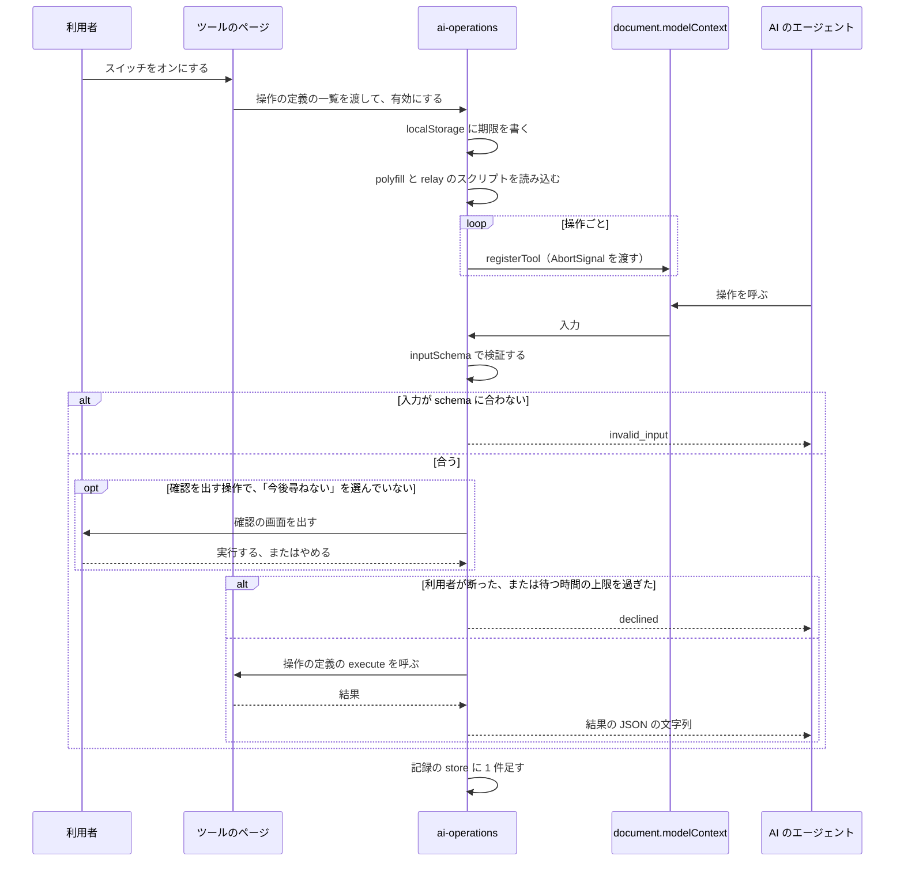

# AI からの操作

## Overview

AI からの操作は、利用者がつないだ AI のエージェントに、プレイグラウンドのツールの操作を公開する機能である。  
利用者は、ツールのページのスイッチで操作を許可し、エージェントが行った操作を、操作の記録の欄で見る。

アプリの構成とツールのページは [プレイグラウンドの Design Doc](../playground/DesignDoc.md) にある。  
方式と、許可と確認の形は、次の ADR が決めている。

- ADR-0044: [AI のエージェントからの操作は、WebMCP の API で登録し、MCP-B の polyfill と relay でも呼べるようにする](../../../adr/0044-ai-operations-with-webmcp.md)
- ADR-0045: [AI のエージェントからの操作は、ツールごとに 7 日のあいだ保存するスイッチで許可し、消す操作と全体を置き換える操作はページが確認を出す](../../../adr/0045-ai-operations-permission-and-confirmation.md)

## Scope

持つものは次のとおり。

- 15 個の操作の名前、入力、結果の形
- 許可のスイッチの位置と文言、スイッチの状態の保存
- 確認の画面の形と、確認を待つ間の動き
- 操作の記録の欄の位置と、1 行に出す内容
- `localStorage` のキーと値、期限の扱い
- 登録、許可、確認、記録の処理の流れと、コードの置き場

持たないものは次のとおり。

- 操作が呼ぶ、ツールの中の処理。ツールごとの Design Doc が持つ。
- ツールのページのヘッダと、ペインの並べ方。ツールごとの Design Doc が持つ。この文書は、スイッチと記録の欄を置く位置だけを決める。
- `Switch` と `Checkbox` の見た目とキーボードの操作。[packages/ui/DESIGN.md](../../../packages/ui/DESIGN.md) が持つ。
- 図とスライドを保存するデータの形。キャンバスの Design Doc が持つ。

## Design

### 操作を公開するページ

操作を公開するツールは、Node の実行環境、スライドのエディタ、Excalidraw のツール、draw.io のツールの 4 つである。  
この文書では、4 つを `node`、`slides`、`excalidraw`、`drawio` と呼ぶ。

- 操作を登録するのは、トップレベルで開いたページだけである。記事に埋め込んだページは、ヘッダを出さないので、スイッチも出ない。
- SQL だけを動かすツールと、Go を動かすツールは、操作を持たない。スイッチと記録の欄を出さない。

### コードの置き場

ツールに共通の処理は、`apps/playground/src/ai-operations/` に置く。  
操作の定義は、ツールのディレクトリに、ツールごとに 1 つのファイルで置く。

| 置き場                                        | 持つもの                                                                                                                          |
| --------------------------------------------- | --------------------------------------------------------------------------------------------------------------------------------- |
| `apps/playground/src/ai-operations/`          | スイッチの状態と `localStorage`、polyfill と relay のスクリプトの読み込み、登録と解除、入力の検証、確認の順番と期限、記録の store |
| `apps/playground/src/ai-operations/` の React | スイッチ、確認の画面、操作の記録の欄のコンポーネント                                                                              |
| `apps/playground/src/<ツール>/`               | そのツールの操作の定義（名前、説明、入力の schema、注釈、確認に出す内容、実行する関数）                                           |
| `@fukuemon/ui`                                | `Switch`、`Checkbox`、`Dialog`、`Disclosure`、`StatusBadge`、`Notice`、`Button`                                                   |

- ツールのディレクトリが、`ai-operations/` を import する。`ai-operations/` は、ツールのディレクトリを import しない。
- `ai-operations/` は、実行環境の package と、`workspace/`、`project/` を import しない。
- ツールのページは、操作の定義の一覧と、ツールの名前を、`ai-operations/` に渡す。

操作の定義は、次の型で書く。名前は、実装のときに変えてよい。

```ts
type OperationDefinition<Input> = {
  name: string;
  description: string;
  inputSchema: JsonSchema;
  annotations?: {
    readOnlyHint?: boolean;
    untrustedContentHint?: boolean;
    consequentialHint?: boolean;
  };
  confirmation?: (input: Input) => ConfirmationContent;
  execute: (input: Input) => Promise<OperationResult>;
};

type ConfirmationContent = {
  target: string;
  summary: string;
};

type OperationResult =
  | ({ ok: true } & Record<string, unknown>)
  | ({ ok: false; error: { code: ErrorCode; message: string } } & Record<string, unknown>);

type ErrorCode =
  | "invalid_input"
  | "not_found"
  | "too_large"
  | "not_ready"
  | "declined"
  | "timeout"
  | "failed";
```

- `confirmation` を持つ操作が、ページが確認を出す操作である。
- 説明の文（`description`）は、日本語で書く。

### 操作の一覧

操作の名前は、ツールの名前を接頭辞にする。  
relay を通すと、開いている全てのタブの操作が、MCP のクライアントの 1 つの一覧に並ぶ。名前だけで、どのツールの操作かを読み取れるようにするためである。

| ツール       | 名前                        | 行うこと                                 | 注釈                           | 確認 |
| ------------ | --------------------------- | ---------------------------------------- | ------------------------------ | ---- |
| `slides`     | `slides_read`               | Markdown の全文、テーマ、枚数を返す      | 読み取りだけ、信頼できない内容 | 無い |
| `slides`     | `slides_write`              | Markdown の全文を置き換える              | 無い                           | 出す |
| `slides`     | `slides_set_theme`          | テーマを変える                           | 無い                           | 無い |
| `excalidraw` | `excalidraw_read`           | 要素の一覧を返す                         | 読み取りだけ、信頼できない内容 | 無い |
| `excalidraw` | `excalidraw_add_elements`   | 図形、文字、図形をつなぐ矢印を足す       | 無い                           | 無い |
| `excalidraw` | `excalidraw_update_element` | 指定した要素の位置、大きさ、色を変える   | 無い                           | 無い |
| `excalidraw` | `excalidraw_clear`          | 全ての要素を消す                         | 重大な操作                     | 出す |
| `drawio`     | `drawio_read`               | 図の XML を返す                          | 読み取りだけ、信頼できない内容 | 無い |
| `drawio`     | `drawio_add_cells`          | 図に `mxCell` を足す                     | 無い                           | 無い |
| `drawio`     | `drawio_write`              | 図の全体を、渡した XML に置き換える      | 重大な操作                     | 出す |
| `node`       | `node_list_files`           | ファイルの一覧を返す                     | 読み取りだけ                   | 無い |
| `node`       | `node_read_file`            | ファイルの中身を返す                     | 読み取りだけ、信頼できない内容 | 無い |
| `node`       | `node_write_file`           | ファイルを書く                           | 無い                           | 無い |
| `node`       | `node_delete_file`          | ファイルを消す                           | 重大な操作                     | 出す |
| `node`       | `node_run_command`          | コマンドを実行し、終了コードと出力を返す | 重大な操作、信頼できない内容   | 無い |

- 名前は、英小文字、数字、`_` だけで書く。polyfill（`@mcp-b/global` 6.2.0）が、`[A-Za-z0-9_.-]` の 1〜128 文字でない名前の登録を拒否し、relay が、名前を `[a-zA-Z0-9_]` に直すためである。
- 注釈の語は、ADR-0044 の Decision 4 と同じである。

### 結果の形

操作は、成功でも失敗でも、JSON の文字列を返す。例外を投げない。

- 成功: `{"ok":true, ...}`。`ok` のほかの項目は、操作ごとに決まる。
- 失敗: `{"ok":false,"error":{"code":"<種類>","message":"<理由の文>"}}`。

`code` は、次の 7 つ。

| `code`          | 返すとき                                                                            |
| --------------- | ----------------------------------------------------------------------------------- |
| `invalid_input` | 入力が schema に合わない。パスが作業ディレクトリの外を指す。XML を読めない          |
| `not_found`     | 指したファイルか要素が無い                                                          |
| `too_large`     | 入力か、返す中身が、上限を超える                                                    |
| `not_ready`     | 実行環境が起動していない。ツールの読み込みが終わっていない                          |
| `declined`      | 利用者が、確認の画面で断った。確認を待つ時間の上限を過ぎた。スイッチがオフになった  |
| `timeout`       | コマンドが、時間の上限までに終わらなかった                                          |
| `failed`        | そのほかの失敗。実行する関数が投げた例外は、`ai-operations/` が受けて、この値にする |

### 入力と結果

入力の schema は、操作の定義の `inputSchema` に 1 つだけ書く。  
`ai-operations/` が、`inputSchema` で入力を検証してから、実行する関数を呼ぶ。ブラウザの `executeTool` が、schema に合わない値をそのまま渡すためである。  
schema で表せない検証（パスの範囲、XML として読めるか）は、実行する関数が行う。

| 名前                        | 入力                                                                                              | 成功のときの結果（`ok` のほか）               |
| --------------------------- | ------------------------------------------------------------------------------------------------- | --------------------------------------------- |
| `slides_read`               | 無い                                                                                              | `document`、`markdown`、`theme`、`slideCount` |
| `slides_write`              | `markdown`                                                                                        | `slideCount`                                  |
| `slides_set_theme`          | `theme`                                                                                           | `theme`                                       |
| `excalidraw_read`           | 無い                                                                                              | `document`、`elements`                        |
| `excalidraw_add_elements`   | `elements`。要素は、`type`、`x`、`y` と、省略できる `id`、`width`、`height`、`text`、`from`、`to` | `ids`（足した要素の識別子）                   |
| `excalidraw_update_element` | `id` と、省略できる `x`、`y`、`width`、`height`、`strokeColor`、`backgroundColor`                 | `id`                                          |
| `excalidraw_clear`          | 無い                                                                                              | `count`（消した要素の数）                     |
| `drawio_read`               | 無い                                                                                              | `document`、`xml`                             |
| `drawio_add_cells`          | `cells`（`<mxCell>` の並びの文字列）                                                              | `count`（足した `mxCell` の数）               |
| `drawio_write`              | `xml`                                                                                             | 無い                                          |
| `node_list_files`           | 省略できる `path`                                                                                 | `entries`（`path` と `kind`）、`truncated`    |
| `node_read_file`            | `path`                                                                                            | `path`、`contents`                            |
| `node_write_file`           | `path`、`contents`                                                                                | `path`                                        |
| `node_delete_file`          | `path`                                                                                            | `path`                                        |
| `node_run_command`          | `command` と、省略できる `args`、`timeoutMs`                                                      | `exitCode`、`output`、`truncated`             |

- `document` は、ページで開いている図かスライドの識別子と名前である（`{ id, name }`）。
- `slides_set_theme` の `theme` の値の一覧は、スライドのエディタが持つテーマの名前の一覧から作る。この文書と操作の定義に、テーマの名前を書かない。
- `excalidraw_read` の `elements` の要素は、`id`、`type`、`x`、`y`、`width`、`height`、`text`、`strokeColor`、`backgroundColor` を持つ。矢印は、つないだ図形の識別子の `from` と `to` も持つ。
- `excalidraw_add_elements` の `type` は、`rectangle`、`ellipse`、`diamond`、`text`、`arrow` のどれかである。矢印は、`from` と `to` に図形の識別子を渡すと、図形をつなぐ。
- `excalidraw_update_element` は、`id` の要素が無いときに、`not_found` を返す。
- `drawio_add_cells` は、今の図にある `id` と同じ `id` の `mxCell` を渡されたときに、`invalid_input` を返す。
- `markdown`、`xml`、`cells`、`contents` は、1 MB までである。超えるときは、`too_large` を返す。

### 操作の対象の図とスライド

`slides`、`excalidraw`、`drawio` の操作は、ページで開いている図かスライドだけを対象にする。  
利用者が画面で見ているものと、エージェントが変えるものを、同じにするためである。

- 操作の入力に、図とスライドの識別子を持たせない。保存してある図とスライドの一覧を返す操作と、開く操作は持たない。
- 同じツールを 2 つのタブで開くと、relay は、操作の名前の後ろにタブの ID を付けて、両方を MCP のクライアントに見せる。エージェントは、次の 2 つで、タブを見分ける。
  - 読み取りの結果の `document`。
  - relay が、操作の説明の先頭に付ける、ページのタイトル。ツールのページは、タイトルに、開いている図かスライドの名前を入れる。

### 実行環境の操作

`node` の操作は、`NodeRuntime` の関数を呼ぶ。

| 名前               | 呼ぶもの          |
| ------------------ | ----------------- |
| `node_list_files`  | `files.tree`      |
| `node_read_file`   | `files.read`      |
| `node_write_file`  | `files.write`     |
| `node_delete_file` | `files.remove`    |
| `node_run_command` | `processes.start` |

- 実行環境が起動していないときと、起動に失敗したときは、どの操作も `not_ready` を返す。
- パスは、作業ディレクトリからの相対パスだけを受ける。`..` で外へ出るパスと絶対パスは、`invalid_input` を返す。
  - ファイルの操作が届く範囲を、ファイルのツリーと保存の対象にそろえるためである。
  - セキュリティの境界にはならない。`node_run_command` は、確認なしで、作業ディレクトリの外のファイルを読み書きできる。
- `node_list_files` は、`path` の下の全ての階層を返す。`path` を省くと、作業ディレクトリの全体を返す。`node_modules` の中は返さない。1,000 件までにし、切ったときは `truncated` を `true` にする。
- `node_read_file` は、1 MB を超えるファイルに `too_large` を、テキストとして読めないファイルに `invalid_input` を返す。保存しないファイルの規則と同じである。
- `node_write_file` は、ファイルがあれば上書きし、親のディレクトリが無ければ作る。上書きの前に、確認を出さない。
- `node_delete_file` は、ファイルだけを消す。ディレクトリを指したときは、`invalid_input` を返す。
- `node_run_command` は、次のとおり動く。
  - `command` と `args` を、そのまま `processes.start` に渡す。コマンドの文字列を、引数に分ける処理は持たない。
  - プロセスには、エージェントが起動したと分かる名前を付ける。プロセスは、端末のペインに、ほかのプロセスと同じように出る。
  - `timeoutMs` のデフォルトは 30 秒、最大は 120 秒である。上限までに終わらないときは、プロセスを終了させ、`timeout` を返す。このときの結果は、`error` のほかに、それまでの `output` と `truncated` を持つ。
  - コマンドが 0 でない終了コードで終了したときは、`ok` を `true` にし、`exitCode` にその値を入れる。
  - `output` は、端末の制御の文字を除いた出力の、末尾の 100,000 文字である。切ったときは、`truncated` を `true` にする。
  - 時間と文字数の値は、実装のタスクで測って変えてよい。

### 許可のスイッチ

スイッチは、ツールのページのヘッダの右端に置く。

- コンポーネントは、`@fukuemon/ui` の `Switch` を使う。ラベルは「AI からの操作」である。
- スイッチのほかに、オンかオフかを示す文言を、画面に足さない。
- デフォルトはオフである。
- オンにすると、polyfill と、relay につなぐスクリプトを読み込み、操作を登録し、操作の記録の欄を出す。
- オフに戻すと、登録を解除し、出ている確認の画面を閉じ、操作の記録の欄を隠す。
- スクリプトを読み込めないときと、登録が拒否されたときは、スイッチをオフに戻し、`Notice` で理由を出す。
- relay を起動するときに渡す `--widget-origin https://play.fukuemon.dev` は、操作の記録の欄の先頭に、`Disclosure` の「つなぎ方」として書く。

### 登録から実行まで

次の図は、利用者がスイッチをオンにしてから、エージェントが呼んだ操作の結果が返るまでの流れを示す。



- 登録の解除は、`registerTool` に渡した `AbortSignal` で行う。
- スイッチのオンを保存してあるページでは、ページを開いたときに、同じ流れで登録する。
- 記録の store には、`invalid_input` と `declined` で終わった呼び出しも足す。
- React のコンポーネントは、Effect の中で、スクリプトの読み込みと登録を行わない。`ai-operations/` の、React の外のモジュールが進め、コンポーネントは、状態を `useSyncExternalStore` で読む。
- オフに戻した後に、読み込んだ relay のスクリプトの接続を切る方法は、実装のタスクで確認する。

### 確認の画面

確認を出す 4 つの操作は、利用者が「実行する」を押してから実行する。  
確認の画面は、`@fukuemon/ui` の `Dialog` で組む。`ConfirmDialog` は、チェックボックスを置けないので使わない。

- 題は、「AI からの操作の確認」である。
- 本文に、操作の名前、失うものの名前（`target`）、何が起きるかの文（`summary`）、元に戻せないことを書く。

  | 名前               | `target`       | `summary`                                   |
  | ------------------ | -------------- | ------------------------------------------- |
  | `slides_write`     | スライドの名前 | Markdown の全文を、渡された内容に置き換える |
  | `excalidraw_clear` | 図の名前       | 全ての要素を消す。消す要素の数              |
  | `drawio_write`     | 図の名前       | 図の全体を、渡された XML に置き換える       |
  | `node_delete_file` | ファイルのパス | ファイルを消す                              |

- 渡された内容の全文は、`Disclosure` を開くと読める。
- 本文の下に、`Checkbox` の「このページでは今後尋ねない」を置く。デフォルトは、チェックなしである。
- ボタンは、「やめる」（`secondary`）と「実行する」（`danger`）の 2 つである。開いたときのフォーカスは、「やめる」に当てる。
- 「このページでは今後尋ねない」をチェックして「実行する」を押すと、そのツールでは、その後の操作を、確認を出さずに実行する。「やめる」を押したときは、チェックを保存しない。

確認を待つ間は、次のとおり動く。

- 「やめる」、Esc のキー、背景のクリックは、`declined` を返す。
- 確認が出ている間に、確認を出す操作がもう 1 つ呼ばれたときは、届いた順に、1 つずつ確認を出す。確認を出さない操作は、待たせずに実行する。
- 呼び出しが届いてから 50 秒で、`declined` を返す。確認が出ていれば、閉じる。順番を待っている間に 50 秒が過ぎた呼び出しは、確認を出さずに `declined` を返す。
  - エージェントが待つのをやめた後に、利用者が「実行する」を押して、結果を受け取る相手がいないまま消える、ということを防ぐためである。
  - 50 秒は、MCP の SDK（`@modelcontextprotocol/sdk` 1.32.2）がリクエストを待つ時間のデフォルトの 60 秒より、短くした値である。実装のタスクで変えてよい。
- 確認が出ている間に、スイッチがオフになったときは、確認を閉じ、`declined` を返す。
- 確認の画面は、ページが裏のタブにあるときも開く。

### 操作の記録の欄

操作の記録の欄は、スイッチがオンの間だけ出す。

- Node の実行環境では、下のペインのタブ（端末、コンソール、HTTP の一覧と同じ並び）に、「AI の操作」のタブを足す。
- スライドのエディタ、Excalidraw のツール、draw.io のツールでは、ページの下端に、開閉できる欄を置く。閉じている間は、題の「AI の操作」と、最後の 1 行だけを出す。
- 欄の先頭に、`Disclosure` の「つなぎ方」を置く。

1 行は、1 回の呼び出しである。

- 1 行に、時刻（時、分、秒）、操作の名前、引数の要約、結果の `StatusBadge`、結果の要約を出す。
  - 要約は、先頭の 80 文字である。
  - `StatusBadge` は、成功（`success`）、失敗（`danger`）、断った（`neutral`）の 3 つで、文字でも状態を出す。
- 行を開くと、引数と結果の全文を読める。それぞれ、10,000 文字までを出す。
- 新しい行は、下に足す。
- 引数と結果は、文字として出す。HTML として描かない。JSON の文字列の中の Markdown と XML は、escape を戻して出す。
- 欄は、`role="log"` を持つ。

記録は、`ai-operations/` の store が、メモリにだけ持つ。

- 200 件までを持ち、超えた古い記録を消す。
- `localStorage` と IndexedDB に書かない。引数と結果が、ファイルの中身を含むためである。
- ページを読み込み直すと、消える。スイッチをオフにしても、ページを開いている間は残り、オンに戻すと出る。

### スイッチと確認の状態の保存

スイッチのオンと、「このページでは今後尋ねない」の状態は、ツールごとに、`localStorage` の 1 つのキーに保存する。

- キー: `fd-ai-operations:<ツール>`。`<ツール>` は、`node`、`slides`、`excalidraw`、`drawio` のどれかである。
- 値: 次の形の JSON。

```ts
type StoredPermission = {
  v: 1;
  enabledUntil: number;
  skipConfirmUntil: number | null;
};
```

- `enabledUntil` は、スイッチをオンにした時刻の 7 日後である。`skipConfirmUntil` は、「このページでは今後尋ねない」を選んだ時刻の 7 日後である。どちらも、エポックからのミリ秒で持つ。
- ページを開いても、期限を延ばさない。
- キーが無いとき、値を JSON として読めないとき、値が型に合わないとき、`enabledUntil` を過ぎているときは、スイッチをオフとして扱い、キーを消す。
- `skipConfirmUntil` を過ぎているときは、確認を出す状態に戻す。
- ページを開いている間に `enabledUntil` が来たときは、その時点で、スイッチをオフにし、登録を解除する。
- スイッチをオフにしたときは、キーを消す。「このページでは今後尋ねない」の状態も消えるので、オンに戻すと、確認を出す状態から始まる。期限でオフになったときも、同じである。
- 同じツールを複数のタブで開いているときは、`storage` のイベントを受けて、ほかのタブのオンとオフを、自分のタブにも反映する。
- `localStorage` を読み書きできないときは、スイッチは、ページを開いている間だけ働き、状態を保存しない。

## Interface

### 置くファイル

- `apps/playground/src/ai-operations/`: ツールに共通の処理と、スイッチ、確認の画面、操作の記録の欄のコンポーネント。
- `apps/playground/src/<ツール>/`: ツールごとの操作の定義のファイル。
- polyfill と、relay につなぐスクリプト: `play.fukuemon.dev` から配る。スイッチがオンのときにだけ読み込む。

### 読む値

- `localStorage` の `fd-ai-operations:<ツール>`: スイッチと、「このページでは今後尋ねない」の期限。

### 使うコンポーネント

- `@fukuemon/ui` の `Switch`: 許可のスイッチ。
- `@fukuemon/ui` の `Checkbox`: 確認の画面の「このページでは今後尋ねない」。
- `@fukuemon/ui` の `Dialog`、`Button`、`Disclosure`、`StatusBadge`、`Notice`: 確認の画面と、操作の記録の欄。

### 動くチェック

この機能が足すチェックは無い。
