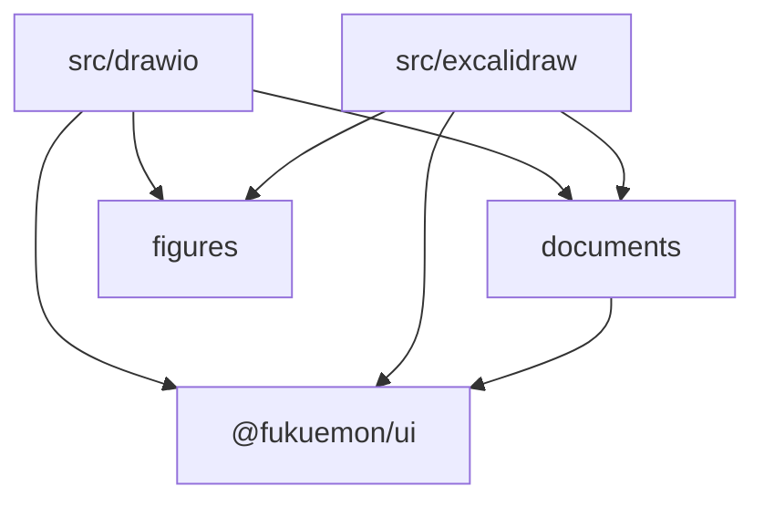
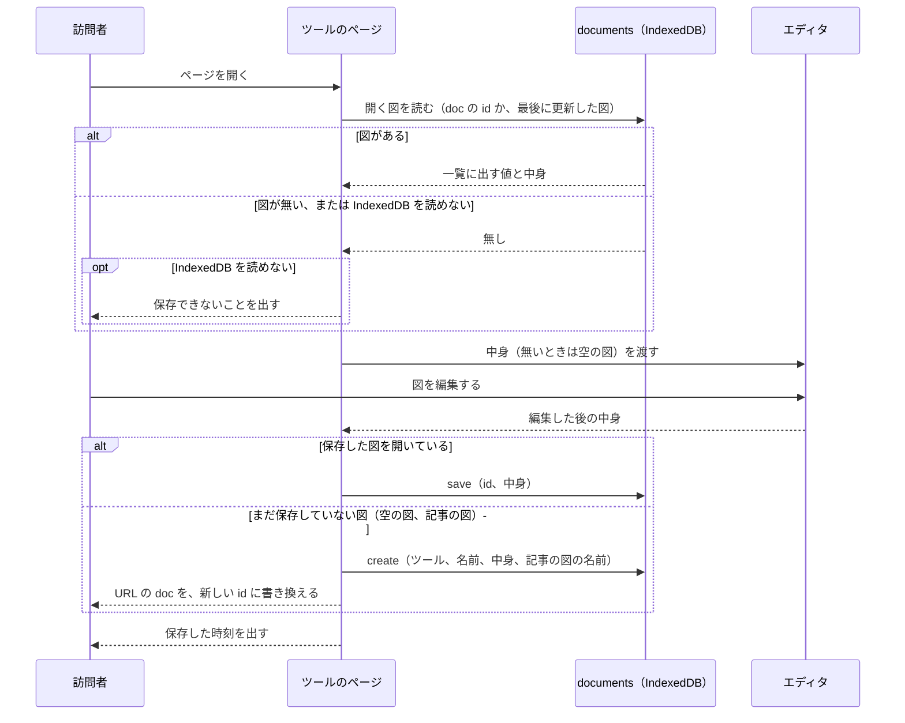
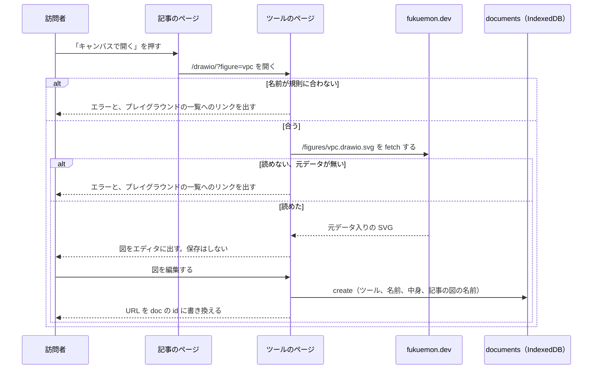

# キャンバス

## Overview

キャンバスは、訪問者と運営者がブラウザの中で図を描くツールである。  
構成図を描く draw.io のツールと、手描きの図を描く Excalidraw のツールの 2 つを、`play.fukuemon.dev` で提供する。  
運営者は、キャンバスから書き出した SVG を記事に埋め込む。訪問者は、記事の図をキャンバスで開いて、描き変えられる。

全体の構成とホスト名は [fukuemon.dev Design Doc](../../DesignDoc.md) に、プレイグラウンドのアプリの構成は [プレイグラウンド](../playground/DesignDoc.md) にある。  
方式は、次の ADR が決めている。

- ADR-0039: [キャンバスは、構成図を draw.io の Embed Mode で、手描きの図を Excalidraw で、別のパスのツールとして提供する](../../../adr/0039-canvas-drawio-and-excalidraw.md)
- ADR-0040: [記事に埋め込むキャンバスの図は、元データ入りの SVG をリポジトリに置き、ビルドのときにインラインにする](../../../adr/0040-canvas-figures-in-articles.md)
- ADR-0043: [キャンバスとスライドのエディタは、ツールごとに、名前を付けた複数の図とスライドを IndexedDB に保存する](../../../adr/0043-multiple-named-documents-per-tool.md)

## Scope

持つものは次のとおり。

- 2 つのツールのパス、ディレクトリ、ページの構成
- IndexedDB に保存する図の形と、保存するモジュール
- 図の一覧の画面と、開く、名前を変える、消す、新しく作る操作
- 保存、ファイルの読み書き、SVG の書き出しの流れ
- 記事の図を置くディレクトリ、Markdown の書き方、ビルドの処理、図の URL
- 記事の図をキャンバスで開く流れ

持たないものは次のとおり。

- スライドのエディタの画面。保存するモジュールは、スライドのエディタと共有する。
- AI のエージェントからの操作の名前と入出力、スイッチと確認と操作の記録の画面。
  - ADR-0044: [AI のエージェントからの操作は、WebMCP の API で登録し、MCP-B の polyfill と relay でも呼べるようにする](../../../adr/0044-ai-operations-with-webmcp.md)
- 図に入る第三者のアイコンと書体を、MIT License の対象から外す記述の文。
- 画面のコンポーネントの見た目。[packages/ui/DESIGN.md](../../../packages/ui/DESIGN.md) が持つ。

## Design

### ツールとパス

| パス           | ツール              | エディタ                              | cross-origin isolation のヘッダ |
| -------------- | ------------------- | ------------------------------------- | ------------------------------- |
| `/drawio/`     | draw.io のツール    | `embed.diagrams.net` の iframe        | 返さない                        |
| `/excalidraw/` | Excalidraw のツール | バンドルした `@excalidraw/excalidraw` | 返さない                        |

- パス、`src/` のディレクトリ、保存するデータの `tool` の値、書き出すファイルの拡張子は、同じ語（`drawio`、`excalidraw`）を使う。
- 2 つのツールは、記事に iframe で埋め込まない。ページのヘッダは、いつも出す。
- ページが読むクエリは、次の 2 つ。

| クエリ   | 値                | 動き                                 |
| -------- | ----------------- | ------------------------------------ |
| `doc`    | 保存した図の `id` | 保存した図を開く                     |
| `figure` | 記事の図の名前    | 記事の図を読み込む。`doc` は読まない |

- クエリが無いときは、そのツールの図のうち、最後に更新した図を開く。図が 1 つも無いときは、空の図を出す。
- `doc` の `id` に当たる図が無いときは、クエリが無いときと同じに扱う。
- ページは、開いている図が変わるたびに、URL の `doc` を、履歴を足さずに書き換える。再読み込みで、同じ図が開く。

### ディレクトリ

キャンバスのコードは、`apps/playground` の中に、プレイグラウンドのほかのツールと同じ階層で置く。

```text
apps/playground/
  drawio/index.html       draw.io のツールのエントリーポイント
  excalidraw/index.html   Excalidraw のツールのエントリーポイント
  src/
    drawio/               draw.io のツールのページ。iframe との postMessage、XML の読み書き
    excalidraw/           Excalidraw のツールのページ。scene の読み書き、書体の配信の設定
    documents/            図とスライドの保存、一覧のダイアログ、名前を変える操作と消す操作のコンポーネント
    figures/              記事の図の名前の検証、URL の組み立て、読み込み
```

次の図は、キャンバスのディレクトリの間で許す import の向きを示す。矢印の無い組は、import しない。



- `documents/` は、ツールの種類ごとの処理を持たない。中身は、文字列として受け取り、文字列として返す。
- `documents/` と `figures/` は、互いを import しない。2 つをつなぐ処理は、ツールのページが持つ。
- `documents/` と `workspace/`（訪問者のファイルの保存）は、互いを import しない。
- `@excalidraw/excalidraw` を import するのは、`src/excalidraw/` だけである。
- Oxlint の `no-restricted-imports` が止める、ツールのページの間の import の対象に、`drawio/` と `excalidraw/` を足す。

### ページの構成

2 つのツールのページは、同じ構成にする。ヘッダと一覧のダイアログは、`documents/` と `@fukuemon/ui` のコンポーネントで組む。

```text
┌──────────────────────────────────────────────────────────────────────┐
│ draw.io  [VPC の構成]  [図の一覧] [新しい図] [ファイル ▾]   保存した 12:34 │
│ エディタは draw.io のサーバーから読み込みます。PDF への書き出しは、…      │
├──────────────────────────────────────────────────────────────────────┤
│                                                                      │
│                              エディタ                                  │
│                                                                      │
└──────────────────────────────────────────────────────────────────────┘
```

- ヘッダは、ツールの名前、開いている図の名前、「図の一覧」、「新しい図」、「ファイル」のメニュー、保存の状態を、この順に並べる。
- 図の名前を押すと、その場で名前を変えられる。
- 「ファイル」のメニューは、ファイルを開く、ファイルに保存、SVG を書き出す、の 3 つを持つ。
- 保存の状態は、最後に保存した時刻か、保存できないことを出す。
- draw.io のツールは、ヘッダの下に、次の 2 つを書いた 1 行の文を、いつも出す。閉じる操作は持たない。
  - エディタを、draw.io のサーバーから読み込むこと。
  - PDF への書き出しが、draw.io のサーバーを通ること。
- エディタの明暗は、ページを開いたときの OS の設定で決める。draw.io には `dark` のパラメータを、Excalidraw には `theme` を渡す。
- draw.io の iframe の URL には、`libs=aws4;gcp2` を渡し、draw.io の中の保存と終了のボタンを出さない設定を渡す。
- Excalidraw は、Library のボタンを隠し、書体を自分のパスから配る。
- AI のエージェントからの操作のスイッチと、操作の記録の欄は、AI からの操作の設計が、このヘッダとページに足す。

### 保存するデータ

図は、`play.fukuemon.dev` の IndexedDB の `playground-documents` のデータベースに、2 つの object store に分けて保存する。  
ADR-0057: [図とスライドは、一覧に出す値と中身を 2 つの object store に分けて、訪問者のファイルと別のデータベースに保存する](../../../adr/0057-document-records-in-two-object-stores.md)

| object store | キー | レコード                       | index               |
| ------------ | ---- | ------------------------------ | ------------------- |
| `documents`  | `id` | 一覧に出す値（`DocumentMeta`） | `[tool, updatedAt]` |
| `contents`   | `id` | 図の中身（`DocumentContent`）  | 無い                |

```ts
type ToolKind = "drawio" | "excalidraw" | "slides";

type DocumentMeta = {
  id: string;
  tool: ToolKind;
  name: string;
  createdAt: number;
  updatedAt: number;
  source?: { kind: "figure"; name: string };
};

type DocumentContent = {
  id: string;
  data: string;
};
```

- `data` は、draw.io のツールでは図の XML、Excalidraw のツールでは `.excalidraw` の JSON である。Excalidraw の JSON は、貼った画像を中に持つ。
- `source` は、記事の図から作った図だけが持つ。
- 時刻は、エポックからのミリ秒の数値である。

`documents/` は、次の型でデータベースを公開する。名前は、実装のときに変えてよい。  
`Store` は、プレイグラウンドの [NodeRuntime](../playground/DesignDoc.md#noderuntime) の `Store` と同じ形である。

```ts
type DocumentStore = {
  status: Store<{ kind: "ready" } | { kind: "unavailable" }>;
  list: (tool: ToolKind) => Store<readonly DocumentMeta[]>;
  read: (id: string) => Promise<{ meta: DocumentMeta; data: string } | undefined>;
  create: (input: {
    tool: ToolKind;
    name: string;
    data: string;
    source?: DocumentMeta["source"];
  }) => Promise<DocumentMeta>;
  save: (id: string, data: string) => Promise<void>;
  rename: (id: string, name: string) => Promise<void>;
  remove: (id: string) => Promise<void>;
};
```

- 一覧は、更新した時刻の新しい順に並ぶ。画面は、`useSyncExternalStore` で読む。
- `create`、`save`、`remove` は、2 つの store を 1 つのトランザクションで書く。`save` は、`updatedAt` を進める。`rename` は、`updatedAt` を進めない。
- IndexedDB を読めないときと、保存の容量が足りなくて書き込めないときは、`status` が `unavailable` になる。その後は、ページを開いている間、`documents/` は IndexedDB に書き込まない。ページは、保存できないことを、保存の状態に出す。
- IndexedDB を読めないときは、一覧が空で、ページは空の図を出す。訪問者は、描いた図を、ファイルに保存できる。
- 2 つのタブで同じ図を開いたときは、後から保存したタブの中身が残る。

### 図の一覧

「図の一覧」のボタンは、ダイアログを開く。エディタは、読み込んだままにする。

```text
┌────────────────────────────────────────────────┐
│ 図の一覧                            [新しい図]  ✕ │
│ 名前                      更新                   │
│ VPC の構成（開いている）    11/13 12:34     [⋯]   │
│ 無題の図 2                 11/12 09:10     [⋯]   │
│ vpc（記事の図から）         11/10 21:02     [⋯]   │
└────────────────────────────────────────────────┘
[⋯] のメニュー: 名前を変える、消す
```

- 一覧は、そのツールの図だけを出す。
- 行の名前を押すと、その図を開き、ダイアログを閉じる。
- 「新しい図」は、空の図を新しく作って開く。前に開いていた図は変えない。名前は、`無題の図` に、ツールごとの連番を付ける（`無題の図 2`）。
- 「消す」は、ConfirmDialog で確認を出し、訪問者が通したら消す。消した図は戻せない。
- 開いている図を消したときは、残りの図のうち、最後に更新した図を開く。残りが無いときは、空の図を出す。
- 記事の図から作った図の行には、記事の図から作ったことを出す。
- 図を複製する操作は、持たない。

空の図は、最初に編集したときに、新しい図として保存する。編集しないで閉じた空の図は、一覧に残らない。

### 保存の流れ

次の図は、ページを開いてから、編集した図が保存されるまでの流れを示す。



- draw.io のツールは、iframe の初期化のメッセージを受けてから、`load` で図の XML を渡す。編集のたびに届く `autosave` のイベントの XML を保存する。
- Excalidraw のツールは、`onChange` を受けてから 300 ミリ秒のあいだ次の `onChange` が無いときに、scene の JSON を保存する。300 ミリ秒は、実装のタスクで測って変えてよい。
- ページは、`embed.diagrams.net` の origin のメッセージだけを受ける。
- 図を切り替えるときは、エディタを読み込み直さずに、次の図の中身を渡す。

### ファイルの読み書きと書き出し

| 操作           | draw.io のツール                                          | Excalidraw のツール                                         |
| -------------- | --------------------------------------------------------- | ----------------------------------------------------------- |
| ファイルに保存 | 図の XML を、`<図の名前>.drawio` で保存する               | scene の JSON を、`<図の名前>.excalidraw` で保存する        |
| SVG を書き出す | 元データ入りの SVG を、`<図の名前>.drawio.svg` で保存する | scene 入りの SVG を、`<図の名前>.excalidraw.svg` で保存する |
| ファイルを開く | `.drawio` と、元データ入りの SVG を開く                   | `.excalidraw` と、scene 入りの SVG を開く                   |

- 「ファイルを開く」は、開いたファイルを、新しい図として保存して開く。前に開いていた図は変えない。名前は、ファイルの名前から拡張子を除いたものにする。
- 元データ入りの SVG を開いたときは、SVG から元データ（図の XML か、scene の JSON）を取り出して、`data` に保存する。
- 開いたファイルに元データが無いときと、そのツールの形式でないときは、エラーを出し、何も保存しない。
- 書き出す SVG は、ライトの配色で、背景を持たない。運営者は、書き出した SVG を、そのまま記事の図のディレクトリに置ける。
- ファイルの読み書きは、訪問者のブラウザの中だけで行う。fukuemon.dev のサーバーに、図を送らない。

### 記事の図

運営者は、キャンバスから書き出した SVG を `apps/web/src/content/figures/` に置き、記事の Markdown から、画像の記法で指す。  
ADR-0056: [記事の図を `content/figures/` に置いて画像の記法で指し、`/figures/` で配り、キャンバスには図の名前を渡す](../../../adr/0056-article-figures-directory-and-name.md)

```text
apps/web/src/content/figures/
  vpc.drawio.svg          draw.io のツールから書き出した図
  request-flow.excalidraw.svg   Excalidraw のツールから書き出した図
```

```md

```

- ファイルの名前は、`<名前>.drawio.svg` か `<名前>.excalidraw.svg` である。`<名前>` は、小文字の英数字とハイフンだけにする（`^[a-z0-9][a-z0-9-]*$`）。
- シリーズの中の記事は、`../../figures/` と書く。

`apps/web` のビルドは、`content/figures/` のファイルを指す画像を、次のとおり置き換える。

- 画像を、`<figure>` に置き換える。中に、インラインの SVG、キャプション、「キャンバスで開く」のリンクを、この順に置く。
- 代替テキストは、SVG の読み上げの名前にする。画像の記法のタイトルは、キャプションにする。タイトルが無いときは、キャプションを出さない。
- 「キャンバスで開く」のリンクの先は、`https://play.fukuemon.dev/<ツール>/?figure=<名前>` である。
- インラインにする SVG は、ADR-0040 の Decision 2 のとおり、色をトークンに渡す。
  - draw.io の SVG は、ルートの `color-scheme` の指定を外し、背景と線の色の変数にトークンを渡す。
  - Excalidraw の SVG は、線と文字のデフォルトの色を、トークンに置き換える。
- インラインにする SVG からは、元データ（draw.io の `content` の属性、Excalidraw の scene）を外す。元データは、図の URL で配る SVG が持つ。
- ビルドは、次のときに失敗する。
  - 代替テキストが空である。
  - 指したファイルが無い。
  - ファイルの名前が、規則に合わない。
  - SVG の中の元データが、拡張子のツールと合わない。
- 1 つの記事に複数の図を入れたときに、SVG の中の `id` が重ならないことを、実装のタスクで確認する。重なるときは、ビルドが、図ごとに `id` を付け替える。

ビルドは、置いた SVG を、変えずに `https://fukuemon.dev/figures/<名前>.<ツール>.svg` に出力する。  
`fukuemon.dev` は、`/figures/*` に、`play.fukuemon.dev` を許す `Access-Control-Allow-Origin` を返す。

### 記事の図をキャンバスで開く

次の図は、訪問者が記事の「キャンバスで開く」のリンクを押してから、図が保存されるまでの流れを示す。



- 名前の検証、URL の組み立て、`fetch` は、`figures/` が持つ。
- `figures/` は、名前が `^[a-z0-9][a-z0-9-]*$` に合わないときは、`fetch` しない。
- URL は、`<fukuemon.dev の origin>/figures/<名前>.<ツール>.svg` である。ツールは、ページのパスで決まる。fukuemon.dev の origin は、ビルドのときの値で、プロジェクトの JSON の URL を組み立てる `project/` と、同じ定義を読む。
- `fetch` は、リダイレクトを辿らない。
- 開いただけでは、IndexedDB に保存しない。最初に編集したときに、新しい図として保存する。同じリンクを開くたびに、一覧に図が増えないようにするためである。
- 新しい図の名前は、記事の図の名前にする。レコードの `source` に、記事の図の名前を持つ。
- 保存してあった図は変えない。同じ記事の図から作った図が保存してあっても、リンクは、記事の図を開く。
- エラーのときは、保存してある図を開かない。リンクの先は、`https://fukuemon.dev/playground` である。

## Interface

### 置くファイル

- `apps/playground/drawio/`、`apps/playground/excalidraw/`: ツールのエントリーポイント。
- `apps/playground/src/drawio/`、`src/excalidraw/`、`src/documents/`、`src/figures/`: キャンバスのコード。
- `apps/web/src/content/figures/<名前>.drawio.svg`、`<名前>.excalidraw.svg`: 運営者が置く、記事の図。

### 読む値

- URL のクエリの `doc`: 保存した図の `id`。
- URL のクエリの `figure`: 記事の図の名前。
- IndexedDB の `playground-documents`: object store の `documents` と `contents`。
- `https://fukuemon.dev/figures/<名前>.<ツール>.svg`: 記事の図の、元データ入りの SVG。

### 動くチェック

- Oxlint の `no-restricted-imports`: `apps/playground/src/` の、ツールのページのディレクトリの間の import を止める。
  - 対象は、`node/`、`sql/`、`go/`、`drawio/`、`excalidraw/` である。
- `apps/web` のビルド: 図を指す画像の代替テキスト、ファイルの有無、ファイルの名前、拡張子と元データの一致を確認する。
