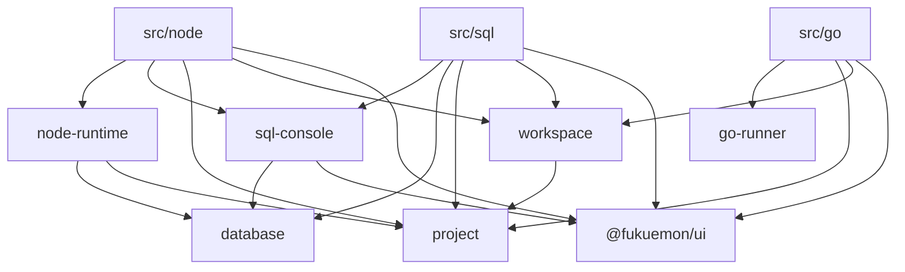
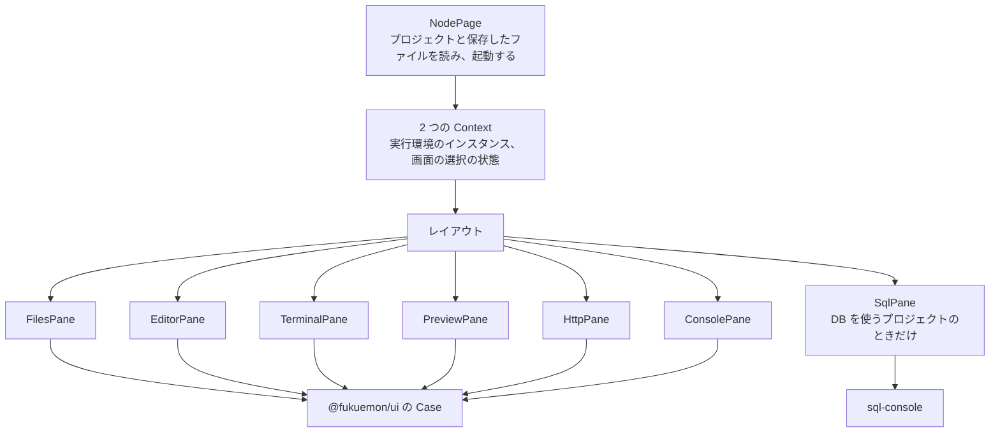
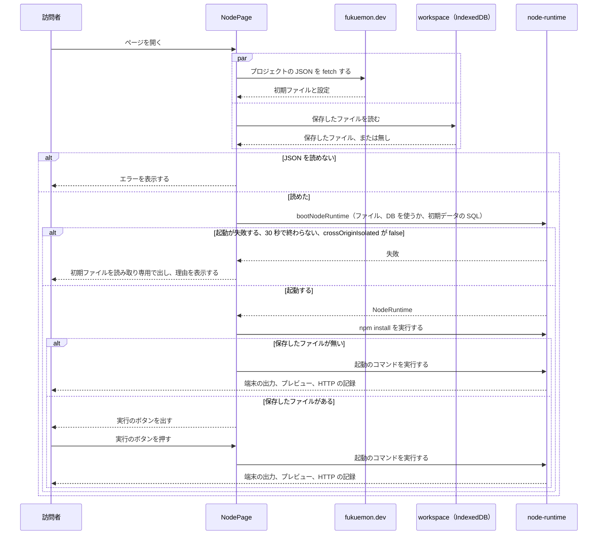

# プレイグラウンド

## Overview

プレイグラウンドは、訪問者がブラウザの中でコードと SQL を動かすツールを、`play.fukuemon.dev` で提供するアプリである。  
ツールは、Node の実行環境、SQL だけを動かすツール、Go を動かすツールの 3 つである。  
記事は、ツールのページを iframe で埋め込む。訪問者は、同じページをトップレベルでも開ける。

全体の構成とホスト名は [fukuemon.dev Design Doc](../../DesignDoc.md) にある。  
実行の方式は、次の ADR が決めている。

- ADR-0033: [Node と npm の実行に WebContainers を採り、実行環境と画面の間をインターフェースで分ける](../../../adr/0033-webcontainers-for-node.md)
- ADR-0037: [Go のコードを、Yaegi のインタプリタの WASM で動かす](../../../adr/0037-go-with-yaegi.md)
- ADR-0053: [DB の記事は PGlite を使い、Node のコードからは Unix ドメインソケットで `pg` から接続し、SQL は DB のプロセスの標準入出力で送る](../../../adr/0053-pglite-database-in-playground.md)

## Scope

持つものは次のとおり。

- アプリの構成、パス、ディレクトリと import の向き
- Node の実行環境と画面の間のインターフェースの型と、画面が記録を読む形
- ツールのページの React のツリーと、状態の置き場
- プロジェクトの JSON の形、訪問者のファイルの保存の形
- 起動から実行までの流れ、動かせないブラウザでの表示
- SQL を送る形式と、結果の表示

持たないものは次のとおり。

- AI のエージェントからの操作の登録。登録する位置（トップレベルで開いたページ）だけを書く。
  - ADR-0044: [AI のエージェントからの操作は、WebMCP の API で登録し、MCP-B の polyfill と relay でも呼べるようにする](../../../adr/0044-ai-operations-with-webmcp.md)
- コンソールの式を評価する入力欄。
- キャンバスとスライドのエディタの中の構成。ディレクトリを並べる位置だけを書く。
- 記事の本文で、埋め込みを置く書き方。記事の形式の設計が持つ。
- 画面のコンポーネントの見た目。[packages/ui/DESIGN.md](../../../packages/ui/DESIGN.md) が持つ。

## Design

### アプリとパス

`apps/playground` は、Vite の React のアプリである。  
ツールごとに、HTML のエントリーポイントを持ち、1 つのツールのページが、1 つの React のツリーになる。  
ADR-0046: [プレイグラウンドを Vite の React のアプリにし、ツールごとに HTML のエントリーポイントとパスを分ける](../../../adr/0046-playground-as-vite-react-app.md)

| パス     | ツール                 | cross-origin isolation のヘッダ |
| -------- | ---------------------- | ------------------------------- |
| `/node/` | Node の実行環境        | 返す                            |
| `/sql/`  | SQL だけを動かすツール | 返さない                        |
| `/go/`   | Go を動かすツール      | 返さない                        |

- `/` は、`https://fukuemon.dev/playground` へリダイレクトする。
- 開くプロジェクトは、クエリの `project` で指定する（`/node/?project=<埋め込みの ID>`）。`project` が無いときは、デフォルトのプロジェクトを開く。
- 記事の iframe と、トップレベルで開くページは、同じ URL を使う。ページは、`window.self !== window.top` で埋め込みかどうかを判定し、埋め込みのときは、ページのヘッダを出さず、AI のエージェントからの操作を登録しない。
- ペインの並べ方は、ページの幅で決める。

React Compiler を、`apps/playground` のビルドにだけ入れる。`apps/playground` のコードに、`memo`、`useMemo`、`useCallback` を書かない。  
ADR-0047: [React Compiler を、`apps/playground` にだけ入れる](../../../adr/0047-react-compiler-in-playground.md)

### ディレクトリ

`apps/playground/src/` は、関心ごとのディレクトリで分ける。実装の種類のディレクトリ（`components/`、`hooks/`、`utils/`）を作らない。  
ADR-0048: [Node の実行環境のモジュールを `apps/playground` の中に置き、記録を store で、操作を関数で公開する](../../../adr/0048-node-runtime-interface-and-stores.md)

```text
apps/playground/
  node/index.html         Node の実行環境のエントリーポイント
  sql/index.html          SQL だけを動かすツールのエントリーポイント
  go/index.html           Go を動かすツールのエントリーポイント
  src/
    node/                 Node の実行環境のページ。レイアウト、ペインのコンポーネント、Context、選択の状態
    sql/                  SQL だけを動かすツールのページ
    go/                   Go を動かすツールのページ
    sql-console/          SQL の入力欄と、結果の表
    node-runtime/         NodeRuntime の型、store、記録の行を抜き出す処理、標準入出力で SqlDatabase を実装する処理
      webcontainer/       @webcontainer/api を import する実装
      guest/              実行環境の中の Node が動かすファイル（preload、DB のプロセスのスクリプト）
    database/             SqlDatabase の型、結果とエラーの形、PGlite を単体で動かす実装
    go-runner/            GoRunner の型、Yaegi の読み込みと実行
    project/              埋め込みの ID、プロジェクトの型、プロジェクトの JSON の読み込み
    workspace/            訪問者のファイルの保存
```

- キャンバスとスライドのエディタは、追加するときに、`src/` の同じ階層に並べる。
- `guest/` のファイルは、ブラウザではなく、実行環境の中の Node で動く。ブラウザのコードは、ファイルの中身を文字列として読み込み、実行環境に書く。tsconfig と lint の対象を、ブラウザのコードと分ける。

次の図は、ディレクトリの間で許す import の向きを示す。矢印の無い組は、import しない。



- `sql-console/`、`node-runtime/`、`workspace/` が、`database/` と `project/` から import するのは、型だけである。
- `workspace/` と `node-runtime/` は、互いを import しない。2 つをつなぐ処理は、`src/node/` が持つ。
- Oxlint の `no-restricted-imports` が止める import は、次の 2 つ。
  - `src/node-runtime/webcontainer/` のほかからの、`@webcontainer/api` の import
  - `src/node/`、`src/sql/`、`src/go/` の間の import

### NodeRuntime

Node の実行環境と画面の間は、`NodeRuntime` で分ける。型は、シリアライズできる素の値だけを使い、`@webcontainer/api` の型を含めない。

```ts
type Store<T> = {
  subscribe: (onChange: () => void) => () => void;
  getSnapshot: () => T;
};

type BootOptions = {
  files: Readonly<Record<string, string>>;
  database: boolean;
  initialSql?: string;
};

declare function bootNodeRuntime(options: BootOptions): Promise<NodeRuntime>;

type NodeRuntime = {
  status: Store<RuntimeStatus>;
  files: {
    tree: Store<readonly FileEntry[]>;
    changes: { subscribe: (onChange: (paths: readonly string[]) => void) => () => void };
    readAll: () => Promise<Readonly<Record<string, string>>>;
    read: (path: string) => Promise<string>;
    write: (path: string, contents: string) => Promise<void>;
    createDirectory: (path: string) => Promise<void>;
    rename: (from: string, to: string) => Promise<void>;
    remove: (path: string) => Promise<void>;
  };
  processes: {
    list: Store<readonly ProcessInfo[]>;
    get: (id: string) => ProcessHandle | undefined;
    start: (
      command: string,
      args: readonly string[],
      options?: { name?: string; terminal?: TerminalSize },
    ) => Promise<ProcessHandle>;
  };
  ports: Store<readonly OpenPort[]>;
  httpExchanges: Store<readonly HttpRecord[]>;
  consoleEntries: Store<readonly ConsoleRecord[]>;
  database?: SqlDatabase;
  dispose: () => Promise<void>;
};

type RuntimeStatus = { kind: "ready" } | { kind: "failed"; reason: string };

type ProcessHandle = {
  id: string;
  output: OutputLog;
  write: (data: string) => void;
  resize: (size: TerminalSize) => void;
  kill: () => void;
  exit: Promise<number>;
};

type OutputLog = {
  read: () => string;
  subscribe: (onChunk: (chunk: string) => void) => () => void;
};
```

名前は、実装のときに変えてよい。

- 起動は、`bootNodeRuntime` が返す Promise で待つ。起動の失敗は、Promise の失敗で受け取る。起動の後に実行環境が動かなくなったとき（DB のプロセスの終了など）は、`status` で受け取る。
- 実行環境は、接続先の環境変数と `NODE_OPTIONS` を、`BootOptions` から組み立て、`start` で起動する全てのプロセスに渡す。画面は、環境変数を渡さない。
- 実行環境が自分で起動するプロセス（DB のプロセス、DB の依存の `npm install`）は、`processes.list` に入れない。
- `start` を呼ばないコンポーネントは、`processes.get` で、プロセスの出力を読む。
- `files.changes` は、ファイルの中身が変わったことの通知である。保存と、エディタで開いているファイルの更新に使う。
- `FileEntry` は、パスを持つ。画面は、パスを、`FileTree` の項目の `id` に使う。
- `OpenPort` は、ポート、URL、プレビューの iframe に付ける属性（`sandbox`、`allow`）を持つ。
- プレビューに入れるスクリプトから `postMessage` で送られるコンソールの記録を受けて、`consoleEntries` に入れる処理は、`node-runtime/` が持つ。
- `database` は、DB を使うプロジェクトのときだけある。
- 実行環境を起動し直すときは、`dispose` を呼び、`bootNodeRuntime` で新しいインスタンスを作る。

SQL だけを動かすツールと、Go を動かすツールは、`NodeRuntime` を実装しない。それぞれ、`SqlDatabase`（`database/`）と `GoRunner`（`go-runner/`）を持つ。

### 記録を読む形

- 記録（ファイルのツリー、プロセスの一覧、ポート、HTTP の記録、コンソールの記録）は、種類ごとの store で公開する。画面は、`useSyncExternalStore` で読む。Effect の中で `setState` を呼んで、記録を写さない。
- `getSnapshot` は、記録が変わっていない間、同じ参照を返す。
- プロセスの出力は、`OutputLog` で公開する。端末のペインは、Effect の中で、`read` の結果を端末のエンジンに書いてから、`subscribe` で追加の出力を書く。
- preload は、記録の行の行頭に、固定のプレフィックスを付ける。`node-runtime/` の直下（`webcontainer/` の外）の処理が、実装から受けたそのままの出力から、プレフィックスの付いた行を抜き出して、store に入れる。`OutputLog` には、抜き出した後の出力を渡す。
- プレフィックスは、HTTP の記録、コンソールの記録、DB のプロセスの応答の 3 種類である。見分ける処理は、`node-runtime/` の直下に 1 つ置く。
- store は、記録の件数に上限を置き、超えた古い記録を消す。上限は、プロセスの出力が 1 つのプロセスにつき 1 MB、コンソールの記録が 1000 件、HTTP の記録が 500 件である。値は、実装のタスクで測って変えてよい。

### React のツリーと状態

次の図は、Node の実行環境のページのツリーを示す。



- Context は 2 つで、`src/node/` に定義する。
  - 実行環境のインスタンスを渡す Context。値が変わるのは、実行環境を起動し直すときだけである。
  - 画面の選択の状態を渡す Context。選んだファイル、開いているタブ、選んだ HTTP のやり取り、下のペインのタブを持つ。状態は、`NodePage` が `useReducer` で持つ。
- Context は、`<Context>` を provider として書き、`use(Context)` で読む。
- ツリーをまたぐ通知（`CustomEvent`）と、状態管理のライブラリは使わない。
- ペインのコンポーネント（`FilesPane` など）が、実行環境を読み、`@fukuemon/ui` の Case に、素の値の props を渡す。Case と、`sql-console/` のコンポーネントは、`NodeRuntime` の型を import しない。
  - `HttpPane` は、`httpExchanges`、`ports`、`processes.list` から、`HttpExchangeList` の `actors` を組み立てる。
  - `PreviewPane` は、`ports` の URL と属性から、iframe を作る。
  - `SqlPane` は、`NodeRuntime` の `database` を、`sql-console/` のコンポーネントに props で渡す。
- `Suspense` の境界は、ペインごとに置く。fallback は、同じ Case に、`state` の `loading` を渡したものにする。
- `use` に渡す Promise は、`project/`、`workspace/`、`node-runtime/` のモジュールが、埋め込みの ID ごとに 1 つだけ作って持つ。実行環境を起動し直すときは、持っている Promise を捨てる。
- タブで切り替えるペイン（端末、コンソール、HTTP の一覧、プレビュー）は、`Activity` で包む。隠している間の記録は、store が持つ。
- 実行のボタンの待ちの状態は、`useTransition` で持つ。
- PGlite を単体で動かすツールと、Yaegi は、訪問者が実行のボタンを押してから読み込む。

### プロジェクト

1 つの埋め込みが持つ、初期ファイルの一式と設定を、プロジェクトと呼ぶ。  
ADR-0049: [記事の埋め込みの初期ファイルと設定を、`apps/web` のビルドが JSON にし、ツールのページが埋め込みの ID で読む](../../../adr/0049-playground-projects-from-articles.md)

- 埋め込みの ID は、記事の `contentId` と、記事の中の埋め込みの名前の組である（`<contentId>/<埋め込みの名前>`）。
- 運営者は、プロジェクトを、記事のディレクトリの下に置く（`apps/web/src/content/articles/<記事>/playground/<埋め込みの名前>/`）。設定は、同じディレクトリの `playground.json` に書く。
- `apps/web` のビルドが、プロジェクトごとに、1 つの JSON を出力する。`fukuemon.dev` は、JSON のパスに、`play.fukuemon.dev` を許す `Access-Control-Allow-Origin` を返す。
- ツールのページは、埋め込みの ID から JSON の URL を組み立てて、`fetch` する。
- デフォルトのプロジェクトは、`apps/playground` が、ツールごとに 1 つ持つ。

JSON は、次の値を持つ。

| キー         | 中身                                                | 使うツール    |
| ------------ | --------------------------------------------------- | ------------- |
| `tool`       | ツールの種類。`node`、`sql`、`go` のどれか          | 全て          |
| `version`    | 初期ファイルの中身から求めたハッシュ                | 全て          |
| `files`      | ファイルのパスと中身                                | 全て          |
| `open`       | 最初に開くファイルのパス                            | 全て          |
| `start`      | 起動のコマンドの一覧                                | `node`        |
| `database`   | `true` のときに、実行環境が DB のプロセスを起動する | `node`        |
| `initialSql` | 初期データの SQL                                    | `node`、`sql` |

### 保存

訪問者のファイルは、`play.fukuemon.dev` の IndexedDB に保存する。  
ADR-0050: [訪問者のファイルを、埋め込みの ID ごとに、IndexedDB に保存する](../../../adr/0050-save-visitor-files-in-indexeddb.md)

- キーは、ツールの名前と、埋め込みの ID の組である。デフォルトのプロジェクトは、固定のキーを使う。
- レコードは、ファイルのパスと中身の一覧、保存した時刻、初期ファイルのバージョンを持つ。
- `src/node/` が、`files.changes` の通知を受けて、`files.readAll` の結果を `workspace/` に渡す。`node_modules` は、`readAll` に含めない。
- 1 つのファイルが 1 MB を超えるものと、テキストとして読めないものは、保存しない。
- 保存したバージョンと、プロジェクトの JSON のバージョンが違うときは、保存したファイルを開き、「初期の状態に戻す」の操作を出す。
- 実行環境が追加するファイルは、作業ディレクトリの外にあるので、保存の対象に入らない。
  - ADR-0052: [実行環境が追加するファイルを、訪問者の作業ディレクトリの外に置き、preload を `NODE_OPTIONS` で渡す](../../../adr/0052-runtime-files-outside-workdir.md)

### 起動から実行まで

次の図は、Node の実行環境のページを開いてから、サーバーが動くまでの流れを示す。  
ADR-0051: [Node の実行環境は、ページを開いたときに起動し、シェルを制限なしで使わせ、訪問者が変えたコードは操作の後に動かす](../../../adr/0051-node-runtime-boot-and-commands.md)



- `bootNodeRuntime` は、DB を使うプロジェクトのときに、DB のプロセスの依存を入れ、DB のプロセスを起動し、初期データの SQL を実行してから、Promise を解決する。
- プレビューの iframe が 30 秒で読み込まれないときは、`PreviewPane` が、プレビューのペインにだけ、動かせない理由を出す。
- 訪問者は、端末で、WebContainers のシェルを制限なしで使う。
- 「実行環境を起動し直す」の操作は、いつでも使える。

### 実行環境が追加するファイルとプロセス

- 実行環境は、preload、DB のプロセスのスクリプトと依存、待ち受けたポートの URL を書くファイルを、`/tmp` の下の、実行環境のディレクトリに置く。
- 実行環境は、起動する全てのプロセスとシェルの環境変数に、次の値を渡す。
  - `NODE_OPTIONS`: preload ごとの `--require <絶対パス>`。HTTP の流れとコンソールを記録する preload は、いつも追加する。Unix ドメインソケットに接続している間はプロセスを終了させない preload は、DB を使うプロジェクトのときだけ追加する。
  - 待ち受けたポートの URL を書くファイルのパス。
  - DB を使うプロジェクトのときは、`PGHOST`、`PGUSER`、`PGDATABASE`、`DATABASE_URL`。
- 環境変数の名前と、プレフィックスの文字列は、実装のタスクで決める。

### SQL

SQL の画面（`sql-console/`）は、`SqlDatabase` に SQL を渡し、結果を表示する。  
`SqlDatabase` の実装は 2 つである。

- SQL だけを動かすツール: ツールのページの PGlite（`database/`）。
- DB を使うプロジェクトの Node の実行環境: DB のプロセスの標準入出力（`node-runtime/`）。

```ts
type SqlDatabase = {
  run: (sql: string) => Promise<SqlResponse>;
};

type SqlResponse =
  | { results: readonly SqlResult[]; ms: number }
  | { error: { message: string; code?: string; position?: number }; ms: number };

type SqlResult = {
  fields: readonly string[];
  rows: readonly (readonly unknown[])[];
  affectedRows: number;
  totalRows: number;
  truncated: boolean;
};
```

- 複数の文を 1 回で渡したときは、`results` に、文ごとの結果が入る。SQL の画面は、最後の文の結果を表示する。
- 1 つの文が失敗したときは、全部を取り消す。SQL の画面は、エラーと、全部を取り消したことを表示する。
- 1 つの結果が 100,000 行を超えるときは、`rows` に先頭の 100,000 行を入れ、`totalRows` に全体の行の数を、`truncated` に `true` を入れる。SQL の画面は、切ったことと、全体の行の数を表示する。
- SQL の画面は、結果をページ送りで表示する。1 ページの行の数は、訪問者が 10、50、100、500 から選ぶ。デフォルトは 100 である。

DB のプロセスの標準入出力では、次の形式で送る。

- リクエスト: 1 行の JSON（`{"id": "<連番>", "sql": "<SQL>"}`）。
- レスポンス: 行頭にプレフィックスを付けた、1 行の JSON。`id` と、`SqlResponse` の値を持つ。
- `node-runtime/` は、`id` でリクエストとレスポンスを対応づける。プレフィックスの無い行（DB のプロセスのログと、入力のエコー）は捨てる。
- DB のプロセスが終了したときは、待っているリクエストをエラーにし、`status` を `failed` にする。

## Interface

### 置くファイル

- `apps/playground/`: アプリのコード。Worker の設定と、レスポンスヘッダ（`/node/*` の cross-origin isolation のヘッダ、`/` のリダイレクト）を持つ。
- `apps/web/src/content/articles/<記事>/playground/<埋め込みの名前>/`: 運営者が書くプロジェクト。`playground.json` と、初期ファイルを置く。

### 読む値

- URL のクエリの `project`: 埋め込みの ID。
- IndexedDB: 訪問者のファイル。キーは、ツールの名前と、埋め込みの ID の組。

### 動くチェック

- Oxlint の `no-restricted-imports`: `@webcontainer/api` の import と、`src/node/`、`src/sql/`、`src/go/` の間の import を止める。
- `apps/web` のビルド: `playground.json` を検証し、`tool` が `node` のプロジェクトを埋め込む記事の URL を、`_headers` に書く。
