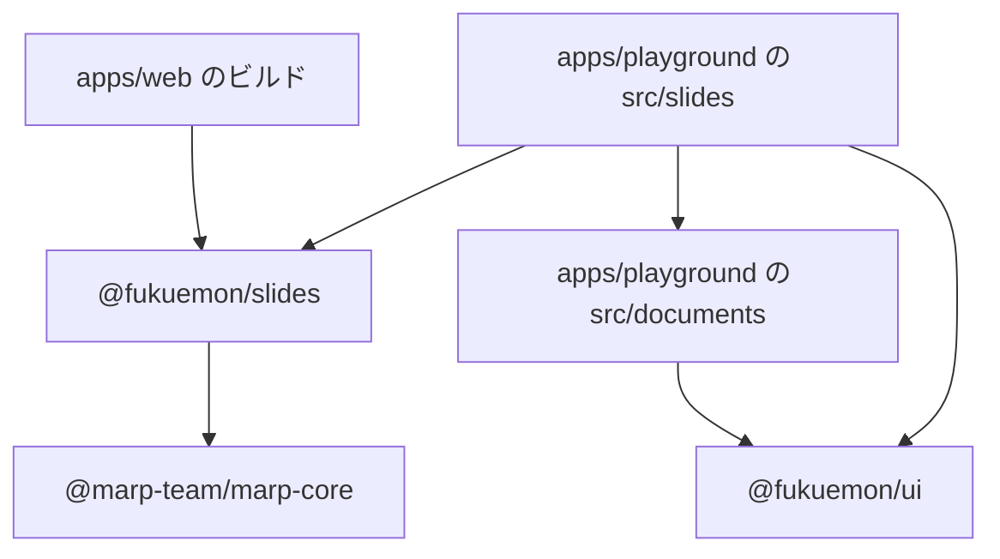
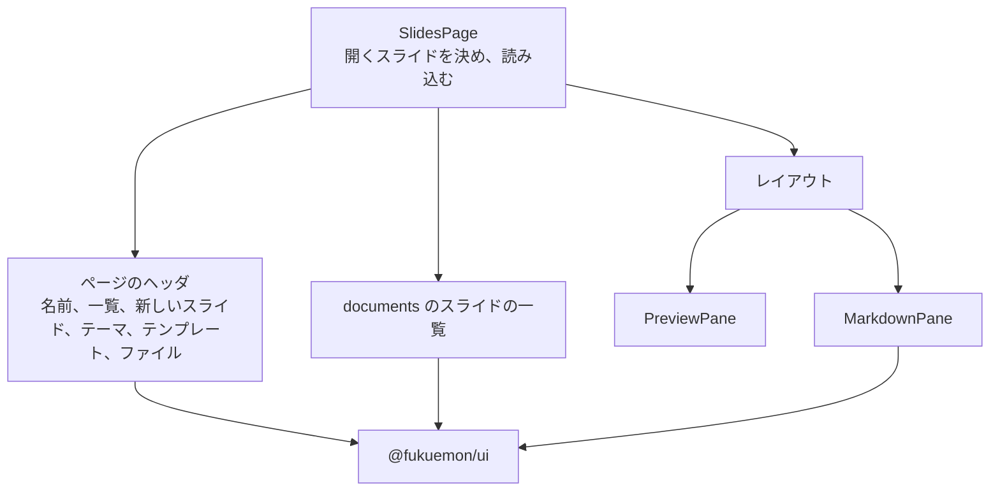
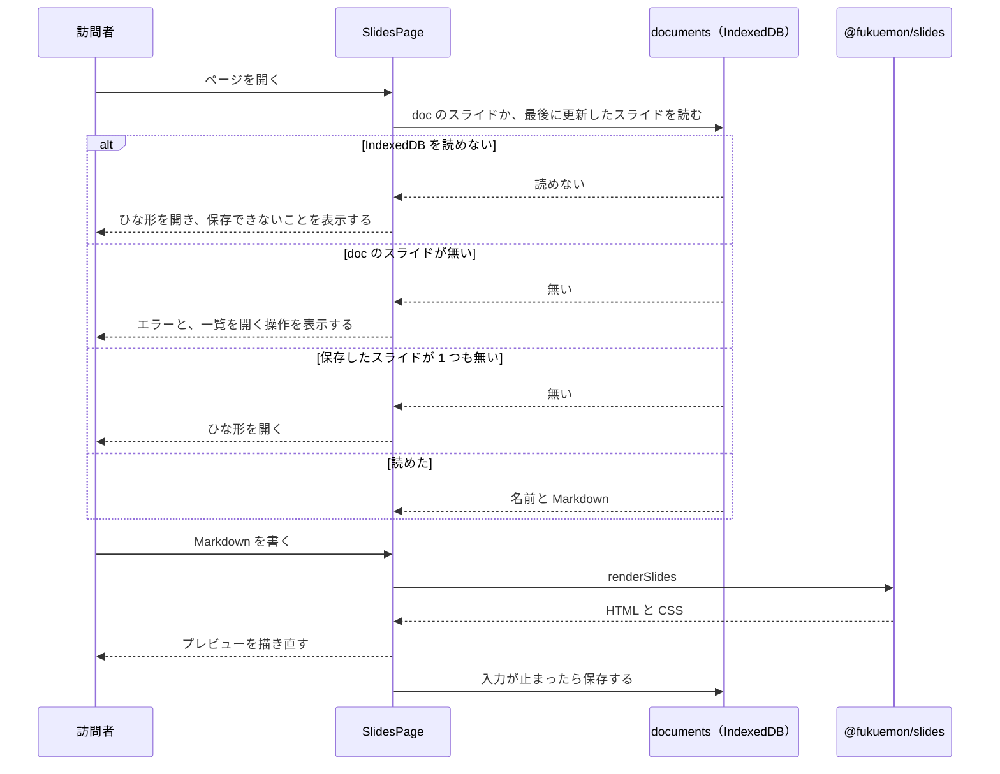
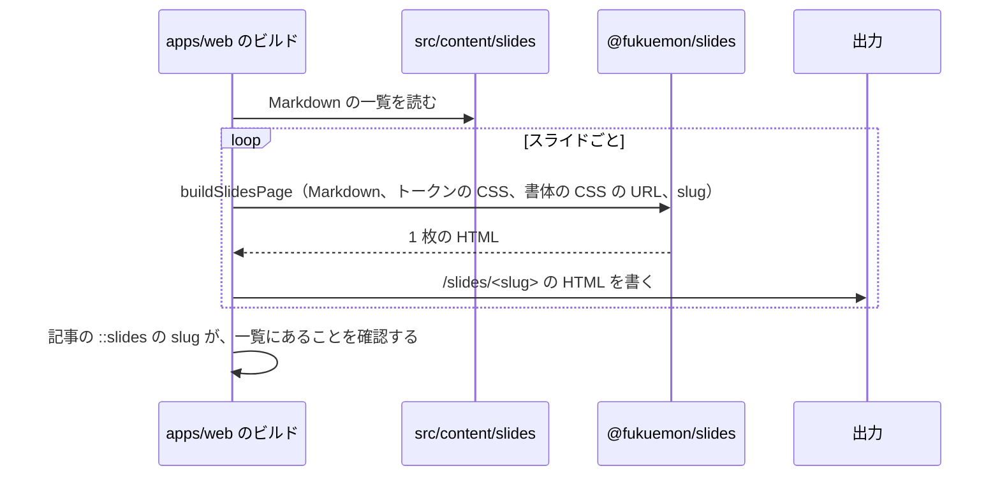

# スライド

## Overview

スライドは、訪問者と運営者が Markdown からスライドを作るエディタと、運営者が公開するスライドのページの 2 つである。  
エディタは、`play.fukuemon.dev` のツールである。公開するスライドは、`fukuemon.dev/slides/<slug>` の静的なページである。

全体の構成とホスト名は [fukuemon.dev Design Doc](../../DesignDoc.md) にある。  
プレイグラウンドのアプリの構成は [プレイグラウンドの Design Doc](../playground/DesignDoc.md) にある。  
方式は、次の ADR が決めている。

- ADR-0041: [スライドのエディタは Marp で作り、テーマの CSS からトークンの CSS 変数を参照する](../../../adr/0041-slides-editor-with-marp.md)
- ADR-0042: [公開するスライドは、ビルドのときに静的な HTML にして `/slides/<slug>` に置き、記事には iframe で埋め込む](../../../adr/0042-published-slides-as-static-pages.md)
- ADR-0043: [キャンバスとスライドのエディタは、ツールごとに、名前を付けた複数の図とスライドを IndexedDB に保存する](../../../adr/0043-multiple-named-documents-per-tool.md)

## Scope

持つものは次のとおり。

- エディタのパス、ページの構成、状態の置き場
- テーマとテンプレートの一覧
- `packages/slides` が公開する関数
- 保存、ファイルを開く操作、書き出しの流れ
- 公開するスライドのビルドの流れと、ページ送りの画面
- 記事の Markdown から、スライドを埋め込む書き方

持たないものは次のとおり。

- IndexedDB に保存するレコードの形と、一覧の画面の中身。ADR-0057 と、キャンバスの設計が持つ。
- AI のエージェントからの操作の登録と、スイッチの位置。
  - ADR-0044: [AI のエージェントからの操作は、WebMCP の API で登録し、MCP-B の polyfill と relay でも呼べるようにする](../../../adr/0044-ai-operations-with-webmcp.md)
- スライドの一覧のページ。最初の公開では作らない。
- 発表者用の画面（発表者のノート、タイマー）。
- Markdown に貼った画像を、IndexedDB と書き出したファイルに入れること。
- 画面のコンポーネントの見た目。[packages/ui/DESIGN.md](../../../packages/ui/DESIGN.md) が持つ。

## Design

### エディタのパス

エディタは、`play.fukuemon.dev/slides/` に置く。

| パス       | ツール             | cross-origin isolation のヘッダ |
| ---------- | ------------------ | ------------------------------- |
| `/slides/` | スライドのエディタ | 返さない                        |

- 開くスライドは、クエリの `doc` で指す（`/slides/?doc=<識別子>`）。
- `doc` が無いときは、最後に更新したスライドを開く。保存したスライドが 1 つも無いときは、ひな形を開く。
- `doc` の識別子に当たるスライドが無いときは、エラーと、一覧を開く操作を出す。ほかのスライドは開かない。
- エディタのページは、記事に埋め込まない。ページのヘッダは、いつも出す。

### ディレクトリと依存

```text
apps/playground/
  slides/index.html       スライドのエディタのエントリーポイント
  src/
    slides/               スライドのエディタのページ。レイアウト、プレビュー、書き出し、保存を進める React の外のモジュール
    documents/            名前を付けた図とスライドの保存と、一覧のコンポーネント。キャンバスのツールと共有する

apps/web/
  src/content/slides/     運営者が公開するスライドの Markdown

packages/
  slides/src/             テーマの CSS、テンプレート、Marp のインスタンスを作る関数、theme: を読み書きする関数、ページを組み立てる関数
```

テーマ、テンプレート、Marp の設定、ページを組み立てる関数は、`packages/slides`（`@fukuemon/slides`）に置く。  
ADR-0058: [スライドのテーマ、テンプレート、Marp の設定、ページを組み立てる関数を、`packages/slides` に置く](../../../adr/0058-slides-package-for-themes-and-pages.md)

次の図は、スライドに関わるディレクトリと package の間で許す import の向きを示す。矢印の無い組は、import しない。



- `@marp-team/marp-core` に依存するのは、`@fukuemon/slides` だけである。`apps/playground` と `apps/web` の `package.json` には、`@marp-team/marp-core` を依存として書かない。
- `@fukuemon/slides` は、React、`@fukuemon/ui`、workspace のほかの package に依存しない。
- `src/slides/` は、`apps/playground/src/` のほかのツールのページのディレクトリ（`node/`、`sql/`、`go/` と、キャンバスのツール）を import しない。Oxlint の `no-restricted-imports` の対象に、`slides/` を足す。
- `documents/` は、`@fukuemon/slides` を import しない。スライドの中身は、文字列として受け取る。

### `@fukuemon/slides`

```ts
type ThemeName = "fd-plain" | "fd-accent";

type Theme = { name: ThemeName; label: string; css: string };

type Template = { id: TemplateId; label: string; markdown: string };

type TemplateId = "title" | "toc" | "section" | "code" | "end";

declare const themes: readonly Theme[];
declare const templates: readonly Template[];
declare const starterMarkdown: string;

declare function renderSlides(markdown: string): RenderedSlides;

type RenderedSlides = { html: string; css: string; count: number; title: string | null };

declare function readTheme(markdown: string): ThemeName;
declare function writeTheme(markdown: string, theme: ThemeName): string;

declare function slideIndexAtLine(markdown: string, line: number): number;
declare function insertAfterSlide(markdown: string, index: number, fragment: string): string;

declare function buildSlidesPage(options: {
  markdown: string;
  tokensCss: string;
  fontsHref?: string;
  fallbackTitle: string;
}): string;
```

名前は、実装のときに変えてよい。

- Marp のインスタンスは、package の中の 1 つの関数が作る。渡す設定は、次のとおり。
  - 数式の記法を無効にする。
  - 絵文字を、OS の絵文字のまま出す。絵文字の画像を読み込まない。
  - Markdown の中の HTML のタグを、タグとして出さない。
  - テーマは、`themes` の 2 つだけを登録する。Marp に最初から入っているテーマは、登録から外す。
  - デフォルトのテーマは、`fd-plain` にする。
- `renderSlides` は、スライドの HTML、CSS、枚数、題を返す。題は、Markdown の先頭の `title:` の値である。無いときは、最初の見出しの文にする。見出しも無いときは、`null` を返す。
- `readTheme` は、Markdown の先頭の `theme:` の値を返す。値が無いときと、`themes` に無い名前のときは、`fd-plain` を返す。
- `writeTheme` は、`theme:` の行を書き換える。front matter が無いときは、先頭に足す。ほかの行は変えない。
- `slideIndexAtLine` は、行の番号から、その行が何枚目のスライドにあるかを返す。`insertAfterSlide` は、指定したスライドの後ろに、断片を 1 枚のスライドとして足す。
- `buildSlidesPage` は、ページ送りつきの 1 枚の HTML を返す。中身は [ページ送りの画面](#ページ送りの画面) にある。
  - トークンの CSS は、`tokensCss` で受け取り、`<style>` に入れる。
  - `fontsHref` を渡したときだけ、書体の CSS を `<link>` で読み込む。
  - ページの題は、`renderSlides` の題にする。題が `null` のときは、`fallbackTitle` を使う。
- 関数は、ブラウザと Node の両方で動く。DOM の API を使わない。

### テーマ

テーマは 2 つである。

| 名前        | 表示の名前 | 見た目                                             |
| ----------- | ---------- | -------------------------------------------------- |
| `fd-plain`  | 素         | 生成りの地に、墨の文字。ページの題の下に、罫を引く |
| `fd-accent` | 緑の帯     | 左の端に、緑の帯。見出しが緑。表紙は、緑の淡い地   |

- スライドの大きさは、1280×720 px である。ほかの大きさは、持たない。
- 色は、セマンティックトークンの CSS 変数を参照する。テーマの CSS に、色の値を書かない。
- コードの色は、highlight.js のクラスに、コードの色のトークンを対応させる。
- ライトとダークは、トークンの値の切り替えに任せる。テーマの CSS に、明暗ごとの規則を書かない。
- 2 つのテーマは、スライドの大きさ、文字の大きさ、コードの色、テンプレートのクラスの配置を、共通の CSS として共有する。
- 選んだテーマは、Markdown の先頭の `theme:` にだけ持つ。保存するレコードに、テーマの項目を置かない。

### テンプレート

テンプレートは、1 枚のスライドの Markdown の断片である。ページの種類は、`<!-- _class: title -->` のように、Marp のクラスで表す。

| 識別子    | 表示の名前 | クラス    | 中身                           |
| --------- | ---------- | --------- | ------------------------------ |
| `title`   | 表紙       | `title`   | 題、発表者の名前、日付         |
| `toc`     | 目次       | `toc`     | 番号付きの一覧                 |
| `section` | 章の扉     | `section` | 章の番号と、章の題             |
| `code`    | コード     | `code`    | 小さい見出しと、コードブロック |
| `end`     | 結び       | `end`     | まとめの箇条書きと、リンク     |

- ひな形（`starterMarkdown`）は、`theme: fd-plain` の front matter と、5 つのテンプレートを表の順に並べたものである。
- テーマは、5 つのクラスの見た目を持つ。

### エディタのページ

次の図は、エディタのページのツリーを示す。



ページのヘッダには、左から次のものを並べる。

| 位置 | 中身               | コンポーネント | 動き                                                                                            |
| ---- | ------------------ | -------------- | ----------------------------------------------------------------------------------------------- |
| 1    | スライドの名前     | `TextField`    | 名前を変える                                                                                    |
| 2    | 「スライドの一覧」 | `Button`       | 一覧のダイアログを開く                                                                          |
| 3    | 「新しいスライド」 | `Button`       | ひな形から、新しいスライドを作って開く。開いていたスライドは変えない                            |
| 4    | 「テーマ: 素」     | `ActionMenu`   | 項目は、テーマの表示の名前である。選ぶと、`theme:` を書き換える。ボタンの文に、今のテーマを出す |
| 5    | 「テンプレート」   | `ActionMenu`   | 項目は、テンプレートの表示の名前である。選ぶと、カーソルのあるスライドの後ろに足す              |
| 6    | 「ファイル」       | `ActionMenu`   | ファイルを開く、Markdown を書き出す、HTML を書き出す、PDF にする                                |
| 7    | 保存の状態         | 文             | 保存した時刻か、保存できないことを出す                                                          |

- レイアウトは、`SplitPane` で、左に `MarkdownPane`、右に `PreviewPane` を並べる。`md:` より狭い画面では、`Tabs` で 2 つを切り替える。
- `MarkdownPane` は、`EditorFrame` に、Node の実行環境と同じエディタのエンジンを渡す。タブは出さない。
- `PreviewPane` は、全てのスライドを縦に並べ、幅に合わせて縮める。スライドの左上に、何枚目かを出す。
  - プレビューは、Shadow DOM に入れる。Marp の CSS を、ページに適用させないためである。
  - 入力のたびに、`renderSlides` の結果で描き直す。
  - カーソルのあるスライドが見えるところまで、プレビューをスクロールする。動きを減らす設定のときは、動かさずに位置を変える。
- スライドの名前、一覧、確認のダイアログは、`documents/` のコンポーネントを使う。一覧の中身と、消す操作の確認は、キャンバスのツールと同じである。
- 新しいスライドの名前は、`無題のスライド` に連番を付ける。
- 状態は、`SlidesPage` が `useReducer` で持つ。持つのは、開いているスライドの識別子と名前、Markdown、カーソルの行、狭い画面で選んだタブ、保存の状態である。
  - テーマは、状態に持たない。`readTheme` で、Markdown から求める。
  - 状態管理のライブラリと、ツリーをまたぐ通知は使わない。
- `use` に渡す Promise（開くスライドの読み込み）は、`src/slides/` の React の外のモジュールが、識別子ごとに 1 つ作って持つ。
- テーマを選ぶ操作と、テンプレートを足す操作は、エディタのエンジンの編集として Markdown を変える。訪問者は、元に戻す操作で取り消せる。

### 保存

保存するレコードの形、データベース、IndexedDB を読めないときの動きは、ADR-0057 に従う。  
スライドのエディタは、`documents/` のモジュールを通して、読み書きする。

- ツールの種類は、`slides` である。
- 中身は、Markdown の全文である。テーマは、Markdown の `theme:` に入っている。
- 保存は、入力が 500 ミリ秒止まったときに行う。ページを隠すとき（`visibilitychange`）は、待たずに保存する。500 ミリ秒は、測っていない値で、実装のタスクで測って変えてよい。
- ひな形を開いただけでは、保存しない。最初に編集したときに、新しいスライドとして保存する。
- 「新しいスライド」を押したときは、すぐに保存する。
- 「ファイルを開く」は、`.md` のファイルを、新しいスライドとして保存して開く。名前は、ファイルの名前から付ける。開いていたスライドは変えない。

次の図は、エディタのページを開いてから、保存するまでの流れを示す。



### 書き出し

書き出すファイルは 3 つである。ファイルの名前は、スライドの名前から付ける。

| 形式        | 作り方                                                                                     |
| ----------- | ------------------------------------------------------------------------------------------ |
| Markdown    | エディタの Markdown を、そのまま `.md` のファイルにする                                    |
| 単独の HTML | `buildSlidesPage` の結果を、`.html` のファイルにする。`fontsHref` は渡さない               |
| PDF         | `buildSlidesPage` の結果を、画面に出さない iframe に入れ、ブラウザの印刷のダイアログを開く |

- トークンの CSS は、`src/slides/` が、`@fukuemon/ui` のトークンの CSS を文字列として読み込み、`tokensCss` に渡す。
- 単独の HTML は、自分のファイルのほかを読み込まない。書体は埋め込まず、訪問者の端末の書体で出す。
- 印刷のときは、全てのスライドを 1 ページに 1 枚ずつ出し、ページ送りの帯を出さない。用紙の大きさは、スライドと同じ 1280×720 px にする。

### 公開するスライドのビルド

運営者は、Markdown を `apps/web/src/content/slides/<slug>.md` に置く。

- `<slug>` は、ファイルの名前である。英小文字、数字、ハイフンだけを使う。
- 置いたスライドは、全て公開する。下書きの状態は持たない。
- `apps/web` のビルドは、Markdown を、記事の Markdown の処理に通さない。文字列として読み、`buildSlidesPage` に渡す。

次の図は、ビルドの流れを示す。



- `fallbackTitle` には、slug を渡す。
- `fontsHref` には、サイトの書体の CSS の URL を渡す。公開するスライドは、サイトの書体で出る。
- slug が規則に合わないときと、スライドが 0 枚のときは、ビルドを失敗させる。

### ページ送りの画面

`buildSlidesPage` が作るページは、スライドと、その下の帯でできている。  
ADR-0059: [公開するスライドのページ送りを下の帯に置き、JavaScript が有効なときに全画面の表示とスワイプでの操作を足す](../../../adr/0059-slides-pager-fullscreen-and-swipe.md)

```text
┌──────────────────────────────────────────────┐
│                                              │
│                  スライド                     │
│                                              │
├──────────────────────────────────────────────┤
│            前へ   3 / 12   次へ      [全画面] │
└──────────────────────────────────────────────┘
```

- 表示するスライドは、URL の `#3` のような番号で決める。番号が無いときは、1 枚目を出す。
- スライドは、ページの幅と、帯を除いた高さに収まる大きさで、中央に出す。
- 帯は、高さ 48px で、`<nav>` に「ページ送り」の名前を付ける。
- 帯の中央に、「前へ」、番号、「次へ」を並べる。番号は `3 / 12` の形で、読み上げには「12 枚中 3 枚目」と渡す。
- 最初のページの「前へ」と、最後のページの「次へ」は、リンクにせず、`text-disabled` の色の文字で出す。
- リンクの押せる範囲は、高さ 44px 以上にする。
- 帯の色と罫は、セマンティックトークンの CSS 変数を参照する。リンクの見た目は `@fukuemon/ui` の `Link` に、「全画面」のボタンの見た目は `Button` に合わせる。
- ページを切り替えるときに、動きを付けない。

JavaScript が有効なときは、ページの 1 つの `<script>` が、次の操作を足す。

| 操作               | 動き                                                                     |
| ------------------ | ------------------------------------------------------------------------ |
| 左右の矢印のキー   | 前後に送る                                                               |
| PageUp、PageDown   | 前後に送る                                                               |
| Home、End          | 最初と最後のページに送る                                                 |
| 「全画面」のボタン | ページを全画面にする。全画面の間は、ボタンの文を「全画面を終える」にする |
| 左右のスワイプ     | 左へのスワイプで次のページに、右へのスワイプで前のページに送る           |

- キーとスワイプは、帯のリンクを押したのと同じ処理で送る。
- キーは、修飾キーを押しているときと、フォーカスがボタンにあるときの Space と Enter では、送らない。
- 「全画面」のボタンは、HTML では隠しておき、`document.fullscreenEnabled` が `true` のときだけ、スクリプトが出す。
- スワイプの判定は、次のとおり。
  - スライドの領域の `touch-action` を、`pan-y pinch-zoom` にする。縦の動きと、2 本の指での拡大は、ブラウザが処理する。
  - 入力がタッチで、指が 1 本で、横の移動が 48px 以上で、縦の移動の 2 倍以上の動きだけを、指を離したときにスワイプと判定する。
  - `pointercancel` が来た動き、ページを拡大している間の動き、文字を選んでいる間の動きは、スワイプと判定しない。
  - 指の動きに合わせて、スライドを動かさない。
- 48px と 2 倍は、測っていない値で、実装のタスクで実機で測って変えてよい。

### 記事への埋め込み

記事の Markdown には、ディレクティブで書く。

```md
::slides[WAL の仕組み]{slug="wal-internals"}
```

- 角括弧の中は、スライドの題である。必須にする。iframe の `title` と、iframe の下のリンクの文に使う。
- `slug` は、`apps/web/src/content/slides/<slug>.md` の名前である。必須にする。
- 題が無いとき、`slug` が無いとき、`slug` に当たる Markdown が無いときは、ビルドを失敗させる。

ビルドは、ディレクティブを、次の HTML にする。

```html
<figure>
  <iframe src="/slides/wal-internals" title="WAL の仕組み" loading="lazy" allowfullscreen></iframe>
  <figcaption><a href="/slides/wal-internals">WAL の仕組み（スライドを開く）</a></figcaption>
</figure>
```

- iframe の幅は、本文の幅にする。高さは、幅の 16 分の 9 に、帯の 48px を足した値にする。
- iframe の中のページは、OS の設定の明暗に従う。
- 記事のページは、エディタの JavaScript と、marp-core を読み込まない。

## Interface

### 置くファイル

- `apps/playground/slides/index.html`、`apps/playground/src/slides/`: スライドのエディタ。
- `apps/playground/src/documents/`: 名前を付けた図とスライドの保存と、一覧のコンポーネント。
- `packages/slides/`: テーマ、テンプレート、Marp の設定、ページを組み立てる関数。
- `apps/web/src/content/slides/<slug>.md`: 運営者が公開するスライドの Markdown。

### 読む値

- URL のクエリの `doc`: 開くスライドの識別子。
- URL の `#<番号>`: 公開するスライドと、単独の HTML で、表示するスライドの番号。
- Markdown の先頭の `theme:`: テーマの名前。`fd-plain` か `fd-accent`。
- Markdown の先頭の `title:`: ページの題。
- IndexedDB: 名前を付けたスライド。ツールの種類は `slides`。

### 記事に書く記法

- `::slides[<題>]{slug="<slug>"}`: 公開するスライドを、記事に埋め込む。

### 動くチェック

- Oxlint の `no-restricted-imports`: `apps/playground/src/` の、ツールのページのディレクトリの間の import を止める。対象に `slides/` を足す。
- package の依存の宣言と knip: 次の 2 つを確認する。
  - `@fukuemon/slides` が、React、`@fukuemon/ui`、workspace のほかの package に依存しないこと
  - `apps/playground` と `apps/web` が、`@marp-team/marp-core` を直接は import しないこと
- `apps/web` のビルド: slug の規則、スライドの枚数、`::slides` の題と `slug` を確認する。

## Verification

端末は Apple M2、ブラウザは Playwright 1.65.0 の Chromium 158、WebKit 27.2、Firefox 159（headless）、配信は `localhost` である。  
バージョンは、`@marp-team/marp-core` 4.4.0 である。実機のブラウザは未確認である。

- `fd-plain` と `fd-accent` の 2 つのテーマで、表紙、目次、コードの 3 つのクラスを描いた。色は、ライトとダークの両方で、トークンの値と一致した。
- 下の帯の中央に「前へ」、番号、「次へ」を並べた形で、JavaScript を無効にして、前後に送れた（3 つのブラウザ）。
- 章の扉と結びのクラスは、描いていない。
- 全画面の表示と、スワイプでの操作は、作っていない。
- Marpit から、スライドの区切りの行の番号を読めるかは、未確認である。`slideIndexAtLine` と `insertAfterSlide` の作り方は、実装のタスクで確認する。
- Marp に最初から入っているテーマを、登録から外せるかは、未確認である。
- `COEP: require-corp` を返す記事に、スライドの iframe を埋め込めるかは、未確認である。埋め込めないときは、`/slides/*` に返すヘッダを足す。
- 訪問者が、印刷のダイアログから PDF に保存する操作と、WebKit と Firefox の印刷は、未確認である。
