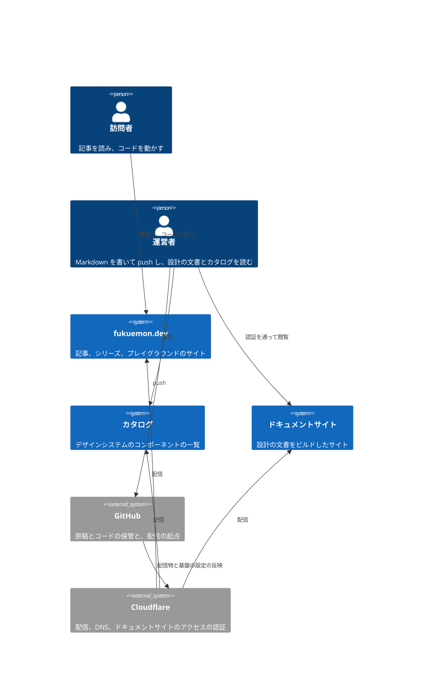

# fukuemon.dev PRD

## Overview / Problem Statement

fukuemon.dev は、運営者 1 名が技術の記事を公開する個人のサイトである。  
目的は、訪問者がコードを書いて動かしながら、技術の仕組みを体系的に学べることにある。

コンテンツの種別は、記事の 1 つである。  
記事は、主題ごとのシリーズにまとまり、読む順に並ぶ。  
記事には、図と、ブラウザの中でコードを動かす実行環境を埋め込む。  
プレイグラウンドは、訪問者がブラウザの中で使う複数のツール（コードと SQL の実行環境、キャンバス、スライドのエディタ）を提供する。  
最初のツールは、コードと SQL の実行環境である。

OAuth、OIDC、セッション管理、データベースの性能のような主題は、説明と図を読むだけでは、何がどの順に起きるかを実感しにくい。  
訪問者が自分の手元で試そうとすると、サーバーとデータベースを用意するところで止まる。  
このサイトは、読む場所と動かす場所を同じページに置いて、読むことと動かすことのあいだを埋める。

## Background

### 説明と図を読むだけでは、何がどの順に起きるかを実感しにくい

認証と認可の仕組みでは、リダイレクト、トークン、Cookie が、ブラウザと複数のサーバーのあいだを行き来する。  
データベースの性能では、インデックスの有無で実行計画が変わる。  
どちらも、文と図で順を説明できるが、訪問者は値を変えたときに何が変わるかを確認できない。

### 手元で試そうとすると、環境を作るところで止まる

認可サーバー、クライアント、データベースを手元に立てる作業は、主題の理解と関係がない。  
環境を作る作業が重い主題ほど、訪問者は手を動かす前に離れる。

### 主題を順に学ぶ道筋が、記事の並びから読み取れない

1 つの主題は、1 本の記事に収まらない。  
記事が公開の日付の順に並ぶだけだと、訪問者はどの記事から読めばよいかを判断できない。

## Goals

対象の利用者は次の 2 者である。

- 訪問者: 技術者。ある主題を、読んで、動かして、順に理解したい。
- 運営者: 1 名。記事を書き、サイトを開発する。Markdown を 1 枚書くだけで記事を公開したい。

訪問者は、主題ごとのシリーズを読む順に辿り、記事の中でコードを動かして、仕組みを確認できる。  
運営者は、Markdown を 1 枚書くだけで、一覧とシリーズに記事を載せられる。  
運営者は、設計の文書とデザインシステムのカタログを、ビルドしたサイトとして読める。

## Lower-Priority Goals

次の機能は、それぞれの条件が実在したときに作る。  
時期では判断しない。

- 手順の形式の記事（複数のセクションに分かれ、手順を順に進める記事）: 実行環境の要らない手順の記事を公開したいとき。
- キャンバス: プレイグラウンドのツール。訪問者と運営者が、ブラウザの中で図を描いて編集する。クラウドのインフラの構成図も描ける。運営者は、描いた図を記事に埋め込む。図を描いて見せる記事を書くとき。
- スライドのエディタ: プレイグラウンドのツール。訪問者と運営者が、Markdown からスライドを作り、テーマとテンプレートを選ぶ。運営者は、作ったスライドをサイトで公開する。登壇の資料をこのサイトで作りたいとき。
- AI からの操作: AI のエージェントが、プレイグラウンドのツール（実行環境、キャンバス、スライドのエディタ）を操作する。操作させたいツールが 1 つ以上できたとき。
- 記事のあいだの関連の表示: シリーズをまたいで参照させたい記事ができたとき。
- 本文の検索: 記事が増えて、一覧とシリーズから辿れなくなったとき。
- 分類での絞り込み: 分類での絞り込みが要ると判断したとき、または分類が 12 を超えたとき。
- コメント: コメントが欲しくなったとき。
- 問い合わせのフォーム: 送信を受ける口が要るとき。

条件が成り立ったときに作る形は [Design Doc](design/DesignDoc.md#条件つきで追加する機能の形) にある。

## Non-Goals

次のものは作らない。

- 訪問者のアカウントと認証
  - ADR-0008: [読者の identity を前提とする機能を作らない](adr/0008-no-reader-identity.md)
- サーバーで訪問者のコードを動かすこと
  - 訪問者が増えると費用が増え、悪用を防ぐ仕組みも要る。
- 問題とテストによる合否の判定
- Bookmark、Highlight、Annotation
  - ブラウザの機能と重なるか、訪問者の identity が要る。
- 分類ごとの索引のページ
  - 分類は組み合わせで数が増える。分類での絞り込みは、一覧のページの中で行う。
- 多言語への対応
  - 日本語だけにする。

## User Stories

### 訪問者が、主題をどの記事から読めばよいか分からない

> How Might We: 訪問者が、主題ごとに、読む順に並んだ記事を辿れるようにするには。

基盤のフェーズで提供する。

### 訪問者が、説明と図を読んでも、通信の順を実感できない

> How Might We: 訪問者が、記事を読みながら、同じページの中でサーバーとクライアントを動かし、やり取りした通信を順に見られるようにするには。

実行環境のフェーズで提供する。

### 訪問者が、手を動かす前に環境を作るところで止まる

> How Might We: 訪問者が、何も入れずに、ブラウザの中でコードと SQL を動かせるようにするには。

実行環境のフェーズで提供する。

### 運営者が、記事を 1 本追加するたびに一覧とシリーズを直している

> How Might We: 運営者が Markdown を 1 枚書くだけで、一覧とシリーズに記事が載るようにするには。

基盤のフェーズで提供する。

## Proposed Solution / Feature Description

### System Context

次の図は、訪問者と運営者が、サイトと外部のシステムに何を頼むかを示す。

訪問者のコードは、訪問者のブラウザの中だけで動く。  
実行のための外部のシステムを持たない。

### コンテンツの構成

コンテンツの違いを、構成と、埋め込むコンテンツの 2 つの軸で表す。  
種別は増やさない。

| 軸                 | 値                                           | 提供するフェーズ                            |
| ------------------ | -------------------------------------------- | ------------------------------------------- |
| 構成               | 1 ページ（上から下へ読む）                   | 基盤のフェーズ                              |
| 構成               | 手順（複数のセクションに分かれ、順に進める） | Lower-Priority Goals の条件が成り立ったとき |
| 埋め込むコンテンツ | Mermaid の記法で書いた図                     | 基盤のフェーズ                              |
| 埋め込むコンテンツ | 実行環境                                     | 実行環境のフェーズ                          |
| 埋め込むコンテンツ | キャンバスの図、スライド                     | Lower-Priority Goals の条件が成り立ったとき |

構成は記事ごとに 1 つ選び、埋め込むコンテンツは 1 本の記事にいくつでも置ける。

### トップ、一覧、記事

- トップ: 運営者のプロフィールを兼ねる。
  - ADR-0026: [トップの最初の訪問で水墨の門を描き、門をくぐった立体の庭にプロフィールを置く](adr/0026-sumi-gate-and-garden-on-top.md)
- 記事の一覧: 公開した全ての記事を並べる。記事がシリーズに入っていれば、シリーズの名前を表示する。
- 記事: 本文、図、シリーズの中の位置、前後の記事へのリンクを表示する。
- RSS

一覧と記事は、JavaScript を無効にしても読める。  
図は、ライトとダークのどちらの配色でも読める。

### シリーズ

シリーズは、1 本ずつ独立して読める記事を、主題ごとに、読む順に並べたまとまりである。

- 記事ごとに URL があり、1 本だけを開いても読める。
- 記事のページに、シリーズの名前と、前の記事、次の記事へのリンクを表示する。
- シリーズのページに、タイトル、説明、記事の一覧を読む順に表示する。
- シリーズに入れない記事も公開できる。

### 実行環境とプレイグラウンド

実行環境のフェーズで提供する。

- 訪問者は、記事に埋め込んだ実行環境で、運営者が用意した初期ファイルからコードを動かせる。
- 訪問者は、プレイグラウンドで、記事から離れて実行環境を使える。
- 実行環境の読み込みは、記事の初回の表示を遅らせない。

プレイグラウンドは、訪問者がブラウザの中で使う複数のツール（コードと SQL の実行環境、キャンバス、スライドのエディタ）を提供する。  
このフェーズで提供するツールは、コードと SQL の実行環境である。  
キャンバスとスライドのエディタは、Lower-Priority Goals の条件が成り立ったときに、プレイグラウンドのツールとして追加する。

- 訪問者がプレイグラウンドで作ったファイル、図、スライドは、訪問者のブラウザに保存する。サイトのサーバーに送らない。
- 訪問者は、同じ端末で再訪したときに、前に作ったものを開ける。

実行環境ができることの一覧は、実行環境のフェーズを始めるときに、このセクションに書く。

### コンテンツの追加

運営者は Markdown を 1 枚書いて記事を追加する。  
一覧とシリーズのページを手動で直さない。  
新しいシリーズを作るときだけ、シリーズのタイトルと説明を書いたファイルを 1 枚追加する。

### カタログとドキュメントサイト

- カタログ: デザインシステムのコンポーネントを、誰でも開ける。
- ドキュメントサイト: PRD、Design Doc、ADR をビルドしたサイトを、運営者が許可した人だけが開ける。文書の原本は、公開のリポジトリにある。

### Milestones

#### 基盤のフェーズ

提供する機能は、記事の一覧、1 ページの記事、シリーズ、Mermaid の図、ドキュメントサイトである。  
確認する問いは、Markdown を 1 枚追加するだけで、記事が一覧とシリーズに載り、JavaScript なしで読めるかである。  
Success Metrics の「記事を読める」「記事の追加が 1 枚で済む」「図が読める」「シリーズを辿れる」「一覧から記事を開く操作を自動で確認している」「初回の表示が速い」で確認する。

このフェーズでは、検証用の原稿で確認する。  
検証用の原稿は、本番で公開しない。

#### デザインシステムのフェーズ

提供する機能は、トークン、コンポーネント、カタログ、トップの庭である。  
基盤のフェーズと並べて進める。

#### 実行環境のフェーズ

提供する機能は、記事に埋め込む実行環境と、プレイグラウンドである。  
確認する問いは、訪問者がブラウザの中でサーバーとクライアントを動かし、通信の流れを追えるかである。

#### 最初の公開

基盤、デザインシステム、実行環境の 3 つのフェーズがそろってから、本番を新しいサイトに切り替える。  
切り替えまで、本番は切り替える前のサイトを配信し続ける。

最初に公開する記事は、OIDC の主題（クライアントとサーバーの通信など）と、データベースの主題（インデックス、実行計画の理解、性能の調整）である。  
どちらも、ブラウザの中で SQL やコードを動かす記事なので、実行環境のフェーズの後に公開する。  
運営者は、1 つのシリーズに 2 本以上の記事を書く。

### Success Metrics

- 記事を読める。
  - 記事の一覧と記事のページが開ける。JavaScript を無効にしても読める。
- 記事の追加が 1 枚で済む。
  - 記事を 1 本追加するときに変えるファイルが、その Markdown だけである。
- 図が読める。
  - 記事に Mermaid の記法で書いた図が、ライトとダークのどちらの配色でも読める。
- シリーズを辿れる。
  - 記事が主題ごとのシリーズにまとまり、読む順に並び、前後の記事へ移れる。
- 一覧から記事を開く操作を自動で確認している。
  - 一覧から記事を開く E2E のテストが、CI で通る。
- 初回の表示が速い。
  - Lighthouse の Performance が 90 以上で、LCP が 2.5 秒以内である（Moto G Power、Slow 4G 相当）。
  - トップの最初の訪問は、この条件の対象から除く。最初の訪問だけに、水墨の門のイントロ（約 10 秒）を表示するためである。2 回目以降の訪問のトップは、対象に含める。
- ドキュメントサイトを、許可した人だけが開ける。
  - 許可していない人がドキュメントサイトの URL を開くと、認証の画面になる。
- 公開に関わる Cloudflare の設定が、Dashboard の上の属人的な設定として残らない。
  - ドメイン、DNS、配信先、ドキュメントサイトのアクセスの認証の設定が、リポジトリに書いた定義と一致する。
  - 確認した結果は [基盤の Design Doc の Verification](../infra/DesignDoc.md#verification) にある。

## Open Questions / Risks

### Open Questions

判断するのは、どれも運営者である。

- 実行環境の方式。実行環境のフェーズの prototype で決める。
- トップの署名と季節の差し色を、ほかのページにも表示するか。記事のページができてから決める。
- キャンバスの方式。候補は、draw.io の Embed Mode と Excalidraw である。キャンバスの要求を書くときに決める。
- スライドのエディタの方式。候補は Marp である。スライドの要求を書くときに決める。
- AI からの操作の方式。候補は WebMCP である。AI からの操作の要求を書くときに決める。
- 分類の粒度と最初の分類の組。最初に公開する記事を書くときに決める。

### Risks

- 最初の公開が、実行環境のフェーズに依存する。実行環境のフェーズが延びると、記事を公開できない期間が延びる。
  - 対策: 文と図だけの記事を先に公開するかを、基盤のフェーズが終わった時点で運営者が判断する。
- 基盤のフェーズを検証用の原稿で確認するので、本物の記事の分量と用語でのレイアウトの確認が、最初の公開の直前になる。
  - 対策: 最初に公開する記事の原稿ができた時点で、プレビューの URL でレイアウトを確認する。
