# ADR の索引

今有効な ADR と、提案の ADR を、話題ごとに並べる。提案の ADR は、題の先頭に（提案）と書く。  
ADR の規則は、[README.md](README.md) にある。

## サイトの構成と描画

| ADR                                              | 題                                                                                 |
| ------------------------------------------------ | ---------------------------------------------------------------------------------- |
| [ADR-0001](0001-starlight-as-docs-renderer.md)   | Starlight を採らず、Astro 単体 + Expressive Code で組む                            |
| [ADR-0002](0002-content-model-independence.md)   | 関係を `contentId` の辺として持ち、Content Model を Astro 非依存に保つ             |
| [ADR-0008](0008-no-reader-identity.md)           | 読者の identity を前提とする機能を作らず、バックエンドを持たない                   |
| [ADR-0016](0016-render-mermaid-with-pele.md)     | mermaid の図を、ビルドでも島でも Pele で SVG にする                                |
| [ADR-0029](0029-repository-layout-like-buddy.md) | リポジトリの構成を buddy に合わせ、文書を `docs/` に、E2E を `packages/e2e` に置く |
| [ADR-0030](0030-articles-format-and-series.md)   | 種別を記事の 1 つにし、構成を記事の形式で、シリーズをディレクトリで表す            |

## 開発のツール

| ADR                                             | 題                                                                                                       |
| ----------------------------------------------- | -------------------------------------------------------------------------------------------------------- |
| [ADR-0003](0003-monorepo-and-vite-plus.md)      | pnpm workspace の monorepo とし、package の境界を最初から物理的に分ける                                  |
| [ADR-0007](0007-quality-gates.md)               | 品質チェックに react-doctor / knip / similarity-ts を採り、Bun / Biome を採らない                        |
| [ADR-0011](0011-pin-tool-versions-with-mise.md) | ツールのバージョンを mise で固定する                                                                     |
| [ADR-0017](0017-vp-run-cache-for-web-build.md)  | Vite+ を、`apps/web` の build のキャッシュ、`apps/playground` の実行、`packages/ui` のテストに限って使う |

## 配信の基盤

| ADR                                                     | 題                                                                                         |
| ------------------------------------------------------- | ------------------------------------------------------------------------------------------ |
| [ADR-0005](0005-workers-terraform-wrangler-boundary.md) | Cloudflare Workers Static Assets を採用し、基盤を Terraform、deploy を Wrangler が管理する |
| [ADR-0031](0031-subdomains-and-workers.md)              | サブドメインに分ける規則を決め、1 つのアプリを 1 つの Worker とホスト名に割り当てる        |
| [ADR-0032](0032-docs-site-zensical.md)                  | ドキュメントサイトを Zensical でビルドし、custom domain だけで配信する                     |

## 書体、トークン、コンポーネント

| ADR                                                          | 題                                                                                                                                                 |
| ------------------------------------------------------------ | -------------------------------------------------------------------------------------------------------------------------------------------------- |
| [ADR-0075](0075-system-font-for-body-text.md)                | 本文をシステムフォントで描き、Web フォントを記事の題と見出しの明朝と等幅だけにする                                                                 |
| [ADR-0055](0055-tailwind-preflight-and-theme-from-ui.md)     | Tailwind CSS v4 を CSS スタイリングの基盤にし、サイトの共通の CSS で preflight を読み、トークンを packages/ui のテーマ変数から使う                 |
| [ADR-0024](0024-tokens-of-fukuemon-dev.md)                   | （提案）トークンを、fukuemon.dev の値のプリミティブトークン、セマンティックトークン、テーマ変数の 3 つの層にし、生成りの地と旧サイトの差し色にする |
| [ADR-0028](0028-radius-shadow-and-brush-motion.md)           | （提案）操作できる要素と重なる面の角を 4px で丸め、ボタンと入力欄にステッチを引き、重なる面にずらした影を付け、罫を引く動きを筆の線にする          |
| [ADR-0061](0061-sumi-focus-ring.md)                          | フォーカスの表示を、DADS の黄と黒の 2 重の表示から、墨の 2px の 1 重の輪にする                                                                     |
| [ADR-0021](0021-ui-components-and-catalog.md)                | packages/ui に Base と Case の React のコンポーネントを置き、packages/ui の Storybook をカタログにする                                             |
| [ADR-0022](0022-code-colors-from-tokens.md)                  | コードの色を、セマンティックトークンから生成したテーマで、コードブロック、エディタ、端末に配る                                                     |
| [ADR-0062](0062-dense-text-and-targets-in-playground.md)     | コードを動かす画面だけ、文字を 12px と 13px まで小さくし、押せる領域をマウスで押す端末は 24×24 CSS px、触る端末は 44×44 CSS px にする              |
| [ADR-0079](0079-inset-focus-ring-in-dense-panes.md)          | コードを動かす画面の詰めたペイン、木の行の中の名前の欄、`SplitPane` の仕切りで、フォーカスの輪を要素の内側に引く                                   |
| [ADR-0068](0068-solid-tab-indicator-in-forced-colors.md)     | ハイコントラストのとき、選んだタブの下の罫を、筆の線の形でなく全幅の帯にする                                                                       |
| [ADR-0071](0071-touch-targets-and-ios-zoom-in-playground.md) | コードを動かす画面の文字の大きさを端末の種類で分けず、iOS と iPadOS の入力時の拡大を viewport の指定で止める                                       |
| [ADR-0072](0072-short-landscape-layout-in-playground.md)     | コードを動かす画面を、幅が 48rem 未満か高さが 500px 未満のときに狭い配置にし、高さが 500px 未満ではペインを左の縦のタブで切り替える                |
| [ADR-0073](0073-layered-panes-and-radius-in-playground.md)   | コードを動かす画面を、地の上に角の丸い紙の面を重ねる見た目にし、面の角を 6〜14px で丸める                                                          |

## 挿絵とトップの演出

| ADR                                                    | 題                                                                                                   |
| ------------------------------------------------------ | ---------------------------------------------------------------------------------------------------- |
| [ADR-0026](0026-sumi-gate-and-garden-on-top.md)        | トップの最初の訪問で水墨の門を描き、門をくぐった立体の庭にプロフィールを置く                         |
| [ADR-0027](0027-garden-by-season-and-time.md)          | トップの庭の絵を、訪問者の端末の日付と時刻で、季節と時間帯ごとに変える                               |
| [ADR-0065](0065-site-header-with-sign-logo.md)         | 全てのページに、イントロの署名をロゴにしたヘッダーを置き、ナビに記事とプレイグラウンドを並べる       |
| [ADR-0078](0078-top-lighthouse-gpu-and-throttling.md)  | トップの Lighthouse の合否を、Metal の GPU と simulate のスロットリングで 5 回測った中央値で判定する |
| [ADR-0080](0080-ink-gate-svg-loaded-on-first-visit.md) | 墨の絵と署名の SVG を、トップの HTML に入れず、最初の訪問のときだけ読み込む                          |

## 実行環境とプレイグラウンド

| ADR                                                             | 題                                                                                                                                                                                                    |
| --------------------------------------------------------------- | ----------------------------------------------------------------------------------------------------------------------------------------------------------------------------------------------------- |
| [ADR-0033](0033-webcontainers-for-node.md)                      | Node と npm の実行に WebContainers を採り、実行環境と画面の間をインターフェースで分ける                                                                                                               |
| [ADR-0034](0034-playground-origin-and-embedding.md)             | cross-origin isolation のヘッダを、プレイグラウンドの Node の実行環境のパスと、それを埋め込む記事の URL にだけ返す                                                                                    |
| [ADR-0037](0037-go-with-yaegi.md)                               | Go のコードを、Yaegi のインタプリタの WASM で動かす                                                                                                                                                   |
| [ADR-0039](0039-canvas-drawio-and-excalidraw.md)                | キャンバスは、構成図を draw.io の Embed Mode で、手描きの図を Excalidraw で、別のパスのツールとして提供する                                                                                           |
| [ADR-0040](0040-canvas-figures-in-articles.md)                  | 記事に埋め込むキャンバスの図は、元データ入りの SVG を `content/figures/` に置いて画像の記法で指し、ビルドのときにインラインにし、キャンバスには図の名前を渡す                                         |
| [ADR-0041](0041-slides-editor-with-marp.md)                     | スライドのエディタは Marp で作り、テーマの CSS からトークンの CSS 変数を参照する                                                                                                                      |
| [ADR-0042](0042-published-slides-as-static-pages.md)            | 公開するスライドは、ビルドのときに静的な HTML にして `/slides/<slug>` に置き、記事には iframe で埋め込む                                                                                              |
| [ADR-0043](0043-multiple-named-documents-per-tool.md)           | キャンバスとスライドのエディタは、ツールごとに、名前を付けた複数の図とスライドを IndexedDB に保存する                                                                                                 |
| [ADR-0044](0044-ai-operations-with-webmcp.md)                   | AI のエージェントからの操作は、WebMCP の API で登録し、MCP-B の polyfill と relay でも呼べるようにする                                                                                                |
| [ADR-0045](0045-ai-operations-permission-and-confirmation.md)   | AI のエージェントからの操作は、ツールごとに 7 日のあいだ保存するスイッチで許可し、消す操作と全体を置き換える操作はページが確認を出す                                                                  |
| [ADR-0046](0046-playground-as-vite-react-app.md)                | プレイグラウンドを Vite の React のアプリにし、ツールごとに HTML のエントリーポイントとパスを分ける                                                                                                   |
| [ADR-0047](0047-react-compiler-in-playground.md)                | React Compiler を、`apps/playground` にだけ入れる                                                                                                                                                     |
| [ADR-0048](0048-node-runtime-interface-and-stores.md)           | Node の実行環境のモジュールを package にし、記録を store で、ファイルの書き込みとプロセスの起動を関数で公開する                                                                                       |
| [ADR-0049](0049-playground-projects-from-articles.md)           | 記事の埋め込みの初期ファイルと設定を、`apps/web` のビルドが JSON にし、ツールのページが埋め込みの ID で読む                                                                                           |
| [ADR-0052](0052-runtime-files-outside-workdir.md)               | 実行環境が追加するファイルを、訪問者の作業ディレクトリの外に置き、preload を `NODE_OPTIONS` で渡す                                                                                                    |
| [ADR-0053](0053-pglite-database-in-playground.md)               | DB の記事は PGlite を使い、Node のコードからは Unix ドメインソケットで `pg` から接続し、SQL は DB のプロセスの標準入出力で送る                                                                        |
| [ADR-0054](0054-record-http-and-console-with-prefixed-lines.md) | HTTP の流れとコンソールを preload とプレビューのスクリプトで記録し、記録の行は端末に出さない                                                                                                          |
| [ADR-0057](0057-document-records-in-two-object-stores.md)       | 図とスライドは、一覧に出す値と中身を 2 つの object store に分けて、訪問者のファイルと別のデータベースに保存する                                                                                       |
| [ADR-0058](0058-slides-package-for-themes-and-pages.md)         | スライドのテーマ、テンプレート、Marp の設定、ページを組み立てる関数を、`packages/slides` に置く                                                                                                       |
| [ADR-0059](0059-slides-pager-fullscreen-and-swipe.md)           | 公開するスライドのページ送りを下の帯に置き、JavaScript が有効なときに全画面の表示とスワイプでの操作を足す                                                                                             |
| [ADR-0064](0064-go-net-http-same-origin-only.md)                | Yaegi で動かす Go のコードの HTTP のリクエストは、Web Worker と同じ origin へのものだけを通す                                                                                                         |
| [ADR-0076](0076-node-runtime-boot-commands-and-restart.md)      | Node の実行環境は、ページを開いたときに起動し、シェルを制限なしで使わせ、訪問者が変えたコードは操作の後に動かし、起動し直すときに作業ディレクトリを読めなければ、前に起動したときのファイルで起動する |
| [ADR-0077](0077-save-visitor-files.md)                          | 訪問者のファイルを、埋め込みの ID ごとに IndexedDB に保存し、Node の実行環境ではシークレットのファイル、ビルドの出力、`.git`、リンクを除き、上限を付ける                                              |

## ADR の間の依存

矢印は、ADR から、その ADR の Context が前提にした ADR へ向く。

```mermaid
flowchart TB
  subgraph site["サイトの構成と描画"]
    A0001["ADR-0001"]
    A0002["ADR-0002"]
    A0008["ADR-0008"]
    A0016["ADR-0016"]
    A0029["ADR-0029"]
    A0030["ADR-0030"]
  end
  subgraph tools["開発のツール"]
    A0003["ADR-0003"]
    A0007["ADR-0007"]
    A0017["ADR-0017"]
  end
  subgraph infra["配信の基盤"]
    A0005["ADR-0005"]
    A0031["ADR-0031"]
    A0032["ADR-0032"]
  end
  subgraph design["書体、トークン、コンポーネント"]
    A0075["ADR-0075"]
    A0055["ADR-0055"]
    A0024["ADR-0024"]
    A0028["ADR-0028"]
    A0061["ADR-0061"]
    A0021["ADR-0021"]
    A0022["ADR-0022"]
    A0062["ADR-0062"]
    A0079["ADR-0079"]
    A0068["ADR-0068"]
    A0071["ADR-0071"]
    A0072["ADR-0072"]
    A0073["ADR-0073"]
  end
  subgraph top["挿絵とトップの演出"]
    A0026["ADR-0026"]
    A0027["ADR-0027"]
    A0065["ADR-0065"]
    A0078["ADR-0078"]
    A0080["ADR-0080"]
  end
  subgraph runtime["実行環境とプレイグラウンド"]
    A0033["ADR-0033"]
    A0034["ADR-0034"]
    A0037["ADR-0037"]
    A0039["ADR-0039"]
    A0040["ADR-0040"]
    A0041["ADR-0041"]
    A0042["ADR-0042"]
    A0043["ADR-0043"]
    A0044["ADR-0044"]
    A0045["ADR-0045"]
    A0046["ADR-0046"]
    A0047["ADR-0047"]
    A0048["ADR-0048"]
    A0049["ADR-0049"]
    A0052["ADR-0052"]
    A0053["ADR-0053"]
    A0054["ADR-0054"]
    A0057["ADR-0057"]
    A0058["ADR-0058"]
    A0059["ADR-0059"]
    A0064["ADR-0064"]
    A0076["ADR-0076"]
    A0077["ADR-0077"]
  end
  A0002 --> A0001
  A0016 --> A0030
  A0029 --> A0021
  A0029 --> A0024
  A0029 --> A0003
  A0029 --> A0002
  A0029 --> A0017
  A0030 --> A0026
  A0030 --> A0002
  A0030 --> A0016
  A0003 --> A0002
  A0007 --> A0017
  A0031 --> A0005
  A0031 --> A0021
  A0031 --> A0008
  A0032 --> A0031
  A0032 --> A0029
  A0032 --> A0021
  A0032 --> A0005
  A0032 --> A0001
  A0075 --> A0034
  A0055 --> A0029
  A0055 --> A0024
  A0024 --> A0055
  A0024 --> A0075
  A0028 --> A0024
  A0028 --> A0026
  A0061 --> A0028
  A0022 --> A0024
  A0062 --> A0024
  A0062 --> A0028
  A0079 --> A0061
  A0079 --> A0062
  A0068 --> A0028
  A0071 --> A0062
  A0071 --> A0034
  A0072 --> A0024
  A0072 --> A0062
  A0073 --> A0024
  A0073 --> A0028
  A0073 --> A0062
  A0073 --> A0061
  A0073 --> A0079
  A0073 --> A0072
  A0026 --> A0024
  A0027 --> A0026
  A0065 --> A0026
  A0065 --> A0031
  A0065 --> A0030
  A0065 --> A0028
  A0078 --> A0026
  A0078 --> A0075
  A0080 --> A0026
  A0080 --> A0078
  A0033 --> A0008
  A0033 --> A0030
  A0034 --> A0033
  A0034 --> A0031
  A0034 --> A0030
  A0034 --> A0005
  A0037 --> A0008
  A0037 --> A0030
  A0037 --> A0034
  A0037 --> A0045
  A0037 --> A0031
  A0039 --> A0031
  A0039 --> A0034
  A0040 --> A0030
  A0040 --> A0016
  A0040 --> A0039
  A0040 --> A0031
  A0040 --> A0043
  A0040 --> A0042
  A0040 --> A0049
  A0041 --> A0031
  A0041 --> A0024
  A0041 --> A0022
  A0042 --> A0030
  A0042 --> A0041
  A0042 --> A0034
  A0043 --> A0031
  A0043 --> A0039
  A0043 --> A0041
  A0043 --> A0040
  A0044 --> A0034
  A0044 --> A0033
  A0044 --> A0039
  A0044 --> A0041
  A0044 --> A0037
  A0044 --> A0053
  A0044 --> A0077
  A0045 --> A0044
  A0045 --> A0008
  A0045 --> A0031
  A0045 --> A0034
  A0045 --> A0053
  A0045 --> A0077
  A0045 --> A0037
  A0046 --> A0031
  A0046 --> A0034
  A0046 --> A0045
  A0047 --> A0046
  A0048 --> A0033
  A0048 --> A0054
  A0048 --> A0037
  A0048 --> A0046
  A0049 --> A0030
  A0049 --> A0031
  A0049 --> A0034
  A0049 --> A0046
  A0049 --> A0040
  A0052 --> A0033
  A0052 --> A0054
  A0052 --> A0077
  A0052 --> A0076
  A0053 --> A0030
  A0053 --> A0033
  A0053 --> A0034
  A0053 --> A0054
  A0053 --> A0031
  A0053 --> A0048
  A0053 --> A0049
  A0053 --> A0076
  A0053 --> A0052
  A0053 --> A0045
  A0054 --> A0033
  A0054 --> A0021
  A0057 --> A0043
  A0057 --> A0039
  A0057 --> A0041
  A0057 --> A0077
  A0057 --> A0048
  A0057 --> A0040
  A0058 --> A0041
  A0058 --> A0042
  A0058 --> A0046
  A0058 --> A0048
  A0058 --> A0021
  A0059 --> A0042
  A0059 --> A0028
  A0064 --> A0045
  A0064 --> A0037
  A0064 --> A0034
  A0064 --> A0008
  A0076 --> A0031
  A0076 --> A0033
  A0076 --> A0034
  A0076 --> A0045
  A0076 --> A0049
  A0076 --> A0077
  A0077 --> A0031
  A0077 --> A0043
  A0077 --> A0049
  A0077 --> A0046
  A0077 --> A0033
  A0077 --> A0076
  A0077 --> A0052
```

依存の無い ADR（ADR-0011）は、図に描かない。

## 番号の対応

コミット、issue、pull request に書いた番号から、その判断を今決めている ADR を探すための表。
番号を振り直したことがあるので、同じ番号が 2 つの判断を指すことがある。

消した ADR の番号は、次のとおり。

| 消した番号 | 判断                                                                                                                                                         | 今の ADR                                                 |
| ---------- | ------------------------------------------------------------------------------------------------------------------------------------------------------------ | -------------------------------------------------------- |
| ADR-0004   | 和文に静的 2 ウェイトの Zen Old Mincho を採り、可変フォントを使わず self-host する                                                                           | ADR-0075                                                 |
| ADR-0006   | 手を動かす場所を 4 つに分け、cross-origin isolation を `/playground/*` に限定する                                                                            | ADR-0030（cross-origin isolation を返す範囲は ADR-0031） |
| ADR-0009   | サイトを about / blog / playground の 3 つのセクションに分け、playground を collection にする                                                                | ADR-0030                                                 |
| ADR-0010   | Tailwind CSS v4 を CSS スタイリングの基盤にし、コンポーネントの CSS を utility へ移す                                                                        | ADR-0055                                                 |
| ADR-0012   | 本文の検索を、一覧の 3 ページに dialog として置く                                                                                                            | ADR-0030                                                 |
| ADR-0013   | DB を使うハンズオンは、Postgres のプランナの出力を見せるために PGlite をデフォルトにする                                                                     | ADR-0030                                                 |
| ADR-0014   | ハンズオンのページは、手順の切り替えを React の外に置き、island どうしを CustomEvent でつなぐ                                                                | ADR-0030                                                 |
| ADR-0015   | ハンズオンの手順の画面へのまとめを、remark ではなく rehype のプラグインに置く                                                                                | ADR-0030                                                 |
| ADR-0018   | playground を `playgrounds/` の直下のディレクトリで分類し、URL をファイルのパスにする                                                                        | ADR-0030                                                 |
| ADR-0019   | 欧文の書体に、x-height と線の太さが和文に近い STIX Two Text を使う                                                                                           | ADR-0075                                                 |
| ADR-0020   | トークンを、DADS の値をコピーしたプリミティブトークン、セマンティックトークン、テーマ変数の 3 つの層にし、ライトとダークをセマンティックトークンで切り替える | ADR-0024                                                 |
| ADR-0023   | 個性として和の感じを残し、見出しを明朝にし、主の色を緑にする                                                                                                 | ADR-0075（主の色は ADR-0024）                            |
| ADR-0025   | 挿絵を、トークンの色で描く版画風の図柄に作り替える                                                                                                           | ADR-0026                                                 |
| ADR-0035   | HTTP の流れとコンソールを、実行環境の中の Node の preload とプレビューのスクリプトで記録する                                                                 | ADR-0054                                                 |
| ADR-0036   | DB の記事は PGlite を単体で動かし、Node から同じ DB を使う記事は、実行環境の中の PGlite を HTTP で使う                                                       | ADR-0053                                                 |
| ADR-0038   | DB の記事は PGlite を使い、Node のコードからは、実行環境の中の PGlite に Unix ドメインソケットで `pg` から接続する                                           | ADR-0053                                                 |
| ADR-0050   | 訪問者のファイルを、埋め込みの ID ごとに、IndexedDB に保存する                                                                                               | ADR-0077                                                 |
| ADR-0051   | Node の実行環境は、ページを開いたときに起動し、シェルを制限なしで使わせ、訪問者が変えたコードは操作の後に動かす                                              | ADR-0076                                                 |
| ADR-0056   | 記事の図を `content/figures/` に置いて画像の記法で指し、`/figures/` で配り、キャンバスには図の名前を渡す                                                     | ADR-0040（開いた図を保存する時点は ADR-0043）            |
| ADR-0060   | フォーカスの色を、DADS の値で持つ                                                                                                                            | ADR-0061                                                 |
| ADR-0066   | コードを動かす画面の詰めたペイン、木の行の中の名前の欄、`SplitPane` の仕切りで、フォーカスの輪を要素の内側に引く                                             | ADR-0079                                                 |
| ADR-0067   | コードを動かす画面の詰めたペインの文字のトークンを 4 つにし、13px の等幅の行高に DADS に無い値を使う                                                         | ADR-0062                                                 |
| ADR-0069   | Node の実行環境を起動し直すときに、作業ディレクトリを読めなければ、前に起動したときのファイルで起動する                                                      | ADR-0076                                                 |
| ADR-0070   | Node の実行環境は、シークレットのファイル、ビルドの出力、`.git`、リンクを保存せず、保存に上限を付ける                                                        | ADR-0077                                                 |
| ADR-0074   | 詰めた木の行の中の名前の欄に内側の輪を引き、欄の行には輪を引かない                                                                                           | ADR-0079                                                 |

番号を振り直す前の番号は、次のとおり。

| 旧番号   | 判断                                                                                                 | 今の ADR |
| -------- | ---------------------------------------------------------------------------------------------------- | -------- |
| ADR-0023 | 挿絵を、トークンの色で描く版画風の図柄に作り替える                                                   | ADR-0026 |
| ADR-0024 | フォーカスの色を、DADS の値で持つ                                                                    | ADR-0061 |
| ADR-0066 | コードを動かす画面の詰めたペインの文字のトークンを 4 つにし、13px の等幅の行高に DADS に無い値を使う | ADR-0062 |

ファイルを残したまま、判断の一部をほかの ADR に移した ADR は、次のとおり。

| 番号     | 移した判断                                                         | 今の ADR |
| -------- | ------------------------------------------------------------------ | -------- |
| ADR-0026 | 墨の絵と署名の SVG を HTML に置く                                  | ADR-0080 |
| ADR-0026 | ふつうのページの帯に、止まった水墨の絵を置く（置かないことにした） | ADR-0080 |
| ADR-0071 | 触る端末では、押せる領域を 44×44 CSS px 以上にする                 | ADR-0062 |
| ADR-0073 | `SplitPane` の仕切りの押せる幅を、8px と 44px にする               | ADR-0062 |
| ADR-0073 | `SplitPane` の仕切りのフォーカスの輪を、仕切りの内側に引く         | ADR-0079 |
