# ADR の索引

今有効な ADR と、提案の ADR を、話題ごとに並べる。提案の ADR は、題の先頭に（提案）と書く。

## サイトの構成と描画

| ADR                                              | 題                                                                                 |
| ------------------------------------------------ | ---------------------------------------------------------------------------------- |
| [ADR-0001](0001-starlight-as-docs-renderer.md)   | Starlight を採らず、Astro 単体 + Expressive Code + Pagefind で組む                 |
| [ADR-0002](0002-content-model-independence.md)   | 関係を `contentId` の辺として持ち、Content Model を Astro 非依存に保つ             |
| [ADR-0008](0008-no-reader-identity.md)           | 読者の identity を前提とする機能を作らず、バックエンドを持たない                   |
| [ADR-0016](0016-render-mermaid-with-pele.md)     | mermaid の図を、ビルドでも島でも Pele で SVG にする                                |
| [ADR-0029](0029-repository-layout-like-buddy.md) | リポジトリの構成を buddy に合わせ、文書を `docs/` に、E2E を `packages/e2e` に置く |
| [ADR-0030](0030-articles-format-and-series.md)   | 種別を記事の 1 つにし、構成を記事の形式で、シリーズをディレクトリで表す            |

次の ADR は、ADR-0030 に置換した。

- ADR-0006（[手を動かす場所を 4 つに分け、cross-origin isolation を `/playground/*` に限定する](0006-interactive-content-levels.md)）。Decision 2 は、ADR-0031 に置換した。
- ADR-0009（[サイトを about / blog / playground の 3 つのセクションに分け、playground を collection にする](0009-site-sections-and-playground-collection.md)）
- ADR-0012（[本文の検索を、一覧の 3 ページに dialog として置く](0012-search-dialog-on-listing.md)）
- ADR-0013（[DB を使うハンズオンは、Postgres のプランナの出力を見せるために PGlite をデフォルトにする](0013-pglite-for-planner-output.md)）
- ADR-0014（[ハンズオンのページは、手順の切り替えを React の外に置き、island どうしを CustomEvent でつなぐ](0014-lab-page-islands.md)）
- ADR-0015（[ハンズオンの手順の画面へのまとめを、remark ではなく rehype のプラグインに置く](0015-lab-steps-in-rehype.md)）
- ADR-0018（[playground を `playgrounds/` の直下のディレクトリで分類し、URL をファイルのパスにする](0018-playground-groups-by-directory.md)）

## 開発のツール

| ADR                                             | 題                                                                                           |
| ----------------------------------------------- | -------------------------------------------------------------------------------------------- |
| [ADR-0003](0003-monorepo-and-vite-plus.md)      | pnpm workspace の monorepo とし、Vite+ を `vp run` / `vp env` / 同梱ツールに限定して採用する |
| [ADR-0007](0007-quality-gates.md)               | 品質チェックに react-doctor / knip / similarity-ts を採り、mise / Bun / Biome を採らない     |
| [ADR-0011](0011-pin-tool-versions-with-mise.md) | ツールのバージョンを mise で固定する                                                         |
| [ADR-0017](0017-vp-run-cache-for-web-build.md)  | Vite+ は `apps/web` の build を `vp run` でキャッシュすることだけに使う                      |

## 配信の基盤

| ADR                                                     | 題                                                                                         |
| ------------------------------------------------------- | ------------------------------------------------------------------------------------------ |
| [ADR-0005](0005-workers-terraform-wrangler-boundary.md) | Cloudflare Workers Static Assets を採用し、基盤を Terraform、deploy を Wrangler が管理する |
| [ADR-0031](0031-subdomains-and-workers.md)              | サブドメインに分ける規則を決め、1 つのアプリを 1 つの Worker とホスト名に割り当てる        |
| [ADR-0032](0032-docs-site-behind-access.md)             | ドキュメントサイトを Zensical でビルドし、Cloudflare Access を Terraform で設定する        |

## 書体、トークン、コンポーネント

| ADR                                                      | 題                                                                                                                                                                   |
| -------------------------------------------------------- | -------------------------------------------------------------------------------------------------------------------------------------------------------------------- |
| [ADR-0004](0004-typography-static-weights.md)            | 和文に静的 2 ウェイトの Zen Old Mincho を採り、可変フォントを使わず self-host する                                                                                   |
| [ADR-0019](0019-latin-font-stix-two-text.md)             | 欧文の書体に、x-height と線の太さが和文に近い STIX Two Text を使う                                                                                                   |
| [ADR-0023](0023-keep-art-and-key-color.md)               | 個性として和の感じを残し、見出しを明朝にし、主の色を緑にする                                                                                                         |
| [ADR-0010](0010-tailwind-as-styling-base.md)             | Tailwind CSS v4 を CSS スタイリングの基盤にし、コンポーネントの CSS を utility へ移す                                                                                |
| [ADR-0055](0055-tailwind-preflight-and-theme-from-ui.md) | サイトの共通の CSS で Tailwind CSS の preflight を読み、トークンを packages/ui のテーマ変数から使う                                                                  |
| [ADR-0024](0024-tokens-of-fukuemon-dev.md)               | トークンを、fukuemon.dev の値のプリミティブトークン、セマンティックトークン、テーマ変数の 3 つの層にし、生成りの地と旧サイトの差し色で、角丸と影を使わない版面にする |
| [ADR-0028](0028-radius-shadow-and-brush-motion.md)       | 操作できる要素と重なる面の角を 2px で丸め、重なる面にずらした影を付け、罫を引く動きを筆の線にする                                                                    |
| [ADR-0061](0061-sumi-focus-ring.md)                      | フォーカスの表示を、DADS の黄と黒の 2 重の表示から、墨の 2px の 1 重の輪にする                                                                                       |
| [ADR-0021](0021-ui-components-and-catalog.md)            | packages/ui に Base と Case の React のコンポーネントを置き、packages/ui の Storybook をカタログにする                                                               |
| [ADR-0022](0022-code-colors-from-tokens.md)              | コードの色を、セマンティックトークンから生成したテーマで、コードブロック、エディタ、端末に配る                                                                       |
| [ADR-0062](0062-dense-text-and-targets-in-playground.md) | コードを動かす画面だけ、文字を 12px と 13px まで、押せる領域を 24×24 CSS px まで小さくする                                                                           |
| [ADR-0066](0066-inset-focus-ring-in-dense-panes.md)      | コードを動かす画面の詰めたペインで、フォーカスの輪を要素の内側に引く                                                                                                 |
| [ADR-0067](0067-compact-text-tokens-in-dense-panes.md)   | コードを動かす画面の詰めたペインの文字のトークンを 4 つにし、13px の等幅の行高に DADS に無い値を使う                                                                 |

ADR-0010 の Decision の「preflight を読み込まない」と「トークンは `@theme static` に置く」は、ADR-0055 に置換した。

ADR-0020（[トークンを、DADS の値をコピーしたプリミティブトークン、セマンティックトークン、テーマ変数の 3 つの層にし、ライトとダークをセマンティックトークンで切り替える](0020-design-tokens-from-dads.md)）は、ADR-0024 に置換した。

ADR-0024 の、角丸、影、読み込み中の印の決定は、ADR-0028 に置換した。

ADR-0024 の、行高を DADS 2.1.0 の値に限った決定のうち、154% の分は、ADR-0067 に置換した。

ADR-0061 の、コードを動かす画面の詰めたペインの行とスクロールする領域について、輪を要素から 2px 離して引く決定と、表示を `focus-ring` 1 つで書く決定は、ADR-0066 に置換した。

ADR-0062 の、テーマ変数に置く compact のトークンを 2 つとした決定と、13px にしてよい文字の範囲は、ADR-0067 に置換した。

ADR-0060（[フォーカスの色を、DADS の値で持つ](0060-focus-color-from-dads.md)）は、ADR-0061 に置換した。

## 挿絵とトップの演出

| ADR                                             | 題                                                                                             |
| ----------------------------------------------- | ---------------------------------------------------------------------------------------------- |
| [ADR-0026](0026-sumi-gate-and-garden-on-top.md) | トップの最初の訪問で水墨の門を描き、門をくぐった立体の庭にプロフィールを置く                   |
| [ADR-0027](0027-garden-by-season-and-time.md)   | トップの庭の絵を、訪問者の端末の日付と時刻で、季節と時間帯ごとに変える                         |
| [ADR-0065](0065-site-header-with-sign-logo.md)  | 全てのページに、イントロの署名をロゴにしたヘッダーを置き、ナビに記事とプレイグラウンドを並べる |

ADR-0025（[挿絵を、トークンの色で描く版画風の図柄に作り替える](0025-woodblock-art.md)）は、ADR-0026 に置換した。

ADR-0026 の Decision の「ヘッダーの『筆者について』は `/` を指す」と、最初の訪問の演出の「署名は、イントロの間だけ出す」は、ADR-0065 に置換した。

## 実行環境とプレイグラウンド

| ADR                                                              | 題                                                                                                                                                                      |
| ---------------------------------------------------------------- | ----------------------------------------------------------------------------------------------------------------------------------------------------------------------- |
| [ADR-0033](0033-webcontainers-for-node.md)                       | Node と npm の実行に WebContainers を採り、実行環境と画面の間をインターフェースで分ける                                                                                 |
| [ADR-0034](0034-playground-origin-and-embedding.md)              | cross-origin isolation のヘッダを、プレイグラウンドの Node の実行環境のパスと、それを埋め込む記事の URL にだけ返す                                                      |
| [ADR-0037](0037-go-with-yaegi.md)                                | Go のコードを、Yaegi のインタプリタの WASM で動かす                                                                                                                     |
| [ADR-0039](0039-canvas-drawio-and-excalidraw.md)                 | キャンバスは、構成図を draw.io の Embed Mode で、手描きの図を Excalidraw で、別のパスのツールとして提供する                                                             |
| [ADR-0040](0040-canvas-figures-in-articles.md)                   | 記事に埋め込むキャンバスの図は、元データ入りの SVG をリポジトリに置き、ビルドのときにインラインにする                                                                   |
| [ADR-0041](0041-slides-editor-with-marp.md)                      | スライドのエディタは Marp で作り、テーマの CSS からトークンの CSS 変数を参照する                                                                                        |
| [ADR-0042](0042-published-slides-as-static-pages.md)             | 公開するスライドは、ビルドのときに静的な HTML にして `/slides/<slug>` に置き、記事には iframe で埋め込む                                                                |
| [ADR-0043](0043-multiple-named-documents-per-tool.md)            | キャンバスとスライドのエディタは、ツールごとに、名前を付けた複数の図とスライドを IndexedDB に保存する                                                                   |
| [ADR-0044](0044-ai-operations-with-webmcp.md)                    | AI のエージェントからの操作は、WebMCP の API で登録し、MCP-B の polyfill と relay でも呼べるようにする                                                                  |
| [ADR-0045](0045-ai-operations-permission-and-confirmation.md)    | AI のエージェントからの操作は、ツールごとに 7 日のあいだ保存するスイッチで許可し、消す操作と全体を置き換える操作はページが確認を出す                                    |
| [ADR-0046](0046-playground-as-vite-react-app.md)                 | プレイグラウンドを Vite の React のアプリにし、ツールごとに HTML のエントリーポイントとパスを分ける                                                                     |
| [ADR-0047](0047-react-compiler-in-playground.md)                 | React Compiler を、`apps/playground` にだけ入れる                                                                                                                       |
| [ADR-0048](0048-node-runtime-interface-and-stores.md)            | Node の実行環境のモジュールを package にし、記録を store で、ファイルの書き込みとプロセスの起動を関数で公開する                                                         |
| [ADR-0049](0049-playground-projects-from-articles.md)            | 記事の埋め込みの初期ファイルと設定を、`apps/web` のビルドが JSON にし、ツールのページが埋め込みの ID で読む                                                             |
| [ADR-0050](0050-save-visitor-files-in-indexeddb.md)              | 訪問者のファイルを、埋め込みの ID ごとに、IndexedDB に保存する                                                                                                          |
| [ADR-0051](0051-node-runtime-boot-and-commands.md)               | Node の実行環境は、ページを開いたときに起動し、シェルを制限なしで使わせ、訪問者が変えたコードは操作の後に動かす                                                         |
| [ADR-0052](0052-runtime-files-outside-workdir.md)                | 実行環境が追加するファイルを、訪問者の作業ディレクトリの外に置き、preload を `NODE_OPTIONS` で渡す                                                                      |
| [ADR-0053](0053-pglite-database-in-playground.md)                | DB の記事は PGlite を使い、Node のコードからは Unix ドメインソケットで `pg` から接続し、SQL は DB のプロセスの標準入出力で送る                                          |
| [ADR-0054](0054-record-http-and-console-with-prefixed-lines.md)  | HTTP の流れとコンソールを preload とプレビューのスクリプトで記録し、記録の行は端末に出さない                                                                            |
| [ADR-0056](0056-article-figures-directory-and-name.md)           | 記事の図を `content/figures/` に置いて画像の記法で指し、`/figures/` で配り、キャンバスには図の名前を渡す                                                                |
| [ADR-0057](0057-document-records-in-two-object-stores.md)        | 図とスライドは、一覧に出す値と中身を 2 つの object store に分けて、訪問者のファイルと別のデータベースに保存する                                                         |
| [ADR-0058](0058-slides-package-for-themes-and-pages.md)          | スライドのテーマ、テンプレート、Marp の設定、ページを組み立てる関数を、`packages/slides` に置く                                                                         |
| [ADR-0059](0059-slides-pager-fullscreen-and-swipe.md)            | 公開するスライドのページ送りを下の帯に置き、JavaScript が有効なときに全画面の表示とスワイプでの操作を足す                                                               |
| [ADR-0063](0063-ai-operations-for-sql-and-go.md)                 | AI のエージェントからの操作を、SQL だけを動かすツールと Go を動かすツールにも公開し、PGlite と Yaegi を操作が呼ばれたときにも読み込む                                   |
| [ADR-0064](0064-go-net-http-same-origin-only.md)                 | Yaegi で動かす Go のコードの HTTP のリクエストは、Web Worker と同じ origin へのものだけを通す                                                                           |
| [ADR-0069](0069-node-runtime-commands-without-visitor-action.md) | Node の実行環境は、初期ファイルのままのときだけ起動のコマンドを自動で実行し、起動し直すときに作業ディレクトリを読めなければ前に起動したときのファイルで起動する（提案） |

ADR-0040 の Decision 3 の「識別子は、fukuemon.dev の図のパスである」は、ADR-0056 の Decision 4 が、図の名前だけを渡す形に変えた。  
ADR-0043 の Decision の「開いた図を新しい図として保存する」は、ADR-0056 の Decision 5 が、最初に編集したときに保存する形に変えた。  
ADR-0044 の Decision 4 と、ADR-0045 の Decision 4 は、ADR-0063 に置換した。  
ADR-0037 の Decision の「Yaegi の WASM は、訪問者が実行のボタンを押してから読み込む」は、ADR-0063 に置換した。

ADR-0036（[DB の記事は PGlite を単体で動かし、Node から同じ DB を使う記事は、実行環境の中の PGlite を HTTP で使う](0036-pglite-standalone-and-http-bridge.md)）は、ADR-0038 に置換した。  
ADR-0038（[DB の記事は PGlite を使い、Node のコードからは、実行環境の中の PGlite に Unix ドメインソケットで `pg` から接続する](0038-pglite-over-unix-socket.md)）は、ADR-0053 に置換した。  
ADR-0035（[HTTP の流れとコンソールを、実行環境の中の Node の preload とプレビューのスクリプトで記録する](0035-record-http-and-console-in-runtime.md)）は、ADR-0054 に置換した。

## ADR の間の依存

矢印は、ADR から、その ADR の Context が前提にした ADR へ向く。

```mermaid
flowchart TB
  subgraph site["サイトの構成と描画"]
    A0001["ADR-0001"]
    A0002["ADR-0002"]
    A0008["ADR-0008"]
    A0016["ADR-0016"]
    A0029["ADR-0029"]
    A0030["ADR-0030"]
  end
  subgraph tools["開発のツール"]
    A0003["ADR-0003"]
    A0007["ADR-0007"]
    A0017["ADR-0017"]
  end
  subgraph infra["配信の基盤"]
    A0005["ADR-0005"]
    A0031["ADR-0031"]
    A0032["ADR-0032"]
  end
  subgraph design["書体、トークン、コンポーネント"]
    A0004["ADR-0004"]
    A0019["ADR-0019"]
    A0023["ADR-0023"]
    A0010["ADR-0010"]
    A0055["ADR-0055"]
    A0062["ADR-0062"]
    A0066["ADR-0066"]
    A0067["ADR-0067"]
    A0024["ADR-0024"]
    A0028["ADR-0028"]
    A0061["ADR-0061"]
    A0021["ADR-0021"]
    A0022["ADR-0022"]
  end
  subgraph top["挿絵とトップの演出"]
    A0026["ADR-0026"]
    A0027["ADR-0027"]
    A0065["ADR-0065"]
  end
  subgraph runtime["実行環境とプレイグラウンド"]
    A0033["ADR-0033"]
    A0034["ADR-0034"]
    A0037["ADR-0037"]
    A0039["ADR-0039"]
    A0040["ADR-0040"]
    A0041["ADR-0041"]
    A0042["ADR-0042"]
    A0043["ADR-0043"]
    A0044["ADR-0044"]
    A0045["ADR-0045"]
    A0046["ADR-0046"]
    A0047["ADR-0047"]
    A0048["ADR-0048"]
    A0049["ADR-0049"]
    A0050["ADR-0050"]
    A0051["ADR-0051"]
    A0052["ADR-0052"]
    A0053["ADR-0053"]
    A0054["ADR-0054"]
    A0056["ADR-0056"]
    A0057["ADR-0057"]
    A0058["ADR-0058"]
    A0059["ADR-0059"]
    A0063["ADR-0063"]
    A0064["ADR-0064"]
    A0069["ADR-0069"]
  end
  A0002 --> A0001
  A0003 --> A0002
  A0007 --> A0003
  A0019 --> A0004
  A0023 --> A0004
  A0024 --> A0010
  A0024 --> A0023
  A0026 --> A0024
  A0027 --> A0026
  A0028 --> A0024
  A0028 --> A0026
  A0029 --> A0001
  A0029 --> A0002
  A0029 --> A0003
  A0029 --> A0017
  A0029 --> A0021
  A0029 --> A0024
  A0030 --> A0001
  A0030 --> A0002
  A0030 --> A0016
  A0030 --> A0026
  A0065 --> A0026
  A0065 --> A0028
  A0065 --> A0030
  A0065 --> A0031
  A0031 --> A0005
  A0031 --> A0008
  A0031 --> A0021
  A0032 --> A0001
  A0032 --> A0005
  A0032 --> A0021
  A0032 --> A0029
  A0032 --> A0031
  A0033 --> A0008
  A0033 --> A0030
  A0034 --> A0005
  A0034 --> A0030
  A0034 --> A0031
  A0034 --> A0033
  A0037 --> A0008
  A0037 --> A0030
  A0037 --> A0034
  A0039 --> A0031
  A0039 --> A0034
  A0040 --> A0016
  A0040 --> A0030
  A0040 --> A0031
  A0040 --> A0039
  A0041 --> A0022
  A0041 --> A0024
  A0041 --> A0031
  A0042 --> A0030
  A0042 --> A0034
  A0042 --> A0041
  A0043 --> A0031
  A0043 --> A0039
  A0043 --> A0040
  A0043 --> A0041
  A0044 --> A0033
  A0044 --> A0034
  A0044 --> A0039
  A0044 --> A0041
  A0045 --> A0008
  A0045 --> A0031
  A0045 --> A0034
  A0045 --> A0044
  A0046 --> A0031
  A0046 --> A0034
  A0046 --> A0045
  A0047 --> A0046
  A0048 --> A0033
  A0048 --> A0054
  A0048 --> A0037
  A0048 --> A0046
  A0049 --> A0030
  A0049 --> A0031
  A0049 --> A0034
  A0049 --> A0040
  A0049 --> A0046
  A0050 --> A0031
  A0050 --> A0043
  A0050 --> A0046
  A0050 --> A0049
  A0051 --> A0031
  A0051 --> A0033
  A0051 --> A0034
  A0051 --> A0045
  A0051 --> A0049
  A0051 --> A0050
  A0052 --> A0033
  A0052 --> A0054
  A0052 --> A0050
  A0052 --> A0051
  A0053 --> A0030
  A0053 --> A0031
  A0053 --> A0033
  A0053 --> A0034
  A0053 --> A0054
  A0053 --> A0048
  A0053 --> A0049
  A0053 --> A0051
  A0053 --> A0052
  A0054 --> A0021
  A0054 --> A0033
  A0055 --> A0010
  A0055 --> A0024
  A0055 --> A0029
  A0061 --> A0028
  A0056 --> A0030
  A0056 --> A0039
  A0056 --> A0040
  A0056 --> A0042
  A0056 --> A0043
  A0056 --> A0049
  A0057 --> A0039
  A0057 --> A0041
  A0057 --> A0043
  A0057 --> A0048
  A0057 --> A0050
  A0057 --> A0056
  A0058 --> A0021
  A0058 --> A0041
  A0058 --> A0042
  A0058 --> A0046
  A0058 --> A0048
  A0059 --> A0028
  A0059 --> A0042
  A0062 --> A0024
  A0062 --> A0028
  A0066 --> A0061
  A0066 --> A0062
  A0067 --> A0062
  A0067 --> A0024
  A0063 --> A0031
  A0063 --> A0037
  A0063 --> A0044
  A0063 --> A0045
  A0063 --> A0050
  A0063 --> A0053
  A0064 --> A0008
  A0064 --> A0034
  A0064 --> A0063
  A0069 --> A0031
  A0069 --> A0049
  A0069 --> A0050
  A0069 --> A0051
```

依存の無い ADR（ADR-0011）は、図に描かない。  
置換した ADR への依存は、図に描かない。ADR-0004 と ADR-0026 の Context は、置換した ADR-0006 と ADR-0009 を前提にしている。

## 番号の対応

コミット、issue、pull request に書いた番号から、今その判断を持つ ADR を探すための表。

| 旧番号   | 判断                                                                                                 | 今の ADR                           |
| -------- | ---------------------------------------------------------------------------------------------------- | ---------------------------------- |
| ADR-0023 | 挿絵を、トークンの色で描く版画風の図柄に作り替える                                                   | ADR-0026（分けた ADR-0025 を置換） |
| ADR-0024 | フォーカスの色を、DADS の値で持つ                                                                    | ADR-0061（分けた ADR-0060 を置換） |
| ADR-0066 | コードを動かす画面の詰めたペインの文字のトークンを 4 つにし、13px の等幅の行高に DADS に無い値を使う | ADR-0067（ADR-0066 から分けた）    |
