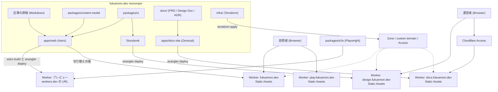
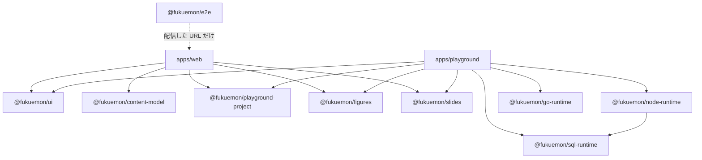

# fukuemon.dev Design Doc

## Overview

fukuemon.dev は、訪問者がコードを書いて動かしながら、技術の仕組みを体系的に学べる個人の技術サイトである。  
訪問者は、シリーズにまとまった記事を読む。運営者（1 名）は、Markdown を書いて push する。  
誰のどの課題を解くかは [PRD](../PRD.md) にある。

実装は pnpm workspace の monorepo にし、Astro のサイト、ドキュメントサイト、UI、Content Model、E2E を package に分ける。  
ADR-0029: [リポジトリの構成を buddy に合わせる](../adr/0029-repository-layout-like-buddy.md)

記事は静的なページとして配信し、React は island として局所に使う。  
ADR-0001: [Starlight の採否](../adr/0001-starlight-as-docs-renderer.md)

配信は Cloudflare Workers Static Assets で行い、基盤のリソースを Terraform が、deploy を Wrangler が管理する。  
ADR-0005: [Workers と Terraform と Wrangler の分担](../adr/0005-workers-terraform-wrangler-boundary.md)

## Goals and Non-Goals

### Goals

- 記事の全てをビルドのときに解決し、実行時のサーバーの処理を持たない。
- 記事の識別子と関係を、URL、描画のレイヤ、データソースから独立させる。
- 1 つのアプリを、1 つの Worker と 1 つのホスト名に閉じる。
- 実行環境が求める制約（cross-origin isolation）を、実行環境を埋め込む記事のほかに広げない。
- 公開に関わる Cloudflare の設定を、コードで管理する。

### Non-Goals

- サーバー側の永続的な状態。訪問者の identity を前提にする機能を作らないので、求める機能がない。
- サイト全体の SPA 化。
- 設計不変量のほかに、将来のために先に作っておくもの。
- 実行環境の方式と、プレイグラウンドのツールの設計。実行環境の方式を決める ADR と、[プレイグラウンドの Design Doc](../../apps/playground/DesignDoc.md) が持つ。

## Assumptions and Constraints

### 動かせない条件

- 運営者は 1 名である。レビューによる職務の分離が成り立たないので、規約は自動でチェックできる形にする。
- サーバー側の永続的な状態を持たない。動的な機能は、静的な生成と、ブラウザの中の処理で表せる範囲に限る。
- 日本語の技術文書を主とし、本文には Latin の技術用語が頻繁に現れる。
- リポジトリは公開である。許可するメールアドレス、account ID、zone ID を、文書とコードに書かない。

### Astro の制約

ツールのバージョンの所在は [context/tech-stack.md](../../context/tech-stack.md#toolchain) にある。

`id` は Astro がファイルのパスから導いて占有するので、安定した識別子は `contentId` という別の名前で持つ。  
ADR-0002: [Content Model の Astro からの独立](../adr/0002-content-model-independence.md)

## Architecture

全体の L1 の図は [PRD の System Context](../PRD.md#system-context) にある。  
次の図は、原稿、UI、文書が monorepo の中でビルドされ、アプリごとの Worker から配信されるまでを示す。



記事のページは、ビルドのときに全て解決する。  
実行時のサーバーのコンポーネントを持たない。  
Mermaid の記法で書いた図は、ビルドのときに Pele で SVG にする。  
ADR-0016: [mermaid を Pele で描く](../adr/0016-render-mermaid-with-pele.md)

クライアントで動く処理は、トップの庭の演出のように、読むことに要らない機能に限る。  
どれもブラウザの中で閉じ、サーバーへ問い合わせない。  
ADR-0026: [トップの水墨の門と庭](../adr/0026-sumi-gate-and-garden-on-top.md)

## Components

モジュールごとの責務は次のとおり。

| モジュール                     | 責務                                                                                                                                   | 持たないもの                                                        |
| ------------------------------ | -------------------------------------------------------------------------------------------------------------------------------------- | ------------------------------------------------------------------- |
| `apps/web`                     | トップ、記事の一覧、記事、シリーズのページ。原稿の読み込みと、`ContentRef` への正規化                                                  | トークンとコンポーネントの定義                                      |
| `apps/playground`              | プレイグラウンドのツールのページ（Node の実行環境、SQL、Go）。画面、画面の状態、訪問者のファイルの保存、プロジェクトの JSON の読み込み | 実行環境の処理と、`@webcontainer/api` への直接の依存                |
| `apps/docs-site`               | `docs/` をビルドしたドキュメントサイトの設定と Worker                                                                                  | 文書の原本                                                          |
| `@fukuemon/ui`                 | トークン、Base と Case のコンポーネント、挿絵、コードの配色、カタログ                                                                  | ページと原稿                                                        |
| `@fukuemon/content-model`      | 記事とシリーズの schema、`ContentRef`、関係グラフの構築と検証、シリーズの読む順の検証                                                  | Astro への依存                                                      |
| `@fukuemon/playground-project` | 記事に埋め込む実行環境のプロジェクトの JSON と、設定のファイルの型と schema                                                            | JSON を出力する処理と、読み込む処理                                 |
| `@fukuemon/figures`            | 記事の図の名前の規則と、ファイルの名前と URL のパスの形                                                                                | SVG を読む処理、`fetch`、2 つのアプリの origin の値                 |
| `@fukuemon/slides`             | スライドのテーマとテンプレート、Marp の設定、Markdown をスライドの HTML にする関数、ページ送りつきのページを組み立てる関数             | React のコンポーネントと、React への依存。トークンの CSS のファイル |
| `@fukuemon/sql-runtime`        | PGlite で SQL を実行して結果の形にする関数、`SqlDatabase` の型、PGlite を Web Worker で動かす `SqlDatabase` の実装                     | 画面と、React への依存                                              |
| `@fukuemon/node-runtime`       | Node の実行環境。WebContainers の起動、記録の store、ファイルとプロセスの操作                                                          | 画面と、React への依存                                              |
| `@fukuemon/go-runtime`         | Go のコードを実行する処理                                                                                                              | 画面と、React への依存                                              |
| `@fukuemon/config`             | tsconfig の共有の設定                                                                                                                  | 無い                                                                |
| `@fukuemon/e2e`                | 配信したサイトを操作する E2E のテストと、エビデンス                                                                                    | サイトのコードへの依存                                              |
| `infra/`                       | Zone、Workers の custom domain、ドキュメントサイトの Access、Terraform の state を置く R2 のバケット                                   | Worker の script と静的なアセット                                   |

次の図は、package の間の依存の向きを示す。



`apps/web` の中では、`astro:content` に触れるのを、collection を結ぶ設定と、正規化のレイヤだけにする。  
依存してよい向き、禁止する依存、チェックの手段は [context/codebase.md](../../context/codebase.md#dependency-rules) にある。

機能ごとの設計は次の文書にある。

- [Content Model](../../packages/content-model/DesignDoc.md): schema、`contentId`、関係グラフ、`ContentRef` への正規化
- [UI](../../packages/ui/DesignDoc.md): トークン、コンポーネント、カタログ
- [トップの庭](features/top-garden/DesignDoc.md): 水墨の門、庭、季節と時間帯
- [プレイグラウンド](../../apps/playground/DesignDoc.md): アプリの構成、パス、実行環境のインターフェース、プロジェクトと保存の形
- [キャンバス](features/canvas/DesignDoc.md): ツールのパス、保存する図の形、図の一覧、記事の図の置き場と書き方
- [スライド](features/slides/DesignDoc.md): エディタのパスと画面、テーマとテンプレート、`@fukuemon/slides` の関数、公開するスライドのビルドとページ送り
- [基盤](../../infra/DesignDoc.md): Terraform の構成、state backend、deploy と apply の流れ

## Interfaces

### ホスト名

1 つのアプリを、1 つの Worker と 1 つのホスト名に割り当てる。  
ADR-0031: [サブドメインに分ける規則](../adr/0031-subdomains-and-workers.md)

プレイグラウンドは 1 つのアプリ（`apps/playground`）で、全てのツールを `play.fukuemon.dev` に置く。  
cross-origin isolation のヘッダは、Node の実行環境のパス（`/node/*`）にだけ返す。  
ADR-0034: [プレイグラウンドのサブドメインと、ヘッダを返すパス](../adr/0034-playground-origin-and-embedding.md)  
ツールのパスは、[プレイグラウンドの Design Doc](../../apps/playground/DesignDoc.md#アプリとパス) にある。

| ホスト名              | 置くもの                                       | アクセスできる人                           |
| --------------------- | ---------------------------------------------- | ------------------------------------------ |
| `fukuemon.dev`        | トップ、記事、シリーズ、プレイグラウンドの一覧 | 誰でも                                     |
| `play.fukuemon.dev`   | プレイグラウンドの全てのツール                 | 誰でも                                     |
| `design.fukuemon.dev` | カタログ                                       | 誰でも                                     |
| `docs.fukuemon.dev`   | ドキュメントサイト                             | 運営者が許可した人                         |
| workers.dev の URL    | 切り替えまでの、新しいサイトのプレビュー       | 誰でも。検索エンジンにインデックスさせない |

ドキュメントサイトのビルドの方法と、アクセスの認証は、次の ADR にある。  
ADR-0032: [ドキュメントサイトと Cloudflare Access](../adr/0032-docs-site-behind-access.md)

### URL の構成

`fukuemon.dev` の URL は次のとおり。  
ADR-0030: [種別、形式、シリーズ](../adr/0030-articles-format-and-series.md)

| URL                                         | 中身                                                                             |
| ------------------------------------------- | -------------------------------------------------------------------------------- |
| `/`                                         | トップ。プロフィールを兼ねる                                                     |
| `/articles`                                 | 記事の一覧                                                                       |
| `/articles/<slug>`                          | シリーズに入れない記事                                                           |
| `/articles/<series>/<slug>`                 | シリーズの中の記事                                                               |
| `/series/<series>`                          | シリーズのページ。タイトル、説明、読む順の記事の一覧                             |
| `/playground`                               | プレイグラウンドの一覧。ツールは、`play.fukuemon.dev` に置く                     |
| `/playground-projects/<埋め込みの ID>.json` | 記事に埋め込む実行環境のプロジェクト。`play.fukuemon.dev` のツールのページが読む |
| `/figures/<名前>.<ツール>.svg`              | 記事の図の、元データ入りの SVG。`play.fukuemon.dev` のキャンバスのツールが読む   |
| `/rss.xml`                                  | RSS                                                                              |

描画の実装の詳細を URL に含めない。  
URL の規約は [context/codebase.md](../../context/codebase.md#url) にある。

### 運営者が書くファイル

運営者は、記事を Markdown で `apps/web/src/content/articles/` の下に置く。

- `articles/<series>/` のディレクトリが、1 つのシリーズになる。タイトルと説明は、ディレクトリの `index.md` に書く。
- 読む順は、記事の frontmatter の `order` で決まる。
- シリーズに入れない記事は、`articles/` の直下に置く。
- 図は、`mermaid` のフェンスに書く。
- キャンバスで描いた図は、書き出した SVG を `apps/web/src/content/figures/` に置き、記事から画像の記法で指す。形は、[キャンバスの Design Doc](features/canvas/DesignDoc.md#記事の図) にある。
- 記事に埋め込む実行環境のプロジェクト（初期ファイルと設定）は、記事の Markdown があるディレクトリの下の `playground/<埋め込みの名前>/` に置く。形は、[プレイグラウンドの Design Doc](../../apps/playground/DesignDoc.md#プロジェクト) にある。
  - シリーズの記事は `articles/<series>/playground/`、シリーズに入れない記事は `articles/playground/` である。`playground/` は、シリーズとして扱わず、ディレクトリの階層にも数えない。
  - ビルドは、`playground` のフェンスを、押すと iframe を作るボタンに置き換える。
  - ビルドは、プロジェクトの JSON を `/playground-projects/<contentId>/<埋め込みの名前>.json` に出力する。Node の実行環境を埋め込むページの URL を出力の HTML から集め、cross-origin isolation のヘッダを返す規則を、出力の `_headers` に足す。

書き方は [context/conventions.md](../../context/conventions.md) にある。

## Cross-Cutting Concerns

### 設計不変量

将来を可能にしているのは、次の 8 点である。  
依存規約の本文は [context/codebase.md](../../context/codebase.md#dependency-rules) にある。  
変えるときは ADR を書く。  
この 8 点のほかに、将来のための先行投資をしない。

| #   | 不変量                                                                                                                                    | 何を可能にするか                                                                  | 根拠                                                           |
| --- | ----------------------------------------------------------------------------------------------------------------------------------------- | --------------------------------------------------------------------------------- | -------------------------------------------------------------- |
| 1   | `contentId` の不変。[context/domain/content.md](../../context/domain/content.md#prohibitions) の取り決め                                  | URL を改名しても関係が切れない。将来の主キーになる                                | [ADR-0002](../adr/0002-content-model-independence.md)          |
| 2   | 関連の片方向の辺。[context/domain/content.md](../../context/domain/content.md#invariants) の取り決め                                      | 書き忘れによる不整合が起きない。関係のテーブルへそのまま写せる                    | [ADR-0002](../adr/0002-content-model-independence.md)          |
| 3   | 依存規約 1。ページとコンポーネントは `astro:content` を直接参照しない                                                                     | ページの実装がデータソースに依存しない                                            | [ADR-0002](../adr/0002-content-model-independence.md)          |
| 4   | 依存規約 2。`@fukuemon/content-model` は Astro に依存しない                                                                               | Astro なしで単体テストできる。別の消費者から再利用できる                          | [ADR-0002](../adr/0002-content-model-independence.md)          |
| 5   | 画面の色、字、余白は、`@fukuemon/ui` のトークンから取る。画面のコードに値を直接書かない                                                   | 配色と版面を、トークンの変更だけで変えられる                                      | [ADR-0024](../adr/0024-tokens-of-fukuemon-dev.md)              |
| 6   | 1 つの Cloudflare のリソースを、Terraform と Wrangler の両方から管理しない                                                                | 二重の管理で差分が互いに打ち消されることがない                                    | [ADR-0005](../adr/0005-workers-terraform-wrangler-boundary.md) |
| 7   | `fukuemon.dev` の全体には、cross-origin isolation のヘッダを返さない。返すのは、isolation を求める実行環境を埋め込む記事の URL だけにする | 全体に適用すると外部の埋め込みが一律に動かなくなる。影響を局所に閉じる            | [ADR-0031](../adr/0031-subdomains-and-workers.md)              |
| 8   | 種別を増やさない。構成は記事の形式で、分類での絞り込みは URL パラメータで表す                                                             | 一覧と URL が種別の数に応じて増えない。分類の組み合わせをページとして書き出さない | [ADR-0030](../adr/0030-articles-format-and-series.md)          |

### 種別と分類の切り分け

| 軸                      | 実現の方法                                                                                      | 理由                                            |
| ----------------------- | ----------------------------------------------------------------------------------------------- | ----------------------------------------------- |
| 種別                    | 記事の 1 つ。一覧は `/articles` の 1 ページ                                                     | 一覧と URL が 1 つで済む。JavaScript が要らない |
| 形式（1 ページ、手順）  | 記事の frontmatter に書く。一覧では、手順の記事にラベルを付ける                                 | 1 つのシリーズに、両方の形式の記事を並べられる  |
| 分類（`postgres` など） | 今は絞り込まず、一覧に表示するだけ。追加するときは URL パラメータとクライアントの絞り込みにする | 分類の組み合わせを、ページとして書き出せない    |

### 判断の優先順位

設計で迷ったときは、次の順に優先する。

1. 一貫性（全てのページで同じ規約が成り立つ）
2. 保守性（1 名で維持できる）
3. パフォーマンス
4. 開発体験
5. 将来の拡張性

将来の拡張性を最も下に置く。  
将来を可能にしているのは設計不変量であり、先に実装しておくことではない。

### JavaScript なしで読めること

記事の一覧、記事、シリーズのページは、JavaScript を無効にしても、本文、図、前後の記事へのリンクを読める。  
island は、読むことに要らない機能にだけ使う。

### 動き

**動きは、状態の変化を伝えるときだけに使う**。  
規則はサイト全体で共通である。

- 位置を動かさない。位置が動くと、罫の位置が確定するまで読み始められない。
- 動きのために配る JavaScript は 0 バイトにする。
- 5 秒を超えて続く動きは、5 秒以内に止める。WCAG 2.2 の 2.2.2 は、自動で始まり、5 秒を超えて続き、ほかの内容と並んで出る動きに、止める手段を求める。
  - 出典: [Understanding SC 2.2.2: Pause, Stop, Hide](https://www.w3.org/WAI/WCAG22/Understanding/pause-stop-hide.html)

処理中の印（`Button` の読み込み中と `Loading`）は、5 秒以内に止める規則の例外にする。  
印は、利用者が待っている処理が終わると消えるためである。

ADR-0028: [操作できる要素と重なる面の角を 2px で丸め、重なる面にずらした影を付け、罫を引く動きを筆の線にする](../adr/0028-radius-shadow-and-brush-motion.md)

動きを付ける操作、長さ、付けない所と、OS で動きを減らす設定にした訪問者への止め方と、動きの時間と緩急のユーティリティは、[デザインシステム（packages/ui）の Design Doc の「動き」](../../packages/ui/DesignDoc.md#動き) にある。

#### トップの庭の例外

**トップの庭は、位置を動かさない規則と、配る JavaScript を 0 バイトにする規則の例外にする**。  
庭は 2 回目以降の訪問にも出すので、例外は最初の訪問に限らない。  
動きを減らす設定のときは、庭を出さず、同じ本文をふつうのページとして出す。

- three を配る。場面のバンドルは別のファイルにし、庭を出すときだけ読み込む。
- カメラが動く。最初の訪問で門をくぐるときと、文から文へ移るときに動く。
- パーティクル（桜の花びら、蛍、紅葉、雪）が動き続ける。庭の中の「動きを止める」のボタンで止める。
- 最初の訪問だけに、約 8 秒のイントロを出す。イントロは画面の全体を使い、ほかの内容と並ばない。「飛ばす」のボタンと Esc と Tab で、動かさずに最後の状態にする。

イントロとパーティクルは、5 秒以内に止める規則の例外にする。  
イントロは、画面の全体を使ってほかの内容と並ばず、「飛ばす」のボタンで止められるためである。  
パーティクルは、「動きを止める」のボタンで止められるためである。

ADR-0026: [トップの最初の訪問で水墨の門を描き、門をくぐった立体の庭にプロフィールを置く](../adr/0026-sumi-gate-and-garden-on-top.md)  
イントロの各段の時間は [トップの水墨の門と立体の庭の Design Doc](features/top-garden/DesignDoc.md) にある。

### 配信

- `fukuemon.dev` の Worker への deploy は、運用者が手動で実行したときだけ行う。
- 新しいサイトは、プレビューの Worker に、develop への push で check が通ったときにデプロイする。
- カタログとドキュメントサイトは、develop への push で check が通ったときにデプロイする。

deploy と apply の条件は [context/operations.md](../../context/operations.md#deployment-conditions) にある。

### 検証

- E2E は、配信した状態のサイトを、ブラウザで操作して確認する。サイトのコードを import しない。
- E2E は、録画と字幕のエビデンスを撮れる形で書く。
- テストの種類と保証の範囲は [context/testing.md](../../context/testing.md) にある。

### 条件つきで追加する機能の形

[PRD の Lower-Priority Goals](../PRD.md#lower-priority-goals) の条件が成り立ったときは、次の形で追加する。

- 手順の形式の記事は、記事の形式の値を追加して作る。種別と URL を増やさない。
- キャンバスの図とスライドは、種別を増やさずに追加する。
- キャンバスとスライドのエディタは、プレイグラウンドのツールとして、`play.fukuemon.dev` に追加する。Worker とホスト名を増やさない。
  - ADR-0031: [サブドメインに分ける規則](../adr/0031-subdomains-and-workers.md)
- 記事のあいだの関連の表示は、Content Model の関係グラフから生成する。
- 分類での絞り込みは、URL パラメータで絞り込む island にする。ページと索引のページは増やさない。
- 本文の検索は、ビルドのときに作る索引と、クライアントの検索にする。
- コメントは、バックエンドを持たない外部のサービスで追加する。
- 問い合わせのフォームの送信を受ける口は、同じ Worker への POST 1 本にする。
  - データを保持するリソースが Terraform の管轄に加わる。
  - Terraform から Wrangler へ値を渡す方法は、[context/operations.md](../../context/operations.md#terraform-と-wrangler-の管轄) の条件のとおりに定める。

ADR-0008: [読者の identity を前提とする機能を作らない](../adr/0008-no-reader-identity.md)

## Repository Layout

```text
.
├── docs/
│   ├── PRD.md
│   ├── design/
│   │   ├── DesignDoc.md         # この文書
│   │   ├── apps/                # コードの隣の Design Doc へのシンボリックリンク
│   │   ├── packages/
│   │   └── infra.md             # infra/DesignDoc.md へのシンボリックリンク
│   └── adr/
├── context/                     # 規約と事実
├── apps/
│   ├── web/                     # Astro のサイト
│   │   └── src/content/articles/  # 記事の原稿
│   └── docs-site/               # ドキュメントサイト
├── packages/
│   ├── config/                  # 共有の tsconfig
│   ├── content-model/           # DesignDoc.md を含む
│   ├── ui/                      # DesignDoc.md を含む
│   └── e2e/                     # E2E のテスト
├── infra/                       # DesignDoc.md を含む
│   ├── bootstrap/
│   └── cloudflare/
├── hooks/                       # Git のフック
├── .github/                     # CI の workflow と issue の雛形
└── scripts/
```
