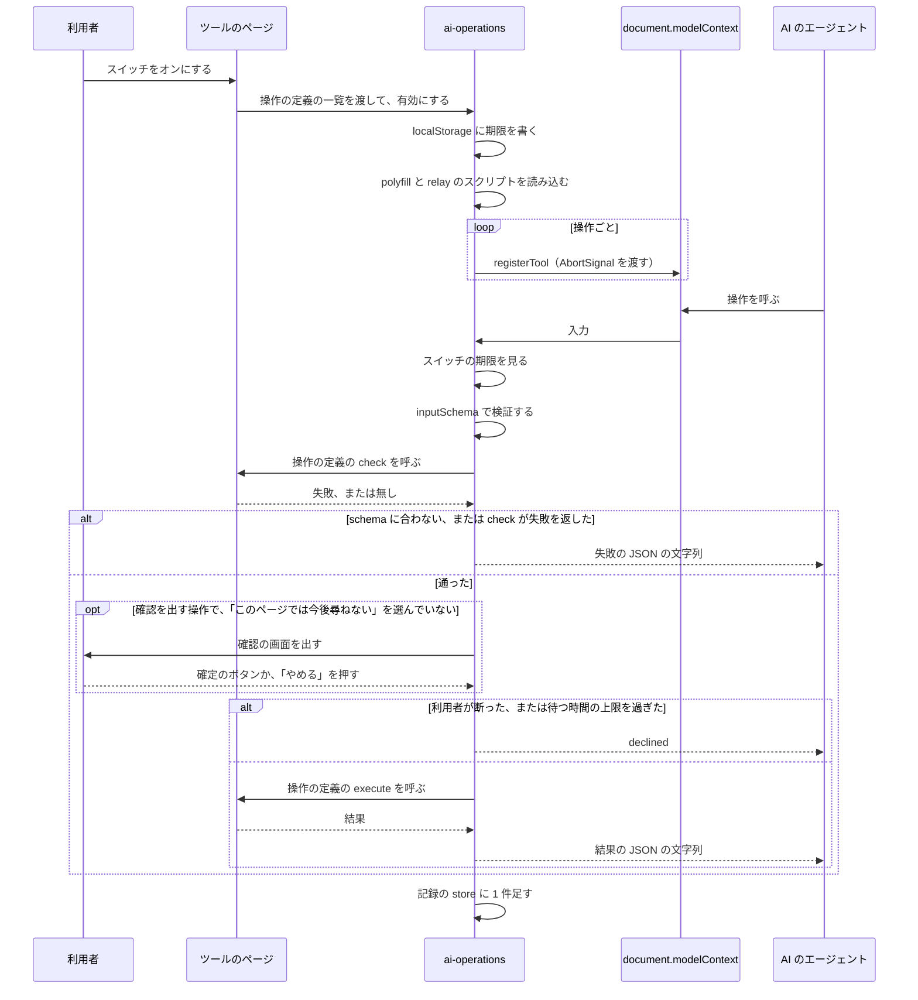

# AI からの操作

## Overview

AI からの操作は、利用者がつないだ AI のエージェントに、プレイグラウンドのツールの操作を公開する機能である。  
利用者は、ツールのページのスイッチで操作を許可し、エージェントが行った操作を、操作の記録の欄で見る。

アプリの構成とツールのページは [プレイグラウンドの Design Doc](../playground/DesignDoc.md) にある。  
方式と、許可と確認の形は、次の ADR が決めている。

- ADR-0044: [AI のエージェントからの操作は、WebMCP の API で登録し、MCP-B の polyfill と relay でも呼べるようにする](../../../adr/0044-ai-operations-with-webmcp.md)
- ADR-0045: [AI のエージェントからの操作は、ツールごとに 7 日のあいだ保存するスイッチで許可し、消す操作と全体を置き換える操作はページが確認を出す](../../../adr/0045-ai-operations-permission-and-confirmation.md)

## Scope

持つものは次のとおり。

- 21 個の操作の名前、入力、結果の形
- 許可のスイッチの位置と文言、スイッチの状態の保存
- 確認の画面の形と、確認を待つ間の動き
- 操作の記録の欄の位置と、1 行に出す内容
- `localStorage` のキーと値、期限の扱い
- 登録、許可、確認、記録の処理の流れと、コードの置き場
- ツールのページと実行環境に、この機能が必要とするもの

持たないものは次のとおり。

- 操作が呼ぶ、ツールの中の処理。ツールごとの Design Doc が持つ。
- ツールのページのヘッダと、ペインの並べ方。ツールごとの Design Doc が持つ。この文書は、スイッチと操作の記録の欄を置く位置だけを決める。
- `Switch` と `Checkbox` の見た目とキーボードの操作。[packages/ui/DESIGN.md](../../../../packages/ui/DESIGN.md) が持つ。
- 図とスライドを保存するデータの形。キャンバスの Design Doc が持つ。

## Design

### 操作を公開するページ

操作を公開するツールは、Node の実行環境、Go を動かすツール、スライドのエディタ、Excalidraw のツール、draw.io のツールの 5 つである。  
この文書では、5 つを `node`、`go`、`slides`、`excalidraw`、`drawio` と呼ぶ。

- 操作を登録するのは、トップレベルで開いたページだけである（ADR-0045 の Decision 3）。
  - 埋め込みかどうかは、`ai-operations/` の React の外のモジュールが、`window.self !== window.top` で判定する。判定は、この 1 か所に置く。
  - 埋め込みのときは、保存してあるスイッチの状態を読まず、スクリプトの読み込みと登録を行わない。ページはヘッダを出さないので、スイッチも出ない。
- SQL だけを動かすツールは、操作を持たない。スイッチと操作の記録の欄を出さない。

### コードの置き場

ツールに共通の処理は、`apps/playground/src/ai-operations/` に置く。  
操作の定義は、ツールのディレクトリに、ツールごとに 1 つのファイルで置く。

| 置き場                                        | 持つもの                                                                                                                                |
| --------------------------------------------- | --------------------------------------------------------------------------------------------------------------------------------------- |
| `apps/playground/src/ai-operations/`          | スイッチの状態と `localStorage`、polyfill と relay のスクリプトの読み込み、登録と解除、入力の検証、確認の順番と時間の上限、記録の store |
| `apps/playground/src/ai-operations/` の React | スイッチ、確認の画面、操作の記録の欄のコンポーネント                                                                                    |
| `apps/playground/src/<ツール>/`               | そのツールの操作の定義（名前、説明、入力の schema、注釈、確認の前の検証、確認に出す内容、実行する関数）                                 |
| `@fukuemon/ui`                                | `Switch`、`Checkbox`、`Dialog`、`Disclosure`、`StatusBadge`、`Notice`、`Button`                                                         |

- ツールのディレクトリが、`ai-operations/` を import する。`ai-operations/` は、ツールのディレクトリを import しない。
- `ai-operations/` は、実行環境の package と、`workspace/`、`project/` を import しない。
- ツールのディレクトリの、React の外のモジュールが、モジュールの初期化で、操作の定義の一覧とツールの名前を、`ai-operations/` に渡す。React のコンポーネントは、渡さない。
  - Node の実行環境では、起動の Promise を持つ `src/node/` のモジュールが渡す。
  - Go を動かすツールでは、ファイルを持つ `src/go/` のモジュールが渡す。
  - `ai-operations/` は、定義を受け取ったときに、保存してあるスイッチの状態を読み、オンなら登録する。
- 操作の定義の `check` と `execute` は、呼ばれるたびに、React の外の値から、ツールの今の状態を読む。Context から読まない。
  - Node の実行環境では、起動の Promise を持つモジュールから、今の `NodeRuntime` のインスタンスを読む。実行環境を起動し直した後も、新しいインスタンスを使うためである。
  - Go を動かすツールでは、ファイルを持つ `src/go/` のモジュールから、今のファイルを読む。
- polyfill（`@mcp-b/global`）と、relay につなぐスクリプト（`@mcp-b/webmcp-local-relay` が配るもの）は、`apps/playground` の依存に、範囲ではなく 1 つのバージョンで書く。読み込むのは、`ai-operations/` だけである。
  - 2 つは、ツールのページのスクリプトと別のファイルにして、`play.fukuemon.dev` から配る。ファイルの分け方（動的な `import()` か、静的なファイルか）は、実装のタスクで決める。

操作の定義は、次の型で書く。  
型と項目の名前は、実装のときに変えてよい。

```ts
type OperationDefinition<Input> = {
  name: string;
  description: string;
  inputSchema: JsonSchema;
  annotations?: {
    readOnlyHint?: boolean;
    untrustedContentHint?: boolean;
    consequentialHint?: boolean;
  };
  check?: (input: Input) => Promise<OperationFailure | null>;
  confirmation?: (input: Input) => ConfirmationContent;
  execute: (input: Input) => Promise<OperationResult>;
};

type ConfirmationContent = {
  title: string;
  summary: string;
  actionLabel: string;
  detail?: string;
};

type OperationFailure = {
  ok: false;
  error: { code: ErrorCode; message: string };
} & Record<string, unknown>;

type OperationResult = ({ ok: true } & Record<string, unknown>) | OperationFailure;

type ErrorCode =
  | "invalid_input"
  | "not_found"
  | "too_large"
  | "not_ready"
  | "declined"
  | "timeout"
  | "failed";
```

- `check` は、schema で表せない検証（パスの範囲、XML として読めるか、対象があるか、ツールが使えるか）を行う。確認の画面より前に呼ぶ。利用者が確定のボタンを押した後に、入力の誤りで失敗することを減らすためである。
- ページは、`confirmation` を持つ操作にだけ、確認の画面を出す。
- 説明の文（`description`）は、日本語で書く。
- `JsonSchema` で検証するライブラリは、実装のタスクで選ぶ。

### 操作の一覧

操作の名前は、ツールの名前を接頭辞にする。  
relay を通すと、開いている全てのタブの操作が、MCP のクライアントの 1 つの一覧に並ぶ。  
名前だけで、どのツールの操作かを読み取れるようにするためである。

| ツール       | 名前                        | 行うこと                                 | 注釈                           | 確認 |
| ------------ | --------------------------- | ---------------------------------------- | ------------------------------ | ---- |
| `slides`     | `slides_read`               | Markdown の全文、テーマ、枚数を返す      | 読み取りだけ、信頼できない内容 | 無い |
| `slides`     | `slides_write`              | Markdown の全文を置き換える              | 無い                           | 出す |
| `slides`     | `slides_set_theme`          | テーマを変える                           | 無い                           | 無い |
| `excalidraw` | `excalidraw_read`           | 要素の一覧を返す                         | 読み取りだけ、信頼できない内容 | 無い |
| `excalidraw` | `excalidraw_add_elements`   | 図形、文字、図形をつなぐ矢印を足す       | 無い                           | 無い |
| `excalidraw` | `excalidraw_update_element` | 指定した要素の位置、大きさ、色を変える   | 無い                           | 無い |
| `excalidraw` | `excalidraw_clear`          | 全ての要素を消す                         | 重大な操作                     | 出す |
| `drawio`     | `drawio_read`               | 図の XML を返す                          | 読み取りだけ、信頼できない内容 | 無い |
| `drawio`     | `drawio_add_cells`          | 図に `mxCell` を足す                     | 無い                           | 無い |
| `drawio`     | `drawio_write`              | 図の全体を、渡した XML に置き換える      | 重大な操作                     | 出す |
| `node`       | `node_list_files`           | ファイルの一覧を返す                     | 読み取りだけ                   | 無い |
| `node`       | `node_read_file`            | ファイルの中身を返す                     | 読み取りだけ、信頼できない内容 | 無い |
| `node`       | `node_write_file`           | ファイルを書く                           | 無い                           | 無い |
| `node`       | `node_delete_file`          | ファイルを消す                           | 重大な操作                     | 出す |
| `node`       | `node_run_command`          | コマンドを実行し、終了コードと出力を返す | 重大な操作、信頼できない内容   | 無い |
| `go`         | `go_list_files`             | ファイルの一覧を返す                     | 読み取りだけ                   | 無い |
| `go`         | `go_read_file`              | ファイルの中身を返す                     | 読み取りだけ、信頼できない内容 | 無い |
| `go`         | `go_write_file`             | ファイルを書く                           | 無い                           | 無い |
| `go`         | `go_delete_file`            | ファイルを消す                           | 重大な操作                     | 出す |
| `go`         | `go_run`                    | ファイルを実行し、終了コードと出力を返す | 重大な操作、信頼できない内容   | 無い |
| `go`         | `go_test`                   | テストを実行し、終了コードと出力を返す   | 重大な操作、信頼できない内容   | 無い |

- 名前は、英小文字、数字、`_` だけで書く。
  - polyfill（`@mcp-b/global` 6.2.0）は、`[A-Za-z0-9_.-]` の 1〜128 文字でない名前の登録を拒否する。
  - relay（`@mcp-b/webmcp-local-relay` 6.2.0）は、名前を `[a-zA-Z0-9_]` に直して、MCP のクライアントに見せる。
- 注釈の語は、ADR-0044 の Decision 4 と同じである。

### 結果の形

操作は、成功でも失敗でも、JSON の文字列を返す。  
例外を投げない。

- 成功: `{"ok":true, ...}`。`ok` のほかの項目は、操作ごとに決まる。
- 失敗: `{"ok":false,"error":{"code":"<種類>","message":"<理由の文>"}}`。

`code` は、次の 7 つ。

| `code`          | 返すとき                                                                                                    |
| --------------- | ----------------------------------------------------------------------------------------------------------- |
| `invalid_input` | 入力が schema に合わない。パスが作業ディレクトリの外を指す。XML を読めない。識別子が重なる                  |
| `not_found`     | 指したファイルか要素が無い                                                                                  |
| `too_large`     | 入力か、読むファイルが、上限を超える                                                                        |
| `not_ready`     | 実行環境が起動していない。ツールの読み込みが終わっていない。開いている図かスライドが無い。Go の実行中である |
| `declined`      | 利用者が、確認の画面で断った。確認を待つ時間の上限を過ぎた。確認を待つ間に、スイッチがオフになった          |
| `timeout`       | コマンドか Go の実行が、時間の上限までに終わらなかった                                                      |
| `failed`        | そのほかの失敗。`check` と `execute` が投げた例外は、`ai-operations/` が受けて、この値にする                |

### 入力と結果

入力の schema は、操作の定義の `inputSchema` に 1 つだけ書く。  
`ai-operations/` が、`inputSchema` で入力を検証してから、`check` と `execute` を呼ぶ。  
ブラウザの `executeTool` が、schema に合わない値をそのまま渡すためである。

入力は、次の型に当たる schema にする。  
`?` の付いた項目は、省略できる。  
どの入力も、型に無い項目を受け付けない（`additionalProperties` が `false`）。  
型に無い項目があるときは、`invalid_input` を返す。  
エージェントが、使われない項目を渡したことに気づけるようにするためである。

```ts
type Inputs = {
  slides_read: {};
  slides_write: { markdown: string };
  slides_set_theme: { theme: string };

  excalidraw_read: {};
  excalidraw_add_elements: { elements: NewElement[] };
  excalidraw_update_element: {
    id: string;
    x?: number;
    y?: number;
    width?: number;
    height?: number;
    strokeColor?: string;
    backgroundColor?: string;
  };
  excalidraw_clear: {};

  drawio_read: {};
  drawio_add_cells: { cells: string };
  drawio_write: { xml: string };

  node_list_files: { path?: string };
  node_read_file: { path: string };
  node_write_file: { path: string; contents: string };
  node_delete_file: { path: string };
  node_run_command: { command: string; args?: string[]; timeoutMs?: number };

  go_list_files: { path?: string };
  go_read_file: { path: string };
  go_write_file: { path: string; contents: string };
  go_delete_file: { path: string };
  go_run: { timeoutMs?: number };
  go_test: { timeoutMs?: number };
};

type NewElement = {
  type: "rectangle" | "ellipse" | "diamond" | "text" | "arrow";
  x: number;
  y: number;
  id?: string;
  width?: number;
  height?: number;
  text?: string;
  from?: string;
  to?: string;
};
```

成功のときの結果は、`ok` のほかに、次の項目を持つ。

| 名前                        | 結果の項目                                        |
| --------------------------- | ------------------------------------------------- |
| `slides_read`               | `document`、`markdown`、`theme`、`slideCount`     |
| `slides_write`              | `slideCount`                                      |
| `slides_set_theme`          | `theme`                                           |
| `excalidraw_read`           | `document`、`elements`                            |
| `excalidraw_add_elements`   | `ids`（足した要素の識別子の配列）                 |
| `excalidraw_update_element` | `id`                                              |
| `excalidraw_clear`          | `count`（消した要素の数）                         |
| `drawio_read`               | `document`、`xml`                                 |
| `drawio_add_cells`          | `count`（足した `mxCell` の数）                   |
| `drawio_write`              | 無い                                              |
| `node_list_files`           | `entries`（`{ path, kind }` の配列）、`truncated` |
| `node_read_file`            | `path`、`contents`                                |
| `node_write_file`           | `path`                                            |
| `node_delete_file`          | `path`                                            |
| `node_run_command`          | `exitCode`、`output`、`truncated`                 |
| `go_list_files`             | `entries`（`{ path, kind }` の配列）、`truncated` |
| `go_read_file`              | `path`、`contents`                                |
| `go_write_file`             | `path`                                            |
| `go_delete_file`            | `path`                                            |
| `go_run`                    | `exitCode`、`output`、`truncated`                 |
| `go_test`                   | `exitCode`、`output`、`truncated`                 |

- `document` は、ページで開いている図かスライドの識別子と名前である（`{ id: string, name: string }`）。
- `slides_set_theme` の `theme` に渡せる値は、スライドのエディタが持つテーマの名前の一覧から、`enum` として作る。この文書と操作の定義に、テーマの名前を書かない。
- `excalidraw_read` の `elements` の要素は、`id`、`type`、`x`、`y`、`width`、`height`、`text`、`strokeColor`、`backgroundColor` を持つ。矢印は、つないだ図形の識別子の `from` と `to` も持つ。
- `excalidraw_add_elements` は、次のとおり動く。
  - `elements` は、1 回に 200 個までである。超えるときは、`too_large` を返す。
  - 矢印は、`from` と `to` に図形の識別子を渡すと、図形をつなぐ。同じ呼び出しで足す図形の `id` も指せる。
  - `id` が、今の図の要素か、同じ呼び出しのほかの要素と重なるときは、`invalid_input` を返す。`from` と `to` が指す図形が無いときは、`not_found` を返す。
- `excalidraw_update_element` は、`id` の要素が無いときに、`not_found` を返す。
- `strokeColor` と `backgroundColor` は、`#` と 6 桁の 16 進の文字列である。`backgroundColor` は、`transparent` も受け付ける。
- `drawio_add_cells` は、今の図にある `id` と同じ `id` の `mxCell` を渡されたときに、`invalid_input` を返す。
- `entries` の `kind` は、`file` か `directory` である。
- `markdown`、`xml`、`cells`、`contents` は、UTF-8 で 1 MB までである。超えるときは、`too_large` を返す。
- 読み取りの結果のうち、大きさの上限を持つのは、ファイルの中身（`contents`）、ファイルの一覧（`entries`）、コマンドと Go の実行の `output` だけである。

### 操作の対象の図とスライド

`slides`、`excalidraw`、`drawio` の操作は、ページで開いている図かスライドだけを対象にする。  
利用者が画面で見ているものと、エージェントが変えるものを、同じにするためである。

- 操作の入力に、図とスライドの識別子を持たせない。保存してある図とスライドの一覧を返す操作と、開く操作は持たない。
- 開いている図かスライドが無いときは、`not_ready` を返す。
- 同じツールを 2 つのタブで開くと、relay は、操作の名前の後ろにタブの ID の短い文字列を付けて、両方を MCP のクライアントに見せる。エージェントは、次の 2 つで、タブを見分ける。
  - 読み取りの結果の `document`。
  - relay が、操作の説明の先頭に付ける、ページのタイトル。

### 実行環境の操作

`node` の操作は、`NodeRuntime` を使う。

| 名前               | 使うもの                       |
| ------------------ | ------------------------------ |
| `node_list_files`  | `files.tree` の store の今の値 |
| `node_read_file`   | `files.read`                   |
| `node_write_file`  | `files.write`                  |
| `node_delete_file` | `files.remove`                 |
| `node_run_command` | `processes.start`              |

- 実行環境が起動していないときと、起動に失敗したときは、どの操作も `not_ready` を返す。
- パスは、作業ディレクトリからの相対パスだけを受け付ける。`..` で外へ出るパスと絶対パスは、`invalid_input` を返す。
  - ファイルの操作が届く範囲を、ファイルのツリーと保存の対象にそろえるためである。
  - セキュリティの境界にはならない。`node_run_command` は、確認なしで、作業ディレクトリの外のファイルを読み書きできる。
- `node_list_files` は、`path` の下の全ての階層を返す。`path` を省くと、作業ディレクトリの全体を返す。保存しないファイルの規則の `exclude` に当たるパスは返さない。1,000 件までにし、切り詰めたときは `truncated` を `true` にする。
- `node_read_file` は、1 MB を超えるファイルに `too_large` を、テキストとして読めないファイルに `invalid_input` を、無いファイルに `not_found` を返す。大きさとテキストの規則は、保存しないファイルの規則と同じである。
- `node_write_file` は、ファイルがあれば上書きし、親のディレクトリが無ければ作る。上書きの前に、確認を出さない。
- `node_delete_file` は、ファイルだけを消す。ディレクトリを指したときは `invalid_input` を、無いパスを指したときは `not_found` を返す。
- `node_run_command` は、次のとおり動く。
  - `command` と `args` を、そのまま `processes.start` に渡す。コマンドの文字列を、引数に分ける処理は持たない。
  - プロセスの名前（`start` の `name`）は、`ai: <command>` にする。プロセスは、端末のペインに、ほかのプロセスと同じように出る。
  - `timeoutMs` は、1,000 から 120,000 までの整数で、デフォルトは 30,000 である。上限までに終わらないときは、プロセスを終了させ、`timeout` を返す。このときの結果は、`error` のほかに、それまでの `output` と `truncated` を持つ。
  - MCP の SDK（`@modelcontextprotocol/sdk` 1.32.2）は、リクエストを待つ時間のデフォルトが 60 秒である。relay を通して呼ぶエージェントは、60 秒を超える `timeoutMs` を渡すと、結果を受け取る前に待つのをやめることがある。説明の文に、このことを書く。
  - コマンドが 0 でない終了コードで終了したときは、`ok` を `true` にし、`exitCode` にその値を入れる。
  - `output` は、端末の制御の文字を除いた出力の、末尾の 100,000 文字である。切り詰めたときは、`truncated` を `true` にする。
  - 時間と文字数の値は、実装のタスクで測って変えてよい。

### Go のツールの操作

`go` の操作は、Go を動かすツールのファイルと、`GoRunner` を使う。  
ファイルの 4 つの操作の入力と結果は、`node` の同じ名前の操作と同じである。

- `go_list_files`、`go_read_file`、`go_write_file`、`go_delete_file` は、`src/go/` の React の外のモジュールが持つファイルを読み書きする。エディタと、IndexedDB への保存は、利用者が書き換えたときと同じように動く。
- パスは、相対パスだけを受け付ける。`..` で外へ出るパスと絶対パスは、`invalid_input` を返す。ファイルは、UTF-8 で 1 MB までのテキストである。保存しないファイルの規則の `exclude` は、使わない。
- ディレクトリを持てるかと、ディレクトリを含むパスの扱いは、Go を動かすツールのファイルの形に従う。ディレクトリを持つときは、`node` の操作と同じに扱う。
- プロジェクトと、保存したファイルを読み終えていないときは、ファイルの 4 つの操作は `not_ready` を返す。
- `go_write_file` は、ファイルがあれば上書きし、無ければ作る。上書きの前に、確認を出さない。
- `go_delete_file` は、確認を出す。
- `go_run` は、`src/go/` のモジュールが持つ今のファイルを実行する。`go_test` は、同じファイルのテストを実行する。画面の実行のボタンとテストのボタンと、同じものが動く。
  - 入力でコードを受け取らない。エージェントは、先に `go_write_file` で書く。
  - Yaegi の WASM を読み込んでいないときは、読み込んでから実行する。読み込みの時間は、`timeoutMs` に含めない。読み込めないときは、`failed` を返す。
  - 実行を始めたときのファイルの写しを実行する。実行中に `go_write_file` と `go_delete_file` が呼ばれても、動いている実行は変わらない。
  - 出力は、出力のペインにも出す。利用者がボタンを押したときと、同じ表示にする。
  - `timeoutMs` は、1,000 から 120,000 までの整数で、デフォルトは 30,000 である。上限までに終わらないときは、`GoRunner` の実行を止める手段で止めて、`timeout` を返す。このときの結果は、`error` のほかに、それまでの `output` と `truncated` を持つ。60 秒を超える値の扱いは、`node_run_command` と同じである。
  - コンパイルのエラーと、テストの失敗は、`ok` を `true` にし、`exitCode` を 1 にして、`output` にエラーを入れる。`go_test` は、出力（`=== RUN`、`--- PASS`、`--- FAIL`）をそのまま返し、テストごとの結果に分けない。
  - `output` は、末尾の 100,000 文字である。切り詰めたときは、`truncated` を `true` にする。
  - 実行中に、もう 1 つの `go_run` か `go_test` が呼ばれたときは、後の呼び出しに `not_ready` を返す。利用者がボタンで実行している間も、同じである。エージェントの操作で実行している間は、画面の実行のボタンとテストのボタンを、実行中の表示にする。
- `go_run` と `go_test` は、確認を出さない。Yaegi で動かすコードが、ページの `localStorage` と IndexedDB に届かないためである。
  - Yaegi に渡す symbol を `stdlib.Symbols` だけにすると、Yaegi で動かすコードは、`syscall/js`、`syscall`、`unsafe` を import できない。Yaegi 0.16.3 の WASM を Node の上で動かして確認した。ブラウザの中では、実装のタスクのテストで確認する。
  - Yaegi で動かすコードは、`net/http` を import できる。ブラウザの中で、外部へリクエストを送れるかは、実装のタスクで確認する。

### 許可のスイッチ

スイッチは、ツールのページのヘッダの右端に置く。

- コンポーネントは、`@fukuemon/ui` の `Switch` を使う。ラベルは「AI からの操作」である。
- スイッチのほかに、オンかオフかを示す文言を、画面に足さない。操作の記録の欄は、ADR-0045 の Decision 5 が決めた欄で、状態を示す文言に当たらない。
- デフォルトはオフである。
- オンにすると、polyfill と、relay につなぐスクリプトを読み込み、操作を登録し、操作の記録の欄を出す。
- オフに戻すと、登録を解除し、出ている確認の画面を閉じ、操作の記録の欄を隠す。
  - 確認を待っている呼び出しと、順番を待っている呼び出しには、`declined` を返す。
  - 実行が始まっている操作は、止めない。結果は、記録の store に足す。
  - Node の実行環境で、「AI からの操作」のタブを選んでいたときは、端末のタブを出す。選択の状態は書き換えず、描画のときに、選択が「AI からの操作」でスイッチがオフなら、端末のタブを出す。期限と、ほかのタブの操作でオフになったときも、同じように動く。
- スクリプトを読み込めないときと、登録が拒否されたときは、スイッチをオフに戻し、`Notice`（`danger`、`isAlert`）を、スイッチの下に出す。題は「AI からの操作を始められません」、本文は理由である。保存してあったオンで、ページを開いたときに失敗したときも、同じである。
- オフに戻した後に、読み込んだ relay のスクリプトが `127.0.0.1` への接続を持ち続けるかは、実装のタスクで確認する。接続を切れないときは、登録した操作が 0 個のまま接続が残る。

### 登録から実行まで

次の図は、利用者がスイッチをオンにしてから、エージェントが呼んだ操作の結果が返るまでの流れを示す。



- 登録の解除は、`registerTool` に渡した `AbortSignal` で行う。
- スイッチのオンを保存してあるページでは、ツールのモジュールが定義を渡したときに、同じ流れで登録する。
- 呼び出しが届いたときに、スイッチの期限を過ぎていれば、スイッチをオフにし、`declined` を返す。バックグラウンドのタブでは、タイマーが遅れることがあるためである。
- 記録の store に 1 件を足すのは、結果が決まったときである。失敗と `declined` で終わった呼び出しも足す。実行中の呼び出しと、確認を待っている呼び出しは、欄に出さない。
- React のコンポーネントは、Effect の中で、スクリプトの読み込みと登録を行わない。`ai-operations/` の、React の外のモジュールが進め、コンポーネントは、状態を `useSyncExternalStore` で読む。
- polyfill は、ブラウザが `document.modelContext` を持つときも読み込む（ADR-0044 の Decision 3）。両方があるときに、どちらが登録を受けるかは、実装のタスクで確認する。

### 確認の画面

確認を出す 5 つの操作は、利用者が確定のボタンを押してから実行する。  
確認の画面は、`@fukuemon/ui` の `Dialog` で組む。  
`ConfirmDialog` は、チェックボックスを置けないので使わない。  
題、本文、ボタンの文、フォーカスは、`ConfirmDialog` の規則にそろえる。

- 題（`title`）と、確定のボタンの文（`actionLabel`）は、操作ごとに次のとおりにする。

  | 名前               | 題                                   | 確定のボタン |
  | ------------------ | ------------------------------------ | ------------ |
  | `slides_write`     | スライド「<名前>」の全文を置き換える | 置き換える   |
  | `excalidraw_clear` | 図「<名前>」の全ての要素を削除する   | 削除する     |
  | `drawio_write`     | 図「<名前>」の全体を置き換える       | 置き換える   |
  | `node_delete_file` | ファイル「<パス>」を削除する         | 削除する     |
  | `go_delete_file`   | ファイル「<パス>」を削除する         | 削除する     |

- 本文に、AI のエージェントが呼んだ操作であること、操作の名前、何が起きるかの文（`summary`）を書く。`excalidraw_clear` の `summary` は、消す要素の数を含む。
- 本文に、元に戻せないことを書く。ツールの「元に戻す」が、エージェントの操作を戻せるかは、ツールごとに、実装のタスクで確認する。戻せるツールでは、この文を、「元に戻す」で戻せることの文に替える。
- 渡された内容の全文（`detail`。`slides_write` の `markdown` と、`drawio_write` の `xml`）は、`Disclosure` を開くと読める。
- 本文の下に、`Checkbox` の「このページでは今後尋ねない」を置く。デフォルトは、チェックなしである。
- ボタンは、「やめる」（`secondary`）と、確定のボタン（`danger`）の 2 つである。開いたときのフォーカスは、「やめる」に当てる。
- 確定のボタンを押すと、実行が終わるまで、確定のボタンを読み込み中にし、「やめる」、Esc のキー、背景のクリックで閉じない。実行が終わると、閉じる。
- 「このページでは今後尋ねない」をチェックして確定のボタンを押すと、そのツールでは、その後の操作を、確認を出さずに実行する。「やめる」を押したときは、チェックを保存しない。

確認を待つ間は、次のとおり動く。

- 「やめる」、Esc のキー、背景のクリックは、`declined` を返す。
- 確認が出ている間に、確認を出す操作がもう 1 つ呼ばれたときは、届いた順に、1 つずつ確認を出す。確認を出さない操作は、待たせずに実行する。
- 呼び出しが届いてから 50 秒で、`declined` を返す。確認が出ていれば、閉じる。順番を待っている間に 50 秒が過ぎた呼び出しは、確認を出さずに `declined` を返す。
  - エージェントが待つのをやめた後に、利用者が確定のボタンを押して操作が実行され、その結果を受け取るエージェントがいない、ということを防ぐためである。
  - 50 秒は、MCP の SDK がリクエストを待つ時間のデフォルトの 60 秒より、短くした値である。実装のタスクで変えてよい。
- 確認の画面は、ページがバックグラウンドのタブにあるときも開く。

### 操作の記録の欄

操作の記録の欄は、スイッチがオンの間だけ出す。

- Node の実行環境では、下のペインのタブ（端末、コンソール、HTTP の一覧と同じ並び）に、「AI からの操作」のタブを足す。
- Go を動かすツール、スライドのエディタ、Excalidraw のツール、draw.io のツールでは、ページの下端に、開閉できる欄を置く。閉じている間は、題の「AI からの操作」と、最後の 1 行だけを出す。
- 欄の先頭に、`Disclosure` の「AI のエージェントのつなぎ方」を置く。relay を起動するときに渡す `--widget-origin <ページの origin>` を書く。本番では、`https://play.fukuemon.dev` になる。

1 行は、1 回の呼び出しである。

- 1 行に、時刻（時、分、秒）、操作の名前、引数の要約、結果の `StatusBadge`、結果の要約を出す。
  - 要約は、先頭の 80 文字である。
  - `StatusBadge` は、成功（`success`）、失敗（`danger`）、中止（`neutral`）の 3 つで、文字でも状態を出す。`ok` が `true` の結果は成功、`declined` は中止、ほかの `code` は失敗である。
- 行を開くと、引数と結果の全文を読める。それぞれ、10,000 文字までを出す。
- 新しい行は、下に足す。
- 引数と結果は、文字として出す。HTML として描かない。JSON の文字列の中の Markdown と XML は、エスケープを解除して出す。
- 欄は、`role="log"` を持つ。

記録は、`ai-operations/` の store が、メモリにだけ持つ。

- 200 件までを持ち、超えた古い記録を消す。
- `localStorage` と IndexedDB に書かない。引数と結果が、ファイルの中身を含むためである。
- ページを読み込み直すと、消える。スイッチをオフにしても、ページを開いている間は残り、オンに戻すと出る。

### スイッチと確認の状態の保存

スイッチのオンと、「このページでは今後尋ねない」の状態は、ツールごとに、`localStorage` の 1 つのキーに保存する。

- キー: `fd-ai-operations:<ツール>`。`<ツール>` は、`node`、`go`、`slides`、`excalidraw`、`drawio` のどれかである。
- 値: 次の形の JSON。

```ts
type StoredPermission = {
  v: 1;
  enabledUntil: number;
  skipConfirmUntil: number | null;
};
```

- `enabledUntil` は、スイッチをオンにした時刻の 7 日後である。`skipConfirmUntil` は、「このページでは今後尋ねない」を選んだ時刻の 7 日後である。どちらも、エポックからのミリ秒で持つ。
- ページを開いても、期限を延ばさない。
- キーが無いとき、値を JSON として読めないとき、値が型に合わないとき、`enabledUntil` を過ぎているときは、スイッチをオフとして扱い、キーを消す。
- `skipConfirmUntil` を過ぎているときは、確認を出す状態に戻す。
- ページを開いている間に `enabledUntil` が来たときは、その時点で、スイッチをオフにし、登録を解除する。
- スイッチをオフにしたときは、キーを消す。「このページでは今後尋ねない」の状態も消えるので、オンに戻すと、確認を出す状態から始まる。期限でオフになったときも、同じである。
  - 「このページでは今後尋ねない」の状態が続くのは、選んでから 7 日と、スイッチがオフになるまでの、短い方である。
- 同じツールを複数のタブで開いているときは、`storage` のイベントを受けて、ほかのタブが書いた値（スイッチと、「このページでは今後尋ねない」の両方）を、自分のタブにも反映する。
- `localStorage` を読み書きできないときは、スイッチは、ページを開いている間だけ働き、状態を保存しない。

### ツールのページと実行環境に必要なもの

この機能を作るには、ツールのページと実行環境に、次のものが必要である。  
持つのは、ツールごとの Design Doc と、プレイグラウンドの Design Doc である。

- ツールのページは、ヘッダの右端に、スイッチを置く場所を持つ。
- Go を動かすツール、スライドのエディタ、Excalidraw のツール、draw.io のツールのページは、下端に、操作の記録の欄を置く場所を持つ。
- Node の実行環境のページは、下のペインのタブの並びに、`ai-operations/` のコンポーネントを置ける。選択の状態の、下のペインのタブの値に、「AI からの操作」のタブを持つ。
- ツールのページは、タイトル（`<title>`）に、開いているものの名前を入れる。図とスライドは、その名前である。Node の実行環境と、Go を動かすツールは、埋め込みの ID である。
- ツールのディレクトリの名前は、`node`、`go`、`slides`、`excalidraw`、`drawio` である。
- `NodeRuntime` は、操作の実装のタスクまでに、次の 3 つを持つ。
  - `FileEntry` の、ファイルかディレクトリかの値。
  - 1 つのファイルの、大きさと、テキストとして読めるかの判定。`files.readAll` と同じ規則で、`maxBytes` は呼ぶ側が渡す。
  - `files.read` と `files.remove` が失敗したときに、パスが無いことを見分けられる値。
- `@fukuemon/go-runtime` の `GoRunner` は、操作の実装のタスクまでに、次のものを持つ。
  - ファイルの一式を渡して、実行するか、テストを実行する関数。
  - 出力と、終了コード。
  - 実行を止める手段。Yaegi を、Worker の中で動かす。
  - Yaegi に渡す symbol は、`stdlib.Symbols` だけにする。`syscall`、`unsafe`、`unrestricted` の symbol を渡さない。`syscall/js` の import が失敗することを、テストで確認する。
- `apps/playground/src/go/` は、React の外のモジュールに、次のものを持つ。
  - ファイルの一覧、読み込み、書き込み、削除の関数。
  - 実行中かどうかの値。
  - Yaegi の読み込みを始める関数。
- Go を動かすツールのページは、訪問者がファイルを足して消せる画面を持つ。
- プレイグラウンドの Design Doc の、Yaegi を「訪問者が実行のボタンを押してから読み込む」の文に、`go_run` と `go_test` が呼ばれたときを足す。

## Interface

### 置くファイル

- `apps/playground/src/ai-operations/`: ツールに共通の処理と、スイッチ、確認の画面、操作の記録の欄のコンポーネント。
- `apps/playground/src/<ツール>/`: ツールごとの操作の定義のファイル。
- polyfill と、relay につなぐスクリプト: `play.fukuemon.dev` から配る。スイッチがオンのときにだけ読み込む。

### 読む値

- `localStorage` の `fd-ai-operations:<ツール>`: スイッチと、「このページでは今後尋ねない」の期限。

### 使うコンポーネント

- `@fukuemon/ui` の `Switch`: 許可のスイッチ。
- `@fukuemon/ui` の `Checkbox`: 確認の画面の「このページでは今後尋ねない」。
- `@fukuemon/ui` の `Dialog`、`Button`、`Disclosure`、`StatusBadge`、`Notice`: 確認の画面と、操作の記録の欄。

### 動くチェック

- Oxlint の `no-restricted-imports`: `apps/playground/src/ai-operations/` からの、ツールのディレクトリの import を止める。対象は、`node/`、`slides/`、`excalidraw/`、`drawio/`、`sql/`、`go/` である。
