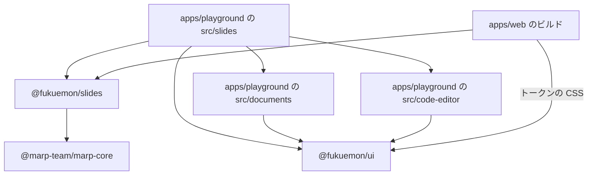
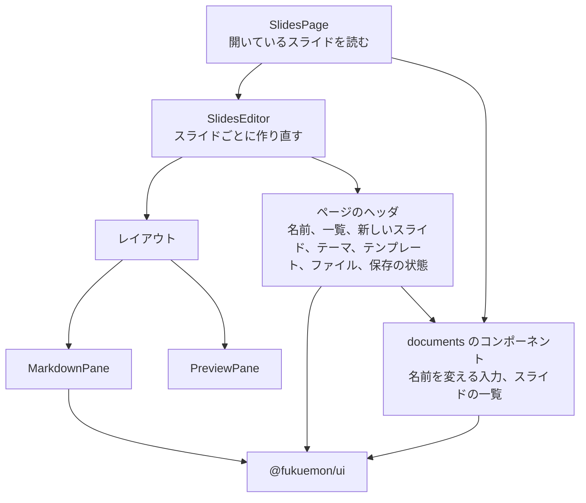
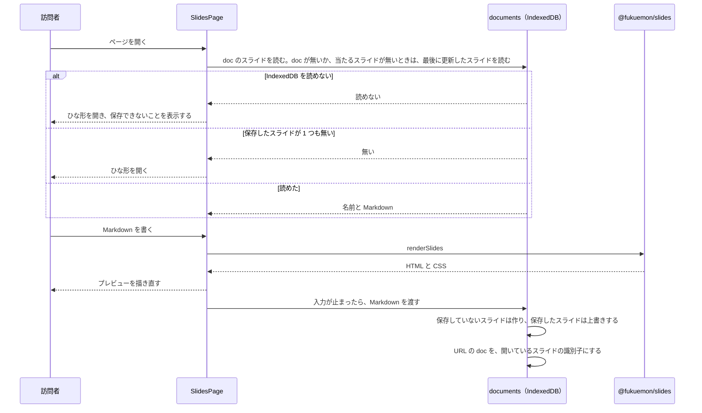
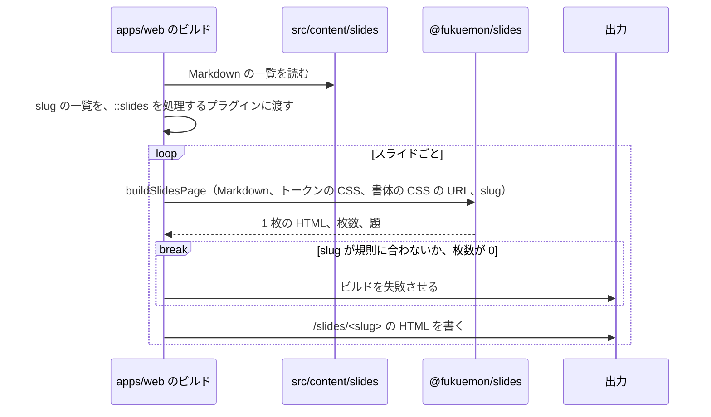

# スライド

## Overview

スライドは、訪問者と運営者が Markdown からスライドを作るエディタと、運営者が公開するスライドのページの 2 つである。  
エディタは、`play.fukuemon.dev` のツールである。  
公開するスライドは、`fukuemon.dev/slides/<slug>` の静的なページである。

全体の構成とホスト名は [fukuemon.dev Design Doc](../../DesignDoc.md) にある。  
プレイグラウンドのアプリの構成は [プレイグラウンドの Design Doc](../../../../apps/playground/DesignDoc.md) にある。  
方式は、次の ADR が決めている。

- ADR-0041: [スライドのエディタは Marp で作り、テーマの CSS からトークンの CSS 変数を参照する](../../../adr/0041-slides-editor-with-marp.md)
- ADR-0042: [公開するスライドは、ビルドのときに静的な HTML にして `/slides/<slug>` に置き、記事には iframe で埋め込む](../../../adr/0042-published-slides-as-static-pages.md)
- ADR-0043: [キャンバスとスライドのエディタは、ツールごとに、名前を付けた複数の図とスライドを IndexedDB に保存する](../../../adr/0043-multiple-named-documents-per-tool.md)

## Scope

持つものは次のとおり。

- エディタのパス、ページの構成、状態の置き場
- テーマとテンプレートの一覧
- `packages/slides` が公開する関数
- 保存、ファイルを開く操作、書き出しの流れ
- 公開するスライドのビルドの流れと、ページ送りの画面
- 記事の Markdown から、スライドを埋め込む書き方

持たないものは次のとおり。

- IndexedDB に保存するレコードの形と、一覧の画面の中身。[キャンバスの Design Doc](../canvas/DesignDoc.md) が持つ。
  - ADR-0057: [図とスライドは、一覧に出す値と中身を 2 つの object store に分けて、訪問者のファイルと別のデータベースに保存する](../../../adr/0057-document-records-in-two-object-stores.md)
- AI のエージェントからの操作の登録と、スイッチと操作の記録の欄の位置。AI からの操作の設計の文書が持つ。
  - ADR-0044: [AI のエージェントからの操作は、WebMCP の API で登録し、MCP-B の polyfill と relay でも呼べるようにする](../../../adr/0044-ai-operations-with-webmcp.md)
- 公開するスライドの一覧のページ。
- 発表者用の画面（発表者のノート、タイマー）。
- Markdown に貼った画像を、IndexedDB と書き出したファイルに入れること。
- 画面のコンポーネントの見た目。[packages/ui/DESIGN.md](../../../../packages/ui/DESIGN.md) が持つ。

## Design

### エディタのパス

エディタは、`play.fukuemon.dev/slides/` に置く。

| パス       | ツール             | cross-origin isolation のヘッダ |
| ---------- | ------------------ | ------------------------------- |
| `/slides/` | スライドのエディタ | 返さない                        |

- 開くスライドは、クエリの `doc` で指す（`/slides/?doc=<識別子>`）。
- `doc` が無いときは、最後に更新したスライドを開く。保存したスライドが 1 つも無いときは、ひな形を開く。
- `doc` の識別子のスライドが無いときと、識別子がほかのツールの図を指すときは、`doc` が無いときと同じに扱う。
- `documents/` のモジュールは、開いているスライドが変わるたびに、URL のクエリを、履歴を足さずに書き換える。再読み込みで、同じスライドが開く。
- 記事に、エディタのページを埋め込まない。
- ページは、プレイグラウンドのほかのツールと同じく、iframe の中で開かれたかを判定する。iframe の中では、ページのヘッダを出さず、AI のエージェントからの操作を登録しない。
- `fukuemon.dev/playground` の一覧から、エディタのページにリンクする。

### ディレクトリと依存

```text
apps/playground/
  slides/index.html       スライドのエディタのエントリーポイント
  src/
    slides/               スライドのエディタのページ。レイアウト、プレビュー、書き出し、ファイルを開く処理
    documents/            名前を付けた図とスライドの保存、開いているものの状態、一覧のコンポーネント。キャンバスのツールと共有する
    code-editor/          エディタのエンジンを、EditorFrame に結び付けるコンポーネント。Node の実行環境のページと共有する

apps/web/
  src/content/slides/     運営者が公開するスライドの Markdown

packages/
  slides/src/             テーマの CSS、テンプレート、Marp のインスタンスを作る関数、theme: を読み書きする関数、ページを組み立てる関数
    page/                 組み立てたページに入れる CSS と、ブラウザで動くスクリプト
```

テーマ、テンプレート、Marp の設定、ページを組み立てる関数は、`packages/slides`（`@fukuemon/slides`）に置く。  
ADR-0058: [スライドのテーマ、テンプレート、Marp の設定、ページを組み立てる関数を、`packages/slides` に置く](../../../adr/0058-slides-package-for-themes-and-pages.md)

次の図は、スライドに関わるディレクトリと package の間で許す import の向きを示す。  
矢印の無い組は、import しない。



- `@marp-team/marp-core` に依存するのは、`@fukuemon/slides` だけである。`apps/playground` と `apps/web` の `package.json` には、`@marp-team/marp-core` を依存として書かない。
- `@fukuemon/slides` は、React、`@fukuemon/ui`、workspace のほかの package に依存しない。
- `src/slides/` は、`apps/playground/src/` のほかのツールのページのディレクトリ（`node/`、`sql/`、`go/` と、キャンバスのツール）を import しない。Oxlint の `no-restricted-imports` の対象に、`slides/` を足す。
- `documents/` は、`@fukuemon/slides` を import しない。スライドの中身は、文字列として受け取る。
- `documents/` は、ツールの種類に依らない処理を、React の外のモジュールとして持つ。持つ処理の一覧は、[キャンバスの Design Doc の「ディレクトリ」](../canvas/DesignDoc.md#ディレクトリ) にある。
- `src/slides/` は、エディタとのやり取り、中身が変わったかの比較、ファイルの形式の処理だけを持つ。
- `code-editor/` は、`sql-console/` と同じく、ツールのページのディレクトリから import される。`code-editor/` は、ツールのページのディレクトリと、`documents/` を import しない。
- `packages/slides/src/page/` のスクリプトは、ブラウザで動く。tsconfig と lint の対象を、package のほかのコードと分ける。package のほかのコードは、`page/` のファイルを、文字列として読み込む。

### `@fukuemon/slides`

```ts
type ThemeName = "fd-plain" | "fd-accent";

type Theme = { name: ThemeName; label: string; css: string };

type Template = { id: TemplateId; label: string; markdown: string };

type TemplateId = "title" | "toc" | "section" | "code" | "end";

declare const themes: readonly Theme[];
declare const templates: readonly Template[];
declare const starterMarkdown: string;

declare function renderSlides(markdown: string): RenderedSlides;

type RenderedSlides = { html: string; css: string; count: number; title: string | null };

type TextEdit = { from: number; to: number; insert: string };

declare function applyEdit(markdown: string, edit: TextEdit): string;

declare function readTheme(markdown: string): ThemeName;
declare function themeEdit(markdown: string, theme: ThemeName): TextEdit;

declare function slideIndexAtLine(markdown: string, line: number): number;
declare function insertAfterSlideEdit(markdown: string, index: number, fragment: string): TextEdit;

declare function buildSlidesPage(options: {
  markdown: string;
  tokensCss: string;
  fontsHref?: string;
  fallbackTitle: string;
}): SlidesPage;

type SlidesPage = { html: string; count: number; title: string };

declare function slidesAssets(): VitePlugin;
```

名前は、実装のときに変えてよい。

- Marp のインスタンスは、package の中の 1 つの関数が作る。渡す設定は、次のとおり。
  - 数式の記法を無効にする。
  - 絵文字を、OS の絵文字のまま出す。絵文字の画像を読み込まない。
  - Markdown の中の HTML のタグを、タグとして出さない。
  - テーマは、`themes` の 2 つだけを登録する。Marp に最初から入っているテーマは、登録から外す。
  - デフォルトのテーマは、`fd-plain` にする。
- `renderSlides` は、スライドの HTML、CSS、枚数、題を返す。HTML は、Marp の出力のままで、n 番目の `<section>` が、n 枚目のスライドである。題は、Markdown の先頭の `title:` の値である。無いときは、最初の見出しの文にする。見出しも無いときは、`null` を返す。
- `readTheme` は、Markdown の先頭の `theme:` の値を返す。値が無いときと、`themes` に無い名前のときは、`fd-plain` を返す。
- `themeEdit` は、`theme:` の行を書き換える編集を返す。front matter が無いときは、先頭に足す編集を返す。
- `slideIndexAtLine` は、行の番号から、その行が何枚目のスライドにあるかを返す。`insertAfterSlideEdit` は、指定したスライドの後ろに、断片を 1 枚のスライドとして足す編集を返す。
- 編集（`TextEdit`）は、置き換える範囲の文字の位置と、差し込む文である。エディタは、編集を、エディタのエンジンに渡す。Markdown の全文が要る呼び出し元は、`applyEdit` を使う。
  - スライドの区切りの行は、Marpit が解析した結果の、スライドの始まりの行の番号から求める。`---` の行を、自分で数えない。コードブロックの中の `---` を、区切りと数えないためである。
  - front matter の中の行は、1 枚目のスライドとして扱う。
- `buildSlidesPage` は、ページ送りつきの 1 枚の HTML と、スライドの枚数と、ページの題を返す。HTML の中身は [ページ送りの画面](#ページ送りの画面) にある。
  - トークンの CSS は、`tokensCss` で受け取り、`<style>` に入れる。
  - `fontsHref` を渡したときだけ、書体の CSS を `<link>` で読み込む。
  - ページの題は、`renderSlides` の題にする。題が `null` のときは、`fallbackTitle` を使う。
- `slidesAssets` のほかの export する関数は、ブラウザと Node の両方で動く。DOM の API を使わない。DOM の API を使うのは、`page/` のスクリプトだけである。
- `slidesAssets` は、テーマの CSS と、`page/` の CSS とスクリプトを、文字列にする Vite の plugin である。`apps/playground` と `apps/web` のビルドの設定は、plugin を登録するだけにする。package が、アプリのビルドの設定に依らないようにするためである。

### テーマ

テーマは 2 つである。

| 名前        | 表示の名前 | 見た目                                                 |
| ----------- | ---------- | ------------------------------------------------------ |
| `fd-plain`  | 素         | 生成りの背景に、墨の文字。スライドの題の下に、罫を引く |
| `fd-accent` | 緑の罫     | 左の端に、緑の太い罫。見出しが緑。表紙は、緑の淡い背景 |

- スライドの大きさは、1280×720 px である。ほかの大きさは、持たない。
- 色は、セマンティックトークンの CSS 変数を参照する。テーマの CSS に、色の値を書かない。
- `fd-accent` の緑は、スライド用のトークン（`slide-accent`、`slide-accent-surface`）を参照する。`primary` と `primary-surface` は、使わない。
- コードの色は、highlight.js のクラスに、コードの色のトークンを対応させる。
- ライトとダークは、トークンの値の切り替えに任せる。テーマの CSS に、明暗ごとの規則を書かない。
- 2 つのテーマは、スライドの大きさ、文字の大きさ、コードの色、テンプレートのクラスの配置を、共通の CSS として共有する。
- 選んだテーマは、Markdown の先頭の `theme:` にだけ持つ。保存するレコードに、テーマの項目を置かない。

### テンプレート

テンプレートは、1 枚のスライドの Markdown の断片である。  
スライドの種類は、`<!-- _class: title -->` のように、Marp のクラスで表す。

| 識別子    | 表示の名前 | クラス    | 中身                           |
| --------- | ---------- | --------- | ------------------------------ |
| `title`   | 表紙       | `title`   | 題、発表者の名前、日付         |
| `toc`     | 目次       | `toc`     | 番号付きの一覧                 |
| `section` | 章の扉     | `section` | 章の番号と、章の題             |
| `code`    | コード     | `code`    | 小さい見出しと、コードブロック |
| `end`     | 結び       | `end`     | まとめの箇条書きと、リンク     |

- ひな形（`starterMarkdown`）は、`theme: fd-plain` の front matter と、5 つのテンプレートを表の順に並べたものである。
- テーマは、5 つのクラスの見た目を持つ。

### エディタのページ

次の図は、エディタのページのツリーを示す。



ページのヘッダには、左から次のものを並べる。

| 位置 | 中身               | コンポーネント                          | 動き                                                                                                                              |
| ---- | ------------------ | --------------------------------------- | --------------------------------------------------------------------------------------------------------------------------------- |
| 1    | スライドの名前     | `documents/` のコンポーネント           | 押すと、その場で名前を変える                                                                                                      |
| 2    | 「スライドの一覧」 | `Button`                                | 一覧のダイアログを開く                                                                                                            |
| 3    | 「新しいスライド」 | `Button`                                | ひな形から、新しいスライドを作って開く。開いていたスライドは変えない                                                              |
| 4    | 「テーマ: 素」     | `ActionMenu` の、ラジオの項目のメニュー | 項目は、テーマの表示の名前である。選んでいるテーマに、印を出す。選ぶと、`theme:` を書き換える。開くボタンの文に、今のテーマを出す |
| 5    | 「テンプレート」   | `ActionMenu`                            | 項目は、テンプレートの表示の名前である。選ぶと、カーソルのあるスライドの後ろに足す                                                |
| 6    | 「ファイル」       | `ActionMenu`                            | ファイルを開く、Markdown を書き出す、HTML を書き出す、PDF にする                                                                  |
| 7    | 保存の状態         | 文                                      | 保存した時刻を出す。保存できないときは、ヘッダの下に、`Notice`（`danger`、`isAlert`）で出す                                       |

- 「スライドの一覧」「新しいスライド」のボタンは、`Button` の `secondary` にする。ヘッダに、主のボタンは置かない。
- `md:` より狭い画面では、ヘッダを 2 行にする。1 行目に、スライドの名前を置く。2 行目に、操作と保存の状態を置く。
- レイアウトは、`SplitPane` で、左に `MarkdownPane`、右に `PreviewPane` を並べる。`md:` より狭い画面では、`Tabs` で 2 つを切り替える。
- `MarkdownPane` は、`code-editor/` のコンポーネントで、`EditorFrame` に、Node の実行環境と同じエディタのエンジンを渡す。タブは、スライドの名前の 1 つだけを出す。閉じる操作は渡さない。
  - 狭い画面では、`Tabs` の中に `EditorFrame` のタブが入り、タブの並びが 2 段になる。2 段のままにするか、`EditorFrame` のタブを出さないかは、実装のタスクで決める。
- `PreviewPane` は、全てのスライドを縦に並べ、幅に合わせて縮める。スライドの左上に、何枚目かを出す。
  - スクロールする領域に、「プレビュー」の名前を付け、キーボードでフォーカスできるようにする。訪問者は、フォーカスした後に、上下の矢印のキーでスクロールできる。
  - プレビューは、Shadow DOM に入れる。Marp の CSS を、ページに適用させないためである。
  - 入力のたびに、`renderSlides` の結果で描き直す。
  - カーソルのあるスライドが見えるところまで、プレビューのスクロールの位置を変える。位置は、動きを付けずに変える。
- スライドの名前、一覧、確認のダイアログは、`documents/` のコンポーネントを使う。一覧の中身と、消す操作の確認は、[キャンバスの Design Doc の「図の一覧」](../canvas/DesignDoc.md#図の一覧) にある。画面に出す語（「スライド」）と、新しく作るものの名前の付け方は、props で渡す。
- 新しいスライドの名前は、`無題のスライド` に連番を付ける。連番の決め方は、キャンバスのツールの「新しい図」と同じである。
- 開いているスライドの識別子、スライドの一覧（名前と、更新した時刻）、IndexedDB を使えるか（`status`）は、`documents/` のモジュールが Store で持つ。保存の状態の文は、この 3 つから出す。`SlidesPage` は、`useSyncExternalStore` で読む。Effect の中で `setState` を呼んで、Store の値を写さない。
- `SlidesPage` は、開いているスライドの識別子を `key` にして、`SlidesEditor` を置く。スライドを切り替えると、`SlidesEditor` を作り直す。
- `SlidesEditor` は、`use` で読んだ中身を初期値にして、`useReducer` で状態を持つ。持つのは、Markdown、カーソルの行、狭い画面で選んだタブである。
  - テーマは、状態に持たない。`readTheme` で、Markdown から求める。
  - 状態管理のライブラリと、ツリーをまたぐ通知は使わない。
- `use` に渡す Promise（開くスライドの読み込み）は、`documents/` のモジュールから受け取る。
- テーマを選ぶ操作と、テンプレートを足す操作は、`themeEdit` と `insertAfterSlideEdit` の編集を、エディタのエンジンに渡す。訪問者は、元に戻す操作で取り消せる。

### 保存

保存するレコードの形、データベース、IndexedDB を読み書きできないときの動きは、ADR-0057 に従う。  
ADR-0057: [図とスライドは、一覧に出す値と中身を 2 つの object store に分けて、訪問者のファイルと別のデータベースに保存する](../../../adr/0057-document-records-in-two-object-stores.md)  
スライドのエディタは、`documents/` のモジュールを通して、読み書きする。  
保存する時点と、開くスライドの決め方は、[キャンバスの Design Doc の「保存の流れ」](../canvas/DesignDoc.md#保存の流れ) と同じである。

- ツールの種類は、`slides` である。
- 中身（`DocumentContent` の `data`）は、Markdown の全文である。テーマは、Markdown の `theme:` に入っている。`DocumentContent` に、スライドだけの値を足さない。
- `src/slides/` は、入力が 500 ミリ秒止まったときに、Markdown を `documents/` に渡す。500 ミリ秒は、測っていない値で、実装のタスクで測って変えてよい。
- スライドを切り替える前と、ページを閉じるときは、`documents/` が、待っている保存を先に書く。
- ひな形を開いただけでは、保存しない。「新しいスライド」を押したときも同じである。最初に編集したときか、名前を変えたときに、`documents/` が、新しいスライドとして保存する。
- 「ファイルを開く」は、`.md` のファイルを、新しいスライドとして保存して開く。名前は、ファイルの名前から付ける。開いていたスライドは変えない。

次の図は、エディタのページを開いてから、保存するまでの流れを示す。



### 書き出し

書き出すファイルは 3 つである。  
ファイルの名前は、スライドの名前から付ける。

| 形式        | 作り方                                                                                     |
| ----------- | ------------------------------------------------------------------------------------------ |
| Markdown    | エディタの Markdown を、そのまま `.md` のファイルにする                                    |
| 単独の HTML | `buildSlidesPage` の結果を、`.html` のファイルにする。`fontsHref` は渡さない               |
| PDF         | `buildSlidesPage` の結果を、画面に出さない iframe に入れ、ブラウザの印刷のダイアログを開く |

- トークンの CSS は、`src/slides/` が、`@fukuemon/ui` のトークンの CSS を文字列として読み込み、`tokensCss` に渡す。`@fukuemon/ui` の `exports` に、トークンの CSS（`src/tokens/tokens.gen.css`）のサブパスを足す。
- 単独の HTML は、自分のファイルのほかを読み込まない。書体は埋め込まず、訪問者の端末の書体で出す。
- 印刷のときは、全てのスライドを 1 ページに 1 枚ずつ出し、ページ送りの帯を出さない。用紙の大きさは、スライドと同じ 1280×720 px にする。

### 公開するスライドのビルド

運営者は、Markdown を `apps/web/src/content/slides/<slug>.md` に置く。

- `<slug>` は、ファイルの名前である。英小文字、数字、ハイフンだけを使う。
- 置いたスライドは、全て公開する。下書きの状態は持たない。
- `apps/web` のビルドは、Markdown を、記事の Markdown の処理に通さない。文字列として読み、`buildSlidesPage` に渡す。
- slug の一覧と Markdown を読む関数は、`apps/web/src/lib/content/` に置く。`/slides/<slug>` の HTML は、`apps/web/src/pages/slides/` のエンドポイントが出力する。
- `tokensCss` には、エディタと同じサブパスで、`@fukuemon/ui` のトークンの CSS を文字列として読んで渡す。テーマの CSS が参照する変数の名前が、エディタと同じになる。

次の図は、ビルドの流れを示す。



- `fallbackTitle` には、slug を渡す。
- `fontsHref` には、サイトの書体の CSS の URL を渡す。公開するスライドは、サイトの書体で出る。
- `::slides` を処理するプラグインは、`apps/web/src/lib/` に置き、slug の一覧を、引数で受け取る。記事を処理する順に依らずに、slug があることを確認できる。
- slug が規則に合わないときと、`buildSlidesPage` の返した枚数が 0 のときは、ビルドを失敗させる。

### ページ送りの画面

`buildSlidesPage` が作るページは、スライドと、その下の帯でできている。  
ADR-0059: [公開するスライドのページ送りを下の帯に置き、JavaScript が有効なときに全画面の表示とスワイプでの操作を足す](../../../adr/0059-slides-pager-fullscreen-and-swipe.md)

```text
┌──────────────────────────────────────────────┐
│                                              │
│                  スライド                     │
│                                              │
├──────────────────────────────────────────────┤
│            前へ   3 / 12   次へ      [全画面] │
└──────────────────────────────────────────────┘
```

- 表示するスライドは、URL の `#3` のような番号で決める。番号が無いときは、1 枚目を出す。
- スライドは、ページの幅と、帯を除いた高さに収まる大きさで、中央に出す。
- 帯は、高さ 48px で、`<nav>` に「ページ送り」の名前を付ける。帯は、スライドごとに 1 つ作り、表示するスライドの帯だけを、CSS の `:target` と `:has()` で出す。JavaScript なしで、番号とリンクの先を変えるためである。
- HTML の中では、スライドごとの帯を、全てのスライドの後ろに、スライドの順に並べる。
- 帯の中央に、「前へ」、番号、「次へ」を並べる。番号は `3 / 12` の形で出す。`3 / 12` は読み上げから外し、画面に出さない文の「12 枚中 3 枚目」を、読み上げに渡す。
- 1 枚目のスライドの「前へ」と、最後のスライドの「次へ」は、`href` の無い、`aria-disabled` が `true` のリンクにし、`text-disabled` の色の文字で出す。
- リンクとボタンの押せる領域は、幅と高さを 44px 以上にする。
- リンクとボタンは、キーボードでフォーカスしたときに、フォーカスの輪を出す。
- 全画面の間も、帯を出す。
- 帯の色と罫は、セマンティックトークンの CSS 変数を参照する。リンクの見た目は `@fukuemon/ui` の `Link` に、「全画面」のボタンの見た目は `Button` の `secondary` に合わせる。
  - フォーカスの輪、角、動きの時間と緩急は、[静的なページが使う CSS 変数](#静的なページが使う-css-変数) を参照する。帯の CSS に、値を書かない。
  - リンクは、hover で、下線の下に 2px の罫を左から 1 回引く。ボタンを押して離すと、文字の色の墨がにじんで消える。
  - 動きを減らす設定（`prefers-reduced-motion: reduce`）では、帯の全ての動きを止める。止める規則は、ページの CSS に 1 か所書く。
- 帯の幅が 480px より狭いときは、「全画面」のボタンの文を出さず、印だけを出す。ボタンの名前は、読み上げに渡す。480px は、画面の幅ではなく、帯の幅で判定する。
- スライドを切り替えるときに、動きを付けない。

JavaScript が有効なときは、ページの 1 つの `<script>` が、次の操作を足す。

| 操作               | 動き                                                                     |
| ------------------ | ------------------------------------------------------------------------ |
| 左右の矢印のキー   | 前後に送る                                                               |
| PageUp、PageDown   | 前後に送る                                                               |
| Home、End          | 最初と最後のスライドに送る                                               |
| 「全画面」のボタン | ページを全画面にする。全画面の間は、ボタンの文を「全画面を終える」にする |
| Esc                | 全画面を終える。ブラウザが処理する                                       |
| 左右のスワイプ     | 左へのスワイプで次のスライドに、右へのスワイプで前のスライドに送る       |

- キーとスワイプは、帯のリンクを押したのと同じ処理で送る。
- 帯のリンクにフォーカスがあるときに送ったら、スクリプトが、新しく出た帯の、同じ向きのリンクにフォーカスを移す。同じ向きのリンクが無い端のスライドでは、反対の向きのリンクに移す。Enter のキーを続けて押して、送り続けられるようにするためである。
- キーは、修飾キーを押しているときは、送らない。Space には、ページ送りを割り当てない。ボタンとリンクを押すキーと重なるためである。
- 「全画面」のボタンは、HTML では隠しておき、`document.fullscreenEnabled` が `true` のときだけ、スクリプトが出す。
- スワイプの判定は、次のとおり。
  - スライドの領域の `touch-action` を、`pan-y pinch-zoom` にする。縦の動きと、2 本の指での拡大は、ブラウザが処理する。
  - 入力がタッチで、指が 1 本で、横の移動が 48px 以上で、縦の移動の 2 倍以上の動きだけを、指を離したときにスワイプと判定する。
  - `pointercancel` が来た動き、ページを拡大している間（`visualViewport.scale` が 1 でない間）の動き、文字を選んでいる間の動きは、スワイプと判定しない。
  - 指の動きに合わせて、スライドを動かさない。
- 48px と 2 倍は、測っていない値で、実装のタスクで実機で測って変えてよい。

### 記事への埋め込み

記事の Markdown には、ディレクティブで書く。

```md
::slides[WAL の仕組み]{slug="wal-internals"}
```

- 角括弧の中は、スライドの題である。必須にする。iframe の `title` と、iframe の下のリンクの文に使う。
- `slug` は、`apps/web/src/content/slides/<slug>.md` の名前である。必須にする。
- 題が無いとき、`slug` が無いとき、`slug` に当たる Markdown が無いときは、ビルドを失敗させる。

ビルドは、ディレクティブを、次の HTML にする。

```html
<figure>
  <iframe src="/slides/wal-internals" title="WAL の仕組み" loading="lazy" allowfullscreen></iframe>
  <figcaption><a href="/slides/wal-internals">WAL の仕組み（スライドを開く）</a></figcaption>
</figure>
```

- iframe の幅は、本文の幅にする。高さは、幅の 16 分の 9 に、帯の 48px を足した値にする。
- iframe は、`border` の色の 1px の枠で囲む。`figcaption` のリンクは、本文のリンクと同じ見た目にする。
- iframe の中のページは、OS の設定の明暗に従う。
- 記事のページは、エディタの JavaScript と、marp-core を読み込まない。

### デザインシステムに足すもの

スライドの画面は、`packages/ui` に、次のものを足して作る。

#### 静的なページが使う CSS 変数

静的なページは、Tailwind のユーティリティを使えないので、次の値を、CSS 変数で読む。
変数は、挿絵の濃さ（`--fd-art-*`）と同じく、色でない値の例外として、セマンティックトークンのファイルに置く。トークンの CSS（`tokens.gen.css`）は、この変数を含めて生成する。
`theme.css` の `--radius-control`、`--animate-*`、`focus-ring`、`link-rule`、`ink-press` は、この表の変数を `var()` で参照する。値を 2 か所に書かないためである。

| 名前                       | 値                             | 使う場面                                                |
| -------------------------- | ------------------------------ | ------------------------------------------------------- |
| `--fd-focus-ring-width`    | `2px`                          | フォーカスの輪の太さ                                    |
| `--fd-focus-ring-offset`   | `2px`                          | フォーカスの輪と、要素の間                              |
| `--fd-radius-control`      | `2px`                          | 操作できる要素と、重なる面の角                          |
| `--fd-duration-feedback`   | `150ms`                        | 操作に応える動き（色、濃度）                            |
| `--fd-duration-rule-hover` | `240ms`                        | リンクの hover で、罫を左から 1 回引く動き              |
| `--fd-duration-stroke`     | `320ms`                        | 選んだタブと、ダイアログの上端で、筆の線を 1 回引く動き |
| `--fd-duration-ink-spread` | `360ms`                        | ボタンを離した後に、墨が広がる動き                      |
| `--fd-duration-ink-fade`   | `480ms`                        | ボタンを離した後に、墨が消える動き                      |
| `--fd-ease-stroke`         | `cubic-bezier(0.4, 0, 0.2, 1)` | 罫と筆の線を引く動きの緩急                              |
| `--fd-ease-out`            | `ease-out`                     | 濃度の変化と、墨のにじみの緩急                          |

- フォーカスの輪の色は、今ある `--fd-color-focus-outline` を使う。色の変数は足さない。
- フォーカスの輪の太さと色は、全てのコンポーネントのフォーカスの表示を、墨の 2px の 1 重の輪にした後の値である（#141）。
- 時間の値は、`theme.css` が今持つ値と同じである。

#### スライド用のセマンティックトークン

色の種類に「スライド」を足し、`fd-accent` が使う緑を置く。

| 名前                              | ライト      | ダーク      | 使う場面                                 |
| --------------------------------- | ----------- | ----------- | ---------------------------------------- |
| `--fd-color-slide-accent`         | `green-700` | `green-300` | `fd-accent` の見出しの文字と、左の端の罫 |
| `--fd-color-slide-accent-surface` | `green-100` | `green-900` | `fd-accent` の表紙の背景                 |

- 値は、`primary` と `primary-surface` と同じプリミティブトークンを指す。
- `primary` と分ける理由は、主のボタンの色を変えたときに、スライドの色が一緒に変わらないようにするためである。
- コントラストのチェックの組に、次の 4 つを足す。
  - `slide-accent` の文字と、`surface`、`surface-subtle`、`surface-raised` の背景
  - `slide-accent` の文字と、`slide-accent-surface` の背景
  - `text` の文字と、`slide-accent-surface` の背景
  - `text-secondary` の文字と、`slide-accent-surface` の背景
- スライドの背景、文字、罫、リンク、コードの色は、今あるセマンティックトークン（`surface`、`text`、`text-secondary`、`border`、`link`、コードの色）を使う。

#### `ActionMenu` の変種

`ActionMenu` に、ラジオの項目のメニューを足す。

- ヘッダの「テーマ」「テンプレート」「ファイル」のメニューは、開くボタンに文を出す。開くボタンに文を出す変種は、キャンバスのツールを実装するときに `@fukuemon/ui` に足したものを使う。スライドの実装では、足さない。
- ラジオの項目のメニュー。項目のうち 1 つを、選んでいる状態にする。「テーマ」のメニューが使う。
  - メニューの全ての項目が、`role="menuitemradio"` と `aria-checked` を持つ。ラジオの項目と、ほかの項目を、1 つのメニューに混ぜない。
  - 選んでいる項目には、項目の左に印を出す。色だけで示さない。印は、読み上げから外す。
  - 項目を選ぶと、メニューを閉じる。キーボードの操作は、今の `ActionMenu` と同じである。
  - ラジオの項目のメニューは、項目が 2 つのときも使う。

#### `packages/ui` の文書とチェック

- コンポーネントの文書の `ActionMenu` に、ラジオの項目のメニューの変種、選んでいる状態、使う場面の「テーマを選ぶ」、項目が 2 つでも使う例外を足す。
- トークンの文書の、色の表と、色でない値の例外の一覧に、足した名前を書く。
- デザインシステムの文書の `MOTION-REDUCE` に、静的なページの例外を書く。静的なページは `theme.css` を読めないので、ページの CSS に、動きを止める規則を 1 か所書く。

## Interface

### 置くファイル

- `apps/playground/slides/index.html`、`apps/playground/src/slides/`: スライドのエディタ。
- `apps/playground/src/documents/`: 名前を付けた図とスライドの保存と、一覧のコンポーネント。
- `packages/slides/`: テーマ、テンプレート、Marp の設定、ページを組み立てる関数。
- `apps/web/src/content/slides/<slug>.md`: 運営者が公開するスライドの Markdown。
- `apps/playground/src/code-editor/`: エディタのエンジンを、`EditorFrame` に結び付けるコンポーネント。
- `apps/web/src/lib/content/`: slug の一覧と Markdown を読む関数。
- `apps/web/src/pages/slides/`: `/slides/<slug>` の HTML を出力するエンドポイント。
- `apps/web/src/lib/`: `::slides` を処理するプラグイン。ディレクティブの解析に、`remark-directive` を使う。
- `packages/ui/package.json`: `exports` に、トークンの CSS のサブパスを足す。
- `packages/ui/src/tokens/`: 静的なページが使う CSS 変数と、スライド用のセマンティックトークン。
- `packages/ui/src/base/ActionMenu/`: ラジオの項目のメニュー。
- `packages/ui/scripts/`: トークンの CSS の生成、コントラストのチェックの組、色の値のチェックの対象。
- `packages/ui/DESIGN.md`、`packages/ui/design/tokens.md`、`packages/ui/design/components.md`: 足したトークン、変種、`MOTION-REDUCE` の例外。

### 読む値

- URL のクエリの `doc`: 開くスライドの識別子。
- URL の `#<番号>`: 公開するスライドと、単独の HTML で、表示するスライドの番号。
- Markdown の先頭の `theme:`: テーマの名前。`fd-plain` か `fd-accent`。
- Markdown の先頭の `title:`: ページの題。
- IndexedDB: 名前を付けたスライド。ツールの種類は `slides`。

### 記事に書く記法

- `::slides[<題>]{slug="<slug>"}`: 公開するスライドを、記事に埋め込む。

### 動くチェック

- Oxlint の `no-restricted-imports`: `apps/playground/src/` の、ツールのページのディレクトリの間の import を止める。対象に `slides/` を足す。
- package の依存の宣言と knip: 次の 2 つを確認する。
  - `@fukuemon/slides` が、React、`@fukuemon/ui`、workspace のほかの package に依存しないこと
  - `apps/playground` と `apps/web` が、`@marp-team/marp-core` を直接は import しないこと
- `apps/web` のビルド: slug の規則、スライドの枚数、`::slides` の題と `slug` を確認する。
- 色の値のチェック（`check:raw-values`）: 対象に `packages/slides` を足す。テーマの CSS と、帯の CSS に、色の値とプリミティブトークンの名前を書けない。時間の値は、チェックが見ないので、レビューで見る。
- コントラストのチェック: スライド用のトークンの 4 つの組を足す。

## Verification

端末は Apple M2、ブラウザは Playwright 1.65.0 の Chromium 158、WebKit 27.2、Firefox 159（headless）、配信は `localhost` である。  
バージョンは、`@marp-team/marp-core` 4.4.0 である。  
実機のブラウザは未確認である。

- `fd-plain` と `fd-accent` の 2 つのテーマで、表紙、目次、コードの 3 つのクラスを描いた。色は、ライトとダークの両方で、トークンの値と一致した。
- 下の帯の中央に「前へ」、番号、「次へ」を並べた形で、JavaScript を無効にして、前後に送れた（3 つのブラウザ）。
- 章の扉と結びのクラスは、描いていない。
- 全画面の表示と、スワイプでの操作は、作っていない。
- Node 24.21.0 で、`marp.markdown.parse()` の結果の、スライドの始まりのトークン（`marpit_slide_open`）は、始まりの行の番号を持っていた。コードブロックの中の `---` は、区切りにならなかった。
- Node 24.21.0 で、`themeSet.clear()` の後に 2 つのテーマを登録し、`themeSet.default` を `fd-plain` にした。`theme: gaia` と、無い名前の `theme:` は、`fd-plain` の CSS で描かれた。
- `COEP: require-corp` を返す記事に、スライドの iframe を埋め込めるかは、未確認である。埋め込めないときの扱いは、決めていない（#120）。
- 新しい `apps/web` が、書体の CSS を、固定の URL で配るかは、未確認である。
- 数式のライブラリを、エディタの JavaScript から外せるかは、未確認である。
- 訪問者が、印刷のダイアログから PDF に保存する操作と、WebKit と Firefox の印刷は、未確認である。
