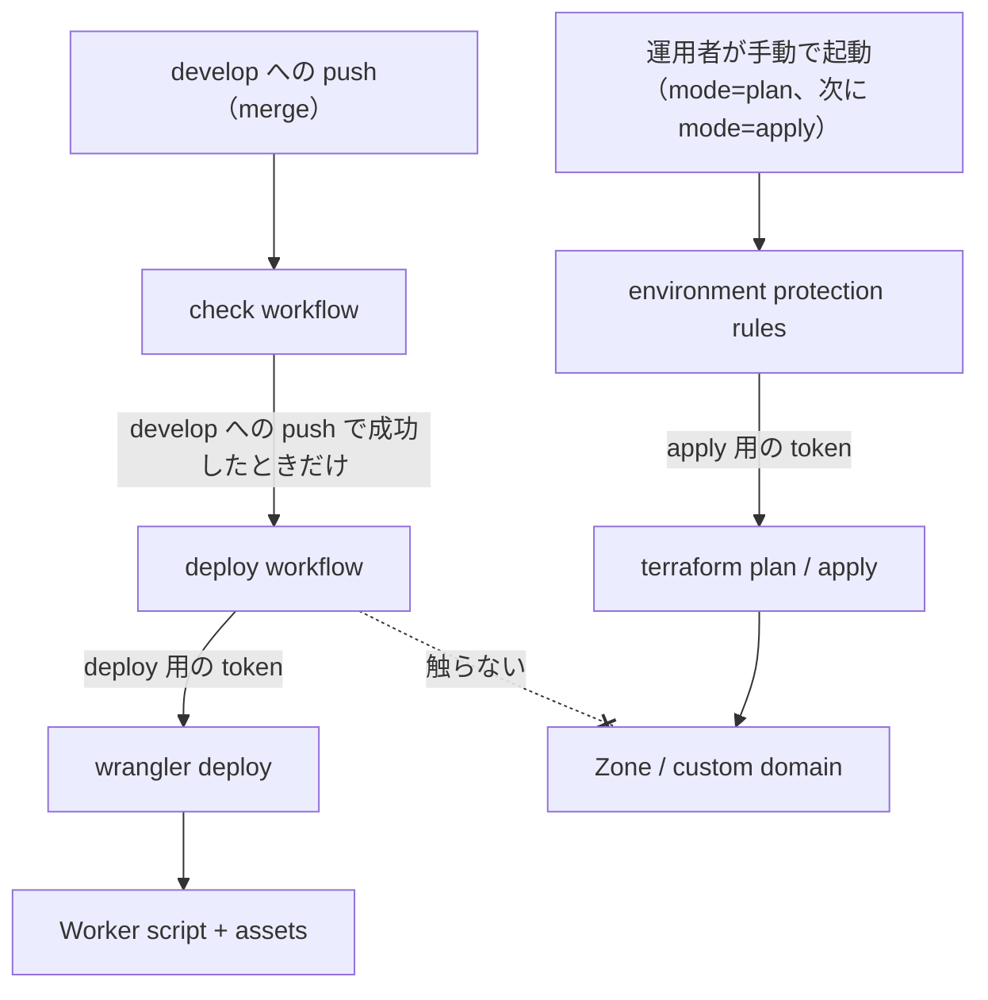

# 基盤

## Overview

基盤は、Cloudflare の zone、Workers の custom domain、Terraform の state を置く R2 のバケットを、Terraform のコードで持つ。  
Worker script と静的アセットの deploy は Wrangler が持ち、この文書の対象に入らない。  
全体の構成は [Design Doc](../design/DesignDoc.md#components) にある。  
ADR-0005: [Workers と Terraform と Wrangler の分担](../adr/0005-workers-terraform-wrangler-boundary.md)

## Scope

持つものは次のとおり。

- `infra/bootstrap/` と `infra/cloudflare/` の分け方
- R2 の state backend の設定
- deploy と apply の流れ

持たないものは次のとおり。

- Terraform と Wrangler の管轄、deploy と apply の条件、credential の置き場。[context/operations.md](../context/operations.md) が持つ。
- 手元で apply する手順。[infra/README.md](README.md) が持つ。
- `.tf` のファイル名とディレクトリの規則。[context/codebase.md](../context/codebase.md#infra) が持つ。

## Design

### deploy と apply の流れ

次の図は、push から Worker の deploy に至る流れと、運用者が手で起動する apply の流れが、別の credential で分かれていることを示す。



Worker のコードの変更は、通常の pull request に含まれ、merge で自動的に deploy される。  
apply の workflow のような、明示的な操作を挟まない。  
コードが app の側にあるので、repo をどう分けても、この性質は変わらない。  
変更を止める手段は、pull request のレビューと自動のテストに頼る。  
`develop` には branch protection を掛けていないので、pull request を通すのは慣行であり、仕組みでは強制しない。  
deploy 用の token は Workers Scripts の権限を持つので、custom domain の apex のレコードにも届きうる。deploy の workflow がそれを触らないのは、`wrangler deploy` の振る舞いによる。  
apply を plan と apply の 2 回に分けて起動する手順は [context/operations.md](../context/operations.md) にある。  
いまの Worker はハンドラを持たないので、誤った変更が及ぶ範囲は静的アセットの誤った配信に限られる。

Wrangler の設定ファイルは `wrangler.jsonc` にする。  
Cloudflare は新しいプロジェクトに JSONC を勧めており、一部の新しい機能は JSON の形式でしか使えない。

### bootstrap と本体

| ディレクトリ        | 対象                             | state の置き場                  | 実行する人               |
| ------------------- | -------------------------------- | ------------------------------- | ------------------------ |
| `infra/bootstrap/`  | state 用の R2 のバケット         | 手元（commit しない）           | 運用者が手元で 1 回      |
| `infra/cloudflare/` | zone と Workers の custom domain | R2（`infra/bootstrap/` が作る） | apply の workflow か手元 |

`infra/bootstrap/` を CI から apply しない。state を手元に置く前提が成り立たなくなる。  
CI は `infra:check` で init（backend なし）と validate だけを実行する。

zone は Terraform で作らない。  
Cloudflare Registrar がドメインを取得したときに作った zone を、`zone.tf` の `import` ブロックが、state にまだないときに取り込む。  
`cloudflare_zone` には `prevent_destroy` を付ける。

`cloudflare_workers_custom_domain` が apex のレコードを管理するので、DNS のレコードは書かない。

### state backend

R2 は S3 と互換だが、AWS ではない。  
`s3` backend には STS、IAM、metadata API を前提にする箇所があるので、その確認を切る。

```hcl
backend "s3" {
  key    = "cloudflare/main/terraform.tfstate"
  region = "auto"

  skip_credentials_validation = true # STS がない
  skip_region_validation      = true # auto は AWS のリージョンの名前ではない
  skip_requesting_account_id  = true # IAM、STS、metadata API がない
  skip_s3_checksum            = true # R2 はチェックサムへの対応が限られる
  use_path_style              = true
  use_lockfile                = true # state のロックを S3 の側のオブジェクトで取る
}
```

bucket の名前と endpoint は account ID を含むので、commit しない。  
bucket の名前は `-backend-config` で、endpoint は `AWS_ENDPOINT_URL_S3` で渡す。

state の key に scope を含める（`cloudflare/main/terraform.tfstate`）。  
後から兄弟の state を足すときに、既存の state の名前を変えずに済む。

バケットのバージョニングを設定しない理由と、state を失ったときの戻し方は [context/operations.md](../context/operations.md#rollback) にある。

## Interface

### 置くファイル

- `infra/bootstrap/provider.tf`、`r2_state_bucket.tf`、`vars.tf`: state 用のバケット
- `infra/cloudflare/provider.tf`: provider と state backend
- `infra/cloudflare/zone.tf`: zone の取り込み
- `infra/cloudflare/workers_domain.tf`: Workers の custom domain
- `infra/cloudflare/vars.tf`: `account_id`、`zone_id`、`zone_name`、`worker_name` の変数
- `apps/web/wrangler.jsonc`: Worker の設定

変数の値は、手元では各ディレクトリの `terraform.tfvars` に置き、commit しない。  
CI では、apply の workflow が `TF_VAR_account_id`、`TF_VAR_zone_id`、`TF_VAR_zone_name` を secret と variable から渡す。  
`worker_name` と、bootstrap の `location` は既定値を持つ。

### 実行するコマンドとチェック

- `pnpm run infra:init`、`infra:plan`、`infra:apply`: `infra/cloudflare/` を対象にする
- `pnpm run infra:bootstrap:init`、`infra:bootstrap:apply`: `infra/bootstrap/` を対象にする
- `pnpm run infra:check`: `terraform fmt -check` と `terraform validate` を、backend を無効にして実行する。credential は要らない
- `pnpm run check:worker-name`: `wrangler.jsonc` の `name` と、`vars.tf` の `worker_name` の既定値が一致するかを確かめる
- `pnpm run check:deploy`: `wrangler deploy --dry-run` を実行する
- check の workflow（`.github/workflows/check.yml`）が、`infra:check` と、上の 2 つを含む `pnpm run check` を実行する
- apply の workflow（`.github/workflows/apply.yml`）と deploy の workflow（`.github/workflows/deploy.yml`）

## Verification

- `cloudflare_workers_custom_domain` が、`wrangler deploy` を済ませた Worker へ結び付くことを、初回の apply で確かめた。`https://fukuemon.dev` が Worker を配信した。
- `skip_s3_checksum` を含む上の backend の設定で、R2 への state の読み書きと `use_lockfile` のロックが通ることを、同じ apply で確かめた。
- 初回の plan は、`cloudflare_zone.site` について、`account.id` を sensitive として扱う差分だけを出した。apply した後に plan を実行すると、差分が残らなかった。
- [context/operations.md](../context/operations.md#secrets) の token の権限の表のとおりで、初回の deploy と初回の apply が通った。
