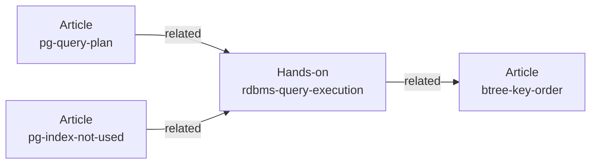

# Content Model

## Overview

Content Model は、記事とハンズオンを同じ一覧に載せ、互いを参照できるようにする。  
[PRD の Success Metrics](../../PRD.md#success-metrics) のうち、種別で絞り込んだ一覧、片方向の記述で双方向に出る関連、Markdown 1 枚での追加を支える。  
全体の構成は [Design Doc](../../design/DesignDoc.md#components) にある。  
ADR-0002: [Content Model の Astro からの独立](../../adr/0002-content-model-independence.md)

## Scope

持つものは次のとおり。

- 記事とハンズオンに共通する schema（`portalBase`）と、種別ごとの拡張
- 安定した識別子 `contentId` の定義と、一意であることのチェック
- 相互参照のグラフの構築、解決できない参照の検出、逆参照の導出
- `ContentRef` への正規化
- Astro の Content Layer の loader との結線

持たないものは次のとおり。

- 一覧のページと詳細のページの表示。[Design System](../design-system/DesignDoc.md) が持つ。
- ハンズオンの実行の方法と、進捗の保存。[ハンズオンと Interactive](../../apps/web/src/features/lab/DesignDoc.md) が持つ。
- 分類（tag）ごとの索引のページ。分類は URL パラメータでの絞り込みにだけ使う。
  - 設計不変量 8: [Design Doc](../../design/DesignDoc.md#種別と分類の切り分け)
- CMS や別のデータソースの実装。loader を差し替える点を 1 つにするところまでを持つ。

## Design

### 安定識別子

Astro は `id` をファイルのパスから導いて占有する。  
`slug` を schema に定義すると、ビルドが `ContentSchemaContainsSlugError` で失敗する。  
自前の安定した識別子は `contentId` として持つ。

```yaml
contentId: rdbms-query-execution # 発行した後は変えない。すべての collection をまたいで一意
path: labs/rdbms-query-execution # URL のパス。改名してよい
```

`contentId` は `^[a-z0-9][a-z0-9-]*$` に合わせて発行する。  
内容を表す語をハイフンでつなぐ。  
日付や連番は、改名の動機になるので入れない。

### 共通の schema

```ts
// packages/content-model/src/schema.ts
export const portalBase = z.object({
  contentId: z.string().regex(CONTENT_ID),
  title: z.string(),
  description: z.string(),
  tags: z.array(z.string()).min(1), // 表示と絞り込みに使う自由な語
  status: z.enum(["draft", "published", "archived"]).default("draft"),
  publishedAt: z.coerce.date(),
  updatedAt: z.coerce.date().optional(),
  related: z.array(z.string()).default([]), // ほかのコンテンツの contentId
  repository: z
    .object({ url: z.string().url(), path: z.string().optional() })
    .optional(),
});
```

`tags` を 1 つ以上必須にする。  
一覧の分類の列に、必ず値が入る状態を保つためである。  
索引のページを持たないので、値の集合を先に定義しない。

### 種別ごとの拡張

読み物の種別は 2 つだけで、増やさない。

| collection    | 足す属性                                                                            | 描画                     |
| ------------- | ----------------------------------------------------------------------------------- | ------------------------ |
| `articles`    | 持たない                                                                            | `ArticleLayout`          |
| `labs`        | `difficulty`、`duration: number`、`setup?: string`、`interactive?: InteractiveSpec` | `LabLayout` と手順の一覧 |
| `playgrounds` | `runtime`、`setup?`、`presets`、`order`                                             | playground のページ      |

遊び場の frontmatter は、次のように書く。

```yaml
contentId: postgres
title: Postgres
description: 手順に縛られず、好きな SQL を投げられます。
runtime: pglite
presets:
  - label: 版と実行環境
    sql: select version();
```

`playgrounds` は種別ではない。  
一覧のタブにも RSS にも出ず、`ContentRef` にも写さない。  
collection にするのは、遊び場を足す手順を、記事と同じ「Markdown 1 枚」に保つためである。  
ADR-0009: [サイトのセクションと playground](../../adr/0009-site-sections-and-playground-collection.md)

記事は固有の属性を持たず、読了時間を出さない。  
手で書くと本文の分量とずれる。ずれた数字があると、同じ行にある計測の値まで信用されなくなる。

`difficulty` は `beginner`、`intermediate`、`advanced` のどれかである。  
`interactive` の型は [ハンズオンと Interactive](../../apps/web/src/features/lab/DesignDoc.md#interactive-の型) が定める。

ハンズオンは、手順の数を frontmatter に持たず、本文の `h2` から導く。  
frontmatter に書くと本文と二重に管理することになり、手順を足したときに片方だけが古くなる。

### 分類

分類を束ねる上位の分類の軸を持たない。  
種別が 2 つなので、分類ごとの交差のページを作っても、相互参照（`related`）より多くのものは得られない。  
種別と分類の分け方は [Design Doc](../../design/DesignDoc.md#種別と分類の切り分け) にある。

### 相互参照のグラフ

`related` は、ほかのコンテンツの `contentId` の配列にする。  
Astro の `reference()` は使わない。  
理由は [ADR-0002](../../adr/0002-content-model-independence.md) にある。

次の図は、記事とハンズオンのあいだの `related` の辺の例を示す。



`related` は、著者が明示した筋である。  
分類が同じであることとは別の軸で、分類から自動では作らない。

`buildContentGraph()` は、次の処理を行う。

- `contentId` の索引を作る。重複があれば、ビルドを失敗させる。
- `related` を解決する。解決できない参照があれば、ビルドを失敗させる。
- 逆参照を導く。

著者は関係を片方向だけ書き、逆方向はグラフが導く。  
両方向を手で書くと、片側の書き忘れで不整合が生じるので許さない。

解決できない参照を、警告ではなく失敗にする。  
静的なサイトでは「関連が表示されない」形で、エラーを出さずに誤り、目視では気づけないためである。

### ContentRef

`ContentRef` は、一覧のページが collection ごとの分岐を持たないための、正規化した表現である。

```ts
// packages/content-model/src/types.ts
export type ContentRef = {
  contentId: string;
  type: "article" | "hands-on";
  title: string;
  description: string;
  href: string; // 種別ごとの URL の規則を吸収した最終の URL
  tags: string[];
  date: Date;
  meta: { label: string; value: string }[]; // 種別に固有の、表示用の metadata
};
```

種別が 2 つでも、`ContentRef` は残す。  
理由は種別の多さではなく、設計不変量 3（`pages/**` は `astro:content` を直接参照しない）を成り立たせることにある。  
`href` と `meta` が違いを吸収するので、URL の規則や描画のレイヤを変えるときに変わるのは、`href` を算出する規則だけである。

`meta` の中身は、一覧の「種類」の列に出る文字列に対応する。

| 種別       | `meta` の例                                                               |
| ---------- | ------------------------------------------------------------------------- |
| `article`  | `[{ label: "所要", value: "12分" }]`                                      |
| `hands-on` | `[{ label: "所要", value: "60分" }, { label: "手順", value: "全 9 歩" }]` |

### コンポーネントの構成

次の図は、Astro に依存しない `@fukuemon/content-model` と、`apps/web` の中の結線の L3 を示す。

```mermaid
flowchart TD
    subgraph cm ["@fukuemon/content-model (Astro 非依存)"]
        schema["schema.ts<br/>portalBase / 種別の拡張"]
        types["types.ts<br/>ContentRef"]
        graph["graph.ts<br/>buildContentGraph()"]
    end
    subgraph web ["apps/web"]
        config["content.config.ts<br/>loader と schema の結線"]
        adapter["lib/content/<br/>listContent / getContent / getRelated"]
        pages["pages/**"]
    end
    ac["astro:content"]
    config --> ac
    config --> schema
    adapter --> ac
    adapter --> graph
    adapter --> types
    pages --> adapter
    graph --> types
```

`listContent()` は、種別での絞り込みを引数で受ける。  
一覧の 3 ページは、同じ関数を違う引数で呼ぶだけで作る。

```ts
listContent(); // すべて → /blog
listContent({ type: "article" }); // 記事 → /blog/articles
listContent({ type: "hands-on" }); // ハンズオン → /blog/labs
```

### loader との結線

```ts
// apps/web/src/content.config.ts
const loader = (dir: string) =>
  glob({ base: `./src/content/${dir}`, pattern: "**/*.{md,mdx}" });

// データソースを差し替える点。schema は種別ごとに持つ
export const collections = {
  articles: defineCollection({
    loader: loader("articles"),
    schema: articleSchema,
  }),
  labs: defineCollection({ loader: loader("labs"), schema: handsOnSchema }),
  playgrounds: defineCollection({
    loader: loader("playgrounds"),
    schema: playgroundSchema,
  }),
};
```

collection を種別ごとに分ける。  
種別は collection の名前そのもので、frontmatter にもディレクトリの判定にも依存しない。

種別ごとに schema が違う。  
`articles` は `difficulty` や `duration` を持たない。  
1 つの collection にまとめると、片方だけが持つ属性をすべて optional にすることになり、schema が種別の違いを表せなくなる。

### コンテンツを 1 本足すときの流れ

1. 著者が `apps/web/src/content/labs/<name>.md` を作り、frontmatter に `contentId`、`title`、`description`、`tags`、`publishedAt` を書く。
2. 関連があれば、`related` に相手の `contentId` を書く（片方向だけ）。
3. ビルドが、`contentId` が一意であることと、`related` が解決できることを確かめる。
4. 該当する一覧（ハンズオンなら `/blog` と `/blog/labs`）と、相手の側の関連するコンテンツに、自動で現れる。

索引のページを手で直す作業は生じない。

## Interface

### 置くファイル

- `packages/content-model/src/schema.ts`: `portalBase`、種別ごとの schema、`playgroundSchema`
- `packages/content-model/src/types.ts`: `ContentRef`
- `packages/content-model/src/graph.ts`: `buildContentGraph()`
- `apps/web/src/content.config.ts`: collection の定義
- `apps/web/src/lib/content/`: `listContent()`、`getContent()`、`getRelated()`

### チェック

テストの共通の規約は [context/testing.md](../../context/testing.md) にある。  
この機能に固有の観点は次のとおり。

- `packages/content-model` には、分岐カバレッジ 100% を求める。
- 解決できない参照の検出、逆参照の導出、`contentId` の重複の検出は、分岐をすべて踏む。
- 逆参照は「A → B を書いたとき、B の関連に A が出る」を、1 つのテストと 1 つの `expect` で確かめる。
- `ContentRef` の生成は、`toStrictEqual` で全体を比べる。フィールドごとに比べない。
- `listContent({ type })` は、種別ごとの件数と、新しい順の並びを確かめる。

Content Model が Astro に依存しないことのチェックは、[context/codebase.md](../../context/codebase.md#dependency-rules) の規約 2 にある。
