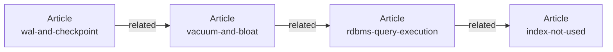

# Content Model

## Overview

Content Model は、記事を同じ一覧に載せ、シリーズにまとめ、互いを参照できるようにする。  
[PRD の Success Metrics](../../docs/PRD.md#success-metrics) のうち、片方向の記述で双方向に出る関連と、Markdown 1 枚での追加を支える。  
全体の構成は [Design Doc](../../docs/design/DesignDoc.md#components) にある。  
ADR-0002: [Content Model の Astro からの独立](../../docs/adr/0002-content-model-independence.md)  
ADR-0030: [種別を記事の 1 つにし、構成を記事の形式で、シリーズをディレクトリで表す](../../docs/adr/0030-articles-format-and-series.md)

## Scope

持つものは次のとおり。

- 記事の schema（`articleSchema`）と、シリーズの schema（`seriesSchema`）
- 安定した識別子 `contentId` の定義と、一意であることのチェック
- シリーズの構造と、シリーズの中の読む順（`order`）のチェック
- 相互参照のグラフの構築、解決できない参照の検出、逆参照の導出
- `ContentRef` の型

持たないものは次のとおり。

- 一覧のページと詳細のページの表示。`apps/web` が持つ。
- 分類（tag）ごとの索引のページ。分類は URL パラメータでの絞り込みにだけ使う。
  - 設計不変量 8: [Design Doc](../../docs/design/DesignDoc.md#種別と分類の切り分け)
- CMS や別のデータソースの実装。loader を差し替える点を 1 つにするところまでを持つ。
- プレイグラウンドの設定。プレイグラウンドは、記事の collection に含めない。

## Design

### 安定識別子

Astro は `id` をファイルのパスから導いて占有するので、自前の安定した識別子は `contentId` として持つ。  
ADR-0002: [Content Model の Astro からの独立](../../docs/adr/0002-content-model-independence.md)

```yaml
contentId: rdbms-query-execution # 発行した後は変えない。記事のあいだで一意
```

URL のパスは、Astro がファイルのパスから導く `id` で決まる。  
ファイルを改名すると URL は変わり、`contentId` は変わらない。

`contentId` は `^[a-z0-9][a-z0-9-]*$` に合わせて発行する。  
内容を表す語をハイフンでつなぐ。  
日付や連番は、改名の動機になるので入れない。

### 記事の schema

```ts
// packages/content-model/src/schema.ts
export const articleSchema = z.object({
  contentId: z.string().regex(CONTENT_ID),
  title: z.string(),
  description: z.string(),
  tags: z.array(z.string()).min(1), // 表示と絞り込みに使う自由な語
  status: z.enum(["draft", "published", "archived"]).default("draft"),
  publishedAt: z.coerce.date(),
  updatedAt: z.coerce.date().optional(),
  related: z.array(z.string()).default([]), // ほかの記事の contentId
  repository: z.object({ url: z.string().url(), path: z.string().optional() }).optional(),
  format: z.enum(["page"]).default("page"),
  order: z.number().int().optional(), // シリーズの中の読む順
});
```

`tags` を 1 つ以上必須にする。  
一覧の分類の列に、必ず値が入る状態を保つためである。  
索引のページを持たないので、値の集合を先に定義しない。

`format` は、記事の構成を表す。  
受け付ける値は、実装した形式の `page` だけで、省くと `page` になる。  
`steps` のように実装していない値を受け付けると、ビルドを通った記事が、表示のときに崩れる。  
形式を足すときは、`ARTICLE_FORMATS` に値を足す。

記事は、読了時間を持たない。  
手で書くと本文の分量とずれる。  
ずれた数字があると、同じ行にある計測の値まで信用されなくなる。

### シリーズ

`apps/web/src/content/articles/<series>/` のディレクトリが、1 つのシリーズになる。  
シリーズに入れない記事は、`articles/` の直下に置く。

```text
articles/
├── standalone.md          # シリーズに入れない記事。order を書かない
└── rdbms/                 # シリーズ rdbms
    ├── index.md           # シリーズのタイトルと説明 (seriesSchema)
    ├── query-execution.md # order: 1
    └── vacuum.md          # order: 2
```

`index.md` は記事ではなくシリーズの定義なので、`series` の collection が読み、`articles` の collection からは外す。  
`seriesSchema` は `title` と `description` を持つ。

`planSeries()` は、記事の `articles/` からの相対パスと `order`、`index.md` を持つシリーズのディレクトリ名の集合を受け取り、次の違反があればビルドを失敗させる。  
エラーには、違反した記事のパスを載せる。

| 違反                                                          | エラー                    |
| ------------------------------------------------------------- | ------------------------- |
| シリーズのディレクトリの下に、もう 1 階層のディレクトリがある | `NestedSeriesError`       |
| シリーズのディレクトリに `index.md` がない                    | `MissingSeriesIndexError` |
| シリーズの中の記事が `order` を書いていない                   | `MissingOrderError`       |
| 1 つのシリーズの中で `order` が重なる                         | `DuplicateOrderError`     |
| シリーズに入れない記事（`articles/` の直下）が `order` を書く | `StandaloneOrderError`    |

`order` はシリーズの中の読む順だけを表す。  
直下の記事に書くと、無視される値が原稿に残り、後でシリーズへ移すときに順が食い違う。

結果は、シリーズごとに、`order` の昇順に並べた記事のパスの配列になる。

### 分類

分類を束ねる上位の分類の軸を持たない。  
一覧の分類は URL パラメータでの絞り込みにだけ使う。  
種別と分類の分け方は [Design Doc](../../docs/design/DesignDoc.md#種別と分類の切り分け) にある。

### 相互参照のグラフ

`related` は、ほかの記事の `contentId` の配列にする。  
Astro の `reference()` は使わない。  
理由は [ADR-0002](../../docs/adr/0002-content-model-independence.md) にある。

次の図は、原稿に書いてある `related` の辺を示す。



`related` は、著者が明示した関連である。  
分類が同じであることとは別の軸で、分類から自動では作らない。  
同じシリーズに入っていることとも別で、シリーズの並びからは作らない。

`buildContentGraph()` は、次の処理を行う。

- `contentId` の索引を作る。重複があれば、ビルドを失敗させる。
- `related` を解決する。解決できない参照があれば、ビルドを失敗させる。
- 両方向を手で書いた `related` があれば、ビルドを失敗させる。
- 自分自身への参照は辺にせず捨てる。
- 逆参照を導く。

著者は関係を片方向だけ書き、逆方向はグラフが導く。  
両方向を手で書くと、片側だけを消し忘れたときに関係が食い違う。

解決できない参照を、警告ではなく失敗にする。  
静的なサイトでは「関連が表示されない」形で、エラーを出さずに誤り、目視では気づけないためである。

### ContentRef

`ContentRef` は、一覧のページが記事の形式ごとの分岐を持たないための、正規化した表現である。

```ts
// packages/content-model/src/types.ts
export type ContentRef = {
  contentId: string;
  format: "page";
  series?: string; // シリーズに入る記事の、articles/ の直下のディレクトリ名
  title: string;
  description: string;
  href: string; // 記事の最終の URL
  tags: string[];
  date: Date;
};
```

`ContentRef` は、設計不変量 3（`pages/`、`features/`、`components/`、`layouts/` は `astro:content` を直接参照しない）を成り立たせるために持つ。  
URL の規則を変えるときに変わるのは、`href` を算出する規則だけである。

### コンポーネントの構成

次の図は、Astro に依存しない `@fukuemon/content-model` と、`apps/web` の中の結線の L3 を示す。

```mermaid
flowchart TD
    subgraph cm ["@fukuemon/content-model (Astro 非依存)"]
        schema["schema.ts<br/>articleSchema / seriesSchema"]
        types["types.ts<br/>ContentRef"]
        series["series.ts<br/>planSeries()"]
        graph["graph.ts<br/>buildContentGraph()"]
        toc["toc.ts<br/>buildToc()"]
    end
    subgraph web ["apps/web"]
        config["content.config.ts<br/>loader と schema の結線"]
        loader["lib/content/articles-loader.ts<br/>読み込み後のシリーズのチェック"]
    end
    ac["astro:content"]
    config --> ac
    config --> schema
    config --> loader
    loader --> series
    graph --> types
```

### loader との結線

```ts
// apps/web/src/content.config.ts
export const collections = {
  articles: defineCollection({ loader: articlesLoader(), schema: articleSchema }),
  series: defineCollection({
    loader: glob({ base: "./src/content/articles", pattern: "*/index.{md,mdx}" }),
    schema: seriesSchema,
  }),
};
```

`articlesLoader()` は、`glob` の loader で記事を読んだ後に、`planSeries()` でシリーズの構造と `order` を確認する。  
チェックをページの描画に任せると、そのページを使わないビルドでチェックが抜けるので、読み込みのときに行う。  
`articles` の glob は、`*/index.{md,mdx}` を除く。

1 つの collection にまとめず、記事とシリーズを別の collection にする。  
frontmatter の項目が違い、1 つの schema にまとめると、記事の必須の項目が欠けた原稿がシリーズの schema で通ってしまう。

### 記事を 1 本足すときの流れ

1. 著者が `apps/web/src/content/articles/<name>.md` を作り、frontmatter を書く。
   - 書くキーは、`contentId`、`title`、`description`、`tags`、`publishedAt` の 5 つ。
   - `status` を省くと `draft` になり、build は書き出さない。公開するときは `status: published` を書く。
   - シリーズに入れるときは、`articles/<series>/` に置き、`order` を書く。
2. 関連があれば、`related` に相手の `contentId` を書く（片方向だけ）。
3. 新しいシリーズを作るときだけ、`articles/<series>/index.md` に `title` と `description` を書く。
4. ビルドが、`contentId` が一意であることと、`related` が解決できることと、シリーズの構造を確認する。

索引のページを手で直す作業は生じない。

## Interface

### 置くファイル

- `packages/content-model/src/schema.ts`: `articleSchema`、`seriesSchema`
- `packages/content-model/src/types.ts`: `ContentRef`
- `packages/content-model/src/series.ts`: `planSeries()`
- `packages/content-model/src/graph.ts`: `buildContentGraph()`
- `packages/content-model/src/toc.ts`: 記事の目次を `h2` ごとの本文量つきで組む `buildToc()`
- `apps/web/src/content.config.ts`: collection の結線
- `apps/web/src/lib/content/articles-loader.ts`: 記事の loader とシリーズのチェック
- `apps/web/src/lib/content/article-pages.ts`: 公開するかを判定する `isPublic()` と、記事のページのシリーズの位置と前後を組む `planArticlePages()`
- `apps/web/src/lib/content/articles.ts`: 記事のページが使う `getArticlePaths()` と `renderArticle()`
- 一覧のページが使う関数（`listContent()` など）は、まだ無い。

`isPublic()` は、dev server ではすべてを、build では `status` が `published` のものだけを通す。  
`planArticlePages()` は、シリーズの位置と前後を、`isPublic()` を通った記事だけで数える。  
`buildContentGraph()` には、下書きも含めたすべての記事を渡す。  
下書きを除いてから組むと、下書きを指す `related` が解決できない参照としてビルドを失敗させる。

### チェック

`graph.ts`、`toc.ts`、`series.ts` に求めるカバレッジと、分岐をすべて踏む検出は [context/testing.md](../../context/testing.md#test-types-and-guarantees) にある。

Content Model が Astro に依存しないことのチェックは、[context/codebase.md](../../context/codebase.md#dependency-rules) の規約 2 にある。
