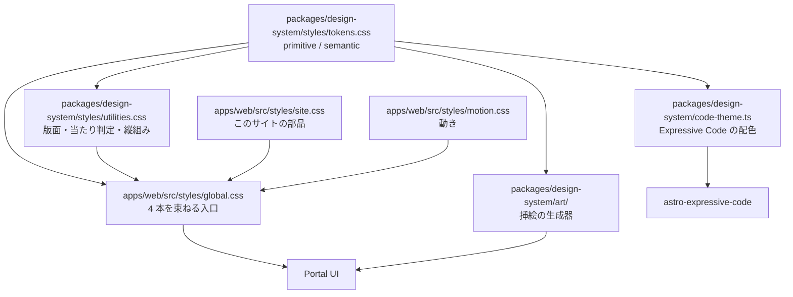

# Design System

## Overview

Design System は、技術資料としての硬質さを基礎にし、そこへ版画的な自然の図版と縦組みの見出しを足す。  
装飾は挿絵と差し色だけが担い、情報を運ぶ要素は罫線と余白で組む。  
全体の構成は [Design Doc](../../design/DesignDoc.md#components) にある。  
ADR-0004: [Typography の判断](../../adr/0004-typography-static-weights.md)  
ADR-0010: [Tailwind CSS の採用](../../adr/0010-tailwind-as-styling-base.md)

## Scope

持つものは次のとおり。

- Design Tokens（primitive と semantic）を `@theme static` で定義し、`:root` の CSS カスタムプロパティとして出力する
- Typography、縦組み、色、余白、Grid の値
- 明るい配色と暗い配色の両方
- 挿絵の版の仕様と、図柄を足す手順
- 動きの規則と、退行したときの見え方
- アイコンを使ってよい範囲
- 版面のユーティリティ（`.g-rail`、`.g-doc`、`.tate`、`.hit`、罫の 3 段階）
- Tailwind の層の順と、状態を markup で書く形

持たないものは次のとおり。

- 汎用の UI コンポーネントのライブラリ。共通化はトークンと版面のユーティリティまでにする。
- Layout primitives のコンポーネント化。
  - `Stack` や `Frame` のような包むコンポーネントを作らず、class で当てる。
  - Astro と React を併用するので、コンポーネントにすると同じものを 2 度書くことになる。
- Portal のコンポーネント（`ContentRow`、`MetaLine` など）の設計。各機能の Design Doc が持つ。
- 挿絵の描画のコードそのもの。この文書は版の仕様を定め、実装は `packages/design-system/art/` に置く。

## Design

### デザインの方針

**情報を運ぶ要素は無彩色と罫線だけで組む**。
色を持つのは、挿絵・リンク・現在地マーカーの 3 つに限る。

| 規則                                      | 根拠                                                                         |
| ----------------------------------------- | ---------------------------------------------------------------------------- |
| カードを使わない                          | 枠を足すと 1 件あたりの視覚的重量が増え、一覧の走査が遅くなる                |
| 区画は罫線と余白で作る                    | 背景色で区切ると、暗い配色で背景どうしの明度差を 1.10 しか取れず区別が消える |
| 罫線は 2px / 1px / 薄い 1px の 3 段階のみ | 段階を増やすと、どれがセクション境界か行境界かを読み取れなくなる             |
| 角丸を使わず、影で奥行きを作らない        | 紙に刷った版面の見えを保つ。角丸と影は画面上の物体を示唆する                 |
| 見出しをほとんど大きくしない              | 階層は small-caps・letter-spacing・罫線で作る                                |
| 状態を色だけで運ばない                    | forced colors mode では色と `box-shadow` が失われる。罫か字形を必ず併せる    |

背景色を塗ってよいのは次の 3 つに限る。
どれも輪郭に 1px 以上の罫を必須とする。
暗い配色では背景どうしの明度差が 1.10 しか取れず、罫がないと境界が消える。

| 背景                       | 用途                               |
| -------------------------- | ---------------------------------- |
| 反転帯 (`data-band`)       | 読みの区切りに置く強い休符         |
| コード (`--color-code-bg`) | コードブロックとその chrome        |
| 注記 (`--color-tint-*`)    | 前提 / 補足 / 注意、コードの強調行 |

帯の中では変数を丸ごと差し替え、地のトークンを参照できなくする。

### Typography

| 役割       | 書体                    | ウェイト         | 用途                                      |
| ---------- | ----------------------- | ---------------- | ----------------------------------------- |
| 和文 Serif | **Zen Old Mincho**      | 400 / 600 (静的) | 本文・見出し・UI のすべて                 |
| 欧文 Serif | **EB Garamond**         | 400 / 600 (可変) | 和文と同じ位置。Latin グリフを担当        |
| Mono       | **Geist Mono Variable** | 400 / 600        | 日付・種別・duration・`contentId`・コード |

```css
--font-serif: "EB Garamond Variable", "Zen Old Mincho", "Yu Mincho", serif;
--font-mono: "Geist Mono Variable", ui-monospace, monospace;
/* 一覧の日付の桁を揃える */
.mono {
  font-variant-numeric: tabular-nums;
}
```

EB Garamond を先に置く。
CSS は左から順にグリフを探すため、Latin は EB Garamond、和文は Zen Old Mincho が担当する。

**Fontsource で self-host し、外部 CDN から読まない**。  
`apps/web/src/styles/global.css` が、`tokens.css` より前に Fontsource の CSS を import する。  
Fontsource の依存は `apps/web` が持ち、`@fukuemon/design-system` は依存を持たない。  
読み込む CSS は次の 5 つ。

- `@fontsource/zen-old-mincho/400.css`
- `@fontsource/zen-old-mincho/600.css`
- `@fontsource-variable/eb-garamond/wght.css`（roman）
- `@fontsource-variable/eb-garamond/wght-italic.css`（italic）
- `@fontsource-variable/geist-mono/wght.css`

可変の EB Garamond と Geist Mono は、1 つのファイルで 400 と 600 の両方を描く。  
ブラウザは、ページの文字に `unicode-range` が一致するスライスだけを取得する。  
フォントのファイルはビルドで `/_astro/` に出力され、サイトと同じオリジンから配信される。  
`apps/web/astro.config.ts` の `build.assetsInlineLimit` は、フォントを base64 で CSS に埋めない。  
埋めると、ページで使わないスライスまで、描画を止める CSS と一緒に配ることになる。  
ADR-0004: [Typography の判断](../../adr/0004-typography-static-weights.md)

#### 型スケール

| 要素            | size                             | weight | line-height | 備考                                    |
| --------------- | -------------------------------- | ------ | ----------- | --------------------------------------- |
| Hero            | `clamp(1.75rem, 4.4vw, 2.75rem)` | 400    | 1.18        | サイト内で唯一大きい要素                |
| h2              | 1.25rem                          | 600    | 1.25        | —                                       |
| h3              | 1.05rem                          | 600    | 1.30        | 本文と同寸                              |
| body            | 1.05rem                          | 400    | 1.85        | 字間 `.05em`、`overflow-wrap: anywhere` |
| small / caption | 0.875rem                         | 400    | 1.4         | 手順名、ロゴ                            |
| metadata (Mono) | 0.8125rem                        | 400    | 1.0         | 字間は既定。必要な箇所へ個別に当てる    |
| section label   | 0.85rem                          | 400    | 1.0         | small-caps、letter-spacing 0.12em       |

見出しには `font-feature-settings: "palt" 1` と `line-break: strict` を掛ける。
和文の詰めを適用し、禁則を厳格な側にする。

本文を両端揃え（`text-align: justify`）にしない。字間 `.05em` と `overflow-wrap: anywhere` で組む。

### 縦組み

節見出しと記事ページの柱 (ページ端の走り見出し) を縦組みにする。

**縦組みへ入れてよいのは和文だけである**。

| 対象                      | 扱い                                                      |
| ------------------------- | --------------------------------------------------------- |
| 和文                      | そのまま正立する (`text-orientation: mixed` の既定)       |
| 3 文字までの数字・略語    | `text-combine-upright: all` で 1 マスにまとめて正立させる |
| 4 文字以上の欧文 (本文)   | 横倒しのまま残す。縦組みの通常の組み方である              |
| 4 文字以上の欧文 (見出し) | `text-orientation: upright` で 1 字ずつ正立させて積む     |
| ロゴなど正立必須の欧文    | **縦組みへ入れない**。 横組みのヘッダに置く               |

**本文では全部を正立させない**。
日本語組版処理の要件 (JLReq) では、縦組みの欧文は 90 度回転が原則である。
`text-orientation: upright` を掛けると `OpenTelemetry Collector` が縦に 21 文字積まれ、帯だけが伸びる。

まとめる長さの上限を 3 文字にするのは、4 文字を超えると 1 マスに収めたとき字が読めなくなるためである。

**見出しだけを例外にする**。
`about` のような 4 文字以上の欧文の見出しは、原則どおり回転させると横倒しのまま残る。
見出しは読み手が節を探すときに最初に当たる語なので、寝かせない。
長さの上限が要らないのは、見出しが数語で終わるためである。

割り振りは `apps/web/src/lib/tate.ts` の `tcy()` が行う。
見出しの例外は `<Tate upright />` で明示する。
著者は本文を書くときに意識しない。

```css
.tate {
  writing-mode: vertical-rl;
  text-orientation: mixed;
  font-feature-settings:
    "vpal" 1,
    "vkrn" 1;
  line-break: strict;
}
.tcy {
  text-combine-upright: all;
}
```

#### 実装上の制約

**縦組みでは block 軸と inline 軸が入れ替わる**。
`block-size` は「高さ」ではなく「幅」を意味し、`flex-direction: column` は横方向に並ぶ。

規則: **`.tate` は中の `span` にだけ掛け、親は横組みのまま置く**。

親に掛けると、位置と寸法の指定がすべて逆の意味になる。
`block-size: 520px` は高さではなく幅として解釈され、版面をその分だけ押し出す。

### Color

**値は [packages/design-system/styles/tokens.css](styles/tokens.css) が持つ**。
本書は値を複写しない。
複写すると実装と二重管理になり、片方が古くなったことに気づけない。

本書が定めるのは、トークンの**層**と**使用制約**である。

| 層        | 例                                                                       | 規則                                       |
| --------- | ------------------------------------------------------------------------ | ------------------------------------------ |
| primitive | `--color-ink` / `--color-green` / `--color-rule-strong`                  | 色そのもの。画面から直接参照しない         |
| semantic  | `--color-fg` / `--color-link` / `--color-now` / `--color-rule`           | 画面はここだけを参照する                   |
| 背景      | `--color-paper` / `--color-panel` / `--color-code-bg` / `--color-tint-*` | 輪郭に 1px 以上の罫を必須とする            |
| 帯        | `[data-band]` が差し替える 6 変数                                        | 帯専用の値。primitive のどれとも一致しない |
| 霞        | `--color-veil-1` / `--color-veil-0`                                      | 地の色そのものを透過させる                 |

**反転帯に入りうる領域では semantic だけを参照する**。
帯は `--color-ink` ではなく `--color-fg` を差し替えて成立する。
帯の中で `--color-ink` を直接参照した要素は、地に沈む。

帯に入らないことが確定している領域では primitive を直接参照してよい。
全画面へ一律に禁じると、守られない規約が文書に残り、自動のチェックを入れられなくなる。

チェックの対象は `[data-band]` の子孫に限る。

#### コントラスト

地 (`--color-paper`) に対して測った値である。

| トークン              | 明    | 暗    |
| --------------------- | ----- | ----- |
| `--color-ink`         | 17.25 | 16.28 |
| `--color-ink-2`       | 7.40  | 8.88  |
| `--color-green`       | 6.55  | 7.86  |
| `--color-blue`        | 8.78  | 8.18  |
| `--color-rust`        | 6.57  | 7.02  |
| `--color-rule-strong` | 4.60  | 4.88  |
| `--color-rule-soft`   | 1.43  | 1.51  |

**文字と UI 境界に使うトークンはすべて WCAG AA (4.5:1) を満たす**。
`--color-rule-soft` だけが例外で、文字にも UI 境界にも使わない。

反転帯の中では、明 3.85 / 暗 3.10 の `--color-rule` を除き、すべて 4.5:1 以上になる。
`--color-rule` は罫専用なので、UI コンポーネントの 3:1 で足りる。

#### 使用制約

- `--color-green` / `--color-blue` / `--color-rust` は**線と文字にのみ使う**。
  テキスト色、罫線、下線。
  背景を塗るときは同系の `--color-tint-*` を使う
- 各色の用途を固定する。
  数で制限しない。手順を持つ画面では現在地マーカーが複数必要になる

  | 色              | semantic           | 用途                                             |
  | --------------- | ------------------ | ------------------------------------------------ |
  | `--color-green` | `--color-link`     | 内部リンク、ハンズオンであること、完了と正常状態 |
  | `--color-blue`  | `--color-link-ext` | 外部リンク、前提の注記                           |
  | `--color-rust`  | `--color-now`      | 現在地 (ヘッダ / タブ / 手順 / 目次)、注意       |

  外部リンクの判定は `a[href^="http"]` で行う。
  内部リンクは相対パスなので、絶対 URL だけが外を指す。

- `--color-rule-soft` は**情報を持たない区切りにのみ使う**。
  地に対して明 1.43 / 暗 1.51 しかなく、UI 境界としては見えない。
  一覧の行の区切りのように、消えても情報が失われない場所に限る

#### コードの色

**5 トークンに絞り、輝度を単調な梯子に並べる**。

| トークン          | 明    | 暗    | 装飾 |
| ----------------- | ----- | ----- | ---- |
| `--color-c-plain` | 15.39 | 14.86 | —    |
| `--color-c-key`   | 10.78 | 7.02  | 太字 |
| `--color-c-ident` | 8.39  | 4.59  | —    |
| `--color-c-lit`   | 6.43  | 9.85  | —    |
| `--color-c-com`   | 5.06  | 5.08  | 斜体 |

**装飾を色に重ねる**。
太字と斜体は、色の比が詰まったときの唯一の手掛かりになる。

隣接する 2 トークンの比は最小 1.27 である。

**トークンを増やさない**。
同じ明度域に 8 トークンを並べると、隣接比が 1.03 まで詰まる。
色の種類を増やすほど、隣り合う色の区別が消える。

暗い配色では梯子が plain 14.86 → literal 9.85 → keyword 7.02 → comment 5.08 → ident 4.59 となり、comment と ident の比が 1.11 まで詰まる。
**ここは斜体の有無だけが手掛かりである**。

#### 訪問済みリンク

読了状態はサイト側で持たず、**CSS の `:visited` に委ねる**。  
ADR-0008: [読者の identity を前提とする機能を作らない](../../adr/0008-no-reader-identity.md)

**`:visited` はプライバシー制限により色系のプロパティしか変えられない**。
下線の色だけを薄くする。
レイアウトや太さを変えようとしても適用されない。

### Spacing

**値は [packages/design-system/styles/tokens.css](styles/tokens.css) が持つ**。

数列を 2 つに分ける。

| 数列                | 用途                                 |
| ------------------- | ------------------------------------ |
| `--spacing-intra-*` | 節の内側。行間、ラベルと本文、列の溝 |
| `--spacing-inter-*` | 節の外側。区画の内側、節と節のあいだ |

**2 つの数列のあいだに段階を置かない**。
この空きが節の境界を作る。
段階を連続させると、どこで話題が変わったかを余白から読み取れなくなる。

生の px を書かない。
書いた時点で、その値がどちらの数列に属するかが失われる。

### 測度と Grid

| 用途                           | 幅                                                                                     | 根拠                               |
| ------------------------------ | -------------------------------------------------------------------------------------- | ---------------------------------- |
| 本文 (記事 / ハンズオン)       | `--measure`: `min(100% - 2 * var(--gutter), var(--measure-w))`、`--measure-w` は 42rem | 日本語で 1 行 40 字前後            |
| 一覧の表、playground、検索の窓 | `--measure-wide`: 68rem                                                                | 罫線で区切るため、行長より広く取る |
| 左右の余白 (`--gutter`)        | `clamp(20px, 5vw, 56px)`                                                               | —                                  |

**`ch` を使わない**。
`ch` は文字 `0` の幅であり、CJK グリフの半分以下である。
和文の行長を `ch` で指定すると、意図の半分以下の幅になって折り返す。
`em` を使う。

#### 折り返し

トークンが持つ折り返しは 2 段だけにする。
`--breakpoint-wide` は 1101px、`--breakpoint-narrow` は 721px で、markup からは `max-wide:` と `max-narrow:` で当てる。
一覧の表と実行パネルだけは、`apps/web/src/styles/site.css` に、それぞれ専用の折り返しの幅を持つ。

| 幅          | トークン              | 変わること                                                                 |
| ----------- | --------------------- | -------------------------------------------------------------------------- |
| 1100px 以下 | `--breakpoint-wide`   | サイドバーをまとめる。記事の目次と柱、ハンズオンの手順一覧を本文の上へ回す |
| 720px 以下  | `--breakpoint-narrow` | 縦組みの見出しを横へ倒す。表から分類の列を隠す                             |
| 520px 以下  | なし                  | 表から種類の列を隠す                                                       |
| 1200px 以上 | なし                  | 記事とハンズオンの実行パネルを本文より右へ広く出す                         |

**表を横スクロールさせない**。
列を隠す。
一覧は探す場面であり、横に隠れた列は探せない。

**縦組みは 720px を下回ったら横組みへ倒す**。
`--rail` の 46px と溝の 28px で 74px を占める。
390px の画面では本文の 19% になる。

**版面より広く出す囲み (`.bleed`) は、720px を下回ったら出さない**。
親に左の余白しか無いため、負のマージンが右へはみ出す。

#### 一覧の切り替え

見た目はタブだが、**実体はページ遷移である**。
`/blog` (すべて) / `/blog/articles` / `/blog/labs` の 3 ページを静的に書き出す。
`/` は表紙であり、一覧のタブを持たない。
ARIA の `tablist` は使わない。
根拠は [Design Doc](../../design/DesignDoc.md#種別と分類の切り分け) の設計不変量 8。

- 現在地はヘッダと同じ `--color-rust` の 2px 下線で示す
- タブに件数を添える。
  押す前に結果の量が分かる
- 絞り込み中は列の中身を変える。
  種別を 1 つに絞ったら、行から種別名を外して列見出しへ移す
- 表の列幅は固定する。
  自動幅にすると題の列だけが伸び、題と種類のあいだに 700px の空白が空く

### 版面

**寸法は [packages/design-system/styles/utilities.css](styles/utilities.css) が持つ**。
本書は構造と、どこに何を割り当てるかを定める。

#### 節の骨格

節は 2 列にする。
左が縦組みの見出し (`--rail`)、右が中身。
溝は `--spacing-intra-4`。

```html
<section style="display: grid; grid-template-columns: var(--rail) minmax(0, 1fr)">
  <h2 class="tate tate-head" style="grid-row: 1 / span 2">ハンズオン</h2>
  <div><!-- 右上: 一覧への導線 --></div>
  <div><!-- 中身 --></div>
</section>
```

見出しは `grid-row: 1 / span 2` で 2 行にまたがる。
`minmax(0, 1fr)` を使う。`1fr` だけだと中身が最小幅を持つとき列が溢れる。

`.tate-head` は右端に 2px の罫を立てる。
**この罫が縦組み見出しの見た目の中心である**。

#### ページごとの骨格

| ページ     | 列               | 左         |
| ---------- | ---------------- | ---------- |
| トップ     | `--rail` + 1fr   | 節見出し   |
| 一覧       | `--rail` + 1fr   | 節見出し   |
| 記事       | `--drawer` + 1fr | サイドバー |
| ハンズオン | `--drawer` + 1fr | サイドバー |
| playground | `--drawer` + 1fr | サイドバー |

**本文を持つ 3 つのページは同じ骨格にする**。
サイドバーの幅と開閉のふるまいが揃うので、ページをまたいでも操作を覚え直さずに済む。
本文は `--measure-w` で止め、右の余りは版面の中で吸収する。

行長は 42rem で止める。
日本語は 1 行 40〜45 字を超えると行を追いにくくなる。
42rem でおよそ 37 字である。

記事の目次は**罫の長さで章の分量を示す**。
現在地の章だけ 2px の `--color-rust`、他は 1px の `--color-rule-strong`。

**サイドバーはたためる**。
`--drawer` (306px) と `--drawer-shut` (46px) を `[data-open]` で切り替える。
たたむと開閉ボタンだけが残り、本文が広がる。

| ページ     | サイドバーの中身            |
| ---------- | --------------------------- |
| 記事       | 目次 + 同じ種別の一覧       |
| ハンズオン | 手順の一覧 + いまのテーブル |
| playground | 試す + いまのテーブル       |

**サイドバーが並べるのは、開いている 1 文書の中身と、同じ種別の兄弟だけである**。
サイト全体のページツリーは持たない。  
ADR-0001: [Starlight の採否](../../adr/0001-starlight-as-docs-renderer.md)

ハンズオンの手順一覧は進捗バーと手順マーカーを持つ。
マーカーは完了 `--color-green` / 現在 `--color-rust` + `outline` / 未着手 `inset` の罫。
**色だけで運ばない**。 状態を `.sr` で読み上げに渡す。

sticky の起点は上部ヘッダの高さに揃える。
記事の目次と、ハンズオンのサイドバーが対象。

**サイドバー自体はスクロールさせない**。 手順が多いときは一覧の中だけを流す。
「いまのテーブル」を画面の外へ押し出さないためである。

#### 罫の割り当て

| class           | 太さと色                  | 割り当て                         |
| --------------- | ------------------------- | -------------------------------- |
| `.rule-section` | 2px `--color-rule-strong` | 節の境界、ハンズオンの手順見出し |
| `.rule-struct`  | 1px `--color-rule-strong` | 構造の境界、記事末尾の前後ナビ   |
| `.rule-row`     | 1px `--color-rule-soft`   | 一覧の行、情報を持たない区切り   |

class を持たない罫も同じ 3 段階に従う。
`.topbar` と `.tabs` の下端、表の `th` と `td`、記事の柱とハンズオン本文の縦罫が該当する。

`.rule-cap` は罫の端に 1px × 1.4em の縦棒を立てる。
罫が「引かれた」ではなく「置かれた」に見える。

#### 背景色を置く場所

| 背景                       | 置く場所                                          |
| -------------------------- | ------------------------------------------------- |
| 反転帯 (`data-band`)       | **全ページの footer**。 加えて各ページ 1 箇所まで |
| コード (`--color-code-bg`) | コードブロックとその chrome                       |
| 注記 (`--color-tint-*`)    | 前提 / 補足 / 注意、コードの強調行                |

**footer が常に帯であることが、ページ末尾の共通の合図になる**。

各ページの 1 箇所は、トップが「最近の更新」、記事が「要点」、ハンズオンが「終わったら」。
帯は本文の左右へはみ出させる。
中身より広い帯が休符になる。

注記の型を固定する。
2px の左罫 (差し色) + `--color-tint-*` の地 + `.mono .meta` のラベル + 本文。

#### 挿絵の重ね順

`.wood-band` は 4 層で組む。
下から順に、挿絵の SVG、粒 (`.wood-grain`)、霞 (`.wood-veil`)、文字 (`.wood-fg`)。

帯は `position: relative; overflow: hidden`、SVG は `position: absolute; inset: 0`。
viewBox は図柄によらず `0 0 1200 400` に固定する。

| 帯           | 高さ                        |
| ------------ | --------------------------- |
| トップの表紙 | `clamp(320px, 46vh, 460px)` |
| トップの末尾 | 132px                       |
| 一覧の頭     | 116px                       |

#### 当たり判定と読み上げ

- 押せる要素は `.hit` で 44px を確保する。
  行の高さを本文の line-height に任せない。
  WCAG 2.2 の 2.5.8 は 24px を求める。44px は AAA (2.5.5) 相当である
- 一覧の表の行だけ 46px。`td` の罫と重なるため 2px 足す
- ページ先頭に `.sr` のスキップリンクを置く。
  **`.sr` はフォーカスで可視へ戻す**。 切り取ったままだと outline も一緒に切り取られ、何も描画されない
- `html` に `scroll-padding-block-start` を置く。
  sticky ヘッダの下へアンカー先とフォーカスが隠れる (WCAG 2.4.11)
- 色だけで運んでいる情報 (完了 / 現在地 / 未着手) は `.sr` で補う
- フォーカスリングは `--color-focus`。
  帯と暗い配色で反転する
- `prefers-reduced-motion: reduce` は `::before` / `::after` も含め、`scroll-behavior` も止める
- `forced-colors: active` で現在地の手掛かりを罫として取得し直す。
  `box-shadow` はこのモードで消える
- 装飾の挿絵は `aria-hidden="true"` にする。`role="img"` を併せない

### 挿絵

**外部の画像ファイルを持たない**。
すべてその場で描く SVG とし、3 階調を `--color-wood-1` / `--color-wood-2` / `--color-wood-3` から参照する。
配色を切り替えると挿絵の色も一緒に変わる。

#### 版の仕様

図柄が変わっても、下記は 5 種すべてで共通にする。

| 要素       | 実装                                                                                                      | 目的                           |
| ---------- | --------------------------------------------------------------------------------------------------------- | ------------------------------ |
| 輪郭の荒れ | `feTurbulence` (`baseFrequency` 0.045 0.09、`numOctaves` 3) + `feDisplacementMap` (`scale` 7)。水面のみ 3 | 刷りのずれ。刷ったものに見せる |
| 霧         | 縦グラデーションを `mask` に掛ける。下端 1.0 / 45% で 0.80 / 上端 0.10 の 3 停止点                        | 上端で紙へなじませる           |
| 粒         | CSS 層の turbulence タイル (160px) を `mix-blend-mode: multiply` で重ねる。不透明度 明 .34 / 暗 .28       | 紙の目                         |
| 3 階調     | 遠景 `--color-wood-3` / 中景 `--color-wood-2` / 近景 `--color-wood-1`                                     | 奥行き                         |
| 断ち落とし | `preserveAspectRatio="xMidYMax slice"`                                                                    | 帯の高さに関わらず下端を保つ   |

**粒を SVG フィルタで作らない**。
`feFlood flood-color="var(--color-wood-1)"` は CSS カスタムプロパティを解決しない。
CSS 層に置く。

**帯の下端で粒に継ぎ目が出る**。
`mask-image: linear-gradient(to bottom, #000 0 78%, transparent 100%)` で消す。

#### 文字を重ねるとき

挿絵の上に文字を直接置かない。
**地の色そのものを透過させた霞 (`--color-veil-1` → `--color-veil-0`) を挟み、文字は必ず無地の紙の上に載せる**。

挿絵の濃さに関わらずコントラストが固定される (明 17.25:1 / 暗 16.28:1)。

霞は**横方向**のグラデーションである (`linear-gradient(96deg, ...)`)。
挿絵が右へ寄り、文字が左に載る配置を、この 1 本が作っている。

**720px 以下では縦方向へ掛け直す**。
本文が版面の全幅を使うので、横方向のままだと図の枝が文字に掛かる。

#### 図柄

| 名前   | 特徴                              | 向く場所             |
| ------ | --------------------------------- | -------------------- |
| 木立   | 幹 41 本 + 枝。手前を斜面が横切る | about (トップの表紙) |
| 竹     | 節を地の色で切る。縦に強い        | 縦長のパネル         |
| 水面   | 同心の波紋 3 群と浮かぶ葉         | 章の切れ目           |
| 遠い山 | 稜線 3 枚の重なり。最も静か       | 表紙 (静かめ)        |
| 草     | 穂を持つ葉 291 本。最も細かく密   | 末尾、細い帯         |

**140px 以下の細い帯には密な図柄を使う**。
`xMidYMax slice` は下端付近だけを残すため、木立のように要素が縦に伸びる図柄は幹の根元しか映らず、左右に空白ができる。
草はどの高さで断っても幅いっぱいが埋まる。

#### 帯の上端

図の霧 (`mask`) は viewBox の全体に掛かる。
**帯が低いと霧の範囲が映らず、切り口が直線で出る**。
絵ではなく区切りに見えるので、帯の側でも上端を紙へなじませる (`ArtBand` の `fade`)。

低い帯で霧を見せようとして、図の停止点を動かさない。
動かすと `fill` で使ったときに図が全体に薄くなる。

#### 図柄を足すときのプロンプト

画像生成に渡す場合は次を使う。

```text
A quiet silkscreen print in exactly three flat tints of desaturated sage
green on a warm cream ground. Subject: <図柄>. Composition: a wide
horizontal band, subject anchored to the bottom edge, dissolving into
empty ground toward the top. No outlines, no gradients within a shape,
no texture inside fills — only three solid tints layered for depth
(far / mid / near). Slightly rough, misregistered edges as if hand
pulled through a screen. No people, no buildings, no text, no sky
details. Calm, still, unpopulated.
```

**実装は画像生成を経由しない**。
`packages/design-system/art/` の生成器がパラメータから SVG を組む。
上のプロンプトは、図柄の候補を検討する段階と、外部に見た目を説明するときに使う。

雨・石・苔・鳥・雪も、この仕様に従って作れる。

### 動き

**動きは状態の変化を伝えるときだけに使う**。
about だけを例外にする。  
ADR-0009: [サイトのセクションと playground](../../adr/0009-site-sections-and-playground-collection.md)

規則はサイト全体で共通である。

| 規則                        | 理由                                                     |
| --------------------------- | -------------------------------------------------------- |
| 位置を動かさない            | 罫の位置が確定するまで読み始められない                   |
| 変えるのは濃度と罫の長さ    | 版面が動かないので、読み手は待たずに読み始められる       |
| 配る JavaScript は 0 バイト | `@starting-style` と `animation-timeline: view()` で組む |

| 対象             | 動き                               |
| ---------------- | ---------------------------------- |
| 一覧の行         | 濃度。段送りは行の添字で決める     |
| 縦組み見出しの罫 | 上から伸びる (`background-size`)   |
| 挿絵の帯         | 濃度                               |
| about の名乗り   | 1 字ずつ濃度。字はビルド時に分ける |
| about の一覧     | 画面に入ったところで行ごとに濃度   |

**退行の受け皿を必ず持つ**。

- `animation-timeline` は Chrome 115 以降でだけ適用される。対応しない環境では規則ごと無視され、最初から見えている
- `prefers-reduced-motion: reduce` では最初から見えている
- `border-width` を動かさない。レイアウトが動く。罫は `background-size` で伸ばす

`animation` の短縮形で書かない。
ビルドの CSS 圧縮が `animation-timeline` ごと削除する。長い形で書く。

実装は [apps/web/src/styles/motion.css](../../apps/web/src/styles/motion.css) にある。

### アイコン

**語よりも形のほうが速く見分けられるものにだけ使う**。
現在の対象は外部サービスへのリンク (GitHub / X / Zenn / RSS) だけである。

- ブランドのアイコンは simple-icons (CC0-1.0) の path を写す。RSS は商標ではないので自分で描く
- 塗りは `currentColor`。差し色はリンク側が決める
- 名前は `aria-label` が持ち、`<svg>` は `aria-hidden`
- 当たり判定は 44px を保つ

**ページ内の移動先には使わない**。
「一覧」「playground」に定着したアイコンは無く、アイコンにすると語より読むのが遅くなる。

### 図

本文の `mermaid` のコードフェンスは、ビルドのときに SVG へ変換する。  
ページに mermaid の本体（約 300 KiB）を配らない。

- 図の色は、サイトのトークンへ置き換える。明暗どちらの地でも、1 枚の SVG が成り立つ。
- 図の書体は、本文と同じにする。

著者が図に色を指定しない規則は [context/conventions.md](../../context/conventions.md#記事とハンズオンの本文) にある。  
ADR-0009: [サイトのセクションと playground](../../adr/0009-site-sections-and-playground-collection.md)

### コンポーネント構成 (C4 L3)



**コンポーネントの CSS は `apps/web` に置く**。
`packages/design-system` が配るのはトークンと版面までにする。
1 サイトでしか使わないコンポーネントを package へ上げると、変更のたびに 2 つの repo 境界をまたぐ。

### 配布と層

CSS スタイリングの基盤は Tailwind CSS v4 である。  
ADR-0010: [Tailwind CSS の採用](../../adr/0010-tailwind-as-styling-base.md)

```css
/* apps/web/src/styles/global.css */
@layer theme, base, components, utilities;

@import "tailwindcss/theme.css" layer(theme);
@import "tailwindcss/utilities.css" layer(utilities);

@import "@fontsource/zen-old-mincho/400.css";
@import "@fontsource/zen-old-mincho/600.css";
@import "@fontsource-variable/eb-garamond/wght.css";
@import "@fontsource-variable/eb-garamond/wght-italic.css";
@import "@fontsource-variable/geist-mono/wght.css";

@import "@fukuemon/design-system/tokens.css";
@import "@fukuemon/design-system/utilities.css";
@import "./site.css";
@import "./motion.css";
```

| 層           | 中身                                             |
| ------------ | ------------------------------------------------ |
| `theme`      | Tailwind の既定と `@theme static` のトークン     |
| `base`       | 要素の既定 (`body` / `a` / `h1, h2, h3` / `pre`) |
| `components` | コンポーネント。markup では表せないものだけ      |
| `utilities`  | Tailwind の utility                              |

**utility を最後に置く**。 markup 側の 1 語がコンポーネントの規則に勝つ。

**preflight を読み込まない**。
本文の段落間隔は UA 既定の `margin-block: 1em` に依存しており、preflight はそれを 0 にする。
ただし **border の初期化だけは `base` に自前で持つ**。
`border-width: 0; border-style: solid` が無いと、`border-b` を当てた要素の
他 3 辺に `medium` (3px) の枠が付く。

**版面とコンポーネントのクラスを `@utility` にしない**。
`@utility` は utilities 層に入り、`[data-open="false"].g-doc` のような状態つきの上書きにも、
`.g-rail > .tate-head` の狭い画面の上書きにも勝つ。
`@utility` にして撮り比べると、40 枚中 28 枚が退行した。

**第三者の CSS が使う class 名を避ける**。
Expressive Code は `.expressive-code` 以下を使う。
そこへは触らず、スタイリングは `styleOverrides` から指定する。
**上書きが要るときは cascade layer の外に置く**。
Expressive Code の CSS は層に属さないので、層の中からは詳細度でも勝てない。

### 状態の書き方

**基準値と状態の上書きは同じ層に置く**。
基準値だけ markup へ移すと、utility が層の上で状態に勝つ。

| 元の CSS                                  | markup                                     |
| ----------------------------------------- | ------------------------------------------ |
| `[data-open="false"] .side__panel`        | `data-[open=false]:...`                    |
| `.steps__link[aria-current]`              | `aria-[current]:...`                       |
| `.steps__link[aria-current] .steps__text` | 親に `group`、子に `group-aria-[current]:` |
| `.steps__mark[data-state="done"]`         | `data-[state=done]:...`                    |
| `.runner__bar:has(.btn)`                  | `has-[.btn]:...`                           |
| `.sheet[open]`                            | `open:...`                                 |

手順の現在地は `aria-current="step"` である。
組み込みの `aria-current:` は `[aria-current="true"]` なので当たらない。`aria-[current]:` を使う。

`<dialog>` の UA 既定は `dialog:not([open]) { display: none }` である。
`display` を `[open]` に限定せず当てると、閉じている窓がサイドバーに出る。

#### 配色の切り替え

**色は `light-dark(明, 暗)` で 1 度だけ書く**。
どちらを解決するかは `color-scheme` が決める。

| 選択子                 | `color-scheme` | 役割               |
| ---------------------- | -------------- | ------------------ |
| `:root`                | `light dark`   | システム設定に追随 |
| `[data-theme="light"]` | `light`        | 明示切り替え       |
| `[data-theme="dark"]`  | `dark`         | 明示切り替え       |

選択子を明暗で分けて値を 2 度書かない。
システム設定用と明示指定用に同じ値を並べると、片方だけを直した誤りに、実行時まで気づけない。
`check-contrast.ts` は、ブラウザが読むのと同じ `tokens.css` の `@theme static` の 1 箇所を読む。

**色でないものは `light-dark()` で書けない**。
`mix-blend-mode` のように色以外を明暗で分ける規則は、選択子を 2 本並べる。
現在その対象は挿絵の粒 (`.wood-grain`) だけである。

**`color-scheme` を宣言する**。
スクロールバーとフォームのコントロールの既定色は、この宣言でしか切り替わらない。
宣言しないと、暗い配色でページ本体だけが暗くなり、UA 由来の UI は明るいまま残る。

全ページが自前のレイアウトを通るため、宣言はここ 1 箇所で足りる。

### トークン共有の必要条件

トークンは `@theme static` に置く。
`--color-paper` は `bg-paper` / `text-paper` を生み、同時に `var(--color-paper)` として残る。
`--breakpoint-*` の値は「その幅から上」を指すので、`max-narrow:` は `max-width: 720.98px` になる。

**`static` を付ける**。
付けないと、utility から参照された変数しか出力されない。
挿絵の SVG は `fill="var(--color-wood-1)"` で色を参照するので Tailwind の走査に映らず、
3 階調が消える。

`astro-expressive-code` が挿す CSS は、こちらのビルドを通らない。
`styleOverrides` から参照できるのは素の CSS カスタムプロパティだけである (設計不変量 5)。
`@theme` は変数を `:root` に出すので、この条件を満たす。

### Expressive Code への橋渡し

コードブロックだけは `astro-expressive-code` が描く。
スタイリングは class を上書きせず、`styleOverrides` から指定する。

```ts
// apps/web/astro.config.ts
import expressiveCode, { ExpressiveCodeTheme } from "astro-expressive-code";
import { codeThemeDark, codeThemeLight } from "@fukuemon/design-system/code-theme";

expressiveCode({
  // --color-c-* を写した自前のテーマ
  themes: [new ExpressiveCodeTheme(codeThemeLight), new ExpressiveCodeTheme(codeThemeDark)],
  minSyntaxHighlightingColorContrast: 0,
  styleOverrides: {
    borderColor: "var(--color-rule-strong)",
    borderRadius: "0",
    codeBackground: "var(--color-code-bg)",
    codeFontFamily: "var(--font-mono)",
    frames: {
      frameBoxShadowCssValue: "none",
      editorTabBarBackground: "var(--color-code-bg)",
      editorActiveTabBackground: "var(--color-code-bg)",
      editorActiveTabIndicatorTopColor: "var(--color-green)",
      editorActiveTabBorderColor: "var(--color-rule-strong)",
      editorBackground: "var(--color-code-bg)",
      terminalBackground: "var(--color-code-bg)",
      terminalTitlebarBackground: "var(--color-code-bg)",
      tooltipSuccessBackground: "var(--color-green)",
    },
    textMarkers: {
      markBackground: "var(--color-tint-green)",
      markBorderColor: "var(--color-green)",
      lineMarkerAccentWidth: "2px",
    },
  },
});
```

**テーマは自前で持つ**。
既製のテーマを使うと、地を `--color-code-bg` へ差し替えたときに比が崩れる。
GitHub のテーマで測ったところ、コメントが明 4.15 / 暗 3.48、`const` が明 3.95 で AA を下回った。

実装は [packages/design-system/code-theme.ts](code-theme.ts) にある。
**値は `tokens.css` の `--color-c-*` と同じである**。
Shiki はビルド時に色を解決するため CSS カスタムプロパティを参照できない。
片方を変えたらもう片方も変える。

`minSyntaxHighlightingColorContrast` は 0 にする。
自前で 4.5:1 を満たしているので、自動の補正が、輝度の梯子の並びを変えてしまう。

実行パネル (RUN / 出力) は Expressive Code の枠の外に置く。
枠の中へ差し込むにはプラグインの `postprocessRenderedBlock` が要る (未検証)。

### 共通化の範囲

| 層                         | 内容                                                | 置き場                                                                                                                                                                                          |
| -------------------------- | --------------------------------------------------- | ----------------------------------------------------------------------------------------------------------------------------------------------------------------------------------------------- |
| Design Tokens              | primitive / semantic                                | `packages/design-system/styles/tokens.css`                                                                                                                                                      |
| 版面                       | `.g-rail` / `.g-doc` / `.tate` / `.hit` / 罫        | `packages/design-system/styles/utilities.css`                                                                                                                                                   |
| 挿絵                       | 版の実装と図柄の生成器                              | `packages/design-system/art/`                                                                                                                                                                   |
| コードの配色               | Expressive Code のテーマと配色のチェック            | `packages/design-system/code-theme.ts`                                                                                                                                                          |
| このサイトのコンポーネント | `ContentRow` / `MetaLine` / 実行パネル / サイドバー | サイドバーは `apps/web/src/components/`、`ContentRow` と `MetaLine` は `apps/web/src/features/listing/`、実行パネルは `apps/web/src/features/lab/panel/`、CSS は `apps/web/src/styles/site.css` |
| 動き                       | サイト全体の動きの実装                              | `apps/web/src/styles/motion.css`                                                                                                                                                                |

**このサイトのコンポーネントを `packages/design-system` に入れない**。
消費者が `apps/web` の 1 つだけであり、「2 つ以上の消費者が実在するまで package にしない」規約に従う。  
規約は [context/codebase.md](../../context/codebase.md#packages) にある。

shadcn/ui は対話的コンポーネント (Command Palette / Dialog) が実在してから導入する。

## Interface

### 置くファイル

- `packages/design-system/styles/tokens.css`: Design Tokens（primitive と semantic）
- `packages/design-system/styles/utilities.css`: 版面、当たり判定、縦組み、罫
- `packages/design-system/art/`: 挿絵の版の実装と、図柄の生成器
- `packages/design-system/code-theme.ts`: Expressive Code のテーマ
- `packages/design-system/check-contrast.ts`: 配色のチェック
- `apps/web/src/styles/global.css`、`site.css`、`motion.css`: 層をまとめるファイル、このサイトのコンポーネント、動き

package の外へは、`package.json` の `exports` にある `tokens.css`、`utilities.css`、`art/*`、`code-theme` だけを出す。

### チェック

テストの共通の規約は [context/testing.md](../../context/testing.md) にある。

- Design Tokens に単体テストを書かない。分岐を持たないためである。
- コントラスト比は、`pnpm run check:contrast` が自動でチェックする。
  - 地とテキスト、地と罫線、コードの 5 トークンの隣接比を、明暗の両方の配色で計算して閾値と比べる。値を手で書き換えたときに気づけない種類の劣化である。
  - `code-theme.ts` と `tokens.css` の `--color-c-*` の値の一致、4.5:1、輝度の梯子もチェックする。
- `react-doctor design` の指摘のうち、この Design System の規則と衝突するものは無効にし、理由を [context/conventions.md](../../context/conventions.md#check-exclusions) に記録する。
  - 「カードを使わない」「見出しを大きくしない」は、汎用の規則に反する可能性がある。
- 挿絵は、見た目の回帰のテストの対象にしない。乱数による刷りのずれを含むので、画素の比較が安定しない。
- 動きは、自動のテストの対象にしない。
  - 退行の受け皿（`prefers-reduced-motion`、`animation-timeline` に対応しない環境）では最初から見えているので、動かないこと自体は不具合にならない。

## Verification

- `astro-expressive-code` で、画面案のコードの見た目を出せることを確かめた。スタイリングは `styleOverrides` から指定する。
- 実行パネルを Expressive Code の枠の外に置いても見た目がそろうことを確かめた。
